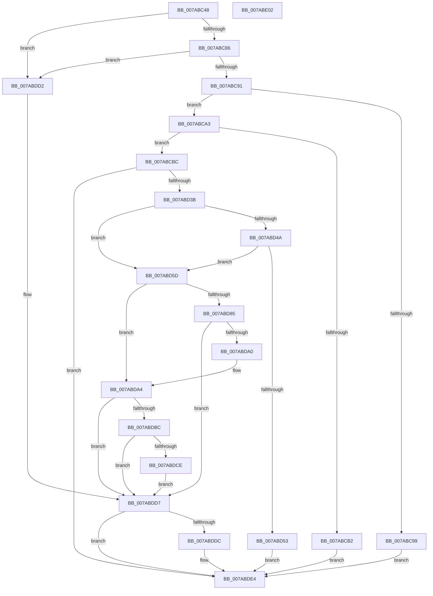

# SmcCacheStart

- RVA: `0x007ABC48`–`0x007ABE03` (길이 `443` bytes)
- VA: `0x00000001407ABC48`
- 실행 섹션: `PAGE`
- PDB 이름 있음: `예`; PDB Function 태그: `아니요`
- unwind 정보 RVA: `0x000D2120`
- 디코드: `127`개 명령, `443/443` bytes 표시
- 미해석 바이트: `0` (있으면 어셈블리에 `.byte`로 보존)

> 이 문서는 커널 이미지의 기계어와 PDB 기호를 분석해 생성했습니다. 4번과 5번은 함수 원형과 자료형을 바이너리 사용 방식에서 추정한 C 해석이며 원본 소스 복구 결과는 아닙니다.

## 1. Dependencies

- 직접 호출 지점: **5**; 고유 호출 대상: **5**
- 직접 호출자로 확인된 함수: **1**
- RIP 상대 이미지 참조: **0**

### Outgoing calls
- `0x007ABD2C` → [SmKmStoreFileCreate](SmKmStoreFileCreate_function_007A8F14.md) (function, `0x007A8F14`)
- `0x007ABD91` → [SmKmStoreFileOpenVolume](SmKmStoreFileOpenVolume_function_007A9C14.md) (function, `0x007A9C14`)
- `0x007ABDB1` → [SmKmVolumeQueryUniqueId](SmKmVolumeQueryUniqueId_function_007A9FE8.md) (function, `0x007A9FE8`)
- `0x007ABDC3` → [StEtaHelper::StartHelper](../../text/4A/StEtaHelper_StartHelper_function_004A0194.md) (function, `0x004A0194`)
- `0x007ABDDF` → [ObfDereferenceObject](../../text/2F/ObfDereferenceObject_function_002F9350.md) (function, `0x002F9350`)

### Direct callers
- [SmcProcessCreateRequest](SmcProcessCreateRequest_function_007A764C.md) at `0x007A782F`

### Static image references
- 디코드된 RIP-relative 메모리 참조가 없습니다.

## 2. Other-region calls and transfers

- 다른 실행 섹션으로 향하는 call: **2**
  - `0x007ABDC3` → [StEtaHelper::StartHelper](../../text/4A/StEtaHelper_StartHelper_function_004A0194.md) (`PAGE` → `.text`)
  - `0x007ABDDF` → [ObfDereferenceObject](../../text/2F/ObfDereferenceObject_function_002F9350.md) (`PAGE` → `.text`)
- 별도 외부 분기/꼬리 이동을 확인하지 못했습니다.

## 3. Assembly (complete function range)

```asm
007ABC48  48 89 5C 24 08                  mov qword ptr [rsp + 8], rbx
007ABC4D  48 89 74 24 10                  mov qword ptr [rsp + 0x10], rsi
007ABC52  55                              push rbp
007ABC53  57                              push rdi
007ABC54  41 54                           push r12
007ABC56  41 56                           push r14
007ABC58  41 57                           push r15
007ABC5A  48 8B EC                        mov rbp, rsp
007ABC5D  48 81 EC 80 00 00 00            sub rsp, 0x80
007ABC64  83 65 40 00                     and dword ptr [rbp + 0x40], 0
007ABC68  33 F6                           xor esi, esi
007ABC6A  48 8B FA                        mov rdi, rdx
007ABC6D  48 89 75 E8                     mov qword ptr [rbp - 0x18], rsi
007ABC71  41 8B 50 08                     mov edx, dword ptr [r8 + 8]
007ABC75  4D 8B F9                        mov r15, r9
007ABC78  4D 8B F0                        mov r14, r8
007ABC7B  4C 8B C9                        mov r9, rcx
007ABC7E  85 D2                           test edx, edx
007ABC80  0F 84 4C 01 00 00               je 0x1407abdd2
007ABC86  8D 42 FF                        lea eax, [rdx - 1]
007ABC89  85 C2                           test edx, eax
007ABC8B  0F 85 41 01 00 00               jne 0x1407abdd2
007ABC91  49 8B 00                        mov rax, qword ptr [r8]
007ABC94  48 85 C0                        test rax, rax
007ABC97  75 0A                           jne 0x1407abca3
007ABC99  BB 0D 00 00 C0                  mov ebx, 0xc000000d
007ABC9E  E9 41 01 00 00                  jmp 0x1407abde4
007ABCA3  48 B9 00 00 00 00 08 00 00 00   movabs rcx, 0x800000000
007ABCAD  48 3B C1                        cmp rax, rcx
007ABCB0  76 0A                           jbe 0x1407abcbc
007ABCB2  BB 04 09 00 C0                  mov ebx, 0xc0000904
007ABCB7  E9 28 01 00 00                  jmp 0x1407abde4
007ABCBC  41 0F 10 00                     movups xmm0, xmmword ptr [r8]
007ABCC0  4C 8D 55 40                     lea r10, [rbp + 0x40]
007ABCC4  4D 8B E7                        mov r12, r15
007ABCC7  4C 89 54 24 58                  mov qword ptr [rsp + 0x58], r10
007ABCCC  48 8D 4F 04                     lea rcx, [rdi + 4]
007ABCD0  0F 11 47 10                     movups xmmword ptr [rdi + 0x10], xmm0
007ABCD4  48 8D 57 28                     lea rdx, [rdi + 0x28]
007ABCD8  41 83 E4 01                     and r12d, 1
007ABCDC  F2 41 0F 10 48 10               movsd xmm1, qword ptr [r8 + 0x10]
007ABCE2  F2 0F 11 4F 20                  movsd qword ptr [rdi + 0x20], xmm1
007ABCE7  41 8B 40 0C                     mov eax, dword ptr [r8 + 0xc]
007ABCEB  83 E0 01                        and eax, 1
007ABCEE  89 45 E0                        mov dword ptr [rbp - 0x20], eax
007ABCF1  49 8B 00                        mov rax, qword ptr [r8]
007ABCF4  44 8B 47 18                     mov r8d, dword ptr [rdi + 0x18]
007ABCF8  48 89 45 F0                     mov qword ptr [rbp - 0x10], rax
007ABCFC  48 8D 47 08                     lea rax, [rdi + 8]
007ABD00  48 89 44 24 50                  mov qword ptr [rsp + 0x50], rax
007ABD05  48 8D 45 E0                     lea rax, [rbp - 0x20]
007ABD09  48 89 4C 24 48                  mov qword ptr [rsp + 0x48], rcx
007ABD0E  48 89 54 24 40                  mov qword ptr [rsp + 0x40], rdx
007ABD13  49 8B D7                        mov rdx, r15
007ABD16  48 89 44 24 38                  mov qword ptr [rsp + 0x38], rax
007ABD1B  48 8D 45 F0                     lea rax, [rbp - 0x10]
007ABD1F  4C 89 4C 24 30                  mov qword ptr [rsp + 0x30], r9
007ABD24  45 8B C8                        mov r9d, r8d
007ABD27  48 89 44 24 20                  mov qword ptr [rsp + 0x20], rax
007ABD2C  E8 E3 D1 FF FF                  call 0x1407a8f14
007ABD31  8B D8                           mov ebx, eax
007ABD33  85 C0                           test eax, eax
007ABD35  0F 88 A9 00 00 00               js 0x1407abde4
007ABD3B  49 83 E7 FE                     and r15, 0xfffffffffffffffe
007ABD3F  49 F7 DC                        neg r12
007ABD42  48 1B C0                        sbb rax, rax
007ABD45  49 85 C7                        test r15, rax
007ABD48  74 13                           je 0x1407abd5d
007ABD4A  49 8B 06                        mov rax, qword ptr [r14]
007ABD4D  48 39 45 F0                     cmp qword ptr [rbp - 0x10], rax
007ABD51  74 0A                           je 0x1407abd5d
007ABD53  BB 20 00 00 C0                  mov ebx, 0xc0000020
007ABD58  E9 87 00 00 00                  jmp 0x1407abde4
007ABD5D  8B 4D 40                        mov ecx, dword ptr [rbp + 0x40]
007ABD60  8B 47 1C                        mov eax, dword ptr [rdi + 0x1c]
007ABD63  83 E1 01                        and ecx, 1
007ABD66  03 C9                           add ecx, ecx
007ABD68  83 E0 FC                        and eax, 0xfffffffc
007ABD6B  0B C8                           or ecx, eax
007ABD6D  8B 45 E0                        mov eax, dword ptr [rbp - 0x20]
007ABD70  83 E0 01                        and eax, 1
007ABD73  0B C8                           or ecx, eax
007ABD75  89 4F 1C                        mov dword ptr [rdi + 0x1c], ecx
007ABD78  48 8B 4F 40                     mov rcx, qword ptr [rdi + 0x40]
007ABD7C  48 89 4D 40                     mov qword ptr [rbp + 0x40], rcx
007ABD80  48 85 C9                        test rcx, rcx
007ABD83  75 1F                           jne 0x1407abda4
007ABD85  48 8B 4F 30                     mov rcx, qword ptr [rdi + 0x30]
007ABD89  4C 8D 45 40                     lea r8, [rbp + 0x40]
007ABD8D  48 8D 55 E8                     lea rdx, [rbp - 0x18]
007ABD91  E8 7E DE FF FF                  call 0x1407a9c14
007ABD96  48 8B 75 E8                     mov rsi, qword ptr [rbp - 0x18]
007ABD9A  8B D8                           mov ebx, eax
007ABD9C  85 C0                           test eax, eax
007ABD9E  78 37                           js 0x1407abdd7
007ABDA0  48 8B 4D 40                     mov rcx, qword ptr [rbp + 0x40]
007ABDA4  48 8D 97 28 02 00 00            lea rdx, [rdi + 0x228]
007ABDAB  41 B8 00 02 00 00               mov r8d, 0x200
007ABDB1  E8 32 E2 FF FF                  call 0x1407a9fe8
007ABDB6  8B D8                           mov ebx, eax
007ABDB8  85 C0                           test eax, eax
007ABDBA  78 1B                           js 0x1407abdd7
007ABDBC  8B 57 18                        mov edx, dword ptr [rdi + 0x18]
007ABDBF  48 8D 4F 68                     lea rcx, [rdi + 0x68]
007ABDC3  E8 CC 43 CF FF                  call 0x1404a0194
007ABDC8  8B D8                           mov ebx, eax
007ABDCA  85 C0                           test eax, eax
007ABDCC  78 09                           js 0x1407abdd7
007ABDCE  33 DB                           xor ebx, ebx
007ABDD0  EB 05                           jmp 0x1407abdd7
007ABDD2  BB 0D 00 00 C0                  mov ebx, 0xc000000d
007ABDD7  48 85 F6                        test rsi, rsi
007ABDDA  74 08                           je 0x1407abde4
007ABDDC  48 8B CE                        mov rcx, rsi
007ABDDF  E8 6C D5 B4 FF                  call 0x1402f9350
007ABDE4  4C 8D 9C 24 80 00 00 00         lea r11, [rsp + 0x80]
007ABDEC  8B C3                           mov eax, ebx
007ABDEE  49 8B 5B 30                     mov rbx, qword ptr [r11 + 0x30]
007ABDF2  49 8B 73 38                     mov rsi, qword ptr [r11 + 0x38]
007ABDF6  49 8B E3                        mov rsp, r11
007ABDF9  41 5F                           pop r15
007ABDFB  41 5E                           pop r14
007ABDFD  41 5C                           pop r12
007ABDFF  5F                              pop rdi
007ABE00  5D                              pop rbp
007ABE01  C3                              ret
007ABE02  CC                              int3
```

## 4. C-style interpretation (structured pseudocode)

```c
__int64 __fastcall SmcCacheStart(__int64 a1, __int64 a2, __int64 a3, __int64 a4)
{
    __int64 result;
    __int64 v_r12;
    __int64 v_r15;
    __int64 v_rbx;
    __int64 v_rsi;
    __int64 v_rsp;
    unsigned __int64 v_stack_m28;
    unsigned __int64 v_stack_m38;
    unsigned __int64 v_stack_m40;
    unsigned int v_stack_m48;
    unsigned __int64 v_stack_m50;
    unsigned __int64 v_stack_m58;
    unsigned __int64 v_stack_m60;
    unsigned __int64 v_stack_m68;
    unsigned __int64 v_stack_m70;
    unsigned __int64 v_stack_m78;
    unsigned __int64 v_stack_m88;
    unsigned __int64 v_stack_p10;
    unsigned int v_stack_p18;
    unsigned __int64 v_stack_p8;

    v_stack_p8 = v_rbx;
    v_stack_p10 = v_rsi;
    v_rsp = (v_rsp) - (128);
    v_rsi = 0;
    v_stack_m40 = 0;
    if ((unsigned int)((unsigned int)(*(unsigned int *)(a3 + 8))) == 0) goto loc_007ABDD2;
    if ((((unsigned int)((unsigned int)(*(unsigned int *)(a3 + 8)))) & ((unsigned int)((unsigned int)(*(unsigned int *)(a3 + 8)) - 1))) != 0) goto loc_007ABDD2;
    if (*(unsigned __int64 *)(a3) != 0) goto loc_007ABCA3;
    goto loc_007ABDE4;
loc_007ABCA3:
    if ((*(unsigned __int64 *)(a3)) <= a1) goto loc_007ABCBC;
    goto loc_007ABDE4;
loc_007ABCBC:
    v_stack_m50 = v_stack_p18;
    *(unsigned __int64 *)(a2 + 16) = v_xmm0;
    v_r12 = (unsigned int)((a4) & (1));
    *(unsigned __int64 *)(a2 + 32) = v_xmm1;
    result = (unsigned int)(((unsigned int)(*(unsigned int *)(a3 + 12))) & (1));
    v_stack_m48 = (unsigned int)(result);
    v_stack_m38 = *(unsigned __int64 *)(a3);
    v_stack_m58 = a2 + 8;
    v_stack_m60 = a2 + 4;
    v_stack_m68 = a2 + 40;
    v_stack_m70 = v_stack_m48;
    v_stack_m78 = a1;
    v_stack_m88 = v_stack_m38;
    result = SmKmStoreFileCreate(a2 + 4, a4, (unsigned int)(*(unsigned int *)(a2 + 24)), (unsigned int)((unsigned int)((unsigned int)(*(unsigned int *)(a2 + 24)))));
    if (sign_flag) goto loc_007ABDE4;
    v_r15 = (a4) & (-2);
    v_r12 = -(v_r12);
    if (((v_r15) & (result)) == 0) goto loc_007ABD5D;
    if (v_stack_m38 == (*(unsigned __int64 *)(a3))) goto loc_007ABD5D;
    goto loc_007ABDE4;
loc_007ABD5D:
    a1 = (unsigned int)(((unsigned int)(v_stack_p18)) & (1));
    a1 = (unsigned int)((a1) + ((unsigned int)(a1)));
    result = (unsigned int)(((unsigned int)(*(unsigned int *)(a2 + 28))) & (0xFFFFFFFCULL));
    a1 = (unsigned int)((a1) | ((unsigned int)(result)));
    result = (unsigned int)(((unsigned int)(v_stack_m48)) & (1));
    a1 = (unsigned int)((a1) | ((unsigned int)(result)));
    *(unsigned int *)(a2 + 28) = (unsigned int)(a1);
    v_stack_p18 = *(unsigned __int64 *)(a2 + 64);
    if (*(unsigned __int64 *)(a2 + 64) != 0) goto loc_007ABDA4;
    result = SmKmStoreFileOpenVolume(*(unsigned __int64 *)(a2 + 48), v_stack_m40, v_stack_p18, (unsigned int)((unsigned int)((unsigned int)(*(unsigned int *)(a2 + 24)))));
    if (sign_flag) goto loc_007ABDD7;
loc_007ABDA4:
    result = SmKmVolumeQueryUniqueId(v_stack_p18, a2 + 552, 512, (unsigned int)((unsigned int)((unsigned int)(*(unsigned int *)(a2 + 24)))));
    if (sign_flag) goto loc_007ABDD7;
    result = StEtaHelper__StartHelper(a2 + 104, (unsigned int)(*(unsigned int *)(a2 + 24)), 512, (unsigned int)((unsigned int)((unsigned int)(*(unsigned int *)(a2 + 24)))));
    if (sign_flag) goto loc_007ABDD7;
    v_rbx = 0;
    goto loc_007ABDD7;
loc_007ABDD2:
loc_007ABDD7:
    if (v_stack_m40 != 0) {
        a1 = v_stack_m40;
        result = ObfDereferenceObject(a1, (unsigned int)(*(unsigned int *)(a2 + 24)), 512, (unsigned int)((unsigned int)((unsigned int)(*(unsigned int *)(a2 + 24)))));
    }
    return (unsigned int)((unsigned int)((unsigned int)(0xC000000DULL)));
}
```

## 5. (Beta) C Style

```c
int64_t SmcCacheStart(int64_t Arg1, void *Arg2, void *Arg3, int64_t Arg4)
{
    uint8_t *arg2 = (uint8_t *)Arg2;
    uint8_t *arg3 = (uint8_t *)Arg3;

    int64_t result;
    int64_t local_r12;
    int64_t local_r15;
    int64_t local_rbx;
    int64_t local_rsi;
    int64_t local_rsp;
    uint64_t v_stack_m28;
    uint64_t v_stack_m38;
    uint64_t v_stack_m40;
    uint32_t v_stack_m48;
    uint64_t v_stack_m50;
    uint64_t v_stack_m58;
    uint64_t v_stack_m60;
    uint64_t v_stack_m68;
    uint64_t v_stack_m70;
    uint64_t v_stack_m78;
    uint64_t v_stack_m88;
    uint64_t v_stack_p10;
    uint32_t v_stack_p18;
    uint64_t v_stack_p8;

    v_stack_p8 = local_rbx;
    v_stack_p10 = local_rsi;
    local_rsp = (local_rsp) - (128);
    local_rsi = 0;
    v_stack_m40 = 0;
    if ((uint32_t)((uint32_t)(*(uint32_t *)(arg3 + 0x8))) == 0) goto loc_007ABDD2;
    if ((((uint32_t)((uint32_t)(*(uint32_t *)(arg3 + 0x8)))) & ((uint32_t)((uint32_t)(*(uint32_t *)(arg3 + 0x8)) - 1))) != 0) goto loc_007ABDD2;
    if (*(uint64_t *)(arg3) != 0) goto loc_007ABCA3;
    goto loc_007ABDE4;
loc_007ABCA3:
    if ((*(uint64_t *)(arg3)) <= Arg1) goto loc_007ABCBC;
    goto loc_007ABDE4;
loc_007ABCBC:
    v_stack_m50 = v_stack_p18;
    *(uint64_t *)(arg2 + 0x10) = v_xmm0;
    local_r12 = (uint32_t)((Arg4) & (1));
    *(uint64_t *)(arg2 + 0x20) = v_xmm1;
    result = (uint32_t)(((uint32_t)(*(uint32_t *)(arg3 + 0xC))) & (1));
    v_stack_m48 = (uint32_t)(result);
    v_stack_m38 = *(uint64_t *)(arg3);
    v_stack_m58 = Arg2 + 8;
    v_stack_m60 = Arg2 + 4;
    v_stack_m68 = Arg2 + 40;
    v_stack_m70 = v_stack_m48;
    v_stack_m78 = Arg1;
    v_stack_m88 = v_stack_m38;
    result = SmKmStoreFileCreate(Arg2 + 4, Arg4, (uint32_t)(*(uint32_t *)(arg2 + 0x18)), (uint32_t)((uint32_t)((uint32_t)(*(uint32_t *)(arg2 + 0x18)))));
    if (sign_flag) goto loc_007ABDE4;
    local_r15 = (Arg4) & (-2);
    local_r12 = -(local_r12);
    if (((local_r15) & (result)) == 0) goto loc_007ABD5D;
    if (v_stack_m38 == (*(uint64_t *)(arg3))) goto loc_007ABD5D;
    goto loc_007ABDE4;
loc_007ABD5D:
    Arg1 = (uint32_t)(((uint32_t)(v_stack_p18)) & (1));
    Arg1 = (uint32_t)((Arg1) + ((uint32_t)(Arg1)));
    result = (uint32_t)(((uint32_t)(*(uint32_t *)(arg2 + 0x1C))) & (0xFFFFFFFCULL));
    Arg1 = (uint32_t)((Arg1) | ((uint32_t)(result)));
    result = (uint32_t)(((uint32_t)(v_stack_m48)) & (1));
    Arg1 = (uint32_t)((Arg1) | ((uint32_t)(result)));
    *(uint32_t *)(arg2 + 0x1C) = (uint32_t)(Arg1);
    v_stack_p18 = *(uint64_t *)(arg2 + 0x40);
    if (*(uint64_t *)(arg2 + 0x40) != 0) goto loc_007ABDA4;
    result = SmKmStoreFileOpenVolume(*(uint64_t *)(arg2 + 0x30), v_stack_m40, v_stack_p18, (uint32_t)((uint32_t)((uint32_t)(*(uint32_t *)(arg2 + 0x18)))));
    if (sign_flag) goto loc_007ABDD7;
loc_007ABDA4:
    result = SmKmVolumeQueryUniqueId(v_stack_p18, Arg2 + 552, 512, (uint32_t)((uint32_t)((uint32_t)(*(uint32_t *)(arg2 + 0x18)))));
    if (sign_flag) goto loc_007ABDD7;
    result = StEtaHelper__StartHelper(Arg2 + 104, (uint32_t)(*(uint32_t *)(arg2 + 0x18)), 512, (uint32_t)((uint32_t)((uint32_t)(*(uint32_t *)(arg2 + 0x18)))));
    if (sign_flag) goto loc_007ABDD7;
    local_rbx = 0;
    goto loc_007ABDD7;
loc_007ABDD2:
loc_007ABDD7:
    if (v_stack_m40 != 0) {
        Arg1 = v_stack_m40;
        result = ObfDereferenceObject(Arg1, (uint32_t)(*(uint32_t *)(arg2 + 0x18)), 512, (uint32_t)((uint32_t)((uint32_t)(*(uint32_t *)(arg2 + 0x18)))));
    }
    return (uint32_t)((uint32_t)((uint32_t)(0xC000000DULL)));
}
```

### 관측된 메모리 오프셋

구조체 형식이 확인되지 않은 접근은 인자 기준의 오프셋으로만 기록했습니다.

| 기준 인자 | 오프셋 표현 | 폭 (bit) | 접근 |
|---|---:|---:|---|
| `Arg2` | `+ 0x4` | `64` | `R` |
| `Arg2` | `+ 0x8` | `64` | `R` |
| `Arg2` | `+ 0x10` | `128` | `R` |
| `Arg2` | `+ 0x18` | `32` | `R` |
| `Arg2` | `+ 0x1C` | `32` | `R` |
| `Arg2` | `+ 0x1C` | `32` | `W` |
| `Arg2` | `+ 0x20` | `64` | `W` |
| `Arg2` | `+ 0x28` | `64` | `R` |
| `Arg2` | `+ 0x30` | `64` | `R` |
| `Arg2` | `+ 0x40` | `64` | `R` |
| `Arg2` | `+ 0x68` | `64` | `R` |
| `Arg2` | `+ 0x228` | `64` | `R` |
| `Arg3` | `+ 0x0` | `64` | `R` |
| `Arg3` | `+ 0x0` | `128` | `R` |
| `Arg3` | `+ 0x8` | `32` | `R` |
| `Arg3` | `+ 0xC` | `32` | `R` |
| `Arg3` | `+ 0x10` | `64` | `R` |

## 6. Execution-region graph

[열기: 2D/3D 그래프와 함수 탐색 컨트롤 패널](../../../control-panel.html?section=page&rva=0x007ABC48&view=graph)

- 2D 그래프는 위에서 아래로 흐르고, 3D 그래프는 빈 공간을 드래그해 회전합니다. Shift+드래그는 이동, 휠은 확대·축소, 함수 노드 선택은 대상 보고서 이동입니다.

### Static fallback


