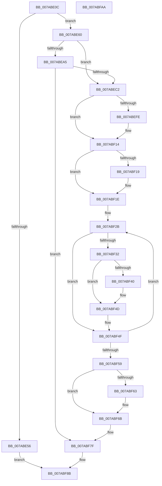

# SmcGetCacheStats

- RVA: `0x007ABE0C`–`0x007ABFAB` (길이 `415` bytes)
- VA: `0x00000001407ABE0C`
- 실행 섹션: `PAGE`
- PDB 이름 있음: `예`; PDB Function 태그: `아니요`
- unwind 정보 RVA: `0x000B0E24`
- 디코드: `118`개 명령, `415/415` bytes 표시
- 미해석 바이트: `0` (있으면 어셈블리에 `.byte`로 보존)

> 이 문서는 커널 이미지의 기계어와 PDB 기호를 분석해 생성했습니다. 4번과 5번은 함수 원형과 자료형을 바이너리 사용 방식에서 추정한 C 해석이며 원본 소스 복구 결과는 아닙니다.

## 1. Dependencies

- 직접 호출 지점: **9**; 고유 호출 대상: **9**
- 직접 호출자로 확인된 함수: **1**
- RIP 상대 이미지 참조: **0**

### Outgoing calls
- `0x007ABE3A` → [memset](../../text/6C/memset_function_006C6C40.md) (function, `0x006C6C40`)
- `0x007ABE46` → [SmcCacheReference](SmcCacheReference_function_007ABAF8.md) (function, `0x007ABAF8`)
- `0x007ABEB3` → [SmKmFileInfoGetPath](SmKmFileInfoGetPath_function_007A83AC.md) (function, `0x007A83AC`)
- `0x007ABEE9` → [KeAbPreAcquire](../../text/21/KeAbPreAcquire_function_00210230.md) (function, `0x00210230`)
- `0x007ABF09` → [ExfAcquirePushLockSharedEx](../../text/21/ExfAcquirePushLockSharedEx_function_0021044C.md) (function, `0x0021044C`)
- `0x007ABF66` → [ExfReleasePushLockShared](../../text/26/ExfReleasePushLockShared_function_00263440.md) (function, `0x00263440`)
- `0x007ABF6E` → [KeAbPostRelease](../../text/2E/KeAbPostRelease_function_002E1600.md) (function, `0x002E1600`)
- `0x007ABF73` → [KeLeaveCriticalRegion](../../text/25/KeLeaveCriticalRegion_function_0025D8B0.md) (function, `0x0025D8B0`)
- `0x007ABF86` → [SmcCacheDereference](SmcCacheDereference_function_007AB8A8.md) (function, `0x007AB8A8`)

### Direct callers
- [SmcProcessStatsRequest](SmcProcessStatsRequest_function_007A7BFC.md) at `0x007A7D43`

### Static image references
- 디코드된 RIP-relative 메모리 참조가 없습니다.

## 2. Other-region calls and transfers

- 다른 실행 섹션으로 향하는 call: **6**
  - `0x007ABE3A` → [memset](../../text/6C/memset_function_006C6C40.md) (`PAGE` → `.text`)
  - `0x007ABEE9` → [KeAbPreAcquire](../../text/21/KeAbPreAcquire_function_00210230.md) (`PAGE` → `.text`)
  - `0x007ABF09` → [ExfAcquirePushLockSharedEx](../../text/21/ExfAcquirePushLockSharedEx_function_0021044C.md) (`PAGE` → `.text`)
  - `0x007ABF66` → [ExfReleasePushLockShared](../../text/26/ExfReleasePushLockShared_function_00263440.md) (`PAGE` → `.text`)
  - `0x007ABF6E` → [KeAbPostRelease](../../text/2E/KeAbPostRelease_function_002E1600.md) (`PAGE` → `.text`)
  - `0x007ABF73` → [KeLeaveCriticalRegion](../../text/25/KeLeaveCriticalRegion_function_0025D8B0.md) (`PAGE` → `.text`)
- 별도 외부 분기/꼬리 이동을 확인하지 못했습니다.

## 3. Assembly (complete function range)

```asm
007ABE0C  48 89 5C 24 08                  mov qword ptr [rsp + 8], rbx
007ABE11  48 89 6C 24 18                  mov qword ptr [rsp + 0x18], rbp
007ABE16  48 89 74 24 20                  mov qword ptr [rsp + 0x20], rsi
007ABE1B  57                              push rdi
007ABE1C  41 54                           push r12
007ABE1E  41 55                           push r13
007ABE20  41 56                           push r14
007ABE22  41 57                           push r15
007ABE24  48 83 EC 20                     sub rsp, 0x20
007ABE28  4C 8B FA                        mov r15, rdx
007ABE2B  4C 8B E1                        mov r12, rcx
007ABE2E  33 D2                           xor edx, edx
007ABE30  41 B8 60 04 00 00               mov r8d, 0x460
007ABE36  49 8D 4F 08                     lea rcx, [r15 + 8]
007ABE3A  E8 01 AE F1 FF                  call 0x1406c6c40
007ABE3F  41 8B 57 04                     mov edx, dword ptr [r15 + 4]
007ABE43  49 8B CC                        mov rcx, r12
007ABE46  E8 AD FC FF FF                  call 0x1407abaf8
007ABE4B  45 33 ED                        xor r13d, r13d
007ABE4E  48 8B F0                        mov rsi, rax
007ABE51  48 85 C0                        test rax, rax
007ABE54  75 0A                           jne 0x1407abe60
007ABE56  BF 98 00 00 C0                  mov edi, 0xc0000098
007ABE5B  E9 2B 01 00 00                  jmp 0x1407abf8b
007ABE60  41 8B 4F 1C                     mov ecx, dword ptr [r15 + 0x1c]
007ABE64  83 E1 C1                        and ecx, 0xffffffc1
007ABE67  83 C9 01                        or ecx, 1
007ABE6A  41 89 4F 1C                     mov dword ptr [r15 + 0x1c], ecx
007ABE6E  48 8B 40 10                     mov rax, qword ptr [rax + 0x10]
007ABE72  49 89 47 08                     mov qword ptr [r15 + 8], rax
007ABE76  8B 46 08                        mov eax, dword ptr [rsi + 8]
007ABE79  41 89 47 14                     mov dword ptr [r15 + 0x14], eax
007ABE7D  8B 46 18                        mov eax, dword ptr [rsi + 0x18]
007ABE80  41 89 47 18                     mov dword ptr [r15 + 0x18], eax
007ABE84  8B 46 20                        mov eax, dword ptr [rsi + 0x20]
007ABE87  41 89 47 64                     mov dword ptr [r15 + 0x64], eax
007ABE8B  8B 46 1C                        mov eax, dword ptr [rsi + 0x1c]
007ABE8E  C1 E0 06                        shl eax, 6
007ABE91  33 C1                           xor eax, ecx
007ABE93  83 E0 40                        and eax, 0x40
007ABE96  33 C1                           xor eax, ecx
007ABE98  41 89 47 1C                     mov dword ptr [r15 + 0x1c], eax
007ABE9C  41 F7 07 00 01 00 00            test dword ptr [r15], 0x100
007ABEA3  75 1D                           jne 0x1407abec2
007ABEA5  49 8D 57 68                     lea rdx, [r15 + 0x68]
007ABEA9  41 B8 00 04 00 00               mov r8d, 0x400
007ABEAF  48 8D 4E 28                     lea rcx, [rsi + 0x28]
007ABEB3  E8 F4 C4 FF FF                  call 0x1407a83ac
007ABEB8  8B F8                           mov edi, eax
007ABEBA  85 C0                           test eax, eax
007ABEBC  0F 88 BD 00 00 00               js 0x1407abf7f
007ABEC2  45 89 6F 60                     mov dword ptr [r15 + 0x60], r13d
007ABEC6  48 8D BE A0 00 00 00            lea rdi, [rsi + 0xa0]
007ABECD  65 48 8B 04 25 88 01 00 00      mov rax, qword ptr gs:[0x188]
007ABED6  45 33 C0                        xor r8d, r8d
007ABED9  33 D2                           xor edx, edx
007ABEDB  48 8B CF                        mov rcx, rdi
007ABEDE  41 8B ED                        mov ebp, r13d
007ABEE1  66 FF 88 E4 01 00 00            dec word ptr [rax + 0x1e4]
007ABEE8  90                              nop
007ABEE9  E8 42 43 A6 FF                  call 0x140210230
007ABEEE  4C 8B F0                        mov r14, rax
007ABEF1  33 C0                           xor eax, eax
007ABEF3  44 8D 48 11                     lea r9d, [rax + 0x11]
007ABEF7  F0 4C 0F B1 0F                  lock cmpxchg qword ptr [rdi], r9
007ABEFC  74 16                           je 0x1407abf14
007ABEFE  4C 8B CF                        mov r9, rdi
007ABF01  4D 8B C6                        mov r8, r14
007ABF04  33 D2                           xor edx, edx
007ABF06  48 8B CF                        mov rcx, rdi
007ABF09  E8 3E 45 A6 FF                  call 0x14021044c
007ABF0E  41 B9 11 00 00 00               mov r9d, 0x11
007ABF14  4D 85 F6                        test r14, r14
007ABF17  74 05                           je 0x1407abf1e
007ABF19  41 C6 46 0A 01                  mov byte ptr [r14 + 0xa], 1
007ABF1E  48 81 C6 A8 00 00 00            add rsi, 0xa8
007ABF25  41 B8 10 00 00 00               mov r8d, 0x10
007ABF2B  8B 0E                           mov ecx, dword ptr [rsi]
007ABF2D  83 F9 FF                        cmp ecx, -1
007ABF30  74 1D                           je 0x1407abf4f
007ABF32  8B C5                           mov eax, ebp
007ABF34  41 89 4C 87 20                  mov dword ptr [r15 + rax*4 + 0x20], ecx
007ABF39  8B 46 04                        mov eax, dword ptr [rsi + 4]
007ABF3C  A8 03                           test al, 3
007ABF3E  75 0D                           jne 0x1407abf4d
007ABF40  8B CD                           mov ecx, ebp
007ABF42  BA 01 00 00 00                  mov edx, 1
007ABF47  D3 E2                           shl edx, cl
007ABF49  41 09 57 60                     or dword ptr [r15 + 0x60], edx
007ABF4D  FF C5                           inc ebp
007ABF4F  48 83 C6 18                     add rsi, 0x18
007ABF53  49 83 E8 01                     sub r8, 1
007ABF57  75 D2                           jne 0x1407abf2b
007ABF59  49 8B C1                        mov rax, r9
007ABF5C  F0 4C 0F B1 2F                  lock cmpxchg qword ptr [rdi], r13
007ABF61  74 08                           je 0x1407abf6b
007ABF63  48 8B CF                        mov rcx, rdi
007ABF66  E8 D5 74 AB FF                  call 0x140263440
007ABF6B  48 8B CF                        mov rcx, rdi
007ABF6E  E8 8D 56 B3 FF                  call 0x1402e1600
007ABF73  E8 38 19 AB FF                  call 0x14025d8b0
007ABF78  41 89 6F 10                     mov dword ptr [r15 + 0x10], ebp
007ABF7C  41 8B FD                        mov edi, r13d
007ABF7F  41 8B 57 04                     mov edx, dword ptr [r15 + 4]
007ABF83  49 8B CC                        mov rcx, r12
007ABF86  E8 1D F9 FF FF                  call 0x1407ab8a8
007ABF8B  48 8B 5C 24 50                  mov rbx, qword ptr [rsp + 0x50]
007ABF90  8B C7                           mov eax, edi
007ABF92  48 8B 6C 24 60                  mov rbp, qword ptr [rsp + 0x60]
007ABF97  48 8B 74 24 68                  mov rsi, qword ptr [rsp + 0x68]
007ABF9C  48 83 C4 20                     add rsp, 0x20
007ABFA0  41 5F                           pop r15
007ABFA2  41 5E                           pop r14
007ABFA4  41 5D                           pop r13
007ABFA6  41 5C                           pop r12
007ABFA8  5F                              pop rdi
007ABFA9  C3                              ret
007ABFAA  CC                              int3
```

## 4. C-style interpretation (structured pseudocode)

```c
__int64 __fastcall SmcGetCacheStats(__int64 a1, __int64 a2)
{
    __int64 result;
    __int64 v_r13;
    __int64 v_rbp;
    __int64 v_rsi;
    __int64 v_rsp;
    unsigned __int64 v_stack_p18;
    unsigned __int64 v_stack_p20;
    unsigned __int64 v_stack_p8;

    v_stack_p8 = v_rbx;
    v_stack_p18 = v_rbp;
    v_stack_p20 = v_rsi;
    v_rsp = (v_rsp) - (32);
    a2 = 0;
    result = memset(a2 + 8, a2, (unsigned int)(0x460ULL), a4);
    result = SmcCacheReference(a1, (unsigned int)(*(unsigned int *)(a2 + 4)), (unsigned int)(0x460ULL), a4);
    v_r13 = 0;
    if (result != 0) goto loc_007ABE60;
    goto loc_007ABF8B;
loc_007ABE60:
    a1 = (unsigned int)(((unsigned int)(*(unsigned int *)(a2 + 28))) & (0xFFFFFFC1ULL));
    a1 = (unsigned int)((a1) | (1));
    *(unsigned int *)(a2 + 28) = (unsigned int)(a1);
    *(unsigned __int64 *)(a2 + 8) = *(unsigned __int64 *)(result + 16);
    *(unsigned int *)(a2 + 20) = (unsigned int)((unsigned int)(*(unsigned int *)(result + 8)));
    *(unsigned int *)(a2 + 24) = (unsigned int)((unsigned int)(*(unsigned int *)(result + 24)));
    *(unsigned int *)(a2 + 100) = (unsigned int)((unsigned int)(*(unsigned int *)(result + 32)));
    result = (unsigned int)(((unsigned int)(*(unsigned int *)(result + 28))) << (6));
    result = (unsigned int)((result) ^ ((unsigned int)(a1)));
    result = (unsigned int)((result) & (64));
    result = (unsigned int)((result) ^ ((unsigned int)(a1)));
    *(unsigned int *)(a2 + 28) = (unsigned int)(result);
    if (((*(unsigned int *)(a2)) & (256)) != 0) goto loc_007ABEC2;
    result = SmKmFileInfoGetPath(result + 40, a2 + 104, (unsigned int)(0x400ULL), a4);
    if (sign_flag) goto loc_007ABF7F;
loc_007ABEC2:
    *(unsigned int *)(a2 + 96) = 0;
    a3 = 0;
    a2 = 0;
    result = KeAbPreAcquire(result + 160, a2, a3, a4);
    result = 0;
    if (!(condition_is_equal)) {
        a4 = result + 160;
        a3 = 0;
        a2 = 0;
        a1 = result + 160;
        result = ExfAcquirePushLockSharedEx(a1, a2, a3, a4);
        a4 = 17;
    }
    if (result != 0) {
        *(unsigned __int8 *)(result + 10) = 1;
    }
    v_rsi = (result) + (168);
loc_007ABF2B:
    if (((unsigned int)((unsigned int)(*(unsigned int *)(v_rsi)))) == -1) goto loc_007ABF4F;
    *(unsigned int *)(a2 + 0 * 4 + 32) = (unsigned int)((unsigned int)(*(unsigned int *)(v_rsi)));
    if ((((unsigned __int8)((unsigned int)(*(unsigned int *)(v_rsi + 4)))) & (3)) == 0) {
        a1 = 0;
        a2 = 1;
        a2 = (unsigned int)((a2) << ((unsigned __int8)(a1)));
    }
    v_rbp = (unsigned int)((0) + 1);
loc_007ABF4F:
    v_rsi = (v_rsi) + (24);
    a3 = (16) - (1);
    if (condition_is_not_equal) goto loc_007ABF2B;
    result = a4;
    if (!(condition_is_equal)) {
        a1 = result + 160;
        result = ExfReleasePushLockShared(a1, a2, a3, a4);
    }
    result = KeAbPostRelease(result + 160, a2, a3, a4);
    result = KeLeaveCriticalRegion(result + 160, a2, a3, a4);
    *(unsigned int *)(a2 + 16) = (unsigned int)(v_rbp);
loc_007ABF7F:
    result = SmcCacheDereference(a1, (unsigned int)(*(unsigned int *)(a2 + 4)), a3, a4);
loc_007ABF8B:
    v_rsp = (v_rsp) + (32);
    return 0;
}
```

## 5. (Beta) C Style

```c
int64_t SmcGetCacheStats(int64_t Arg1, void *Arg2)
{
    uint8_t *arg2 = (uint8_t *)Arg2;

    int64_t result;
    int64_t local_r13;
    int64_t local_rbp;
    int64_t local_rsi;
    int64_t local_rsp;
    uint64_t v_stack_p18;
    uint64_t v_stack_p20;
    uint64_t v_stack_p8;

    v_stack_p8 = local_rbx;
    v_stack_p18 = local_rbp;
    v_stack_p20 = local_rsi;
    local_rsp = (local_rsp) - (32);
    Arg2 = 0;
    result = memset(Arg2 + 8, Arg2, (uint32_t)(0x460ULL), a4);
    result = SmcCacheReference(Arg1, (uint32_t)(*(uint32_t *)(arg2 + 0x4)), (uint32_t)(0x460ULL), a4);
    local_r13 = 0;
    if (result != 0) goto loc_007ABE60;
    goto loc_007ABF8B;
loc_007ABE60:
    Arg1 = (uint32_t)(((uint32_t)(*(uint32_t *)(arg2 + 0x1C))) & (0xFFFFFFC1ULL));
    Arg1 = (uint32_t)((Arg1) | (1));
    *(uint32_t *)(arg2 + 0x1C) = (uint32_t)(Arg1);
    *(uint64_t *)(arg2 + 0x8) = *(uint64_t *)(result + 0x10);
    *(uint32_t *)(arg2 + 0x14) = (uint32_t)((uint32_t)(*(uint32_t *)(result + 0x8)));
    *(uint32_t *)(arg2 + 0x18) = (uint32_t)((uint32_t)(*(uint32_t *)(result + 0x18)));
    *(uint32_t *)(arg2 + 0x64) = (uint32_t)((uint32_t)(*(uint32_t *)(result + 0x20)));
    result = (uint32_t)(((uint32_t)(*(uint32_t *)(result + 0x1C))) << (6));
    result = (uint32_t)((result) ^ ((uint32_t)(Arg1)));
    result = (uint32_t)((result) & (64));
    result = (uint32_t)((result) ^ ((uint32_t)(Arg1)));
    *(uint32_t *)(arg2 + 0x1C) = (uint32_t)(result);
    if (((*(uint32_t *)(arg2)) & (256)) != 0) goto loc_007ABEC2;
    result = SmKmFileInfoGetPath(result + 40, Arg2 + 104, (uint32_t)(0x400ULL), a4);
    if (sign_flag) goto loc_007ABF7F;
loc_007ABEC2:
    *(uint32_t *)(arg2 + 0x60) = 0;
    a3 = 0;
    Arg2 = 0;
    result = KeAbPreAcquire(result + 160, Arg2, a3, a4);
    result = 0;
    if (!(condition_is_equal)) {
        a4 = result + 160;
        a3 = 0;
        Arg2 = 0;
        Arg1 = result + 160;
        result = ExfAcquirePushLockSharedEx(Arg1, Arg2, a3, a4);
        a4 = 17;
    }
    if (result != 0) {
        *(uint8_t *)(result + 0xA) = 1;
    }
    local_rsi = (result) + (168);
loc_007ABF2B:
    if (((uint32_t)((uint32_t)(*(uint32_t *)(local_rsi)))) == -1) goto loc_007ABF4F;
    *(uint32_t *)(arg2 + 0x0 * 4 + 0x20) = (uint32_t)((uint32_t)(*(uint32_t *)(local_rsi)));
    if ((((uint8_t)((uint32_t)(*(uint32_t *)(local_rsi + 0x4)))) & (3)) == 0) {
        Arg1 = 0;
        Arg2 = 1;
        Arg2 = (uint32_t)((Arg2) << ((uint8_t)(Arg1)));
    }
    local_rbp = (uint32_t)((0) + 1);
loc_007ABF4F:
    local_rsi = (local_rsi) + (24);
    a3 = (16) - (1);
    if (condition_is_not_equal) goto loc_007ABF2B;
    result = a4;
    if (!(condition_is_equal)) {
        Arg1 = result + 160;
        result = ExfReleasePushLockShared(Arg1, Arg2, a3, a4);
    }
    result = KeAbPostRelease(result + 160, Arg2, a3, a4);
    result = KeLeaveCriticalRegion(result + 160, Arg2, a3, a4);
    *(uint32_t *)(arg2 + 0x10) = (uint32_t)(local_rbp);
loc_007ABF7F:
    result = SmcCacheDereference(Arg1, (uint32_t)(*(uint32_t *)(arg2 + 0x4)), a3, a4);
loc_007ABF8B:
    local_rsp = (local_rsp) + (32);
    return 0;
}
```

### 관측된 메모리 오프셋

구조체 형식이 확인되지 않은 접근은 인자 기준의 오프셋으로만 기록했습니다.

| 기준 인자 | 오프셋 표현 | 폭 (bit) | 접근 |
|---|---:|---:|---|
| `Arg2` | `+ 0x0` | `32` | `R` |
| `Arg2` | `+ 0x4` | `32` | `R` |
| `Arg2` | `+ 0x8` | `64` | `R` |
| `Arg2` | `+ 0x8` | `64` | `W` |
| `Arg2` | `+ 0x10` | `32` | `W` |
| `Arg2` | `+ 0x14` | `32` | `W` |
| `Arg2` | `+ 0x18` | `32` | `W` |
| `Arg2` | `+ 0x1C` | `32` | `R` |
| `Arg2` | `+ 0x1C` | `32` | `W` |
| `Arg2` | `+ 0x20 + rax*4` | `32` | `W` |
| `Arg2` | `+ 0x60` | `32` | `R/W` |
| `Arg2` | `+ 0x60` | `32` | `W` |
| `Arg2` | `+ 0x64` | `32` | `W` |
| `Arg2` | `+ 0x68` | `64` | `R` |

## 6. Execution-region graph

[열기: 2D/3D 그래프와 함수 탐색 컨트롤 패널](../../../control-panel.html?section=page&rva=0x007ABE0C&view=graph)

- 2D 그래프는 위에서 아래로 흐르고, 3D 그래프는 빈 공간을 드래그해 회전합니다. Shift+드래그는 이동, 휠은 확대·축소, 함수 노드 선택은 대상 보고서 이동입니다.

### Static fallback


