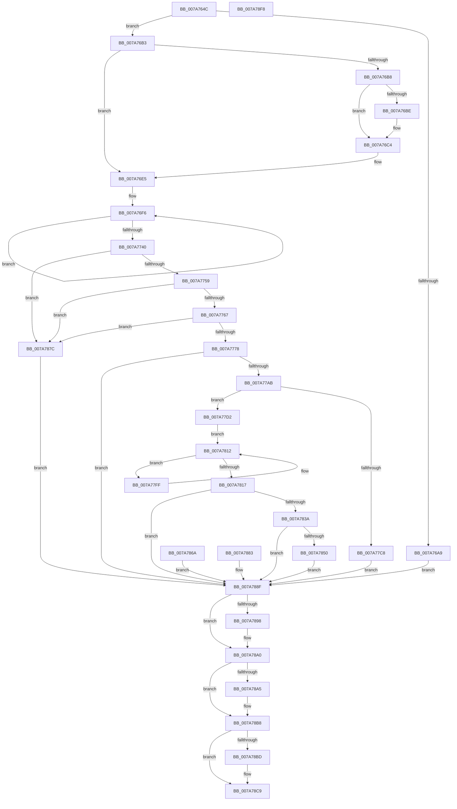

# SmcProcessCreateRequest

- RVA: `0x007A764C`–`0x007A78F9` (길이 `685` bytes)
- VA: `0x00000001407A764C`
- 실행 섹션: `PAGE`
- PDB 이름 있음: `예`; PDB Function 태그: `아니요`
- unwind 정보 RVA: `0x000D1B68`
- 디코드: `181`개 명령, `685/685` bytes 표시
- 미해석 바이트: `0` (있으면 어셈블리에 `.byte`로 보존)

> 이 문서는 커널 이미지의 기계어와 PDB 기호를 분석해 생성했습니다. 4번과 5번은 함수 원형과 자료형을 바이너리 사용 방식에서 추정한 C 해석이며 원본 소스 복구 결과는 아닙니다.

## 1. Dependencies

- 직접 호출 지점: **15**; 고유 호출 대상: **14**
- 직접 호출자로 확인된 함수: **1**
- RIP 상대 이미지 참조: **1**

### Outgoing calls
- `0x007A769C` → [memset](../../text/6C/memset_function_006C6C40.md) (function, `0x006C6C40`)
- `0x007A76BE` → [ExRaiseDatatypeMisalignment](../89/ExRaiseDatatypeMisalignment_function_00899FD0.md) (function, `0x00899FD0`)
- `0x007A7788` → [SmpGetProcessPartition](../../text/4A/SmpGetProcessPartition_function_004A3CCC.md) (function, `0x004A3CCC`)
- `0x007A779C` → [SmcCacheCreatePrepare](SmcCacheCreatePrepare_function_007A754C.md) (function, `0x007A754C`)
- `0x007A77BB` → [SmAllocEx](../../text/34/SmAllocEx_function_0034C794.md) (function, `0x0034C794`)
- `0x007A77DA` → [memset](../../text/6C/memset_function_006C6C40.md) (function, `0x006C6C40`)
- `0x007A77E3` → [StEtaInitialize](../../text/4C/StEtaInitialize_function_004C6674.md) (function, `0x004C6674`)
- `0x007A7809` → [ExWaitForRundownProtectionRelease](../../text/2A/ExWaitForRundownProtectionRelease_function_002A4CB0.md) (function, `0x002A4CB0`)
- `0x007A782F` → [SmcCacheStart](SmcCacheStart_function_007ABC48.md) (function, `0x007ABC48`)
- `0x007A7845` → [SmcCacheAdd](SmcCacheAdd_function_007AB670.md) (function, `0x007AB670`)
- `0x007A789B` → [SmcCacheDereference](SmcCacheDereference_function_007AB8A8.md) (function, `0x007AB8A8`)
- `0x007A78AB` → [SmcCacheCleanup](SmcCacheCleanup_function_007AB7B4.md) (function, `0x007AB7B4`)
- `0x007A78B3` → [CmSiFreeMemory](../../text/47/CmSiFreeMemory_function_00475D80.md) (function, `0x00475D80`)
- `0x007A78C4` → [SmcCacheDelete](SmcCacheDelete_function_007AB84C.md) (function, `0x007AB84C`)
- `0x007A78D6` → [_security_check_cookie](../../text/6A/_security_check_cookie_function_006AC640.md) (function, `0x006AC640`)

### Direct callers
- [sub_00B419D6](../B4/Unknown_function_00B419D6.md) at `0x00B419F9`

### Static image references
- `0x007A7666` → RVA `0x00E0A740` (`.data`; read)

## 2. Other-region calls and transfers

- 다른 실행 섹션으로 향하는 call: **8**
  - `0x007A769C` → [memset](../../text/6C/memset_function_006C6C40.md) (`PAGE` → `.text`)
  - `0x007A7788` → [SmpGetProcessPartition](../../text/4A/SmpGetProcessPartition_function_004A3CCC.md) (`PAGE` → `.text`)
  - `0x007A77BB` → [SmAllocEx](../../text/34/SmAllocEx_function_0034C794.md) (`PAGE` → `.text`)
  - `0x007A77DA` → [memset](../../text/6C/memset_function_006C6C40.md) (`PAGE` → `.text`)
  - `0x007A77E3` → [StEtaInitialize](../../text/4C/StEtaInitialize_function_004C6674.md) (`PAGE` → `.text`)
  - `0x007A7809` → [ExWaitForRundownProtectionRelease](../../text/2A/ExWaitForRundownProtectionRelease_function_002A4CB0.md) (`PAGE` → `.text`)
  - `0x007A78B3` → [CmSiFreeMemory](../../text/47/CmSiFreeMemory_function_00475D80.md) (`PAGE` → `.text`)
  - `0x007A78D6` → [_security_check_cookie](../../text/6A/_security_check_cookie_function_006AC640.md) (`PAGE` → `.text`)
- 별도 외부 분기/꼬리 이동을 확인하지 못했습니다.

## 3. Assembly (complete function range)

```asm
007A764C  48 89 5C 24 10                  mov qword ptr [rsp + 0x10], rbx
007A7651  48 89 74 24 18                  mov qword ptr [rsp + 0x18], rsi
007A7656  57                              push rdi
007A7657  41 54                           push r12
007A7659  41 55                           push r13
007A765B  41 56                           push r14
007A765D  41 57                           push r15
007A765F  48 81 EC 70 04 00 00            sub rsp, 0x470
007A7666  48 8B 05 D3 30 66 00            mov rax, qword ptr [rip + 0x6630d3]
007A766D  48 33 C4                        xor rax, rsp
007A7670  48 89 84 24 60 04 00 00         mov qword ptr [rsp + 0x460], rax
007A7678  45 8A E0                        mov r12b, r8b
007A767B  8B DA                           mov ebx, edx
007A767D  4C 8B E9                        mov r13, rcx
007A7680  33 FF                           xor edi, edi
007A7682  8B F7                           mov esi, edi
007A7684  44 8B FF                        mov r15d, edi
007A7687  83 4C 24 20 FF                  or dword ptr [rsp + 0x20], 0xffffffff
007A768C  44 8B F7                        mov r14d, edi
007A768F  33 D2                           xor edx, edx
007A7691  41 B8 20 04 00 00               mov r8d, 0x420
007A7697  48 8D 4C 24 40                  lea rcx, [rsp + 0x40]
007A769C  E8 9F F5 F1 FF                  call 0x1406c6c40
007A76A1  81 FB 20 04 00 00               cmp ebx, 0x420
007A76A7  74 0A                           je 0x1407a76b3
007A76A9  BB 06 02 00 C0                  mov ebx, 0xc0000206
007A76AE  E9 DC 01 00 00                  jmp 0x1407a788f
007A76B3  45 84 E4                        test r12b, r12b
007A76B6  74 2D                           je 0x1407a76e5
007A76B8  41 F6 C5 07                     test r13b, 7
007A76BC  74 06                           je 0x1407a76c4
007A76BE  E8 0D 29 0F 00                  call 0x140899fd0
007A76C3  CC                              int3
007A76C4  48 B9 00 00 FF FF FF 7F 00 00   movabs rcx, 0x7fffffff0000
007A76CE  4C 3B E9                        cmp r13, rcx
007A76D1  49 0F 42 CD                     cmovb rcx, r13
007A76D5  8A 01                           mov al, byte ptr [rcx]
007A76D7  88 01                           mov byte ptr [rcx], al
007A76D9  8A 81 1F 04 00 00               mov al, byte ptr [rcx + 0x41f]
007A76DF  88 81 1F 04 00 00               mov byte ptr [rcx + 0x41f], al
007A76E5  49 8B C5                        mov rax, r13
007A76E8  48 8D 4C 24 40                  lea rcx, [rsp + 0x40]
007A76ED  BA 08 00 00 00                  mov edx, 8
007A76F2  44 8D 42 78                     lea r8d, [rdx + 0x78]
007A76F6  0F 10 00                        movups xmm0, xmmword ptr [rax]
007A76F9  0F 11 01                        movups xmmword ptr [rcx], xmm0
007A76FC  0F 10 48 10                     movups xmm1, xmmword ptr [rax + 0x10]
007A7700  0F 11 49 10                     movups xmmword ptr [rcx + 0x10], xmm1
007A7704  0F 10 40 20                     movups xmm0, xmmword ptr [rax + 0x20]
007A7708  0F 11 41 20                     movups xmmword ptr [rcx + 0x20], xmm0
007A770C  0F 10 48 30                     movups xmm1, xmmword ptr [rax + 0x30]
007A7710  0F 11 49 30                     movups xmmword ptr [rcx + 0x30], xmm1
007A7714  0F 10 40 40                     movups xmm0, xmmword ptr [rax + 0x40]
007A7718  0F 11 41 40                     movups xmmword ptr [rcx + 0x40], xmm0
007A771C  0F 10 48 50                     movups xmm1, xmmword ptr [rax + 0x50]
007A7720  0F 11 49 50                     movups xmmword ptr [rcx + 0x50], xmm1
007A7724  0F 10 40 60                     movups xmm0, xmmword ptr [rax + 0x60]
007A7728  0F 11 41 60                     movups xmmword ptr [rcx + 0x60], xmm0
007A772C  49 03 C8                        add rcx, r8
007A772F  0F 10 48 70                     movups xmm1, xmmword ptr [rax + 0x70]
007A7733  0F 11 49 F0                     movups xmmword ptr [rcx - 0x10], xmm1
007A7737  49 03 C0                        add rax, r8
007A773A  48 83 EA 01                     sub rdx, 1
007A773E  75 B6                           jne 0x1407a76f6
007A7740  0F 10 00                        movups xmm0, xmmword ptr [rax]
007A7743  0F 11 01                        movups xmmword ptr [rcx], xmm0
007A7746  0F 10 48 10                     movups xmm1, xmmword ptr [rax + 0x10]
007A774A  0F 11 49 10                     movups xmmword ptr [rcx + 0x10], xmm1
007A774E  80 7C 24 40 03                  cmp byte ptr [rsp + 0x40], 3
007A7753  0F 85 23 01 00 00               jne 0x1407a787c
007A7759  F7 44 24 40 00 FF FF FF         test dword ptr [rsp + 0x40], 0xffffff00
007A7761  0F 85 15 01 00 00               jne 0x1407a787c
007A7767  48 8B 44 24 50                  mov rax, qword ptr [rsp + 0x50]
007A776C  48 C1 E8 20                     shr rax, 0x20
007A7770  85 C0                           test eax, eax
007A7772  0F 85 04 01 00 00               jne 0x1407a787c
007A7778  65 48 8B 04 25 88 01 00 00      mov rax, qword ptr gs:[0x188]
007A7781  48 8B 88 B8 00 00 00            mov rcx, qword ptr [rax + 0xb8]
007A7788  E8 3F C5 CF FF                  call 0x1404a3ccc
007A778D  4C 8D B0 F0 08 00 00            lea r14, [rax + 0x8f0]
007A7794  4C 89 74 24 30                  mov qword ptr [rsp + 0x30], r14
007A7799  49 8B CE                        mov rcx, r14
007A779C  E8 AB FD FF FF                  call 0x1407a754c
007A77A1  8B D8                           mov ebx, eax
007A77A3  85 C0                           test eax, eax
007A77A5  0F 88 E4 00 00 00               js 0x1407a788f
007A77AB  41 83 C8 FF                     or r8d, 0xffffffff
007A77AF  BA 73 6D 43 61                  mov edx, 0x61436d73
007A77B4  BB 28 04 00 00                  mov ebx, 0x428
007A77B9  8B CB                           mov ecx, ebx
007A77BB  E8 D4 4F BA FF                  call 0x14034c794
007A77C0  48 8B F0                        mov rsi, rax
007A77C3  48 85 C0                        test rax, rax
007A77C6  75 0A                           jne 0x1407a77d2
007A77C8  BB 9A 00 00 C0                  mov ebx, 0xc000009a
007A77CD  E9 BD 00 00 00                  jmp 0x1407a788f
007A77D2  4C 8B C3                        mov r8, rbx
007A77D5  33 D2                           xor edx, edx
007A77D7  48 8B CE                        mov rcx, rsi
007A77DA  E8 61 F4 F1 FF                  call 0x1406c6c40
007A77DF  48 8D 4E 68                     lea rcx, [rsi + 0x68]
007A77E3  E8 8C EE D1 FF                  call 0x1404c6674
007A77E8  48 89 BE A0 00 00 00            mov qword ptr [rsi + 0xa0], rdi
007A77EF  48 8D 9E A8 00 00 00            lea rbx, [rsi + 0xa8]
007A77F6  4C 8D A3 80 01 00 00            lea r12, [rbx + 0x180]
007A77FD  EB 13                           jmp 0x1407a7812
007A77FF  83 0B FF                        or dword ptr [rbx], 0xffffffff
007A7802  48 8D 4B 10                     lea rcx, [rbx + 0x10]
007A7806  48 89 39                        mov qword ptr [rcx], rdi
007A7809  E8 A2 D4 AF FF                  call 0x1402a4cb0
007A780E  48 83 C3 18                     add rbx, 0x18
007A7812  49 3B DC                        cmp rbx, r12
007A7815  72 E8                           jb 0x1407a77ff
007A7817  66 89 BC 24 5E 04 00 00         mov word ptr [rsp + 0x45e], di
007A781F  4C 8D 4C 24 60                  lea r9, [rsp + 0x60]
007A7824  4C 8D 44 24 48                  lea r8, [rsp + 0x48]
007A7829  48 8B D6                        mov rdx, rsi
007A782C  49 8B CE                        mov rcx, r14
007A782F  E8 14 44 00 00                  call 0x1407abc48
007A7834  8B D8                           mov ebx, eax
007A7836  85 C0                           test eax, eax
007A7838  78 55                           js 0x1407a788f
007A783A  4C 8D 44 24 20                  lea r8, [rsp + 0x20]
007A783F  48 8B D6                        mov rdx, rsi
007A7842  49 8B CE                        mov rcx, r14
007A7845  E8 26 3E 00 00                  call 0x1407ab670
007A784A  8B D8                           mov ebx, eax
007A784C  85 C0                           test eax, eax
007A784E  78 3F                           js 0x1407a788f
007A7850  48 8B F7                        mov rsi, rdi
007A7853  C7 44 24 24 01 00 00 00         mov dword ptr [rsp + 0x24], 1
007A785B  8B DF                           mov ebx, edi
007A785D  8B 44 24 20                     mov eax, dword ptr [rsp + 0x20]
007A7861  41 89 45 04                     mov dword ptr [r13 + 4], eax
007A7865  44 8B FF                        mov r15d, edi
007A7868  EB 25                           jmp 0x1407a788f
007A786A  8B D8                           mov ebx, eax
007A786C  33 FF                           xor edi, edi
007A786E  8B F7                           mov esi, edi
007A7870  44 8B 7C 24 24                  mov r15d, dword ptr [rsp + 0x24]
007A7875  4C 8B 74 24 30                  mov r14, qword ptr [rsp + 0x30]
007A787A  EB 13                           jmp 0x1407a788f
007A787C  BB 0D 00 00 C0                  mov ebx, 0xc000000d
007A7881  EB 0C                           jmp 0x1407a788f
007A7883  8B D8                           mov ebx, eax
007A7885  33 FF                           xor edi, edi
007A7887  8B F7                           mov esi, edi
007A7889  44 8B FF                        mov r15d, edi
007A788C  44 8B F7                        mov r14d, edi
007A788F  8B 54 24 20                     mov edx, dword ptr [rsp + 0x20]
007A7893  83 FA FF                        cmp edx, -1
007A7896  74 08                           je 0x1407a78a0
007A7898  49 8B CE                        mov rcx, r14
007A789B  E8 08 40 00 00                  call 0x1407ab8a8
007A78A0  48 85 F6                        test rsi, rsi
007A78A3  74 13                           je 0x1407a78b8
007A78A5  48 8B D6                        mov rdx, rsi
007A78A8  49 8B CE                        mov rcx, r14
007A78AB  E8 04 3F 00 00                  call 0x1407ab7b4
007A78B0  48 8B CE                        mov rcx, rsi
007A78B3  E8 C8 E4 CC FF                  call 0x140475d80
007A78B8  45 85 FF                        test r15d, r15d
007A78BB  74 0C                           je 0x1407a78c9
007A78BD  8B 54 24 20                     mov edx, dword ptr [rsp + 0x20]
007A78C1  49 8B CE                        mov rcx, r14
007A78C4  E8 83 3F 00 00                  call 0x1407ab84c
007A78C9  8B C3                           mov eax, ebx
007A78CB  48 8B 8C 24 60 04 00 00         mov rcx, qword ptr [rsp + 0x460]
007A78D3  48 33 CC                        xor rcx, rsp
007A78D6  E8 65 4D F0 FF                  call 0x1406ac640
007A78DB  4C 8D 9C 24 70 04 00 00         lea r11, [rsp + 0x470]
007A78E3  49 8B 5B 38                     mov rbx, qword ptr [r11 + 0x38]
007A78E7  49 8B 73 40                     mov rsi, qword ptr [r11 + 0x40]
007A78EB  49 8B E3                        mov rsp, r11
007A78EE  41 5F                           pop r15
007A78F0  41 5E                           pop r14
007A78F2  41 5D                           pop r13
007A78F4  41 5C                           pop r12
007A78F6  5F                              pop rdi
007A78F7  C3                              ret
007A78F8  CC                              int3
```

## 4. C-style interpretation (structured pseudocode)

```c
__int64 __fastcall SmcProcessCreateRequest(__int64 a1, int a2, unsigned __int8 a3)
{
    __int64 result;
    __int64 v_rbx;
    __int64 v_rdi;
    __int64 v_rsp;
    unsigned __int64 v_stack_m28;
    unsigned __int64 v_stack_m38;
    unsigned __int16 v_stack_m3A;
    unsigned __int64 v_stack_m438;
    unsigned __int64 v_stack_m448;
    unsigned __int64 v_stack_m450;
    unsigned __int64 v_stack_m458;
    unsigned __int64 v_stack_m468;
    unsigned int v_stack_m474;
    unsigned int v_stack_m478;
    unsigned __int64 v_stack_p10;
    unsigned __int64 v_stack_p18;

    v_stack_p10 = v_rbx;
    v_stack_p18 = v_rsi;
    v_rsp = (v_rsp) - (0x470ULL);
    result = (*(unsigned __int64 *)(v_rip + 6697171)) ^ (v_rsp);
    v_stack_m38 = result;
    v_rdi = 0;
    a2 = 0;
    result = memset(v_stack_m458, a2, (unsigned int)(0x420ULL), a4);
    if (((unsigned int)((unsigned int)(a2))) == 0x420ULL) goto loc_007A76B3;
    goto loc_007A788F;
loc_007A76B3:
    if (a3 == 0) goto loc_007A76E5;
    if ((((unsigned __int8)(a1)) & (7)) != 0) {
        result = ExRaiseDatatypeMisalignment(v_stack_m458, a2, (unsigned int)(0x420ULL), a4);
    }
    a1 = v_stack_m458;
    if (a1 < v_stack_m458) { a1 = a1; }
    *(unsigned __int8 *)(a1) = (unsigned __int8)(*(unsigned __int8 *)(a1));
    *(unsigned __int8 *)(a1 + 1055) = (unsigned __int8)(*(unsigned __int8 *)(a1 + 1055));
loc_007A76E5:
loc_007A76F6:
    *(unsigned __int64 *)(v_stack_m458) = v_xmm0;
    *(unsigned __int64 *)(v_stack_m458 + 16) = v_xmm1;
    *(unsigned __int64 *)(v_stack_m458 + 32) = v_xmm0;
    *(unsigned __int64 *)(v_stack_m458 + 48) = v_xmm1;
    *(unsigned __int64 *)(v_stack_m458 + 64) = v_xmm0;
    *(unsigned __int64 *)(v_stack_m458 + 80) = v_xmm1;
    *(unsigned __int64 *)(v_stack_m458 + 96) = v_xmm0;
    a1 = (v_stack_m458) + (8 + 120);
    *(unsigned __int64 *)(a1 - 16) = v_xmm1;
    result = (a1) + (8 + 120);
    a2 = (8) - (1);
    if (condition_is_not_equal) goto loc_007A76F6;
    *(unsigned __int64 *)(a1) = v_xmm0;
    *(unsigned __int64 *)(a1 + 16) = v_xmm1;
    if (v_stack_m458 != 3) goto loc_007A787C;
    if (((v_stack_m458) & (0xFFFFFF00ULL)) != 0) goto loc_007A787C;
    result = (v_stack_m448) >> (32);
    if ((unsigned int)(result) != 0) goto loc_007A787C;
    result = SmpGetProcessPartition(*(unsigned __int64 *)(*(unsigned __int64 *)(gs_base + (0 + 392)) + 184), a2, 8 + 120, a4);
    v_stack_m468 = result + 2288;
    result = SmcCacheCreatePrepare(result + 2288, a2, 8 + 120, a4);
    if (sign_flag) goto loc_007A788F;
    a3 = (unsigned int)((8 + 120) | (0xFFFFFFFFULL));
    result = SmAllocEx((unsigned int)((unsigned int)((unsigned int)(0x428ULL))), (unsigned int)(0x61436D73ULL), a3, a4);
    if (result != 0) goto loc_007A77D2;
    goto loc_007A788F;
loc_007A77D2:
    a2 = 0;
    result = memset(result, a2, (unsigned int)(0xC000009AULL), a4);
    result = StEtaInitialize(result + 104, a2, (unsigned int)(0xC000009AULL), a4);
    *(unsigned __int64 *)(result + 160) = 0;
    goto loc_007A7812;
loc_007A77FF:
    *(unsigned __int64 *)(result + 168 + 16) = 0;
    result = ExWaitForRundownProtectionRelease(result + 168 + 16, a2, (unsigned int)(0xC000009AULL), a4);
    v_rbx = (result + 168) + (24);
loc_007A7812:
    if (v_rbx < (result + 168 + 384)) goto loc_007A77FF;
    v_stack_m3A = 0;
    result = SmcCacheStart(result + 2288, result, v_stack_m450, v_stack_m438);
    if (sign_flag) goto loc_007A788F;
    result = SmcCacheAdd(result + 2288, result, v_stack_m478, v_stack_m438);
    if (sign_flag) goto loc_007A788F;
    v_stack_m474 = 1;
    *(unsigned int *)(a1 + 4) = (unsigned int)((unsigned int)(v_stack_m478));
    goto loc_007A788F;
loc_007A787C:
    goto loc_007A788F;
loc_007A788F:
    result = (unsigned int)(v_stack_m478);
    if (((unsigned int)((unsigned int)(v_stack_m478))) != -1) {
        a1 = result + 2288;
        result = SmcCacheDereference(a1, (unsigned int)(v_stack_m478), v_stack_m478, v_stack_m438);
    }
    if (0 != 0) {
        a2 = 0;
        a1 = result + 2288;
        result = SmcCacheCleanup(a1, a2, v_stack_m478, v_stack_m438);
        a1 = 0;
        result = CmSiFreeMemory(a1, a2, v_stack_m478, v_stack_m438);
    }
    if (0 != 0) {
        a2 = v_stack_m478;
        a1 = result + 2288;
        result = SmcCacheDelete(a1, a2, v_stack_m478, v_stack_m438);
    }
    a1 = (v_stack_m38) ^ (v_rsp);
    result = _security_check_cookie(a1, a2, v_stack_m478, v_stack_m438);
    return result;
}
```

## 5. (Beta) C Style

```c
int64_t SmcProcessCreateRequest(int64_t Arg1, int32_t Arg2, uint8_t Arg3)
{
    int64_t result;
    int64_t local_rbx;
    int64_t local_rdi;
    int64_t local_rsp;
    uint64_t v_stack_m28;
    uint64_t v_stack_m38;
    uint16_t v_stack_m3A;
    uint64_t v_stack_m438;
    uint64_t v_stack_m448;
    uint64_t v_stack_m450;
    uint64_t v_stack_m458;
    uint64_t v_stack_m468;
    uint32_t v_stack_m474;
    uint32_t v_stack_m478;
    uint64_t v_stack_p10;
    uint64_t v_stack_p18;

    v_stack_p10 = local_rbx;
    v_stack_p18 = local_rsi;
    local_rsp = (local_rsp) - (0x470ULL);
    result = (*(uint64_t *)(v_rip + 0x6630D3)) ^ (local_rsp);
    v_stack_m38 = result;
    local_rdi = 0;
    Arg2 = 0;
    result = memset(v_stack_m458, Arg2, (uint32_t)(0x420ULL), a4);
    if (((uint32_t)((uint32_t)(Arg2))) == 0x420ULL) goto loc_007A76B3;
    goto loc_007A788F;
loc_007A76B3:
    if (Arg3 == 0) goto loc_007A76E5;
    if ((((uint8_t)(Arg1)) & (7)) != 0) {
        result = ExRaiseDatatypeMisalignment(v_stack_m458, Arg2, (uint32_t)(0x420ULL), a4);
    }
    Arg1 = v_stack_m458;
    if (Arg1 < v_stack_m458) { Arg1 = Arg1; }
    *(uint8_t *)(Arg1) = (uint8_t)(*(uint8_t *)(Arg1));
    *(uint8_t *)(Arg1 + 0x41F) = (uint8_t)(*(uint8_t *)(Arg1 + 0x41F));
loc_007A76E5:
loc_007A76F6:
    *(uint64_t *)(v_stack_m458) = v_xmm0;
    *(uint64_t *)(v_stack_m458 + 0x10) = v_xmm1;
    *(uint64_t *)(v_stack_m458 + 0x20) = v_xmm0;
    *(uint64_t *)(v_stack_m458 + 0x30) = v_xmm1;
    *(uint64_t *)(v_stack_m458 + 0x40) = v_xmm0;
    *(uint64_t *)(v_stack_m458 + 0x50) = v_xmm1;
    *(uint64_t *)(v_stack_m458 + 0x60) = v_xmm0;
    Arg1 = (v_stack_m458) + (8 + 120);
    *(uint64_t *)(Arg1 - 0x10) = v_xmm1;
    result = (Arg1) + (8 + 120);
    Arg2 = (8) - (1);
    if (condition_is_not_equal) goto loc_007A76F6;
    *(uint64_t *)(Arg1) = v_xmm0;
    *(uint64_t *)(Arg1 + 0x10) = v_xmm1;
    if (v_stack_m458 != 3) goto loc_007A787C;
    if (((v_stack_m458) & (0xFFFFFF00ULL)) != 0) goto loc_007A787C;
    result = (v_stack_m448) >> (32);
    if ((uint32_t)(result) != 0) goto loc_007A787C;
    result = SmpGetProcessPartition(*(uint64_t *)(*(uint64_t *)(gs_base + (0 + 0x188)) + 0xB8), Arg2, 8 + 120, a4);
    v_stack_m468 = result + 2288;
    result = SmcCacheCreatePrepare(result + 2288, Arg2, 8 + 120, a4);
    if (sign_flag) goto loc_007A788F;
    Arg3 = (uint32_t)((8 + 120) | (0xFFFFFFFFULL));
    result = SmAllocEx((uint32_t)((uint32_t)((uint32_t)(0x428ULL))), (uint32_t)(0x61436D73ULL), Arg3, a4);
    if (result != 0) goto loc_007A77D2;
    goto loc_007A788F;
loc_007A77D2:
    Arg2 = 0;
    result = memset(result, Arg2, (uint32_t)(0xC000009AULL), a4);
    result = StEtaInitialize(result + 104, Arg2, (uint32_t)(0xC000009AULL), a4);
    *(uint64_t *)(result + 0xA0) = 0;
    goto loc_007A7812;
loc_007A77FF:
    *(uint64_t *)(result + 0xA8 + 0x10) = 0;
    result = ExWaitForRundownProtectionRelease(result + 168 + 16, Arg2, (uint32_t)(0xC000009AULL), a4);
    local_rbx = (result + 168) + (24);
loc_007A7812:
    if (local_rbx < (result + 168 + 384)) goto loc_007A77FF;
    v_stack_m3A = 0;
    result = SmcCacheStart(result + 2288, result, v_stack_m450, v_stack_m438);
    if (sign_flag) goto loc_007A788F;
    result = SmcCacheAdd(result + 2288, result, v_stack_m478, v_stack_m438);
    if (sign_flag) goto loc_007A788F;
    v_stack_m474 = 1;
    *(uint32_t *)(Arg1 + 0x4) = (uint32_t)((uint32_t)(v_stack_m478));
    goto loc_007A788F;
loc_007A787C:
    goto loc_007A788F;
loc_007A788F:
    result = (uint32_t)(v_stack_m478);
    if (((uint32_t)((uint32_t)(v_stack_m478))) != -1) {
        Arg1 = result + 2288;
        result = SmcCacheDereference(Arg1, (uint32_t)(v_stack_m478), v_stack_m478, v_stack_m438);
    }
    if (0 != 0) {
        Arg2 = 0;
        Arg1 = result + 2288;
        result = SmcCacheCleanup(Arg1, Arg2, v_stack_m478, v_stack_m438);
        Arg1 = 0;
        result = CmSiFreeMemory(Arg1, Arg2, v_stack_m478, v_stack_m438);
    }
    if (0 != 0) {
        Arg2 = v_stack_m478;
        Arg1 = result + 2288;
        result = SmcCacheDelete(Arg1, Arg2, v_stack_m478, v_stack_m438);
    }
    Arg1 = (v_stack_m38) ^ (local_rsp);
    result = _security_check_cookie(Arg1, Arg2, v_stack_m478, v_stack_m438);
    return result;
}
```

## 6. Execution-region graph

[열기: 2D/3D 그래프와 함수 탐색 컨트롤 패널](../../../control-panel.html?section=page&rva=0x007A764C&view=graph)

- 2D 그래프는 위에서 아래로 흐르고, 3D 그래프는 빈 공간을 드래그해 회전합니다. Shift+드래그는 이동, 휠은 확대·축소, 함수 노드 선택은 대상 보고서 이동입니다.

### Static fallback


