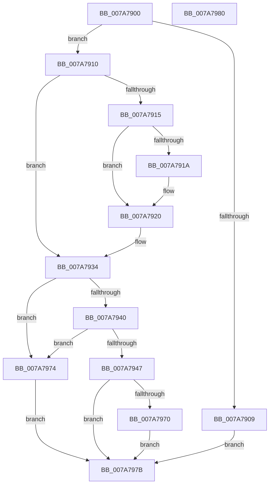

# SmcProcessDeleteRequest

- RVA: `0x007A7900`–`0x007A7981` (길이 `129` bytes)
- VA: `0x00000001407A7900`
- 실행 섹션: `PAGE`
- PDB 이름 있음: `예`; PDB Function 태그: `아니요`
- unwind 정보 RVA: `0x000D1B44`
- 디코드: `37`개 명령, `129/129` bytes 표시
- 미해석 바이트: `0` (있으면 어셈블리에 `.byte`로 보존)

> 이 문서는 커널 이미지의 기계어와 PDB 기호를 분석해 생성했습니다. 4번과 5번은 함수 원형과 자료형을 바이너리 사용 방식에서 추정한 C 해석이며 원본 소스 복구 결과는 아닙니다.

## 1. Dependencies

- 직접 호출 지점: **3**; 고유 호출 대상: **3**
- 직접 호출자로 확인된 함수: **1**
- RIP 상대 이미지 참조: **0**

### Outgoing calls
- `0x007A791A` → [ExRaiseDatatypeMisalignment](../89/ExRaiseDatatypeMisalignment_function_00899FD0.md) (function, `0x00899FD0`)
- `0x007A7957` → [SmpGetProcessPartition](../../text/4A/SmpGetProcessPartition_function_004A3CCC.md) (function, `0x004A3CCC`)
- `0x007A7967` → [SmcCacheDelete](SmcCacheDelete_function_007AB84C.md) (function, `0x007AB84C`)

### Direct callers
- [sub_00B419D6](../B4/Unknown_function_00B419D6.md) at `0x00B419E2`

### Static image references
- 디코드된 RIP-relative 메모리 참조가 없습니다.

## 2. Other-region calls and transfers

- 다른 실행 섹션으로 향하는 call: **1**
  - `0x007A7957` → [SmpGetProcessPartition](../../text/4A/SmpGetProcessPartition_function_004A3CCC.md) (`PAGE` → `.text`)
- 별도 외부 분기/꼬리 이동을 확인하지 못했습니다.

## 3. Assembly (complete function range)

```asm
007A7900  48 83 EC 28                     sub rsp, 0x28
007A7904  83 FA 08                        cmp edx, 8
007A7907  74 07                           je 0x1407a7910
007A7909  B8 06 02 00 C0                  mov eax, 0xc0000206
007A790E  EB 6B                           jmp 0x1407a797b
007A7910  45 84 C0                        test r8b, r8b
007A7913  74 1F                           je 0x1407a7934
007A7915  F6 C1 03                        test cl, 3
007A7918  74 06                           je 0x1407a7920
007A791A  E8 B1 26 0F 00                  call 0x140899fd0
007A791F  CC                              int3
007A7920  48 B8 00 00 FF FF FF 7F 00 00   movabs rax, 0x7fffffff0000
007A792A  48 3B C8                        cmp rcx, rax
007A792D  48 0F 42 C1                     cmovb rax, rcx
007A7931  90                              nop
007A7932  8A 00                           mov al, byte ptr [rax]
007A7934  48 8B 01                        mov rax, qword ptr [rcx]
007A7937  48 89 44 24 48                  mov qword ptr [rsp + 0x48], rax
007A793C  3C 01                           cmp al, 1
007A793E  75 34                           jne 0x1407a7974
007A7940  A9 00 FF FF FF                  test eax, 0xffffff00
007A7945  75 2D                           jne 0x1407a7974
007A7947  65 48 8B 0C 25 88 01 00 00      mov rcx, qword ptr gs:[0x188]
007A7950  48 8B 89 B8 00 00 00            mov rcx, qword ptr [rcx + 0xb8]
007A7957  E8 70 C3 CF FF                  call 0x1404a3ccc
007A795C  48 8D 88 F0 08 00 00            lea rcx, [rax + 0x8f0]
007A7963  8B 54 24 4C                     mov edx, dword ptr [rsp + 0x4c]
007A7967  E8 E0 3E 00 00                  call 0x1407ab84c
007A796C  85 C0                           test eax, eax
007A796E  78 0B                           js 0x1407a797b
007A7970  33 C0                           xor eax, eax
007A7972  EB 07                           jmp 0x1407a797b
007A7974  B8 0D 00 00 C0                  mov eax, 0xc000000d
007A7979  EB 00                           jmp 0x1407a797b
007A797B  48 83 C4 28                     add rsp, 0x28
007A797F  C3                              ret
007A7980  CC                              int3
```

## 4. C-style interpretation (structured pseudocode)

```c
__int64 __fastcall SmcProcessDeleteRequest(__int64 a1, int a2, unsigned __int8 a3)
{
    __int64 result;
    __int64 v_rsp;
    unsigned __int64 v_stack_p20;
    unsigned int v_stack_p24;

    v_rsp = (v_rsp) - (40);
    if (a2 == 8) goto loc_007A7910;
    goto loc_007A797B;
loc_007A7910:
    if (a3 == 0) goto loc_007A7934;
    result = (unsigned int)(0xC0000206ULL);
    if ((((unsigned __int8)(a1)) & (3)) != 0) {
        result = ExRaiseDatatypeMisalignment(a1, a2, a3, a4);
    }
    if (a1 < result) { result = a1; }
loc_007A7934:
    v_stack_p20 = *(unsigned __int64 *)(a1);
    if (((unsigned __int8)(*(unsigned __int64 *)(a1))) != 1) goto loc_007A7974;
    if ((((unsigned int)(*(unsigned __int64 *)(a1))) & (0xFFFFFF00ULL)) != 0) goto loc_007A7974;
    result = SmpGetProcessPartition(*(unsigned __int64 *)(*(unsigned __int64 *)(gs_base + (0 + 392)) + 184), a2, a3, a4);
    result = SmcCacheDelete(result + 2288, (unsigned int)(v_stack_p24), a3, a4);
    if (sign_flag) goto loc_007A797B;
    result = 0;
    goto loc_007A797B;
loc_007A7974:
    goto loc_007A797B;
loc_007A797B:
    v_rsp = (v_rsp) + (40);
    return (unsigned int)(0xC000000DULL);
}
```

## 5. (Beta) C Style

```c
int64_t SmcProcessDeleteRequest(int64_t Arg1, int32_t Arg2, uint8_t Arg3)
{
    int64_t result;
    int64_t local_rsp;
    uint64_t v_stack_p20;
    uint32_t v_stack_p24;

    local_rsp = (local_rsp) - (40);
    if (Arg2 == 8) goto loc_007A7910;
    goto loc_007A797B;
loc_007A7910:
    if (Arg3 == 0) goto loc_007A7934;
    result = (uint32_t)(0xC0000206ULL);
    if ((((uint8_t)(Arg1)) & (3)) != 0) {
        result = ExRaiseDatatypeMisalignment(Arg1, Arg2, Arg3, a4);
    }
    if (Arg1 < result) { result = Arg1; }
loc_007A7934:
    v_stack_p20 = *(uint64_t *)(Arg1);
    if (((uint8_t)(*(uint64_t *)(Arg1))) != 1) goto loc_007A7974;
    if ((((uint32_t)(*(uint64_t *)(Arg1))) & (0xFFFFFF00ULL)) != 0) goto loc_007A7974;
    result = SmpGetProcessPartition(*(uint64_t *)(*(uint64_t *)(gs_base + (0 + 0x188)) + 0xB8), Arg2, Arg3, a4);
    result = SmcCacheDelete(result + 2288, (uint32_t)(v_stack_p24), Arg3, a4);
    if (sign_flag) goto loc_007A797B;
    result = 0;
    goto loc_007A797B;
loc_007A7974:
    goto loc_007A797B;
loc_007A797B:
    local_rsp = (local_rsp) + (40);
    return (uint32_t)(0xC000000DULL);
}
```

## 6. Execution-region graph

[열기: 2D/3D 그래프와 함수 탐색 컨트롤 패널](../../../control-panel.html?section=page&rva=0x007A7900&view=graph)

- 2D 그래프는 위에서 아래로 흐르고, 3D 그래프는 빈 공간을 드래그해 회전합니다. Shift+드래그는 이동, 휠은 확대·축소, 함수 노드 선택은 대상 보고서 이동입니다.

### Static fallback


