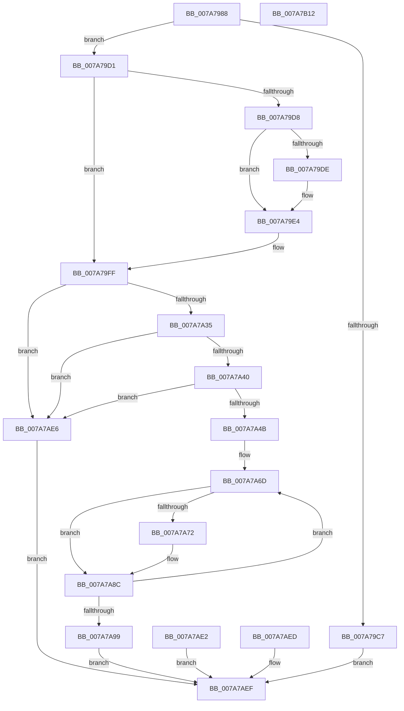

# SmcProcessListRequest

- RVA: `0x007A7988`–`0x007A7B13` (길이 `395` bytes)
- VA: `0x00000001407A7988`
- 실행 섹션: `PAGE`
- PDB 이름 있음: `예`; PDB Function 태그: `아니요`
- unwind 정보 RVA: `0x000D1BB4`
- 디코드: `104`개 명령, `395/395` bytes 표시
- 미해석 바이트: `0` (있으면 어셈블리에 `.byte`로 보존)

> 이 문서는 커널 이미지의 기계어와 PDB 기호를 분석해 생성했습니다. 4번과 5번은 함수 원형과 자료형을 바이너리 사용 방식에서 추정한 C 해석이며 원본 소스 복구 결과는 아닙니다.

## 1. Dependencies

- 직접 호출 지점: **4**; 고유 호출 대상: **4**
- 직접 호출자로 확인된 함수: **1**
- RIP 상대 이미지 참조: **1**

### Outgoing calls
- `0x007A79BD` → [memset](../../text/6C/memset_function_006C6C40.md) (function, `0x006C6C40`)
- `0x007A79DE` → [ExRaiseDatatypeMisalignment](../89/ExRaiseDatatypeMisalignment_function_00899FD0.md) (function, `0x00899FD0`)
- `0x007A7A5B` → [SmpGetProcessPartition](../../text/4A/SmpGetProcessPartition_function_004A3CCC.md) (function, `0x004A3CCC`)
- `0x007A7AF9` → [_security_check_cookie](../../text/6A/_security_check_cookie_function_006AC640.md) (function, `0x006AC640`)

### Direct callers
- [SmQueryStoreInformation](../A0/SmQueryStoreInformation_function_00A0E7BC.md) at `0x00A0E93B`

### Static image references
- `0x007A7998` → RVA `0x00E0A740` (`.data`; read)

## 2. Other-region calls and transfers

- 다른 실행 섹션으로 향하는 call: **3**
  - `0x007A79BD` → [memset](../../text/6C/memset_function_006C6C40.md) (`PAGE` → `.text`)
  - `0x007A7A5B` → [SmpGetProcessPartition](../../text/4A/SmpGetProcessPartition_function_004A3CCC.md) (`PAGE` → `.text`)
  - `0x007A7AF9` → [_security_check_cookie](../../text/6A/_security_check_cookie_function_006AC640.md) (`PAGE` → `.text`)
- 별도 외부 분기/꼬리 이동을 확인하지 못했습니다.

## 3. Assembly (complete function range)

```asm
007A7988  48 89 5C 24 10                  mov qword ptr [rsp + 0x10], rbx
007A798D  56                              push rsi
007A798E  57                              push rdi
007A798F  41 56                           push r14
007A7991  48 81 EC 80 00 00 00            sub rsp, 0x80
007A7998  48 8B 05 A1 2D 66 00            mov rax, qword ptr [rip + 0x662da1]
007A799F  48 33 C4                        xor rax, rsp
007A79A2  48 89 44 24 70                  mov qword ptr [rsp + 0x70], rax
007A79A7  41 8A F1                        mov sil, r9b
007A79AA  4D 8B F0                        mov r14, r8
007A79AD  8B DA                           mov ebx, edx
007A79AF  48 8B F9                        mov rdi, rcx
007A79B2  33 D2                           xor edx, edx
007A79B4  44 8D 42 44                     lea r8d, [rdx + 0x44]
007A79B8  48 8D 4C 24 20                  lea rcx, [rsp + 0x20]
007A79BD  E8 7E F2 F1 FF                  call 0x1406c6c40
007A79C2  83 FB 44                        cmp ebx, 0x44
007A79C5  74 0A                           je 0x1407a79d1
007A79C7  BA 06 02 00 C0                  mov edx, 0xc0000206
007A79CC  E9 1E 01 00 00                  jmp 0x1407a7aef
007A79D1  33 D2                           xor edx, edx
007A79D3  40 84 F6                        test sil, sil
007A79D6  74 27                           je 0x1407a79ff
007A79D8  40 F6 C7 03                     test dil, 3
007A79DC  74 06                           je 0x1407a79e4
007A79DE  E8 ED 25 0F 00                  call 0x140899fd0
007A79E3  CC                              int3
007A79E4  48 B9 00 00 FF FF FF 7F 00 00   movabs rcx, 0x7fffffff0000
007A79EE  48 3B F9                        cmp rdi, rcx
007A79F1  48 0F 42 CF                     cmovb rcx, rdi
007A79F5  8A 01                           mov al, byte ptr [rcx]
007A79F7  88 01                           mov byte ptr [rcx], al
007A79F9  8A 41 43                        mov al, byte ptr [rcx + 0x43]
007A79FC  88 41 43                        mov byte ptr [rcx + 0x43], al
007A79FF  0F 10 07                        movups xmm0, xmmword ptr [rdi]
007A7A02  0F 29 44 24 20                  movaps xmmword ptr [rsp + 0x20], xmm0
007A7A07  0F 10 4F 10                     movups xmm1, xmmword ptr [rdi + 0x10]
007A7A0B  0F 29 4C 24 30                  movaps xmmword ptr [rsp + 0x30], xmm1
007A7A10  0F 10 47 20                     movups xmm0, xmmword ptr [rdi + 0x20]
007A7A14  0F 29 44 24 40                  movaps xmmword ptr [rsp + 0x40], xmm0
007A7A19  0F 10 4F 30                     movups xmm1, xmmword ptr [rdi + 0x30]
007A7A1D  0F 29 4C 24 50                  movaps xmmword ptr [rsp + 0x50], xmm1
007A7A22  8B 47 40                        mov eax, dword ptr [rdi + 0x40]
007A7A25  89 44 24 60                     mov dword ptr [rsp + 0x60], eax
007A7A29  8B 44 24 20                     mov eax, dword ptr [rsp + 0x20]
007A7A2D  3C 01                           cmp al, 1
007A7A2F  0F 85 B1 00 00 00               jne 0x1407a7ae6
007A7A35  A9 00 FF 00 00                  test eax, 0xff00
007A7A3A  0F 85 A6 00 00 00               jne 0x1407a7ae6
007A7A40  A9 00 00 FF FF                  test eax, 0xffff0000
007A7A45  0F 85 9B 00 00 00               jne 0x1407a7ae6
007A7A4B  65 48 8B 04 25 88 01 00 00      mov rax, qword ptr gs:[0x188]
007A7A54  48 8B 88 B8 00 00 00            mov rcx, qword ptr [rax + 0xb8]
007A7A5B  E8 6C C2 CF FF                  call 0x1404a3ccc
007A7A60  4C 8D 80 F0 08 00 00            lea r8, [rax + 0x8f0]
007A7A67  44 8B D2                        mov r10d, edx
007A7A6A  44 8B CA                        mov r9d, edx
007A7A6D  49 39 10                        cmp qword ptr [r8], rdx
007A7A70  74 1A                           je 0x1407a7a8c
007A7A72  41 8B 48 18                     mov ecx, dword ptr [r8 + 0x18]
007A7A76  81 E1 FF 0F 00 00               and ecx, 0xfff
007A7A7C  C1 E1 04                        shl ecx, 4
007A7A7F  41 0B C9                        or ecx, r9d
007A7A82  41 8B C2                        mov eax, r10d
007A7A85  89 4C 84 24                     mov dword ptr [rsp + rax*4 + 0x24], ecx
007A7A89  41 FF C2                        inc r10d
007A7A8C  41 FF C1                        inc r9d
007A7A8F  49 83 C0 20                     add r8, 0x20
007A7A93  41 83 F9 10                     cmp r9d, 0x10
007A7A97  72 D4                           jb 0x1407a7a6d
007A7A99  41 0F B6 CA                     movzx ecx, r10b
007A7A9D  C1 E1 08                        shl ecx, 8
007A7AA0  8B 44 24 20                     mov eax, dword ptr [rsp + 0x20]
007A7AA4  25 FF 00 FF FF                  and eax, 0xffff00ff
007A7AA9  0B C8                           or ecx, eax
007A7AAB  89 4C 24 20                     mov dword ptr [rsp + 0x20], ecx
007A7AAF  0F 28 44 24 20                  movaps xmm0, xmmword ptr [rsp + 0x20]
007A7AB4  0F 11 07                        movups xmmword ptr [rdi], xmm0
007A7AB7  0F 28 4C 24 30                  movaps xmm1, xmmword ptr [rsp + 0x30]
007A7ABC  0F 11 4F 10                     movups xmmword ptr [rdi + 0x10], xmm1
007A7AC0  0F 28 44 24 40                  movaps xmm0, xmmword ptr [rsp + 0x40]
007A7AC5  0F 11 47 20                     movups xmmword ptr [rdi + 0x20], xmm0
007A7AC9  0F 28 4C 24 50                  movaps xmm1, xmmword ptr [rsp + 0x50]
007A7ACE  0F 11 4F 30                     movups xmmword ptr [rdi + 0x30], xmm1
007A7AD2  8B 44 24 60                     mov eax, dword ptr [rsp + 0x60]
007A7AD6  89 47 40                        mov dword ptr [rdi + 0x40], eax
007A7AD9  41 C7 06 44 00 00 00            mov dword ptr [r14], 0x44
007A7AE0  EB 0D                           jmp 0x1407a7aef
007A7AE2  8B D0                           mov edx, eax
007A7AE4  EB 09                           jmp 0x1407a7aef
007A7AE6  BA 0D 00 00 C0                  mov edx, 0xc000000d
007A7AEB  EB 02                           jmp 0x1407a7aef
007A7AED  8B D0                           mov edx, eax
007A7AEF  8B C2                           mov eax, edx
007A7AF1  48 8B 4C 24 70                  mov rcx, qword ptr [rsp + 0x70]
007A7AF6  48 33 CC                        xor rcx, rsp
007A7AF9  E8 42 4B F0 FF                  call 0x1406ac640
007A7AFE  48 8B 9C 24 A8 00 00 00         mov rbx, qword ptr [rsp + 0xa8]
007A7B06  48 81 C4 80 00 00 00            add rsp, 0x80
007A7B0D  41 5E                           pop r14
007A7B0F  5F                              pop rdi
007A7B10  5E                              pop rsi
007A7B11  C3                              ret
007A7B12  CC                              int3
```

## 4. C-style interpretation (structured pseudocode)

```c
__int64 __fastcall SmcProcessListRequest(__int64 a1, int a2, __int64 a3, unsigned __int8 a4)
{
    __int64 result;
    __int64 v_r10;
    __int64 v_rsp;
    unsigned __int64 v_stack_m28;
    unsigned int v_stack_m38;
    unsigned __int64 v_stack_m48;
    unsigned __int64 v_stack_m58;
    unsigned __int64 v_stack_m68;
    unsigned __int64 v_stack_m78;
    unsigned __int64 v_stack_p10;

    v_stack_p10 = v_rbx;
    v_rsp = (v_rsp) - (128);
    result = (*(unsigned __int64 *)(v_rip + 6696353)) ^ (v_rsp);
    v_stack_m28 = result;
    a2 = 0;
    result = memset(v_stack_m78, a2, a2 + 68, a4);
    if (((unsigned int)((unsigned int)(a2))) == 68) goto loc_007A79D1;
    goto loc_007A7AEF;
loc_007A79D1:
    a2 = 0;
    if (a4 == 0) goto loc_007A79FF;
    if ((((unsigned __int8)(a1)) & (3)) != 0) {
        result = ExRaiseDatatypeMisalignment(v_stack_m78, a2, a2 + 68, a4);
    }
    a1 = v_stack_m78;
    if (a1 < v_stack_m78) { a1 = a1; }
    *(unsigned __int8 *)(a1) = (unsigned __int8)(*(unsigned __int8 *)(a1));
    *(unsigned __int8 *)(a1 + 67) = (unsigned __int8)(*(unsigned __int8 *)(a1 + 67));
loc_007A79FF:
    v_stack_m78 = v_xmm0;
    v_stack_m68 = v_xmm1;
    v_stack_m58 = v_xmm0;
    v_stack_m48 = v_xmm1;
    v_stack_m38 = (unsigned int)((unsigned int)(*(unsigned int *)(a1 + 64)));
    if (((unsigned __int8)((unsigned int)(v_stack_m78))) != 1) goto loc_007A7AE6;
    if ((((unsigned int)((unsigned int)(v_stack_m78))) & (0xFF00ULL)) != 0) goto loc_007A7AE6;
    if ((((unsigned int)((unsigned int)(v_stack_m78))) & (0xFFFF0000ULL)) != 0) goto loc_007A7AE6;
    result = SmpGetProcessPartition(*(unsigned __int64 *)(*(unsigned __int64 *)(gs_base + (0 + 392)) + 184), a2, a2 + 68, a4);
loc_007A7A6D:
    v_r10 = 0;
    if ((*(unsigned __int64 *)(result + 2288)) != 0) {
        a1 = *(unsigned int *)(result + 2288 + 24);
        a1 = (unsigned int)((a1) & (0xFFFULL));
        a1 = (unsigned int)((a1) << (4));
        a1 = (unsigned int)((a1) | (0));
        result = 0;
        *(unsigned int *)(v_rsp + result * 4 + 36) = (unsigned int)(a1);
        v_r10 = (unsigned int)((0) + 1);
    }
    a4 = (unsigned int)((0) + 1);
    a3 = (result + 2288) + (32);
    if (a4 < 16) goto loc_007A7A6D;
    a1 = (unsigned int)(((unsigned __int8)(v_r10)) << (8));
    result = (unsigned int)(((unsigned int)(v_stack_m78)) & (0xFFFF00FFULL));
    a1 = (unsigned int)((a1) | ((unsigned int)(result)));
    v_stack_m78 = (unsigned int)(a1);
    *(unsigned __int64 *)(a1) = v_xmm0;
    *(unsigned __int64 *)(a1 + 16) = v_xmm1;
    *(unsigned __int64 *)(a1 + 32) = v_xmm0;
    *(unsigned __int64 *)(a1 + 48) = v_xmm1;
    *(unsigned int *)(a1 + 64) = (unsigned int)((unsigned int)(v_stack_m38));
    *(unsigned int *)(a3) = 68;
    goto loc_007A7AEF;
loc_007A7AE6:
    goto loc_007A7AEF;
loc_007A7AEF:
    a1 = (v_stack_m28) ^ (v_rsp);
    result = _security_check_cookie(a1, (unsigned int)(0xC000000DULL), a3, a4);
    v_rsp = (v_rsp) + (128);
    return result;
}
```

## 5. (Beta) C Style

```c
int64_t SmcProcessListRequest(int64_t Arg1, int32_t Arg2, void *Arg3, uint8_t Arg4)
{
    uint8_t *arg3 = (uint8_t *)Arg3;

    int64_t result;
    int64_t local_r10;
    int64_t local_rsp;
    uint64_t v_stack_m28;
    uint32_t v_stack_m38;
    uint64_t v_stack_m48;
    uint64_t v_stack_m58;
    uint64_t v_stack_m68;
    uint64_t v_stack_m78;
    uint64_t v_stack_p10;

    v_stack_p10 = local_rbx;
    local_rsp = (local_rsp) - (128);
    result = (*(uint64_t *)(v_rip + 0x662DA1)) ^ (local_rsp);
    v_stack_m28 = result;
    Arg2 = 0;
    result = memset(v_stack_m78, Arg2, Arg2 + 68, Arg4);
    if (((uint32_t)((uint32_t)(Arg2))) == 68) goto loc_007A79D1;
    goto loc_007A7AEF;
loc_007A79D1:
    Arg2 = 0;
    if (Arg4 == 0) goto loc_007A79FF;
    if ((((uint8_t)(Arg1)) & (3)) != 0) {
        result = ExRaiseDatatypeMisalignment(v_stack_m78, Arg2, Arg2 + 68, Arg4);
    }
    Arg1 = v_stack_m78;
    if (Arg1 < v_stack_m78) { Arg1 = Arg1; }
    *(uint8_t *)(Arg1) = (uint8_t)(*(uint8_t *)(Arg1));
    *(uint8_t *)(Arg1 + 0x43) = (uint8_t)(*(uint8_t *)(Arg1 + 0x43));
loc_007A79FF:
    v_stack_m78 = v_xmm0;
    v_stack_m68 = v_xmm1;
    v_stack_m58 = v_xmm0;
    v_stack_m48 = v_xmm1;
    v_stack_m38 = (uint32_t)((uint32_t)(*(uint32_t *)(Arg1 + 0x40)));
    if (((uint8_t)((uint32_t)(v_stack_m78))) != 1) goto loc_007A7AE6;
    if ((((uint32_t)((uint32_t)(v_stack_m78))) & (0xFF00ULL)) != 0) goto loc_007A7AE6;
    if ((((uint32_t)((uint32_t)(v_stack_m78))) & (0xFFFF0000ULL)) != 0) goto loc_007A7AE6;
    result = SmpGetProcessPartition(*(uint64_t *)(*(uint64_t *)(gs_base + (0 + 0x188)) + 0xB8), Arg2, Arg2 + 68, Arg4);
loc_007A7A6D:
    local_r10 = 0;
    if ((*(uint64_t *)(result + 0x8F0)) != 0) {
        Arg1 = *(uint32_t *)(result + 0x8F0 + 0x18);
        Arg1 = (uint32_t)((Arg1) & (0xFFFULL));
        Arg1 = (uint32_t)((Arg1) << (4));
        Arg1 = (uint32_t)((Arg1) | (0));
        result = 0;
        *(uint32_t *)(local_rsp + result * 4 + 0x24) = (uint32_t)(Arg1);
        local_r10 = (uint32_t)((0) + 1);
    }
    Arg4 = (uint32_t)((0) + 1);
    Arg3 = (result + 2288) + (32);
    if (Arg4 < 16) goto loc_007A7A6D;
    Arg1 = (uint32_t)(((uint8_t)(local_r10)) << (8));
    result = (uint32_t)(((uint32_t)(v_stack_m78)) & (0xFFFF00FFULL));
    Arg1 = (uint32_t)((Arg1) | ((uint32_t)(result)));
    v_stack_m78 = (uint32_t)(Arg1);
    *(uint64_t *)(Arg1) = v_xmm0;
    *(uint64_t *)(Arg1 + 0x10) = v_xmm1;
    *(uint64_t *)(Arg1 + 0x20) = v_xmm0;
    *(uint64_t *)(Arg1 + 0x30) = v_xmm1;
    *(uint32_t *)(Arg1 + 0x40) = (uint32_t)((uint32_t)(v_stack_m38));
    *(uint32_t *)(arg3) = 68;
    goto loc_007A7AEF;
loc_007A7AE6:
    goto loc_007A7AEF;
loc_007A7AEF:
    Arg1 = (v_stack_m28) ^ (local_rsp);
    result = _security_check_cookie(Arg1, (uint32_t)(0xC000000DULL), Arg3, Arg4);
    local_rsp = (local_rsp) + (128);
    return result;
}
```

### 관측된 메모리 오프셋

구조체 형식이 확인되지 않은 접근은 인자 기준의 오프셋으로만 기록했습니다.

| 기준 인자 | 오프셋 표현 | 폭 (bit) | 접근 |
|---|---:|---:|---|
| `Arg3` | `+ 0x0` | `32` | `W` |

## 6. Execution-region graph

[열기: 2D/3D 그래프와 함수 탐색 컨트롤 패널](../../../control-panel.html?section=page&rva=0x007A7988&view=graph)

- 2D 그래프는 위에서 아래로 흐르고, 3D 그래프는 빈 공간을 드래그해 회전합니다. Shift+드래그는 이동, 휠은 확대·축소, 함수 노드 선택은 대상 보고서 이동입니다.

### Static fallback


