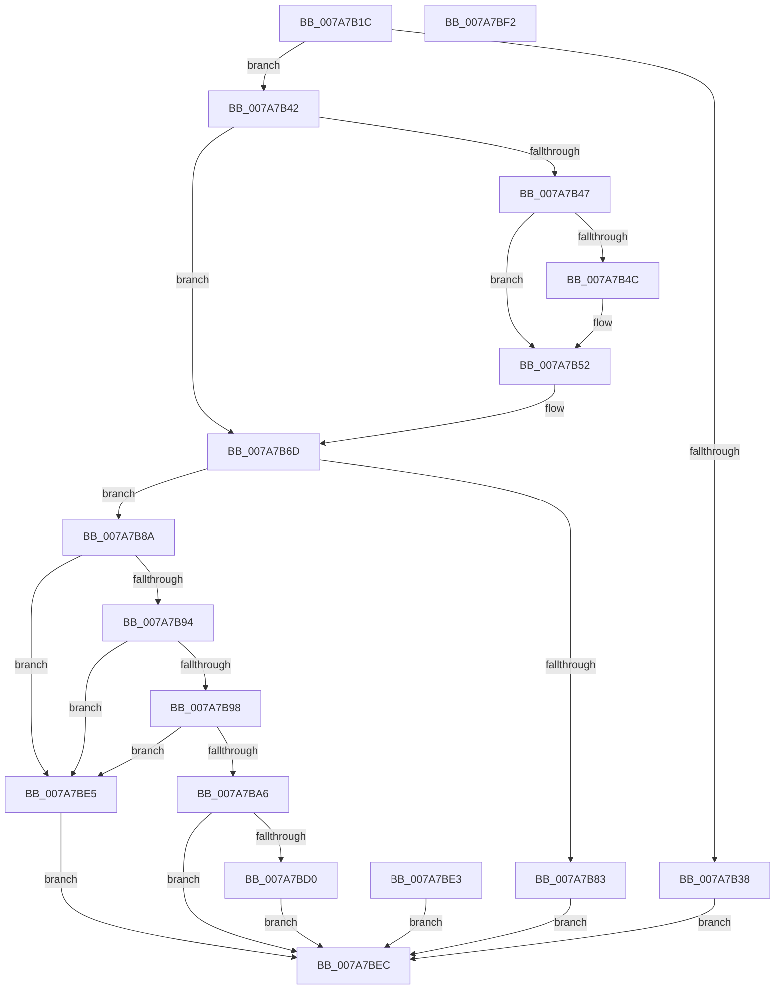

# SmcProcessResizeRequest

- RVA: `0x007A7B1C`–`0x007A7BF3` (길이 `215` bytes)
- VA: `0x00000001407A7B1C`
- 실행 섹션: `PAGE`
- PDB 이름 있음: `예`; PDB Function 태그: `아니요`
- unwind 정보 RVA: `0x000D1A6C`
- 디코드: `61`개 명령, `215/215` bytes 표시
- 미해석 바이트: `0` (있으면 어셈블리에 `.byte`로 보존)

> 이 문서는 커널 이미지의 기계어와 PDB 기호를 분석해 생성했습니다. 4번과 5번은 함수 원형과 자료형을 바이너리 사용 방식에서 추정한 C 해석이며 원본 소스 복구 결과는 아닙니다.

## 1. Dependencies

- 직접 호출 지점: **3**; 고유 호출 대상: **3**
- 직접 호출자로 확인된 함수: **1**
- RIP 상대 이미지 참조: **0**

### Outgoing calls
- `0x007A7B4C` → [ExRaiseDatatypeMisalignment](../89/ExRaiseDatatypeMisalignment_function_00899FD0.md) (function, `0x00899FD0`)
- `0x007A7BB6` → [SmpGetProcessPartition](../../text/4A/SmpGetProcessPartition_function_004A3CCC.md) (function, `0x004A3CCC`)
- `0x007A7BC7` → [SmcStoreResize](SmcStoreResize_function_007AC500.md) (function, `0x007AC500`)

### Direct callers
- [SmSetStoreInformation](../A7/SmSetStoreInformation_function_00A781B8.md) at `0x00A782E4`

### Static image references
- 디코드된 RIP-relative 메모리 참조가 없습니다.

## 2. Other-region calls and transfers

- 다른 실행 섹션으로 향하는 call: **1**
  - `0x007A7BB6` → [SmpGetProcessPartition](../../text/4A/SmpGetProcessPartition_function_004A3CCC.md) (`PAGE` → `.text`)
- 별도 외부 분기/꼬리 이동을 확인하지 못했습니다.

## 3. Assembly (complete function range)

```asm
007A7B1C  40 53                           push rbx
007A7B1E  48 83 EC 40                     sub rsp, 0x40
007A7B22  48 8B D9                        mov rbx, rcx
007A7B25  0F 57 C0                        xorps xmm0, xmm0
007A7B28  33 C0                           xor eax, eax
007A7B2A  0F 11 44 24 20                  movups xmmword ptr [rsp + 0x20], xmm0
007A7B2F  89 44 24 30                     mov dword ptr [rsp + 0x30], eax
007A7B33  83 FA 14                        cmp edx, 0x14
007A7B36  74 0A                           je 0x1407a7b42
007A7B38  B8 06 02 00 C0                  mov eax, 0xc0000206
007A7B3D  E9 AA 00 00 00                  jmp 0x1407a7bec
007A7B42  45 84 C0                        test r8b, r8b
007A7B45  74 26                           je 0x1407a7b6d
007A7B47  F6 C3 03                        test bl, 3
007A7B4A  74 06                           je 0x1407a7b52
007A7B4C  E8 7F 24 0F 00                  call 0x140899fd0
007A7B51  CC                              int3
007A7B52  48 B9 00 00 FF FF FF 7F 00 00   movabs rcx, 0x7fffffff0000
007A7B5C  48 3B D9                        cmp rbx, rcx
007A7B5F  48 0F 42 CB                     cmovb rcx, rbx
007A7B63  8A 01                           mov al, byte ptr [rcx]
007A7B65  88 01                           mov byte ptr [rcx], al
007A7B67  8A 41 13                        mov al, byte ptr [rcx + 0x13]
007A7B6A  88 41 13                        mov byte ptr [rcx + 0x13], al
007A7B6D  0F 10 03                        movups xmm0, xmmword ptr [rbx]
007A7B70  0F 11 44 24 20                  movups xmmword ptr [rsp + 0x20], xmm0
007A7B75  8B 43 10                        mov eax, dword ptr [rbx + 0x10]
007A7B78  89 44 24 30                     mov dword ptr [rsp + 0x30], eax
007A7B7C  80 7C 24 20 01                  cmp byte ptr [rsp + 0x20], 1
007A7B81  74 07                           je 0x1407a7b8a
007A7B83  B8 59 00 00 C0                  mov eax, 0xc0000059
007A7B88  EB 62                           jmp 0x1407a7bec
007A7B8A  F7 44 24 20 00 FE FF FF         test dword ptr [rsp + 0x20], 0xfffffe00
007A7B92  75 51                           jne 0x1407a7be5
007A7B94  85 C0                           test eax, eax
007A7B96  74 4D                           je 0x1407a7be5
007A7B98  48 8B 44 24 28                  mov rax, qword ptr [rsp + 0x28]
007A7B9D  48 C1 E8 20                     shr rax, 0x20
007A7BA1  83 F8 02                        cmp eax, 2
007A7BA4  7D 3F                           jge 0x1407a7be5
007A7BA6  65 48 8B 04 25 88 01 00 00      mov rax, qword ptr gs:[0x188]
007A7BAF  48 8B 88 B8 00 00 00            mov rcx, qword ptr [rax + 0xb8]
007A7BB6  E8 11 C1 CF FF                  call 0x1404a3ccc
007A7BBB  48 8D 88 F0 08 00 00            lea rcx, [rax + 0x8f0]
007A7BC2  48 8D 54 24 20                  lea rdx, [rsp + 0x20]
007A7BC7  E8 34 49 00 00                  call 0x1407ac500
007A7BCC  85 C0                           test eax, eax
007A7BCE  78 1C                           js 0x1407a7bec
007A7BD0  0F 10 44 24 20                  movups xmm0, xmmword ptr [rsp + 0x20]
007A7BD5  0F 11 03                        movups xmmword ptr [rbx], xmm0
007A7BD8  8B 44 24 30                     mov eax, dword ptr [rsp + 0x30]
007A7BDC  89 43 10                        mov dword ptr [rbx + 0x10], eax
007A7BDF  33 C0                           xor eax, eax
007A7BE1  EB 09                           jmp 0x1407a7bec
007A7BE3  EB 07                           jmp 0x1407a7bec
007A7BE5  B8 0D 00 00 C0                  mov eax, 0xc000000d
007A7BEA  EB 00                           jmp 0x1407a7bec
007A7BEC  48 83 C4 40                     add rsp, 0x40
007A7BF0  5B                              pop rbx
007A7BF1  C3                              ret
007A7BF2  CC                              int3
```

## 4. C-style interpretation (structured pseudocode)

```c
__int64 __fastcall SmcProcessResizeRequest(__int64 a1, int a2, unsigned __int8 a3)
{
    __int64 result;
    __int64 v_rsp;
    unsigned int v_stack_m18;
    unsigned __int64 v_stack_m20;
    unsigned __int64 v_stack_m28;

    v_rsp = (v_rsp) - (64);
    result = 0;
    v_stack_m28 = v_xmm0;
    v_stack_m18 = 0;
    if (a2 == 20) goto loc_007A7B42;
    goto loc_007A7BEC;
loc_007A7B42:
    if (a3 == 0) goto loc_007A7B6D;
    result = (unsigned int)(0xC0000206ULL);
    if ((((unsigned __int8)(a1)) & (3)) != 0) {
        result = ExRaiseDatatypeMisalignment(a1, a2, a3, a4);
    }
    if (a1 < a1) { a1 = a1; }
    *(unsigned __int8 *)(a1) = (unsigned __int8)(*(unsigned __int8 *)(a1));
    *(unsigned __int8 *)(a1 + 19) = (unsigned __int8)(*(unsigned __int8 *)(a1 + 19));
loc_007A7B6D:
    v_stack_m28 = v_xmm0;
    v_stack_m18 = (unsigned int)((unsigned int)(*(unsigned int *)(a1 + 16)));
    if (v_stack_m28 == 1) goto loc_007A7B8A;
    goto loc_007A7BEC;
loc_007A7B8A:
    if (((v_stack_m28) & (0xFFFFFE00ULL)) != 0) goto loc_007A7BE5;
    if ((unsigned int)((unsigned int)(0xC0000059ULL)) == 0) goto loc_007A7BE5;
    result = (v_stack_m20) >> (32);
    if (((unsigned int)(result)) >= 2) goto loc_007A7BE5;
    result = SmpGetProcessPartition(*(unsigned __int64 *)(*(unsigned __int64 *)(gs_base + (0 + 392)) + 184), a2, a3, a4);
    result = SmcStoreResize(result + 2288, v_stack_m28, a3, a4);
    if (sign_flag) goto loc_007A7BEC;
    *(unsigned __int64 *)(a1) = v_xmm0;
    *(unsigned int *)(a1 + 16) = (unsigned int)((unsigned int)(v_stack_m18));
    result = 0;
    goto loc_007A7BEC;
loc_007A7BE5:
    goto loc_007A7BEC;
loc_007A7BEC:
    v_rsp = (v_rsp) + (64);
    return (unsigned int)(0xC000000DULL);
}
```

## 5. (Beta) C Style

```c
int64_t SmcProcessResizeRequest(int64_t Arg1, int32_t Arg2, uint8_t Arg3)
{
    int64_t result;
    int64_t local_rsp;
    uint32_t v_stack_m18;
    uint64_t v_stack_m20;
    uint64_t v_stack_m28;

    local_rsp = (local_rsp) - (64);
    result = 0;
    v_stack_m28 = v_xmm0;
    v_stack_m18 = 0;
    if (Arg2 == 20) goto loc_007A7B42;
    goto loc_007A7BEC;
loc_007A7B42:
    if (Arg3 == 0) goto loc_007A7B6D;
    result = (uint32_t)(0xC0000206ULL);
    if ((((uint8_t)(Arg1)) & (3)) != 0) {
        result = ExRaiseDatatypeMisalignment(Arg1, Arg2, Arg3, a4);
    }
    if (Arg1 < Arg1) { Arg1 = Arg1; }
    *(uint8_t *)(Arg1) = (uint8_t)(*(uint8_t *)(Arg1));
    *(uint8_t *)(Arg1 + 0x13) = (uint8_t)(*(uint8_t *)(Arg1 + 0x13));
loc_007A7B6D:
    v_stack_m28 = v_xmm0;
    v_stack_m18 = (uint32_t)((uint32_t)(*(uint32_t *)(Arg1 + 0x10)));
    if (v_stack_m28 == 1) goto loc_007A7B8A;
    goto loc_007A7BEC;
loc_007A7B8A:
    if (((v_stack_m28) & (0xFFFFFE00ULL)) != 0) goto loc_007A7BE5;
    if ((uint32_t)((uint32_t)(0xC0000059ULL)) == 0) goto loc_007A7BE5;
    result = (v_stack_m20) >> (32);
    if (((uint32_t)(result)) >= 2) goto loc_007A7BE5;
    result = SmpGetProcessPartition(*(uint64_t *)(*(uint64_t *)(gs_base + (0 + 0x188)) + 0xB8), Arg2, Arg3, a4);
    result = SmcStoreResize(result + 2288, v_stack_m28, Arg3, a4);
    if (sign_flag) goto loc_007A7BEC;
    *(uint64_t *)(Arg1) = v_xmm0;
    *(uint32_t *)(Arg1 + 0x10) = (uint32_t)((uint32_t)(v_stack_m18));
    result = 0;
    goto loc_007A7BEC;
loc_007A7BE5:
    goto loc_007A7BEC;
loc_007A7BEC:
    local_rsp = (local_rsp) + (64);
    return (uint32_t)(0xC000000DULL);
}
```

## 6. Execution-region graph

[열기: 2D/3D 그래프와 함수 탐색 컨트롤 패널](../../../control-panel.html?section=page&rva=0x007A7B1C&view=graph)

- 2D 그래프는 위에서 아래로 흐르고, 3D 그래프는 빈 공간을 드래그해 회전합니다. Shift+드래그는 이동, 휠은 확대·축소, 함수 노드 선택은 대상 보고서 이동입니다.

### Static fallback


