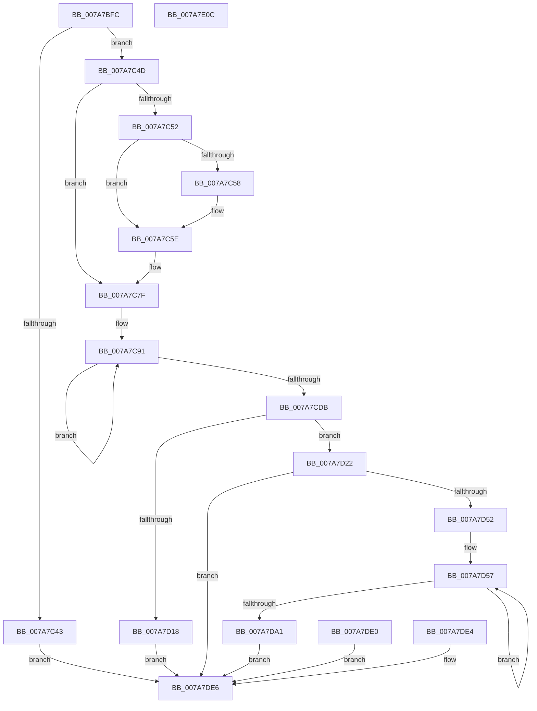

# SmcProcessStatsRequest

- RVA: `0x007A7BFC`–`0x007A7E0D` (길이 `529` bytes)
- VA: `0x00000001407A7BFC`
- 실행 섹션: `PAGE`
- PDB 이름 있음: `예`; PDB Function 태그: `아니요`
- unwind 정보 RVA: `0x000D1B00`
- 디코드: `136`개 명령, `529/529` bytes 표시
- 미해석 바이트: `0` (있으면 어셈블리에 `.byte`로 보존)

> 이 문서는 커널 이미지의 기계어와 PDB 기호를 분석해 생성했습니다. 4번과 5번은 함수 원형과 자료형을 바이너리 사용 방식에서 추정한 C 해석이며 원본 소스 복구 결과는 아닙니다.

## 1. Dependencies

- 직접 호출 지점: **5**; 고유 호출 대상: **5**
- 직접 호출자로 확인된 함수: **1**
- RIP 상대 이미지 참조: **1**

### Outgoing calls
- `0x007A7C36` → [memset](../../text/6C/memset_function_006C6C40.md) (function, `0x006C6C40`)
- `0x007A7C58` → [ExRaiseDatatypeMisalignment](../89/ExRaiseDatatypeMisalignment_function_00899FD0.md) (function, `0x00899FD0`)
- `0x007A7D32` → [SmpGetProcessPartition](../../text/4A/SmpGetProcessPartition_function_004A3CCC.md) (function, `0x004A3CCC`)
- `0x007A7D43` → [SmcGetCacheStats](SmcGetCacheStats_function_007ABE0C.md) (function, `0x007ABE0C`)
- `0x007A7DF3` → [_security_check_cookie](../../text/6A/_security_check_cookie_function_006AC640.md) (function, `0x006AC640`)

### Direct callers
- [SmQueryStoreInformation](../A0/SmQueryStoreInformation_function_00A0E7BC.md) at `0x00A0E923`

### Static image references
- `0x007A7C0C` → RVA `0x00E0A740` (`.data`; read)

## 2. Other-region calls and transfers

- 다른 실행 섹션으로 향하는 call: **3**
  - `0x007A7C36` → [memset](../../text/6C/memset_function_006C6C40.md) (`PAGE` → `.text`)
  - `0x007A7D32` → [SmpGetProcessPartition](../../text/4A/SmpGetProcessPartition_function_004A3CCC.md) (`PAGE` → `.text`)
  - `0x007A7DF3` → [_security_check_cookie](../../text/6A/_security_check_cookie_function_006AC640.md) (`PAGE` → `.text`)
- 별도 외부 분기/꼬리 이동을 확인하지 못했습니다.

## 3. Assembly (complete function range)

```asm
007A7BFC  48 89 5C 24 10                  mov qword ptr [rsp + 0x10], rbx
007A7C01  56                              push rsi
007A7C02  57                              push rdi
007A7C03  41 56                           push r14
007A7C05  48 81 EC A0 04 00 00            sub rsp, 0x4a0
007A7C0C  48 8B 05 2D 2B 66 00            mov rax, qword ptr [rip + 0x662b2d]
007A7C13  48 33 C4                        xor rax, rsp
007A7C16  48 89 84 24 90 04 00 00         mov qword ptr [rsp + 0x490], rax
007A7C1E  41 8A F1                        mov sil, r9b
007A7C21  4D 8B F0                        mov r14, r8
007A7C24  8B DA                           mov ebx, edx
007A7C26  48 8B F9                        mov rdi, rcx
007A7C29  33 D2                           xor edx, edx
007A7C2B  41 B8 68 04 00 00               mov r8d, 0x468
007A7C31  48 8D 4C 24 20                  lea rcx, [rsp + 0x20]
007A7C36  E8 05 F0 F1 FF                  call 0x1406c6c40
007A7C3B  81 FB 68 04 00 00               cmp ebx, 0x468
007A7C41  74 0A                           je 0x1407a7c4d
007A7C43  B9 06 02 00 C0                  mov ecx, 0xc0000206
007A7C48  E9 99 01 00 00                  jmp 0x1407a7de6
007A7C4D  40 84 F6                        test sil, sil
007A7C50  74 2D                           je 0x1407a7c7f
007A7C52  40 F6 C7 07                     test dil, 7
007A7C56  74 06                           je 0x1407a7c5e
007A7C58  E8 73 23 0F 00                  call 0x140899fd0
007A7C5D  CC                              int3
007A7C5E  48 B9 00 00 FF FF FF 7F 00 00   movabs rcx, 0x7fffffff0000
007A7C68  48 3B F9                        cmp rdi, rcx
007A7C6B  48 0F 42 CF                     cmovb rcx, rdi
007A7C6F  8A 01                           mov al, byte ptr [rcx]
007A7C71  88 01                           mov byte ptr [rcx], al
007A7C73  8A 81 67 04 00 00               mov al, byte ptr [rcx + 0x467]
007A7C79  88 81 67 04 00 00               mov byte ptr [rcx + 0x467], al
007A7C7F  48 8B C7                        mov rax, rdi
007A7C82  48 8D 4C 24 20                  lea rcx, [rsp + 0x20]
007A7C87  BB 08 00 00 00                  mov ebx, 8
007A7C8C  8B D3                           mov edx, ebx
007A7C8E  8D 73 78                        lea esi, [rbx + 0x78]
007A7C91  0F 10 00                        movups xmm0, xmmword ptr [rax]
007A7C94  0F 11 01                        movups xmmword ptr [rcx], xmm0
007A7C97  0F 10 48 10                     movups xmm1, xmmword ptr [rax + 0x10]
007A7C9B  0F 11 49 10                     movups xmmword ptr [rcx + 0x10], xmm1
007A7C9F  0F 10 40 20                     movups xmm0, xmmword ptr [rax + 0x20]
007A7CA3  0F 11 41 20                     movups xmmword ptr [rcx + 0x20], xmm0
007A7CA7  0F 10 48 30                     movups xmm1, xmmword ptr [rax + 0x30]
007A7CAB  0F 11 49 30                     movups xmmword ptr [rcx + 0x30], xmm1
007A7CAF  0F 10 40 40                     movups xmm0, xmmword ptr [rax + 0x40]
007A7CB3  0F 11 41 40                     movups xmmword ptr [rcx + 0x40], xmm0
007A7CB7  0F 10 48 50                     movups xmm1, xmmword ptr [rax + 0x50]
007A7CBB  0F 11 49 50                     movups xmmword ptr [rcx + 0x50], xmm1
007A7CBF  0F 10 40 60                     movups xmm0, xmmword ptr [rax + 0x60]
007A7CC3  0F 11 41 60                     movups xmmword ptr [rcx + 0x60], xmm0
007A7CC7  48 03 CE                        add rcx, rsi
007A7CCA  0F 10 48 70                     movups xmm1, xmmword ptr [rax + 0x70]
007A7CCE  0F 11 49 F0                     movups xmmword ptr [rcx - 0x10], xmm1
007A7CD2  48 03 C6                        add rax, rsi
007A7CD5  48 83 EA 01                     sub rdx, 1
007A7CD9  75 B6                           jne 0x1407a7c91
007A7CDB  0F 10 00                        movups xmm0, xmmword ptr [rax]
007A7CDE  0F 11 01                        movups xmmword ptr [rcx], xmm0
007A7CE1  0F 10 48 10                     movups xmm1, xmmword ptr [rax + 0x10]
007A7CE5  0F 11 49 10                     movups xmmword ptr [rcx + 0x10], xmm1
007A7CE9  0F 10 40 20                     movups xmm0, xmmword ptr [rax + 0x20]
007A7CED  0F 11 41 20                     movups xmmword ptr [rcx + 0x20], xmm0
007A7CF1  0F 10 48 30                     movups xmm1, xmmword ptr [rax + 0x30]
007A7CF5  0F 11 49 30                     movups xmmword ptr [rcx + 0x30], xmm1
007A7CF9  0F 10 40 40                     movups xmm0, xmmword ptr [rax + 0x40]
007A7CFD  0F 11 41 40                     movups xmmword ptr [rcx + 0x40], xmm0
007A7D01  0F 10 48 50                     movups xmm1, xmmword ptr [rax + 0x50]
007A7D05  0F 11 49 50                     movups xmmword ptr [rcx + 0x50], xmm1
007A7D09  48 8B 40 60                     mov rax, qword ptr [rax + 0x60]
007A7D0D  48 89 41 60                     mov qword ptr [rcx + 0x60], rax
007A7D11  80 7C 24 20 03                  cmp byte ptr [rsp + 0x20], 3
007A7D16  74 0A                           je 0x1407a7d22
007A7D18  B9 0D 00 00 C0                  mov ecx, 0xc000000d
007A7D1D  E9 C4 00 00 00                  jmp 0x1407a7de6
007A7D22  65 48 8B 04 25 88 01 00 00      mov rax, qword ptr gs:[0x188]
007A7D2B  48 8B 88 B8 00 00 00            mov rcx, qword ptr [rax + 0xb8]
007A7D32  E8 95 BF CF FF                  call 0x1404a3ccc
007A7D37  48 8D 88 F0 08 00 00            lea rcx, [rax + 0x8f0]
007A7D3E  48 8D 54 24 20                  lea rdx, [rsp + 0x20]
007A7D43  E8 C4 40 00 00                  call 0x1407abe0c
007A7D48  8B C8                           mov ecx, eax
007A7D4A  85 C0                           test eax, eax
007A7D4C  0F 88 94 00 00 00               js 0x1407a7de6
007A7D52  48 8D 44 24 20                  lea rax, [rsp + 0x20]
007A7D57  0F 10 00                        movups xmm0, xmmword ptr [rax]
007A7D5A  0F 11 07                        movups xmmword ptr [rdi], xmm0
007A7D5D  0F 10 48 10                     movups xmm1, xmmword ptr [rax + 0x10]
007A7D61  0F 11 4F 10                     movups xmmword ptr [rdi + 0x10], xmm1
007A7D65  0F 10 40 20                     movups xmm0, xmmword ptr [rax + 0x20]
007A7D69  0F 11 47 20                     movups xmmword ptr [rdi + 0x20], xmm0
007A7D6D  0F 10 48 30                     movups xmm1, xmmword ptr [rax + 0x30]
007A7D71  0F 11 4F 30                     movups xmmword ptr [rdi + 0x30], xmm1
007A7D75  0F 10 40 40                     movups xmm0, xmmword ptr [rax + 0x40]
007A7D79  0F 11 47 40                     movups xmmword ptr [rdi + 0x40], xmm0
007A7D7D  0F 10 48 50                     movups xmm1, xmmword ptr [rax + 0x50]
007A7D81  0F 11 4F 50                     movups xmmword ptr [rdi + 0x50], xmm1
007A7D85  0F 10 40 60                     movups xmm0, xmmword ptr [rax + 0x60]
007A7D89  0F 11 47 60                     movups xmmword ptr [rdi + 0x60], xmm0
007A7D8D  48 03 FE                        add rdi, rsi
007A7D90  0F 10 48 70                     movups xmm1, xmmword ptr [rax + 0x70]
007A7D94  0F 11 4F F0                     movups xmmword ptr [rdi - 0x10], xmm1
007A7D98  48 03 C6                        add rax, rsi
007A7D9B  48 83 EB 01                     sub rbx, 1
007A7D9F  75 B6                           jne 0x1407a7d57
007A7DA1  0F 10 00                        movups xmm0, xmmword ptr [rax]
007A7DA4  0F 11 07                        movups xmmword ptr [rdi], xmm0
007A7DA7  0F 10 48 10                     movups xmm1, xmmword ptr [rax + 0x10]
007A7DAB  0F 11 4F 10                     movups xmmword ptr [rdi + 0x10], xmm1
007A7DAF  0F 10 40 20                     movups xmm0, xmmword ptr [rax + 0x20]
007A7DB3  0F 11 47 20                     movups xmmword ptr [rdi + 0x20], xmm0
007A7DB7  0F 10 48 30                     movups xmm1, xmmword ptr [rax + 0x30]
007A7DBB  0F 11 4F 30                     movups xmmword ptr [rdi + 0x30], xmm1
007A7DBF  0F 10 40 40                     movups xmm0, xmmword ptr [rax + 0x40]
007A7DC3  0F 11 47 40                     movups xmmword ptr [rdi + 0x40], xmm0
007A7DC7  0F 10 48 50                     movups xmm1, xmmword ptr [rax + 0x50]
007A7DCB  0F 11 4F 50                     movups xmmword ptr [rdi + 0x50], xmm1
007A7DCF  48 8B 40 60                     mov rax, qword ptr [rax + 0x60]
007A7DD3  48 89 47 60                     mov qword ptr [rdi + 0x60], rax
007A7DD7  41 C7 06 68 04 00 00            mov dword ptr [r14], 0x468
007A7DDE  EB 06                           jmp 0x1407a7de6
007A7DE0  8B C8                           mov ecx, eax
007A7DE2  EB 02                           jmp 0x1407a7de6
007A7DE4  8B C8                           mov ecx, eax
007A7DE6  8B C1                           mov eax, ecx
007A7DE8  48 8B 8C 24 90 04 00 00         mov rcx, qword ptr [rsp + 0x490]
007A7DF0  48 33 CC                        xor rcx, rsp
007A7DF3  E8 48 48 F0 FF                  call 0x1406ac640
007A7DF8  48 8B 9C 24 C8 04 00 00         mov rbx, qword ptr [rsp + 0x4c8]
007A7E00  48 81 C4 A0 04 00 00            add rsp, 0x4a0
007A7E07  41 5E                           pop r14
007A7E09  5F                              pop rdi
007A7E0A  5E                              pop rsi
007A7E0B  C3                              ret
007A7E0C  CC                              int3
```

## 4. C-style interpretation (structured pseudocode)

```c
__int64 __fastcall SmcProcessStatsRequest(__int64 a1, int a2, __int64 a3, unsigned __int8 a4)
{
    __int64 result;
    __int64 v_rbx;
    __int64 v_rdi;
    __int64 v_rsp;
    unsigned __int64 v_stack_m28;
    unsigned __int64 v_stack_m498;
    unsigned __int64 v_stack_p10;

    v_stack_p10 = v_rbx;
    v_rsp = (v_rsp) - (0x4A0ULL);
    result = (*(unsigned __int64 *)(v_rip + 6695725)) ^ (v_rsp);
    v_stack_m28 = result;
    a2 = 0;
    result = memset(v_stack_m498, a2, (unsigned int)(0x468ULL), a4);
    if (((unsigned int)((unsigned int)(a2))) == 0x468ULL) goto loc_007A7C4D;
    goto loc_007A7DE6;
loc_007A7C4D:
    if (a4 == 0) goto loc_007A7C7F;
    if ((((unsigned __int8)(a1)) & (7)) != 0) {
        result = ExRaiseDatatypeMisalignment((unsigned int)(0xC0000206ULL), a2, (unsigned int)(0x468ULL), a4);
    }
    a1 = (unsigned int)(0xC0000206ULL);
    if (a1 < ((unsigned int)(0xC0000206ULL))) { a1 = a1; }
    *(unsigned __int8 *)(a1) = (unsigned __int8)(*(unsigned __int8 *)(a1));
    *(unsigned __int8 *)(a1 + 1127) = (unsigned __int8)(*(unsigned __int8 *)(a1 + 1127));
loc_007A7C7F:
loc_007A7C91:
    *(unsigned __int64 *)(v_stack_m498) = v_xmm0;
    *(unsigned __int64 *)(v_stack_m498 + 16) = v_xmm1;
    *(unsigned __int64 *)(v_stack_m498 + 32) = v_xmm0;
    *(unsigned __int64 *)(v_stack_m498 + 48) = v_xmm1;
    *(unsigned __int64 *)(v_stack_m498 + 64) = v_xmm0;
    *(unsigned __int64 *)(v_stack_m498 + 80) = v_xmm1;
    *(unsigned __int64 *)(v_stack_m498 + 96) = v_xmm0;
    a1 = (v_stack_m498) + (8 + 120);
    *(unsigned __int64 *)(a1 - 16) = v_xmm1;
    result = (a1) + (8 + 120);
    a2 = (8) - (1);
    if (condition_is_not_equal) goto loc_007A7C91;
    *(unsigned __int64 *)(a1) = v_xmm0;
    *(unsigned __int64 *)(a1 + 16) = v_xmm1;
    *(unsigned __int64 *)(a1 + 32) = v_xmm0;
    *(unsigned __int64 *)(a1 + 48) = v_xmm1;
    *(unsigned __int64 *)(a1 + 64) = v_xmm0;
    *(unsigned __int64 *)(a1 + 80) = v_xmm1;
    *(unsigned __int64 *)(a1 + 96) = *(unsigned __int64 *)(result + 96);
    if (v_stack_m498 == 3) goto loc_007A7D22;
    goto loc_007A7DE6;
loc_007A7D22:
    result = SmpGetProcessPartition(*(unsigned __int64 *)(*(unsigned __int64 *)(gs_base + (0 + 392)) + 184), a2, (unsigned int)(0x468ULL), a4);
    result = SmcGetCacheStats(result + 2288, v_stack_m498, (unsigned int)(0x468ULL), a4);
    if (sign_flag) goto loc_007A7DE6;
loc_007A7D57:
    *(unsigned __int64 *)(a1) = v_xmm0;
    *(unsigned __int64 *)(a1 + 16) = v_xmm1;
    *(unsigned __int64 *)(a1 + 32) = v_xmm0;
    *(unsigned __int64 *)(a1 + 48) = v_xmm1;
    *(unsigned __int64 *)(a1 + 64) = v_xmm0;
    *(unsigned __int64 *)(a1 + 80) = v_xmm1;
    *(unsigned __int64 *)(a1 + 96) = v_xmm0;
    v_rdi = (a1) + (8 + 120);
    *(unsigned __int64 *)(v_rdi - 16) = v_xmm1;
    result = (v_stack_m498) + (8 + 120);
    v_rbx = (8) - (1);
    if (condition_is_not_equal) goto loc_007A7D57;
    *(unsigned __int64 *)(v_rdi) = v_xmm0;
    *(unsigned __int64 *)(v_rdi + 16) = v_xmm1;
    *(unsigned __int64 *)(v_rdi + 32) = v_xmm0;
    *(unsigned __int64 *)(v_rdi + 48) = v_xmm1;
    *(unsigned __int64 *)(v_rdi + 64) = v_xmm0;
    *(unsigned __int64 *)(v_rdi + 80) = v_xmm1;
    *(unsigned __int64 *)(v_rdi + 96) = *(unsigned __int64 *)(result + 96);
    *(unsigned int *)(a3) = 0x468ULL;
    goto loc_007A7DE6;
loc_007A7DE6:
    a1 = (v_stack_m28) ^ (v_rsp);
    result = _security_check_cookie(a1, v_stack_m498, (unsigned int)(0x468ULL), a4);
    v_rsp = (v_rsp) + (0x4A0ULL);
    return result;
}
```

## 5. (Beta) C Style

```c
int64_t SmcProcessStatsRequest(int64_t Arg1, int32_t Arg2, void *Arg3, uint8_t Arg4)
{
    uint8_t *arg3 = (uint8_t *)Arg3;

    int64_t result;
    int64_t local_rbx;
    int64_t local_rdi;
    int64_t local_rsp;
    uint64_t v_stack_m28;
    uint64_t v_stack_m498;
    uint64_t v_stack_p10;

    v_stack_p10 = local_rbx;
    local_rsp = (local_rsp) - (0x4A0ULL);
    result = (*(uint64_t *)(v_rip + 0x662B2D)) ^ (local_rsp);
    v_stack_m28 = result;
    Arg2 = 0;
    result = memset(v_stack_m498, Arg2, (uint32_t)(0x468ULL), Arg4);
    if (((uint32_t)((uint32_t)(Arg2))) == 0x468ULL) goto loc_007A7C4D;
    goto loc_007A7DE6;
loc_007A7C4D:
    if (Arg4 == 0) goto loc_007A7C7F;
    if ((((uint8_t)(Arg1)) & (7)) != 0) {
        result = ExRaiseDatatypeMisalignment((uint32_t)(0xC0000206ULL), Arg2, (uint32_t)(0x468ULL), Arg4);
    }
    Arg1 = (uint32_t)(0xC0000206ULL);
    if (Arg1 < ((uint32_t)(0xC0000206ULL))) { Arg1 = Arg1; }
    *(uint8_t *)(Arg1) = (uint8_t)(*(uint8_t *)(Arg1));
    *(uint8_t *)(Arg1 + 0x467) = (uint8_t)(*(uint8_t *)(Arg1 + 0x467));
loc_007A7C7F:
loc_007A7C91:
    *(uint64_t *)(v_stack_m498) = v_xmm0;
    *(uint64_t *)(v_stack_m498 + 0x10) = v_xmm1;
    *(uint64_t *)(v_stack_m498 + 0x20) = v_xmm0;
    *(uint64_t *)(v_stack_m498 + 0x30) = v_xmm1;
    *(uint64_t *)(v_stack_m498 + 0x40) = v_xmm0;
    *(uint64_t *)(v_stack_m498 + 0x50) = v_xmm1;
    *(uint64_t *)(v_stack_m498 + 0x60) = v_xmm0;
    Arg1 = (v_stack_m498) + (8 + 120);
    *(uint64_t *)(Arg1 - 0x10) = v_xmm1;
    result = (Arg1) + (8 + 120);
    Arg2 = (8) - (1);
    if (condition_is_not_equal) goto loc_007A7C91;
    *(uint64_t *)(Arg1) = v_xmm0;
    *(uint64_t *)(Arg1 + 0x10) = v_xmm1;
    *(uint64_t *)(Arg1 + 0x20) = v_xmm0;
    *(uint64_t *)(Arg1 + 0x30) = v_xmm1;
    *(uint64_t *)(Arg1 + 0x40) = v_xmm0;
    *(uint64_t *)(Arg1 + 0x50) = v_xmm1;
    *(uint64_t *)(Arg1 + 0x60) = *(uint64_t *)(result + 0x60);
    if (v_stack_m498 == 3) goto loc_007A7D22;
    goto loc_007A7DE6;
loc_007A7D22:
    result = SmpGetProcessPartition(*(uint64_t *)(*(uint64_t *)(gs_base + (0 + 0x188)) + 0xB8), Arg2, (uint32_t)(0x468ULL), Arg4);
    result = SmcGetCacheStats(result + 2288, v_stack_m498, (uint32_t)(0x468ULL), Arg4);
    if (sign_flag) goto loc_007A7DE6;
loc_007A7D57:
    *(uint64_t *)(Arg1) = v_xmm0;
    *(uint64_t *)(Arg1 + 0x10) = v_xmm1;
    *(uint64_t *)(Arg1 + 0x20) = v_xmm0;
    *(uint64_t *)(Arg1 + 0x30) = v_xmm1;
    *(uint64_t *)(Arg1 + 0x40) = v_xmm0;
    *(uint64_t *)(Arg1 + 0x50) = v_xmm1;
    *(uint64_t *)(Arg1 + 0x60) = v_xmm0;
    local_rdi = (Arg1) + (8 + 120);
    *(uint64_t *)(local_rdi - 0x10) = v_xmm1;
    result = (v_stack_m498) + (8 + 120);
    local_rbx = (8) - (1);
    if (condition_is_not_equal) goto loc_007A7D57;
    *(uint64_t *)(local_rdi) = v_xmm0;
    *(uint64_t *)(local_rdi + 0x10) = v_xmm1;
    *(uint64_t *)(local_rdi + 0x20) = v_xmm0;
    *(uint64_t *)(local_rdi + 0x30) = v_xmm1;
    *(uint64_t *)(local_rdi + 0x40) = v_xmm0;
    *(uint64_t *)(local_rdi + 0x50) = v_xmm1;
    *(uint64_t *)(local_rdi + 0x60) = *(uint64_t *)(result + 0x60);
    *(uint32_t *)(arg3) = 0x468ULL;
    goto loc_007A7DE6;
loc_007A7DE6:
    Arg1 = (v_stack_m28) ^ (local_rsp);
    result = _security_check_cookie(Arg1, v_stack_m498, (uint32_t)(0x468ULL), Arg4);
    local_rsp = (local_rsp) + (0x4A0ULL);
    return result;
}
```

### 관측된 메모리 오프셋

구조체 형식이 확인되지 않은 접근은 인자 기준의 오프셋으로만 기록했습니다.

| 기준 인자 | 오프셋 표현 | 폭 (bit) | 접근 |
|---|---:|---:|---|
| `Arg3` | `+ 0x0` | `32` | `W` |

## 6. Execution-region graph

[열기: 2D/3D 그래프와 함수 탐색 컨트롤 패널](../../../control-panel.html?section=page&rva=0x007A7BFC&view=graph)

- 2D 그래프는 위에서 아래로 흐르고, 3D 그래프는 빈 공간을 드래그해 회전합니다. Shift+드래그는 이동, 휠은 확대·축소, 함수 노드 선택은 대상 보고서 이동입니다.

### Static fallback


