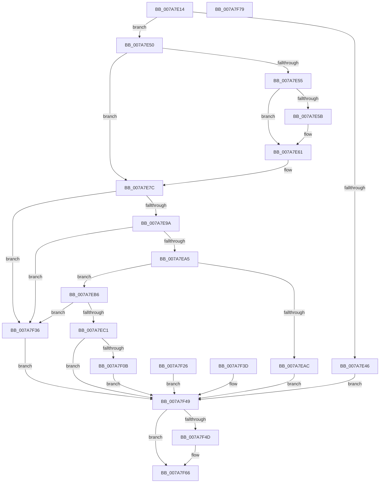

# SmcProcessStoreCreateRequest

- RVA: `0x007A7E14`–`0x007A7F7A` (길이 `358` bytes)
- VA: `0x00000001407A7E14`
- 실행 섹션: `PAGE`
- PDB 이름 있음: `예`; PDB Function 태그: `아니요`
- unwind 정보 RVA: `0x000D1AC4`
- 디코드: `92`개 명령, `358/358` bytes 표시
- 미해석 바이트: `0` (있으면 어셈블리에 `.byte`로 보존)

> 이 문서는 커널 이미지의 기계어와 PDB 기호를 분석해 생성했습니다. 4번과 5번은 함수 원형과 자료형을 바이너리 사용 방식에서 추정한 C 해석이며 원본 소스 복구 결과는 아닙니다.

## 1. Dependencies

- 직접 호출 지점: **4**; 고유 호출 대상: **4**
- 직접 호출자로 확인된 함수: **1**
- RIP 상대 이미지 참조: **0**

### Outgoing calls
- `0x007A7E5B` → [ExRaiseDatatypeMisalignment](../89/ExRaiseDatatypeMisalignment_function_00899FD0.md) (function, `0x00899FD0`)
- `0x007A7ED1` → [SmpGetProcessPartition](../../text/4A/SmpGetProcessPartition_function_004A3CCC.md) (function, `0x004A3CCC`)
- `0x007A7F00` → [SmcStoreCreate](SmcStoreCreate_function_007ABFB4.md) (function, `0x007ABFB4`)
- `0x007A7F61` → [SmcStoreDelete](SmcStoreDelete_function_007AC214.md) (function, `0x007AC214`)

### Direct callers
- [SmSetStoreInformation](../A7/SmSetStoreInformation_function_00A781B8.md) at `0x00A782B1`

### Static image references
- 디코드된 RIP-relative 메모리 참조가 없습니다.

## 2. Other-region calls and transfers

- 다른 실행 섹션으로 향하는 call: **1**
  - `0x007A7ED1` → [SmpGetProcessPartition](../../text/4A/SmpGetProcessPartition_function_004A3CCC.md) (`PAGE` → `.text`)
- 별도 외부 분기/꼬리 이동을 확인하지 못했습니다.

## 3. Assembly (complete function range)

```asm
007A7E14  48 8B C4                        mov rax, rsp
007A7E17  48 89 58 08                     mov qword ptr [rax + 8], rbx
007A7E1B  56                              push rsi
007A7E1C  57                              push rdi
007A7E1D  41 56                           push r14
007A7E1F  48 83 EC 60                     sub rsp, 0x60
007A7E23  48 8B F9                        mov rdi, rcx
007A7E26  33 F6                           xor esi, esi
007A7E28  89 B4 24 88 00 00 00            mov dword ptr [rsp + 0x88], esi
007A7E2F  83 48 20 FF                     or dword ptr [rax + 0x20], 0xffffffff
007A7E33  45 33 F6                        xor r14d, r14d
007A7E36  0F 57 C0                        xorps xmm0, xmm0
007A7E39  0F 11 40 C0                     movups xmmword ptr [rax - 0x40], xmm0
007A7E3D  0F 11 40 D0                     movups xmmword ptr [rax - 0x30], xmm0
007A7E41  83 FA 20                        cmp edx, 0x20
007A7E44  74 0A                           je 0x1407a7e50
007A7E46  BB 06 02 00 C0                  mov ebx, 0xc0000206
007A7E4B  E9 F9 00 00 00                  jmp 0x1407a7f49
007A7E50  45 84 C0                        test r8b, r8b
007A7E53  74 27                           je 0x1407a7e7c
007A7E55  40 F6 C7 03                     test dil, 3
007A7E59  74 06                           je 0x1407a7e61
007A7E5B  E8 70 21 0F 00                  call 0x140899fd0
007A7E60  CC                              int3
007A7E61  48 B9 00 00 FF FF FF 7F 00 00   movabs rcx, 0x7fffffff0000
007A7E6B  48 3B F9                        cmp rdi, rcx
007A7E6E  48 0F 42 CF                     cmovb rcx, rdi
007A7E72  8A 01                           mov al, byte ptr [rcx]
007A7E74  88 01                           mov byte ptr [rcx], al
007A7E76  8A 41 1F                        mov al, byte ptr [rcx + 0x1f]
007A7E79  88 41 1F                        mov byte ptr [rcx + 0x1f], al
007A7E7C  0F 10 07                        movups xmm0, xmmword ptr [rdi]
007A7E7F  0F 11 44 24 38                  movups xmmword ptr [rsp + 0x38], xmm0
007A7E84  0F 10 4F 10                     movups xmm1, xmmword ptr [rdi + 0x10]
007A7E88  0F 11 4C 24 48                  movups xmmword ptr [rsp + 0x48], xmm1
007A7E8D  48 8B 44 24 38                  mov rax, qword ptr [rsp + 0x38]
007A7E92  3C 02                           cmp al, 2
007A7E94  0F 85 9C 00 00 00               jne 0x1407a7f36
007A7E9A  A9 00 FF FF FF                  test eax, 0xffffff00
007A7E9F  0F 85 91 00 00 00               jne 0x1407a7f36
007A7EA5  83 7C 24 50 02                  cmp dword ptr [rsp + 0x50], 2
007A7EAA  7C 0A                           jl 0x1407a7eb6
007A7EAC  BB 02 00 00 C0                  mov ebx, 0xc0000002
007A7EB1  E9 93 00 00 00                  jmp 0x1407a7f49
007A7EB6  48 C1 E8 20                     shr rax, 0x20
007A7EBA  A9 00 E0 FE FF                  test eax, 0xfffee000
007A7EBF  75 75                           jne 0x1407a7f36
007A7EC1  65 48 8B 04 25 88 01 00 00      mov rax, qword ptr gs:[0x188]
007A7ECA  48 8B 88 B8 00 00 00            mov rcx, qword ptr [rax + 0xb8]
007A7ED1  E8 F6 BD CF FF                  call 0x1404a3ccc
007A7ED6  4C 8D B0 F0 08 00 00            lea r14, [rax + 0x8f0]
007A7EDD  4C 89 74 24 30                  mov qword ptr [rsp + 0x30], r14
007A7EE2  48 8D 84 24 98 00 00 00         lea rax, [rsp + 0x98]
007A7EEA  48 89 44 24 20                  mov qword ptr [rsp + 0x20], rax
007A7EEF  44 8B 4C 24 4C                  mov r9d, dword ptr [rsp + 0x4c]
007A7EF4  4C 8D 44 24 3C                  lea r8, [rsp + 0x3c]
007A7EF9  8B 54 24 50                     mov edx, dword ptr [rsp + 0x50]
007A7EFD  49 8B CE                        mov rcx, r14
007A7F00  E8 AF 40 00 00                  call 0x1407abfb4
007A7F05  8B D8                           mov ebx, eax
007A7F07  85 C0                           test eax, eax
007A7F09  78 3E                           js 0x1407a7f49
007A7F0B  C7 84 24 88 00 00 00 01 00 00 00  mov dword ptr [rsp + 0x88], 1
007A7F16  33 DB                           xor ebx, ebx
007A7F18  8B 84 24 98 00 00 00            mov eax, dword ptr [rsp + 0x98]
007A7F1F  89 47 1C                        mov dword ptr [rdi + 0x1c], eax
007A7F22  33 F6                           xor esi, esi
007A7F24  EB 23                           jmp 0x1407a7f49
007A7F26  8B D8                           mov ebx, eax
007A7F28  8B B4 24 88 00 00 00            mov esi, dword ptr [rsp + 0x88]
007A7F2F  4C 8B 74 24 30                  mov r14, qword ptr [rsp + 0x30]
007A7F34  EB 13                           jmp 0x1407a7f49
007A7F36  BB 0D 00 00 C0                  mov ebx, 0xc000000d
007A7F3B  EB 0C                           jmp 0x1407a7f49
007A7F3D  8B D8                           mov ebx, eax
007A7F3F  8B B4 24 88 00 00 00            mov esi, dword ptr [rsp + 0x88]
007A7F46  44 8B F6                        mov r14d, esi
007A7F49  85 F6                           test esi, esi
007A7F4B  74 19                           je 0x1407a7f66
007A7F4D  44 8B 4C 24 50                  mov r9d, dword ptr [rsp + 0x50]
007A7F52  44 8B 84 24 98 00 00 00         mov r8d, dword ptr [rsp + 0x98]
007A7F5A  8B 54 24 4C                     mov edx, dword ptr [rsp + 0x4c]
007A7F5E  49 8B CE                        mov rcx, r14
007A7F61  E8 AE 42 00 00                  call 0x1407ac214
007A7F66  8B C3                           mov eax, ebx
007A7F68  48 8B 9C 24 80 00 00 00         mov rbx, qword ptr [rsp + 0x80]
007A7F70  48 83 C4 60                     add rsp, 0x60
007A7F74  41 5E                           pop r14
007A7F76  5F                              pop rdi
007A7F77  5E                              pop rsi
007A7F78  C3                              ret
007A7F79  CC                              int3
```

## 4. C-style interpretation (structured pseudocode)

```c
__int64 __fastcall SmcProcessStoreCreateRequest(__int64 a1, int a2, unsigned __int8 a3)
{
    __int64 result;
    __int64 v_r14;
    __int64 v_rbx;
    __int64 v_rsi;
    __int64 v_rsp;
    unsigned int v_stack_m28;
    unsigned int v_stack_m2C;
    unsigned __int64 v_stack_m30;
    unsigned __int64 v_stack_m3C;
    unsigned __int64 v_stack_m40;
    unsigned __int64 v_stack_m48;
    unsigned __int64 v_stack_m58;
    unsigned int v_stack_p10;
    unsigned __int64 v_stack_p20;
    unsigned __int64 v_stack_p8;

    *(unsigned __int64 *)(v_rsp + 8) = v_rbx;
    v_rsp = (v_rsp) - (96);
    v_rsi = 0;
    v_stack_p10 = 0;
    v_r14 = 0;
    *(unsigned __int64 *)(v_rsp - 64) = v_xmm0;
    *(unsigned __int64 *)(v_rsp - 48) = v_xmm0;
    if (a2 == 32) goto loc_007A7E50;
    goto loc_007A7F49;
loc_007A7E50:
    if (a3 == 0) goto loc_007A7E7C;
    result = v_rsp;
    if ((((unsigned __int8)(a1)) & (3)) != 0) {
        result = ExRaiseDatatypeMisalignment(a1, a2, a3, a4);
    }
    if (a1 < a1) { a1 = a1; }
    *(unsigned __int8 *)(a1) = (unsigned __int8)(*(unsigned __int8 *)(a1));
    *(unsigned __int8 *)(a1 + 31) = (unsigned __int8)(*(unsigned __int8 *)(a1 + 31));
loc_007A7E7C:
    v_stack_m40 = v_xmm0;
    v_stack_m30 = v_xmm1;
    if (((unsigned __int8)(v_stack_m40)) != 2) goto loc_007A7F36;
    if ((((unsigned int)(v_stack_m40)) & (0xFFFFFF00ULL)) != 0) goto loc_007A7F36;
    if (v_stack_m28 < 2) goto loc_007A7EB6;
    goto loc_007A7F49;
loc_007A7EB6:
    result = (v_stack_m40) >> (32);
    if ((((unsigned int)(result)) & (0xFFFEE000ULL)) != 0) goto loc_007A7F36;
    result = SmpGetProcessPartition(*(unsigned __int64 *)(*(unsigned __int64 *)(gs_base + (0 + 392)) + 184), a2, a3, a4);
    v_stack_m48 = result + 2288;
    v_stack_m58 = v_stack_p20;
    result = SmcStoreCreate(result + 2288, (unsigned int)(v_stack_m28), v_stack_m3C, (unsigned int)(v_stack_m2C));
    if (sign_flag) goto loc_007A7F49;
    v_stack_p10 = 1;
    v_rbx = 0;
    *(unsigned int *)(a1 + 28) = (unsigned int)((unsigned int)(v_stack_p20));
    v_rsi = 0;
    goto loc_007A7F49;
loc_007A7F36:
    goto loc_007A7F49;
loc_007A7F49:
    result = (unsigned int)(v_stack_p20);
    if (0 != 0) {
        a4 = v_stack_m28;
        a3 = v_stack_p20;
        a2 = v_stack_m2C;
        a1 = result + 2288;
        result = SmcStoreDelete(a1, a2, a3, a4);
    }
    v_rsp = (v_rsp) + (96);
    return (unsigned int)((unsigned int)((unsigned int)(0xC000000DULL)));
}
```

## 5. (Beta) C Style

```c
int64_t SmcProcessStoreCreateRequest(int64_t Arg1, int32_t Arg2, uint8_t Arg3)
{
    int64_t result;
    int64_t local_r14;
    int64_t local_rbx;
    int64_t local_rsi;
    int64_t local_rsp;
    uint32_t v_stack_m28;
    uint32_t v_stack_m2C;
    uint64_t v_stack_m30;
    uint64_t v_stack_m3C;
    uint64_t v_stack_m40;
    uint64_t v_stack_m48;
    uint64_t v_stack_m58;
    uint32_t v_stack_p10;
    uint64_t v_stack_p20;
    uint64_t v_stack_p8;

    *(uint64_t *)(local_rsp + 0x8) = local_rbx;
    local_rsp = (local_rsp) - (96);
    local_rsi = 0;
    v_stack_p10 = 0;
    local_r14 = 0;
    *(uint64_t *)(local_rsp - 0x40) = v_xmm0;
    *(uint64_t *)(local_rsp - 0x30) = v_xmm0;
    if (Arg2 == 32) goto loc_007A7E50;
    goto loc_007A7F49;
loc_007A7E50:
    if (Arg3 == 0) goto loc_007A7E7C;
    result = local_rsp;
    if ((((uint8_t)(Arg1)) & (3)) != 0) {
        result = ExRaiseDatatypeMisalignment(Arg1, Arg2, Arg3, a4);
    }
    if (Arg1 < Arg1) { Arg1 = Arg1; }
    *(uint8_t *)(Arg1) = (uint8_t)(*(uint8_t *)(Arg1));
    *(uint8_t *)(Arg1 + 0x1F) = (uint8_t)(*(uint8_t *)(Arg1 + 0x1F));
loc_007A7E7C:
    v_stack_m40 = v_xmm0;
    v_stack_m30 = v_xmm1;
    if (((uint8_t)(v_stack_m40)) != 2) goto loc_007A7F36;
    if ((((uint32_t)(v_stack_m40)) & (0xFFFFFF00ULL)) != 0) goto loc_007A7F36;
    if (v_stack_m28 < 2) goto loc_007A7EB6;
    goto loc_007A7F49;
loc_007A7EB6:
    result = (v_stack_m40) >> (32);
    if ((((uint32_t)(result)) & (0xFFFEE000ULL)) != 0) goto loc_007A7F36;
    result = SmpGetProcessPartition(*(uint64_t *)(*(uint64_t *)(gs_base + (0 + 0x188)) + 0xB8), Arg2, Arg3, a4);
    v_stack_m48 = result + 2288;
    v_stack_m58 = v_stack_p20;
    result = SmcStoreCreate(result + 2288, (uint32_t)(v_stack_m28), v_stack_m3C, (uint32_t)(v_stack_m2C));
    if (sign_flag) goto loc_007A7F49;
    v_stack_p10 = 1;
    local_rbx = 0;
    *(uint32_t *)(Arg1 + 0x1C) = (uint32_t)((uint32_t)(v_stack_p20));
    local_rsi = 0;
    goto loc_007A7F49;
loc_007A7F36:
    goto loc_007A7F49;
loc_007A7F49:
    result = (uint32_t)(v_stack_p20);
    if (0 != 0) {
        a4 = v_stack_m28;
        Arg3 = v_stack_p20;
        Arg2 = v_stack_m2C;
        Arg1 = result + 2288;
        result = SmcStoreDelete(Arg1, Arg2, Arg3, a4);
    }
    local_rsp = (local_rsp) + (96);
    return (uint32_t)((uint32_t)((uint32_t)(0xC000000DULL)));
}
```

## 6. Execution-region graph

[열기: 2D/3D 그래프와 함수 탐색 컨트롤 패널](../../../control-panel.html?section=page&rva=0x007A7E14&view=graph)

- 2D 그래프는 위에서 아래로 흐르고, 3D 그래프는 빈 공간을 드래그해 회전합니다. Shift+드래그는 이동, 휠은 확대·축소, 함수 노드 선택은 대상 보고서 이동입니다.

### Static fallback


