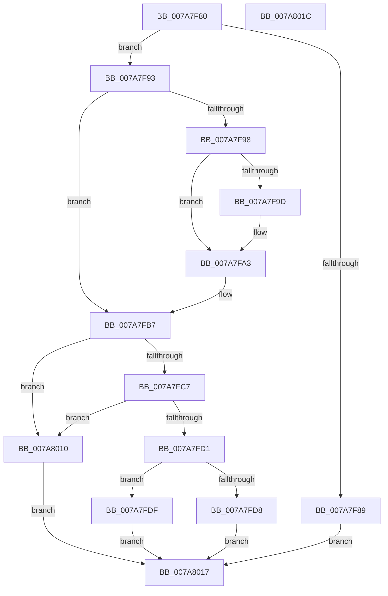

# SmcProcessStoreDeleteRequest

- RVA: `0x007A7F80`–`0x007A801D` (길이 `157` bytes)
- VA: `0x00000001407A7F80`
- 실행 섹션: `PAGE`
- PDB 이름 있음: `예`; PDB Function 태그: `아니요`
- unwind 정보 RVA: `0x000D1AA0`
- 디코드: `40`개 명령, `157/157` bytes 표시
- 미해석 바이트: `0` (있으면 어셈블리에 `.byte`로 보존)

> 이 문서는 커널 이미지의 기계어와 PDB 기호를 분석해 생성했습니다. 4번과 5번은 함수 원형과 자료형을 바이너리 사용 방식에서 추정한 C 해석이며 원본 소스 복구 결과는 아닙니다.

## 1. Dependencies

- 직접 호출 지점: **3**; 고유 호출 대상: **3**
- 직접 호출자로 확인된 함수: **1**
- RIP 상대 이미지 참조: **0**

### Outgoing calls
- `0x007A7F9D` → [ExRaiseDatatypeMisalignment](../89/ExRaiseDatatypeMisalignment_function_00899FD0.md) (function, `0x00899FD0`)
- `0x007A7FEF` → [SmpGetProcessPartition](../../text/4A/SmpGetProcessPartition_function_004A3CCC.md) (function, `0x004A3CCC`)
- `0x007A8009` → [SmcStoreDelete](SmcStoreDelete_function_007AC214.md) (function, `0x007AC214`)

### Direct callers
- [sub_00B419D6](../B4/Unknown_function_00B419D6.md) at `0x00B41A57`

### Static image references
- 디코드된 RIP-relative 메모리 참조가 없습니다.

## 2. Other-region calls and transfers

- 다른 실행 섹션으로 향하는 call: **1**
  - `0x007A7FEF` → [SmpGetProcessPartition](../../text/4A/SmpGetProcessPartition_function_004A3CCC.md) (`PAGE` → `.text`)
- 별도 외부 분기/꼬리 이동을 확인하지 못했습니다.

## 3. Assembly (complete function range)

```asm
007A7F80  48 83 EC 38                     sub rsp, 0x38
007A7F84  83 FA 10                        cmp edx, 0x10
007A7F87  74 0A                           je 0x1407a7f93
007A7F89  B8 06 02 00 C0                  mov eax, 0xc0000206
007A7F8E  E9 84 00 00 00                  jmp 0x1407a8017
007A7F93  45 84 C0                        test r8b, r8b
007A7F96  74 1F                           je 0x1407a7fb7
007A7F98  F6 C1 03                        test cl, 3
007A7F9B  74 06                           je 0x1407a7fa3
007A7F9D  E8 2E 20 0F 00                  call 0x140899fd0
007A7FA2  CC                              int3
007A7FA3  48 B8 00 00 FF FF FF 7F 00 00   movabs rax, 0x7fffffff0000
007A7FAD  48 3B C8                        cmp rcx, rax
007A7FB0  48 0F 42 C1                     cmovb rax, rcx
007A7FB4  90                              nop
007A7FB5  8A 00                           mov al, byte ptr [rax]
007A7FB7  0F 10 01                        movups xmm0, xmmword ptr [rcx]
007A7FBA  F3 0F 7F 44 24 20               movdqu xmmword ptr [rsp + 0x20], xmm0
007A7FC0  80 7C 24 20 01                  cmp byte ptr [rsp + 0x20], 1
007A7FC5  75 49                           jne 0x1407a8010
007A7FC7  F7 44 24 20 00 FF FF FF         test dword ptr [rsp + 0x20], 0xffffff00
007A7FCF  75 3F                           jne 0x1407a8010
007A7FD1  83 7C 24 28 02                  cmp dword ptr [rsp + 0x28], 2
007A7FD6  7C 07                           jl 0x1407a7fdf
007A7FD8  B8 02 00 00 C0                  mov eax, 0xc0000002
007A7FDD  EB 38                           jmp 0x1407a8017
007A7FDF  65 48 8B 0C 25 88 01 00 00      mov rcx, qword ptr gs:[0x188]
007A7FE8  48 8B 89 B8 00 00 00            mov rcx, qword ptr [rcx + 0xb8]
007A7FEF  E8 D8 BC CF FF                  call 0x1404a3ccc
007A7FF4  48 8D 88 F0 08 00 00            lea rcx, [rax + 0x8f0]
007A7FFB  44 8B 4C 24 28                  mov r9d, dword ptr [rsp + 0x28]
007A8000  44 8B 44 24 2C                  mov r8d, dword ptr [rsp + 0x2c]
007A8005  8B 54 24 24                     mov edx, dword ptr [rsp + 0x24]
007A8009  E8 06 42 00 00                  call 0x1407ac214
007A800E  EB 07                           jmp 0x1407a8017
007A8010  B8 0D 00 00 C0                  mov eax, 0xc000000d
007A8015  EB 00                           jmp 0x1407a8017
007A8017  48 83 C4 38                     add rsp, 0x38
007A801B  C3                              ret
007A801C  CC                              int3
```

## 4. C-style interpretation (structured pseudocode)

```c
__int64 __fastcall SmcProcessStoreDeleteRequest(__int64 a1, int a2, unsigned __int8 a3)
{
    __int64 result;
    __int64 v_rsp;
    unsigned int v_stack_m10;
    unsigned int v_stack_m14;
    unsigned __int64 v_stack_m18;
    unsigned int v_stack_mC;

    v_rsp = (v_rsp) - (56);
    if (a2 == 16) goto loc_007A7F93;
    goto loc_007A8017;
loc_007A7F93:
    if (a3 == 0) goto loc_007A7FB7;
    result = (unsigned int)(0xC0000206ULL);
    if ((((unsigned __int8)(a1)) & (3)) != 0) {
        result = ExRaiseDatatypeMisalignment(a1, a2, a3, a4);
    }
    if (a1 < result) { result = a1; }
loc_007A7FB7:
    v_stack_m18 = v_xmm0;
    if (v_stack_m18 != 1) goto loc_007A8010;
    if (((v_stack_m18) & (0xFFFFFF00ULL)) != 0) goto loc_007A8010;
    if (v_stack_m10 < 2) goto loc_007A7FDF;
    goto loc_007A8017;
loc_007A7FDF:
    result = SmpGetProcessPartition(*(unsigned __int64 *)(*(unsigned __int64 *)(gs_base + (0 + 392)) + 184), a2, a3, a4);
    result = SmcStoreDelete(result + 2288, (unsigned int)(v_stack_m14), (unsigned int)(v_stack_mC), (unsigned int)(v_stack_m10));
    goto loc_007A8017;
loc_007A8010:
    goto loc_007A8017;
loc_007A8017:
    v_rsp = (v_rsp) + (56);
    return (unsigned int)(0xC000000DULL);
}
```

## 5. (Beta) C Style

```c
int64_t SmcProcessStoreDeleteRequest(int64_t Arg1, int32_t Arg2, uint8_t Arg3)
{
    int64_t result;
    int64_t local_rsp;
    uint32_t v_stack_m10;
    uint32_t v_stack_m14;
    uint64_t v_stack_m18;
    uint32_t v_stack_mC;

    local_rsp = (local_rsp) - (56);
    if (Arg2 == 16) goto loc_007A7F93;
    goto loc_007A8017;
loc_007A7F93:
    if (Arg3 == 0) goto loc_007A7FB7;
    result = (uint32_t)(0xC0000206ULL);
    if ((((uint8_t)(Arg1)) & (3)) != 0) {
        result = ExRaiseDatatypeMisalignment(Arg1, Arg2, Arg3, a4);
    }
    if (Arg1 < result) { result = Arg1; }
loc_007A7FB7:
    v_stack_m18 = v_xmm0;
    if (v_stack_m18 != 1) goto loc_007A8010;
    if (((v_stack_m18) & (0xFFFFFF00ULL)) != 0) goto loc_007A8010;
    if (v_stack_m10 < 2) goto loc_007A7FDF;
    goto loc_007A8017;
loc_007A7FDF:
    result = SmpGetProcessPartition(*(uint64_t *)(*(uint64_t *)(gs_base + (0 + 0x188)) + 0xB8), Arg2, Arg3, a4);
    result = SmcStoreDelete(result + 2288, (uint32_t)(v_stack_m14), (uint32_t)(v_stack_mC), (uint32_t)(v_stack_m10));
    goto loc_007A8017;
loc_007A8010:
    goto loc_007A8017;
loc_007A8017:
    local_rsp = (local_rsp) + (56);
    return (uint32_t)(0xC000000DULL);
}
```

## 6. Execution-region graph

[열기: 2D/3D 그래프와 함수 탐색 컨트롤 패널](../../../control-panel.html?section=page&rva=0x007A7F80&view=graph)

- 2D 그래프는 위에서 아래로 흐르고, 3D 그래프는 빈 공간을 드래그해 회전합니다. Shift+드래그는 이동, 휠은 확대·축소, 함수 노드 선택은 대상 보고서 이동입니다.

### Static fallback


