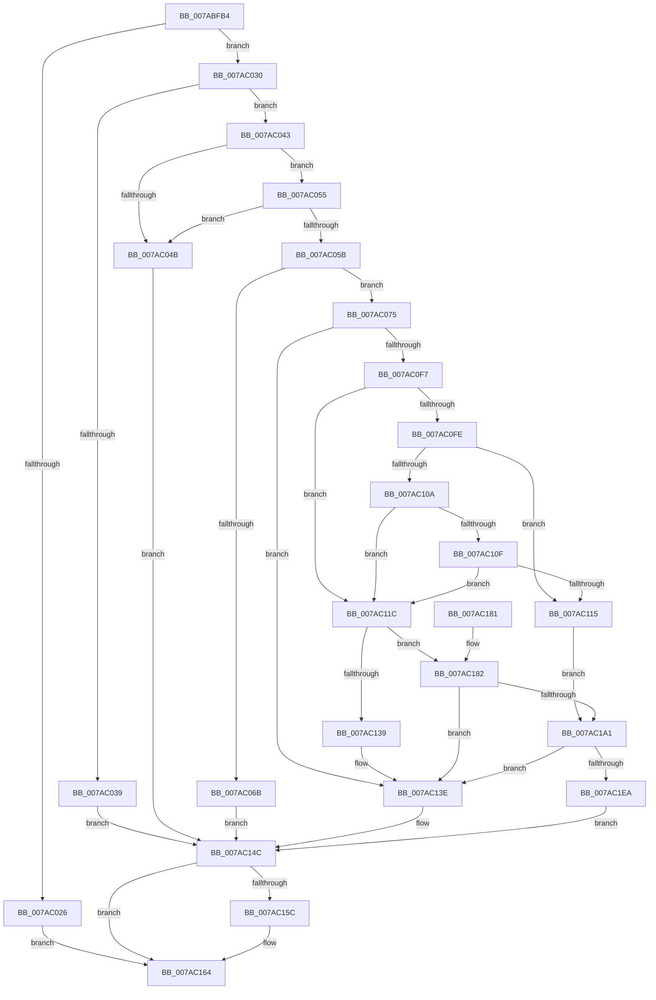

# SmcStoreCreate

- RVA: `0x007ABFB4`–`0x007AC20B` (길이 `599` bytes)
- VA: `0x00000001407ABFB4`
- 실행 섹션: `PAGE`
- PDB 이름 있음: `예`; PDB Function 태그: `아니요`
- unwind 정보 RVA: `0x000D213C`
- 디코드: `174`개 명령, `599/599` bytes 표시
- 미해석 바이트: `0` (있으면 어셈블리에 `.byte`로 보존)

> 이 문서는 커널 이미지의 기계어와 PDB 기호를 분석해 생성했습니다. 4번과 5번은 함수 원형과 자료형을 바이너리 사용 방식에서 추정한 C 해석이며 원본 소스 복구 결과는 아닙니다.

## 1. Dependencies

- 직접 호출 지점: **12**; 고유 호출 대상: **11**
- 직접 호출자로 확인된 함수: **1**
- RIP 상대 이미지 참조: **0**

### Outgoing calls
- `0x007ABFEB` → [memset](../../text/6C/memset_function_006C6C40.md) (function, `0x006C6C40`)
- `0x007AC008` → [memset](../../text/6C/memset_function_006C6C40.md) (function, `0x006C6C40`)
- `0x007AC019` → [SmcCacheReference](SmcCacheReference_function_007ABAF8.md) (function, `0x007ABAF8`)
- `0x007AC05E` → [SmcStoreSlotReserve](SmcStoreSlotReserve_function_007AC978.md) (function, `0x007AC978`)
- `0x007AC0EC` → [SmKmRegParamsLoad](SmKmRegParamsLoad_function_007A8C64.md) (function, `0x007A8C64`)
- `0x007AC12C` → [SmAllocEx](../../text/34/SmAllocEx_function_0034C794.md) (function, `0x0034C794`)
- `0x007AC147` → [SmcStoreSlotAbort](SmcStoreSlotAbort_function_007AC7DC.md) (function, `0x007AC7DC`)
- `0x007AC152` → [SmcCacheDereference](SmcCacheDereference_function_007AB8A8.md) (function, `0x007AB8A8`)
- `0x007AC15F` → [CmSiFreeMemory](../../text/47/CmSiFreeMemory_function_00475D80.md) (function, `0x00475D80`)
- `0x007AC196` → [SmKmKeyGenGenerate](SmKmKeyGenGenerate_function_007A85CC.md) (function, `0x007A85CC`)
- `0x007AC1DB` → [SmStoreCreate](SmStoreCreate_function_007A7198.md) (function, `0x007A7198`)
- `0x007AC1F9` → [SmcStoreSlotCommit](SmcStoreSlotCommit_function_007AC8A8.md) (function, `0x007AC8A8`)

### Direct callers
- [SmcProcessStoreCreateRequest](SmcProcessStoreCreateRequest_function_007A7E14.md) at `0x007A7F00`

### Static image references
- 디코드된 RIP-relative 메모리 참조가 없습니다.

## 2. Other-region calls and transfers

- 다른 실행 섹션으로 향하는 call: **4**
  - `0x007ABFEB` → [memset](../../text/6C/memset_function_006C6C40.md) (`PAGE` → `.text`)
  - `0x007AC008` → [memset](../../text/6C/memset_function_006C6C40.md) (`PAGE` → `.text`)
  - `0x007AC12C` → [SmAllocEx](../../text/34/SmAllocEx_function_0034C794.md) (`PAGE` → `.text`)
  - `0x007AC15F` → [CmSiFreeMemory](../../text/47/CmSiFreeMemory_function_00475D80.md) (`PAGE` → `.text`)
- 별도 외부 분기/꼬리 이동을 확인하지 못했습니다.

## 3. Assembly (complete function range)

```asm
007ABFB4  48 89 5C 24 10                  mov qword ptr [rsp + 0x10], rbx
007ABFB9  44 89 4C 24 20                  mov dword ptr [rsp + 0x20], r9d
007ABFBE  55                              push rbp
007ABFBF  56                              push rsi
007ABFC0  57                              push rdi
007ABFC1  41 54                           push r12
007ABFC3  41 55                           push r13
007ABFC5  41 56                           push r14
007ABFC7  41 57                           push r15
007ABFC9  48 8D 6C 24 E1                  lea rbp, [rsp - 0x1f]
007ABFCE  48 81 EC D0 00 00 00            sub rsp, 0xd0
007ABFD5  44 8B E2                        mov r12d, edx
007ABFD8  49 8B D8                        mov rbx, r8
007ABFDB  33 D2                           xor edx, edx
007ABFDD  4C 8B E9                        mov r13, rcx
007ABFE0  48 8D 4D DF                     lea rcx, [rbp - 0x21]
007ABFE4  41 8B F9                        mov edi, r9d
007ABFE7  44 8D 42 40                     lea r8d, [rdx + 0x40]
007ABFEB  E8 50 AC F1 FF                  call 0x1406c6c40
007ABFF0  48 83 64 24 20 00               and qword ptr [rsp + 0x20], 0
007ABFF6  48 8D 4D 8F                     lea rcx, [rbp - 0x71]
007ABFFA  33 D2                           xor edx, edx
007ABFFC  0F 57 C0                        xorps xmm0, xmm0
007ABFFF  0F 11 44 24 28                  movups xmmword ptr [rsp + 0x28], xmm0
007AC004  44 8D 42 48                     lea r8d, [rdx + 0x48]
007AC008  E8 33 AC F1 FF                  call 0x1406c6c40
007AC00D  45 33 F6                        xor r14d, r14d
007AC010  8B D7                           mov edx, edi
007AC012  44 21 75 5F                     and dword ptr [rbp + 0x5f], r14d
007AC016  49 8B CD                        mov rcx, r13
007AC019  E8 DA FA FF FF                  call 0x1407abaf8
007AC01E  48 8B F0                        mov rsi, rax
007AC021  48 85 C0                        test rax, rax
007AC024  75 0A                           jne 0x1407ac030
007AC026  BF 98 00 00 C0                  mov edi, 0xc0000098
007AC02B  E9 34 01 00 00                  jmp 0x1407ac164
007AC030  44 8B 43 0C                     mov r8d, dword ptr [rbx + 0xc]
007AC034  45 85 C0                        test r8d, r8d
007AC037  75 0A                           jne 0x1407ac043
007AC039  BF 0D 00 00 C0                  mov edi, 0xc000000d
007AC03E  E9 09 01 00 00                  jmp 0x1407ac14c
007AC043  8B 43 08                        mov eax, dword ptr [rbx + 8]
007AC046  39 46 18                        cmp dword ptr [rsi + 0x18], eax
007AC049  74 0A                           je 0x1407ac055
007AC04B  BF BB 00 00 C0                  mov edi, 0xc00000bb
007AC050  E9 F7 00 00 00                  jmp 0x1407ac14c
007AC055  8B 03                           mov eax, dword ptr [rbx]
007AC057  3C 01                           cmp al, 1
007AC059  75 F0                           jne 0x1407ac04b
007AC05B  48 8B CE                        mov rcx, rsi
007AC05E  E8 15 09 00 00                  call 0x1407ac978
007AC063  4C 8B F8                        mov r15, rax
007AC066  48 85 C0                        test rax, rax
007AC069  75 0A                           jne 0x1407ac075
007AC06B  BF 7F 00 00 C0                  mov edi, 0xc000007f
007AC070  E9 D7 00 00 00                  jmp 0x1407ac14c
007AC075  8B 46 08                        mov eax, dword ptr [rsi + 8]
007AC078  48 8D 4C 24 20                  lea rcx, [rsp + 0x20]
007AC07D  0F 10 03                        movups xmm0, xmmword ptr [rbx]
007AC080  8B 5E 1C                        mov ebx, dword ptr [rsi + 0x1c]
007AC083  83 E3 03                        and ebx, 3
007AC086  F3 0F 7F 45 8F                  movdqu xmmword ptr [rbp - 0x71], xmm0
007AC08B  89 45 9B                        mov dword ptr [rbp - 0x65], eax
007AC08E  8B 46 04                        mov eax, dword ptr [rsi + 4]
007AC091  0F 57 C0                        xorps xmm0, xmm0
007AC094  89 45 A7                        mov dword ptr [rbp - 0x59], eax
007AC097  8B 45 8F                        mov eax, dword ptr [rbp - 0x71]
007AC09A  25 FF 9F FF FF                  and eax, 0xffff9fff
007AC09F  C1 E3 0D                        shl ebx, 0xd
007AC0A2  0B D8                           or ebx, eax
007AC0A4  8B 46 20                        mov eax, dword ptr [rsi + 0x20]
007AC0A7  44 21 75 1B                     and dword ptr [rbp + 0x1b], r14d
007AC0AB  89 45 9F                        mov dword ptr [rbp - 0x61], eax
007AC0AE  66 0F 7F 45 FF                  movdqa xmmword ptr [rbp - 1], xmm0
007AC0B3  48 8B 46 28                     mov rax, qword ptr [rsi + 0x28]
007AC0B7  48 89 45 DF                     mov qword ptr [rbp - 0x21], rax
007AC0BB  48 8B 46 30                     mov rax, qword ptr [rsi + 0x30]
007AC0BF  48 89 45 E7                     mov qword ptr [rbp - 0x19], rax
007AC0C3  48 8B 46 38                     mov rax, qword ptr [rsi + 0x38]
007AC0C7  48 89 45 EF                     mov qword ptr [rbp - 0x11], rax
007AC0CB  48 8B 46 40                     mov rax, qword ptr [rsi + 0x40]
007AC0CF  48 89 45 F7                     mov qword ptr [rbp - 9], rax
007AC0D3  48 8B 46 58                     mov rax, qword ptr [rsi + 0x58]
007AC0D7  48 89 45 0F                     mov qword ptr [rbp + 0xf], rax
007AC0DB  8B 46 60                        mov eax, dword ptr [rsi + 0x60]
007AC0DE  89 45 17                        mov dword ptr [rbp + 0x17], eax
007AC0E1  48 8D 45 DF                     lea rax, [rbp - 0x21]
007AC0E5  48 89 45 BF                     mov qword ptr [rbp - 0x41], rax
007AC0E9  89 5D 8F                        mov dword ptr [rbp - 0x71], ebx
007AC0EC  E8 73 CB FF FF                  call 0x1407a8c64
007AC0F1  8B F8                           mov edi, eax
007AC0F3  85 C0                           test eax, eax
007AC0F5  78 47                           js 0x1407ac13e
007AC0F7  8B 46 1C                        mov eax, dword ptr [rsi + 0x1c]
007AC0FA  A8 01                           test al, 1
007AC0FC  75 1E                           jne 0x1407ac11c
007AC0FE  8B 44 24 24                     mov eax, dword ptr [rsp + 0x24]
007AC102  83 E0 03                        and eax, 3
007AC105  83 F8 02                        cmp eax, 2
007AC108  74 0B                           je 0x1407ac115
007AC10A  83 F8 01                        cmp eax, 1
007AC10D  75 0D                           jne 0x1407ac11c
007AC10F  0F BA E3 0B                     bt ebx, 0xb
007AC113  73 07                           jae 0x1407ac11c
007AC115  33 DB                           xor ebx, ebx
007AC117  E9 85 00 00 00                  jmp 0x1407ac1a1
007AC11C  48 8B 5C 24 20                  mov rbx, qword ptr [rsp + 0x20]
007AC121  41 83 C8 FF                     or r8d, 0xffffffff
007AC125  8B CB                           mov ecx, ebx
007AC127  BA 73 6D 45 4B                  mov edx, 0x4b456d73
007AC12C  E8 63 06 BA FF                  call 0x14034c794
007AC131  4C 8B F0                        mov r14, rax
007AC134  48 85 C0                        test rax, rax
007AC137  75 49                           jne 0x1407ac182
007AC139  BF 9A 00 00 C0                  mov edi, 0xc000009a
007AC13E  45 33 C0                        xor r8d, r8d
007AC141  49 8B D7                        mov rdx, r15
007AC144  48 8B CE                        mov rcx, rsi
007AC147  E8 90 06 00 00                  call 0x1407ac7dc
007AC14C  8B 55 77                        mov edx, dword ptr [rbp + 0x77]
007AC14F  49 8B CD                        mov rcx, r13
007AC152  E8 51 F7 FF FF                  call 0x1407ab8a8
007AC157  4D 85 F6                        test r14, r14
007AC15A  74 08                           je 0x1407ac164
007AC15C  49 8B CE                        mov rcx, r14
007AC15F  E8 1C 9C CC FF                  call 0x140475d80
007AC164  48 8B 9C 24 18 01 00 00         mov rbx, qword ptr [rsp + 0x118]
007AC16C  8B C7                           mov eax, edi
007AC16E  48 81 C4 D0 00 00 00            add rsp, 0xd0
007AC175  41 5F                           pop r15
007AC177  41 5E                           pop r14
007AC179  41 5D                           pop r13
007AC17B  41 5C                           pop r12
007AC17D  5F                              pop rdi
007AC17E  5E                              pop rsi
007AC17F  5D                              pop rbp
007AC180  C3                              ret
007AC181  CC                              int3
007AC182  48 8D 96 28 02 00 00            lea rdx, [rsi + 0x228]
007AC189  44 8B CB                        mov r9d, ebx
007AC18C  49 8D 8D 00 02 00 00            lea rcx, [r13 + 0x200]
007AC193  4C 8B C0                        mov r8, rax
007AC196  E8 31 C4 FF FF                  call 0x1407a85cc
007AC19B  8B F8                           mov edi, eax
007AC19D  85 C0                           test eax, eax
007AC19F  78 9D                           js 0x1407ac13e
007AC1A1  49 8B 57 08                     mov rdx, qword ptr [r15 + 8]
007AC1A5  4C 8D 4D 5F                     lea r9, [rbp + 0x5f]
007AC1A9  8B 46 08                        mov eax, dword ptr [rsi + 8]
007AC1AC  4C 8D 45 8F                     lea r8, [rbp - 0x71]
007AC1B0  89 44 24 28                     mov dword ptr [rsp + 0x28], eax
007AC1B4  49 8D 8D 10 F7 FF FF            lea rcx, [r13 - 0x8f0]
007AC1BB  48 8D 44 24 28                  lea rax, [rsp + 0x28]
007AC1C0  48 89 54 24 30                  mov qword ptr [rsp + 0x30], rdx
007AC1C5  48 89 45 CF                     mov qword ptr [rbp - 0x31], rax
007AC1C9  41 8B D4                        mov edx, r12d
007AC1CC  48 8D 46 68                     lea rax, [rsi + 0x68]
007AC1D0  4C 89 75 AF                     mov qword ptr [rbp - 0x51], r14
007AC1D4  48 89 45 C7                     mov qword ptr [rbp - 0x39], rax
007AC1D8  89 5D B7                        mov dword ptr [rbp - 0x49], ebx
007AC1DB  E8 B8 AF FF FF                  call 0x1407a7198
007AC1E0  8B F8                           mov edi, eax
007AC1E2  85 C0                           test eax, eax
007AC1E4  0F 88 54 FF FF FF               js 0x1407ac13e
007AC1EA  8B 5D 5F                        mov ebx, dword ptr [rbp + 0x5f]
007AC1ED  45 8B CC                        mov r9d, r12d
007AC1F0  44 8B C3                        mov r8d, ebx
007AC1F3  49 8B D7                        mov rdx, r15
007AC1F6  48 8B CE                        mov rcx, rsi
007AC1F9  E8 AA 06 00 00                  call 0x1407ac8a8
007AC1FE  48 8B 45 7F                     mov rax, qword ptr [rbp + 0x7f]
007AC202  33 FF                           xor edi, edi
007AC204  89 18                           mov dword ptr [rax], ebx
007AC206  E9 41 FF FF FF                  jmp 0x1407ac14c
```

## 4. C-style interpretation (structured pseudocode)

```c
__int64 __fastcall SmcStoreCreate(__int64 a1, int a2, __int64 a3, int a4, __int64 a5)
{
    __int64 result;
    __int64 v_r14;
    __int64 v_rbx;
    __int64 v_rdi;
    __int64 v_rsp;
    unsigned int v_stack_m3C;
    unsigned int v_stack_m40;
    unsigned __int64 v_stack_m48;
    unsigned __int64 v_stack_m57;
    unsigned __int64 v_stack_m58;
    unsigned __int64 v_stack_m60;
    unsigned __int64 v_stack_m68;
    unsigned __int64 v_stack_m70;
    unsigned __int64 v_stack_m78;
    unsigned __int64 v_stack_m88;
    unsigned __int64 v_stack_m90;
    unsigned __int64 v_stack_m98;
    unsigned int v_stack_mA0;
    unsigned __int64 v_stack_mA8;
    unsigned int v_stack_mB0;
    unsigned int v_stack_mB8;
    unsigned int v_stack_mBC;
    unsigned __int64 v_stack_mC8;
    unsigned __int64 v_stack_mE0;
    unsigned int v_stack_mE4;
    unsigned __int64 v_stack_mE8;
    unsigned __int64 v_stack_p10;
    unsigned int v_stack_p20;
    unsigned int v_stack_p28;
    unsigned __int64 v_stack_p30;
    unsigned int v_stack_p8;

    v_stack_p10 = v_rbx;
    v_stack_p20 = a4;
    v_rsp = (v_rsp) - (208);
    a2 = 0;
    result = memset(v_stack_m78, a2, a2 + 64, a4);
    a2 = 0;
    v_stack_mE0 = v_xmm0;
    result = memset(v_stack_mC8, a2, a2 + 72, a4);
    v_r14 = 0;
    result = SmcCacheReference(a1, (unsigned int)((unsigned int)((unsigned int)(a4))), a2 + 72, a4);
    if (result != 0) goto loc_007AC030;
    goto loc_007AC164;
loc_007AC030:
    if ((unsigned int)((unsigned int)(*(unsigned int *)(a3 + 12))) != 0) goto loc_007AC043;
    goto loc_007AC14C;
loc_007AC043:
    if ((*(unsigned int *)(result + 24)) == ((unsigned int)((unsigned int)(*(unsigned int *)(a3 + 8))))) goto loc_007AC055;
loc_007AC04B:
    goto loc_007AC14C;
loc_007AC055:
    if (((unsigned __int8)((unsigned int)(*(unsigned int *)(a3)))) != 1) goto loc_007AC04B;
    result = SmcStoreSlotReserve(result, (unsigned int)((unsigned int)((unsigned int)(a4))), (unsigned int)(*(unsigned int *)(a3 + 12)), a4);
    if (result != 0) goto loc_007AC075;
    goto loc_007AC14C;
loc_007AC075:
    v_rbx = (unsigned int)(((unsigned int)(*(unsigned int *)(result + 28))) & (3));
    v_stack_mC8 = v_xmm0;
    v_stack_mBC = (unsigned int)((unsigned int)(*(unsigned int *)(result + 8)));
    v_stack_mB0 = (unsigned int)((unsigned int)(*(unsigned int *)(result + 4)));
    result = (unsigned int)(((unsigned int)(v_stack_mC8)) & (0xFFFF9FFFULL));
    v_rbx = (unsigned int)((v_rbx) << (13));
    v_rbx = (unsigned int)((v_rbx) | ((unsigned int)(result)));
    v_stack_mB8 = (unsigned int)((unsigned int)(*(unsigned int *)(result + 32)));
    v_stack_m58 = v_xmm0;
    v_stack_m78 = *(unsigned __int64 *)(result + 40);
    v_stack_m70 = *(unsigned __int64 *)(result + 48);
    v_stack_m68 = *(unsigned __int64 *)(result + 56);
    v_stack_m60 = *(unsigned __int64 *)(result + 64);
    v_stack_m48 = *(unsigned __int64 *)(result + 88);
    v_stack_m40 = (unsigned int)((unsigned int)(*(unsigned int *)(result + 96)));
    v_stack_m98 = v_stack_m78;
    v_stack_mC8 = (unsigned int)(v_rbx);
    result = SmKmRegParamsLoad(v_stack_mE8, (unsigned int)((unsigned int)((unsigned int)(a4))), (unsigned int)(*(unsigned int *)(a3 + 12)), a4);
    if (sign_flag) goto loc_007AC13E;
    if ((((unsigned __int8)((unsigned int)(*(unsigned int *)(result + 28)))) & (1)) != 0) goto loc_007AC11C;
    result = (unsigned int)(((unsigned int)(v_stack_mE4)) & (3));
    if (((unsigned int)(result)) == 2) goto loc_007AC115;
    if (((unsigned int)(result)) != 1) goto loc_007AC11C;
    if (((unsigned int)(result)) >= 1) goto loc_007AC11C;
loc_007AC115:
    v_rbx = 0;
    goto loc_007AC1A1;
loc_007AC11C:
    a3 = (unsigned int)(((unsigned int)(*(unsigned int *)(a3 + 12))) | (0xFFFFFFFFULL));
    result = SmAllocEx((unsigned int)((unsigned int)(v_stack_mE8)), (unsigned int)(0x4B456D73ULL), a3, a4);
    if (result != 0) goto loc_007AC182;
loc_007AC13E:
    a3 = 0;
    result = SmcStoreSlotAbort(result, result, a3, a4);
loc_007AC14C:
    result = SmcCacheDereference(a1, (unsigned int)(v_stack_p20), a3, a4);
    if (result != 0) {
        a1 = result;
        result = CmSiFreeMemory(a1, (unsigned int)(v_stack_p20), a3, a4);
    }
    v_rsp = (v_rsp) + (208);
    return (unsigned int)((unsigned int)((unsigned int)(0xC000009AULL)));
loc_007AC182:
    result = SmKmKeyGenGenerate(a1 + 512, result + 552, (unsigned int)((unsigned int)((unsigned int)(0xC000009AULL))), (unsigned int)((unsigned int)(v_stack_p10)));
    if (sign_flag) goto loc_007AC13E;
loc_007AC1A1:
    v_stack_p28 = (unsigned int)((unsigned int)(*(unsigned int *)(result + 8)));
    v_stack_p30 = *(unsigned __int64 *)(result + 8);
    v_stack_m88 = v_stack_p28;
    v_stack_mA8 = result;
    v_stack_m90 = result + 104;
    v_stack_mA0 = (unsigned int)(v_stack_p10);
    result = SmStoreCreate(a1 - 2288, (unsigned int)((unsigned int)((unsigned int)(a2))), v_stack_mC8, v_stack_p8);
    if (sign_flag) goto loc_007AC13E;
    result = SmcStoreSlotCommit(result, result, (unsigned int)((unsigned int)((unsigned int)(v_stack_p8))), (unsigned int)((unsigned int)((unsigned int)(a2))));
    v_rdi = 0;
    *(unsigned int *)(a5) = (unsigned int)((unsigned int)(v_stack_p8));
    goto loc_007AC14C;
}
```

## 5. (Beta) C Style

```c
int64_t SmcStoreCreate(void *Arg1, int32_t Arg2, void *Arg3, int32_t Arg4, void *Arg5)
{
    uint8_t *arg1 = (uint8_t *)Arg1;
    uint8_t *arg3 = (uint8_t *)Arg3;
    uint8_t *arg5 = (uint8_t *)Arg5;

    int64_t result;
    int64_t local_r14;
    int64_t local_rbx;
    int64_t local_rdi;
    int64_t local_rsp;
    uint32_t v_stack_m3C;
    uint32_t v_stack_m40;
    uint64_t v_stack_m48;
    uint64_t v_stack_m57;
    uint64_t v_stack_m58;
    uint64_t v_stack_m60;
    uint64_t v_stack_m68;
    uint64_t v_stack_m70;
    uint64_t v_stack_m78;
    uint64_t v_stack_m88;
    uint64_t v_stack_m90;
    uint64_t v_stack_m98;
    uint32_t v_stack_mA0;
    uint64_t v_stack_mA8;
    uint32_t v_stack_mB0;
    uint32_t v_stack_mB8;
    uint32_t v_stack_mBC;
    uint64_t v_stack_mC8;
    uint64_t v_stack_mE0;
    uint32_t v_stack_mE4;
    uint64_t v_stack_mE8;
    uint64_t v_stack_p10;
    uint32_t v_stack_p20;
    uint32_t v_stack_p28;
    uint64_t v_stack_p30;
    uint32_t v_stack_p8;

    v_stack_p10 = local_rbx;
    v_stack_p20 = Arg4;
    local_rsp = (local_rsp) - (208);
    Arg2 = 0;
    result = memset(v_stack_m78, Arg2, Arg2 + 64, Arg4);
    Arg2 = 0;
    v_stack_mE0 = v_xmm0;
    result = memset(v_stack_mC8, Arg2, Arg2 + 72, Arg4);
    local_r14 = 0;
    result = SmcCacheReference(Arg1, (uint32_t)((uint32_t)((uint32_t)(Arg4))), Arg2 + 72, Arg4);
    if (result != 0) goto loc_007AC030;
    goto loc_007AC164;
loc_007AC030:
    if ((uint32_t)((uint32_t)(*(uint32_t *)(arg3 + 0xC))) != 0) goto loc_007AC043;
    goto loc_007AC14C;
loc_007AC043:
    if ((*(uint32_t *)(result + 0x18)) == ((uint32_t)((uint32_t)(*(uint32_t *)(arg3 + 0x8))))) goto loc_007AC055;
loc_007AC04B:
    goto loc_007AC14C;
loc_007AC055:
    if (((uint8_t)((uint32_t)(*(uint32_t *)(arg3)))) != 1) goto loc_007AC04B;
    result = SmcStoreSlotReserve(result, (uint32_t)((uint32_t)((uint32_t)(Arg4))), (uint32_t)(*(uint32_t *)(arg3 + 0xC)), Arg4);
    if (result != 0) goto loc_007AC075;
    goto loc_007AC14C;
loc_007AC075:
    local_rbx = (uint32_t)(((uint32_t)(*(uint32_t *)(result + 0x1C))) & (3));
    v_stack_mC8 = v_xmm0;
    v_stack_mBC = (uint32_t)((uint32_t)(*(uint32_t *)(result + 0x8)));
    v_stack_mB0 = (uint32_t)((uint32_t)(*(uint32_t *)(result + 0x4)));
    result = (uint32_t)(((uint32_t)(v_stack_mC8)) & (0xFFFF9FFFULL));
    local_rbx = (uint32_t)((local_rbx) << (13));
    local_rbx = (uint32_t)((local_rbx) | ((uint32_t)(result)));
    v_stack_mB8 = (uint32_t)((uint32_t)(*(uint32_t *)(result + 0x20)));
    v_stack_m58 = v_xmm0;
    v_stack_m78 = *(uint64_t *)(result + 0x28);
    v_stack_m70 = *(uint64_t *)(result + 0x30);
    v_stack_m68 = *(uint64_t *)(result + 0x38);
    v_stack_m60 = *(uint64_t *)(result + 0x40);
    v_stack_m48 = *(uint64_t *)(result + 0x58);
    v_stack_m40 = (uint32_t)((uint32_t)(*(uint32_t *)(result + 0x60)));
    v_stack_m98 = v_stack_m78;
    v_stack_mC8 = (uint32_t)(local_rbx);
    result = SmKmRegParamsLoad(v_stack_mE8, (uint32_t)((uint32_t)((uint32_t)(Arg4))), (uint32_t)(*(uint32_t *)(arg3 + 0xC)), Arg4);
    if (sign_flag) goto loc_007AC13E;
    if ((((uint8_t)((uint32_t)(*(uint32_t *)(result + 0x1C)))) & (1)) != 0) goto loc_007AC11C;
    result = (uint32_t)(((uint32_t)(v_stack_mE4)) & (3));
    if (((uint32_t)(result)) == 2) goto loc_007AC115;
    if (((uint32_t)(result)) != 1) goto loc_007AC11C;
    if (((uint32_t)(result)) >= 1) goto loc_007AC11C;
loc_007AC115:
    local_rbx = 0;
    goto loc_007AC1A1;
loc_007AC11C:
    Arg3 = (uint32_t)(((uint32_t)(*(uint32_t *)(arg3 + 0xC))) | (0xFFFFFFFFULL));
    result = SmAllocEx((uint32_t)((uint32_t)(v_stack_mE8)), (uint32_t)(0x4B456D73ULL), Arg3, Arg4);
    if (result != 0) goto loc_007AC182;
loc_007AC13E:
    Arg3 = 0;
    result = SmcStoreSlotAbort(result, result, Arg3, Arg4);
loc_007AC14C:
    result = SmcCacheDereference(Arg1, (uint32_t)(v_stack_p20), Arg3, Arg4);
    if (result != 0) {
        Arg1 = result;
        result = CmSiFreeMemory(Arg1, (uint32_t)(v_stack_p20), Arg3, Arg4);
    }
    local_rsp = (local_rsp) + (208);
    return (uint32_t)((uint32_t)((uint32_t)(0xC000009AULL)));
loc_007AC182:
    result = SmKmKeyGenGenerate(Arg1 + 512, result + 552, (uint32_t)((uint32_t)((uint32_t)(0xC000009AULL))), (uint32_t)((uint32_t)(v_stack_p10)));
    if (sign_flag) goto loc_007AC13E;
loc_007AC1A1:
    v_stack_p28 = (uint32_t)((uint32_t)(*(uint32_t *)(result + 0x8)));
    v_stack_p30 = *(uint64_t *)(result + 0x8);
    v_stack_m88 = v_stack_p28;
    v_stack_mA8 = result;
    v_stack_m90 = result + 104;
    v_stack_mA0 = (uint32_t)(v_stack_p10);
    result = SmStoreCreate(Arg1 - 2288, (uint32_t)((uint32_t)((uint32_t)(Arg2))), v_stack_mC8, v_stack_p8);
    if (sign_flag) goto loc_007AC13E;
    result = SmcStoreSlotCommit(result, result, (uint32_t)((uint32_t)((uint32_t)(v_stack_p8))), (uint32_t)((uint32_t)((uint32_t)(Arg2))));
    local_rdi = 0;
    *(uint32_t *)(arg5) = (uint32_t)((uint32_t)(v_stack_p8));
    goto loc_007AC14C;
}
```

### 관측된 메모리 오프셋

구조체 형식이 확인되지 않은 접근은 인자 기준의 오프셋으로만 기록했습니다.

| 기준 인자 | 오프셋 표현 | 폭 (bit) | 접근 |
|---|---:|---:|---|
| `Arg1` | `- 0x8F0` | `64` | `R` |
| `Arg1` | `+ 0x200` | `64` | `R` |
| `Arg3` | `+ 0x0` | `32` | `R` |
| `Arg3` | `+ 0x0` | `128` | `R` |
| `Arg3` | `+ 0x8` | `32` | `R` |
| `Arg3` | `+ 0xC` | `32` | `R` |
| `Arg5` | `+ 0x0` | `32` | `W` |

## 6. Execution-region graph

[열기: 2D/3D 그래프와 함수 탐색 컨트롤 패널](../../../control-panel.html?section=page&rva=0x007ABFB4&view=graph)

- 2D 그래프는 위에서 아래로 흐르고, 3D 그래프는 빈 공간을 드래그해 회전합니다. Shift+드래그는 이동, 휠은 확대·축소, 함수 노드 선택은 대상 보고서 이동입니다.

### Static fallback


