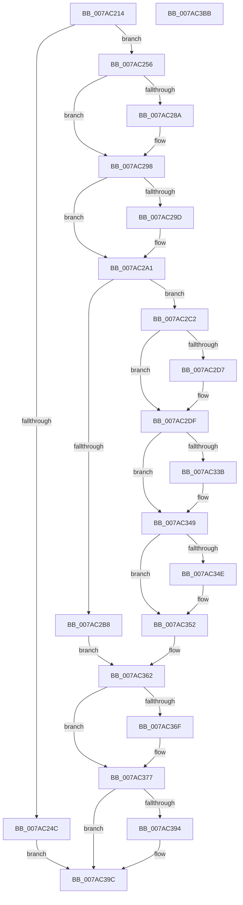

# SmcStoreDelete

- RVA: `0x007AC214`–`0x007AC3BC` (길이 `424` bytes)
- VA: `0x00000001407AC214`
- 실행 섹션: `PAGE`
- PDB 이름 있음: `예`; PDB Function 태그: `아니요`
- unwind 정보 RVA: `0x000BCDB8`
- 디코드: `118`개 명령, `424/424` bytes 표시
- 미해석 바이트: `0` (있으면 어셈블리에 `.byte`로 보존)

> 이 문서는 커널 이미지의 기계어와 PDB 기호를 분석해 생성했습니다. 4번과 5번은 함수 원형과 자료형을 바이너리 사용 방식에서 추정한 C 해석이며 원본 소스 복구 결과는 아닙니다.

## 1. Dependencies

- 직접 호출 지점: **16**; 고유 호출 대상: **11**
- 직접 호출자로 확인된 함수: **2**
- RIP 상대 이미지 참조: **0**

### Outgoing calls
- `0x007AC23F` → [SmcCacheReference](SmcCacheReference_function_007ABAF8.md) (function, `0x007ABAF8`)
- `0x007AC27A` → [KeAbPreAcquire](../../text/21/KeAbPreAcquire_function_00210230.md) (function, `0x00210230`)
- `0x007AC293` → [ExfAcquirePushLockExclusiveEx](../../text/20/ExfAcquirePushLockExclusiveEx_function_0020FC90.md) (function, `0x0020FC90`)
- `0x007AC2AB` → [SmcStoreEntryFind](SmcStoreEntryFind_function_007AC3C4.md) (function, `0x007AC3C4`)
- `0x007AC2DA` → [ExfTryToWakePushLock](../../text/26/ExfTryToWakePushLock_function_00265DD0.md) (function, `0x00265DD0`)
- `0x007AC2E2` → [KeAbPostRelease](../../text/2E/KeAbPostRelease_function_002E1600.md) (function, `0x002E1600`)
- `0x007AC2E7` → [KeLeaveCriticalRegion](../../text/25/KeLeaveCriticalRegion_function_0025D8B0.md) (function, `0x0025D8B0`)
- `0x007AC2F0` → [ExWaitForRundownProtectionRelease](../../text/2A/ExWaitForRundownProtectionRelease_function_002A4CB0.md) (function, `0x002A4CB0`)
- `0x007AC30D` → [SmStoreDelete](SmStoreDelete_function_007A72A0.md) (function, `0x007A72A0`)
- `0x007AC32B` → [KeAbPreAcquire](../../text/21/KeAbPreAcquire_function_00210230.md) (function, `0x00210230`)
- `0x007AC344` → [ExfAcquirePushLockExclusiveEx](../../text/20/ExfAcquirePushLockExclusiveEx_function_0020FC90.md) (function, `0x0020FC90`)
- `0x007AC372` → [ExfTryToWakePushLock](../../text/26/ExfTryToWakePushLock_function_00265DD0.md) (function, `0x00265DD0`)
- `0x007AC37A` → [KeAbPostRelease](../../text/2E/KeAbPostRelease_function_002E1600.md) (function, `0x002E1600`)
- `0x007AC37F` → [KeLeaveCriticalRegion](../../text/25/KeLeaveCriticalRegion_function_0025D8B0.md) (function, `0x0025D8B0`)
- `0x007AC38A` → [SmcCacheDereference](SmcCacheDereference_function_007AB8A8.md) (function, `0x007AB8A8`)
- `0x007AC397` → [CmSiFreeMemory](../../text/47/CmSiFreeMemory_function_00475D80.md) (function, `0x00475D80`)

### Direct callers
- [SmcProcessStoreCreateRequest](SmcProcessStoreCreateRequest_function_007A7E14.md) at `0x007A7F61`
- [SmcProcessStoreDeleteRequest](SmcProcessStoreDeleteRequest_function_007A7F80.md) at `0x007A8009`

### Static image references
- 디코드된 RIP-relative 메모리 참조가 없습니다.

## 2. Other-region calls and transfers

- 다른 실행 섹션으로 향하는 call: **12**
  - `0x007AC27A` → [KeAbPreAcquire](../../text/21/KeAbPreAcquire_function_00210230.md) (`PAGE` → `.text`)
  - `0x007AC293` → [ExfAcquirePushLockExclusiveEx](../../text/20/ExfAcquirePushLockExclusiveEx_function_0020FC90.md) (`PAGE` → `.text`)
  - `0x007AC2DA` → [ExfTryToWakePushLock](../../text/26/ExfTryToWakePushLock_function_00265DD0.md) (`PAGE` → `.text`)
  - `0x007AC2E2` → [KeAbPostRelease](../../text/2E/KeAbPostRelease_function_002E1600.md) (`PAGE` → `.text`)
  - `0x007AC2E7` → [KeLeaveCriticalRegion](../../text/25/KeLeaveCriticalRegion_function_0025D8B0.md) (`PAGE` → `.text`)
  - `0x007AC2F0` → [ExWaitForRundownProtectionRelease](../../text/2A/ExWaitForRundownProtectionRelease_function_002A4CB0.md) (`PAGE` → `.text`)
  - `0x007AC32B` → [KeAbPreAcquire](../../text/21/KeAbPreAcquire_function_00210230.md) (`PAGE` → `.text`)
  - `0x007AC344` → [ExfAcquirePushLockExclusiveEx](../../text/20/ExfAcquirePushLockExclusiveEx_function_0020FC90.md) (`PAGE` → `.text`)
  - `0x007AC372` → [ExfTryToWakePushLock](../../text/26/ExfTryToWakePushLock_function_00265DD0.md) (`PAGE` → `.text`)
  - `0x007AC37A` → [KeAbPostRelease](../../text/2E/KeAbPostRelease_function_002E1600.md) (`PAGE` → `.text`)
  - `0x007AC37F` → [KeLeaveCriticalRegion](../../text/25/KeLeaveCriticalRegion_function_0025D8B0.md) (`PAGE` → `.text`)
  - `0x007AC397` → [CmSiFreeMemory](../../text/47/CmSiFreeMemory_function_00475D80.md) (`PAGE` → `.text`)
- 별도 외부 분기/꼬리 이동을 확인하지 못했습니다.

## 3. Assembly (complete function range)

```asm
007AC214  48 8B C4                        mov rax, rsp
007AC217  48 89 58 08                     mov qword ptr [rax + 8], rbx
007AC21B  48 89 68 10                     mov qword ptr [rax + 0x10], rbp
007AC21F  48 89 70 20                     mov qword ptr [rax + 0x20], rsi
007AC223  44 89 40 18                     mov dword ptr [rax + 0x18], r8d
007AC227  57                              push rdi
007AC228  41 54                           push r12
007AC22A  41 55                           push r13
007AC22C  41 56                           push r14
007AC22E  41 57                           push r15
007AC230  48 83 EC 20                     sub rsp, 0x20
007AC234  45 8B E9                        mov r13d, r9d
007AC237  44 8B E2                        mov r12d, edx
007AC23A  4C 8B F9                        mov r15, rcx
007AC23D  33 ED                           xor ebp, ebp
007AC23F  E8 B4 F8 FF FF                  call 0x1407abaf8
007AC244  4C 8B F0                        mov r14, rax
007AC247  48 85 C0                        test rax, rax
007AC24A  75 0A                           jne 0x1407ac256
007AC24C  BF 98 00 00 C0                  mov edi, 0xc0000098
007AC251  E9 46 01 00 00                  jmp 0x1407ac39c
007AC256  48 8D B0 A0 00 00 00            lea rsi, [rax + 0xa0]
007AC25D  48 83 CB FF                     or rbx, 0xffffffffffffffff
007AC261  65 48 8B 04 25 88 01 00 00      mov rax, qword ptr gs:[0x188]
007AC26A  45 33 C0                        xor r8d, r8d
007AC26D  33 D2                           xor edx, edx
007AC26F  48 8B CE                        mov rcx, rsi
007AC272  66 01 98 E4 01 00 00            add word ptr [rax + 0x1e4], bx
007AC279  90                              nop
007AC27A  E8 B1 3F A6 FF                  call 0x140210230
007AC27F  F0 48 0F BA 2E 00               lock bts qword ptr [rsi], 0
007AC285  48 8B F8                        mov rdi, rax
007AC288  73 0E                           jae 0x1407ac298
007AC28A  4C 8B C6                        mov r8, rsi
007AC28D  48 8B D0                        mov rdx, rax
007AC290  48 8B CE                        mov rcx, rsi
007AC293  E8 F8 39 A6 FF                  call 0x14020fc90
007AC298  48 85 FF                        test rdi, rdi
007AC29B  74 04                           je 0x1407ac2a1
007AC29D  C6 47 0A 01                     mov byte ptr [rdi + 0xa], 1
007AC2A1  8B 54 24 60                     mov edx, dword ptr [rsp + 0x60]
007AC2A5  45 8B C5                        mov r8d, r13d
007AC2A8  49 8B CE                        mov rcx, r14
007AC2AB  E8 14 01 00 00                  call 0x1407ac3c4
007AC2B0  4C 8B F0                        mov r14, rax
007AC2B3  48 85 C0                        test rax, rax
007AC2B6  75 0A                           jne 0x1407ac2c2
007AC2B8  BF 98 00 00 C0                  mov edi, 0xc0000098
007AC2BD  E9 A0 00 00 00                  jmp 0x1407ac362
007AC2C2  83 48 04 04                     or dword ptr [rax + 4], 4
007AC2C6  83 08 FF                        or dword ptr [rax], 0xffffffff
007AC2C9  48 8B C3                        mov rax, rbx
007AC2CC  F0 48 0F C1 06                  lock xadd qword ptr [rsi], rax
007AC2D1  24 06                           and al, 6
007AC2D3  3C 02                           cmp al, 2
007AC2D5  75 08                           jne 0x1407ac2df
007AC2D7  48 8B CE                        mov rcx, rsi
007AC2DA  E8 F1 9A AB FF                  call 0x140265dd0
007AC2DF  48 8B CE                        mov rcx, rsi
007AC2E2  E8 19 53 B3 FF                  call 0x1402e1600
007AC2E7  E8 C4 15 AB FF                  call 0x14025d8b0
007AC2EC  49 8D 4E 10                     lea rcx, [r14 + 0x10]
007AC2F0  E8 BB 89 AF FF                  call 0x1402a4cb0
007AC2F5  44 8B 44 24 60                  mov r8d, dword ptr [rsp + 0x60]
007AC2FA  49 8D 8F 10 F7 FF FF            lea rcx, [r15 - 0x8f0]
007AC301  B8 01 00 00 00                  mov eax, 1
007AC306  41 8B D5                        mov edx, r13d
007AC309  49 87 46 10                     xchg qword ptr [r14 + 0x10], rax
007AC30D  E8 8E AF FF FF                  call 0x1407a72a0
007AC312  65 48 8B 04 25 88 01 00 00      mov rax, qword ptr gs:[0x188]
007AC31B  45 33 C0                        xor r8d, r8d
007AC31E  33 D2                           xor edx, edx
007AC320  48 8B CE                        mov rcx, rsi
007AC323  66 01 98 E4 01 00 00            add word ptr [rax + 0x1e4], bx
007AC32A  90                              nop
007AC32B  E8 00 3F A6 FF                  call 0x140210230
007AC330  F0 48 0F BA 2E 00               lock bts qword ptr [rsi], 0
007AC336  48 8B F8                        mov rdi, rax
007AC339  73 0E                           jae 0x1407ac349
007AC33B  4C 8B C6                        mov r8, rsi
007AC33E  48 8B D0                        mov rdx, rax
007AC341  48 8B CE                        mov rcx, rsi
007AC344  E8 47 39 A6 FF                  call 0x14020fc90
007AC349  48 85 FF                        test rdi, rdi
007AC34C  74 04                           je 0x1407ac352
007AC34E  C6 47 0A 01                     mov byte ptr [rdi + 0xa], 1
007AC352  49 8B 6E 08                     mov rbp, qword ptr [r14 + 8]
007AC356  49 83 66 08 00                  and qword ptr [r14 + 8], 0
007AC35B  41 83 66 04 FB                  and dword ptr [r14 + 4], 0xfffffffb
007AC360  33 FF                           xor edi, edi
007AC362  F0 48 0F C1 1E                  lock xadd qword ptr [rsi], rbx
007AC367  80 E3 06                        and bl, 6
007AC36A  80 FB 02                        cmp bl, 2
007AC36D  75 08                           jne 0x1407ac377
007AC36F  48 8B CE                        mov rcx, rsi
007AC372  E8 59 9A AB FF                  call 0x140265dd0
007AC377  48 8B CE                        mov rcx, rsi
007AC37A  E8 81 52 B3 FF                  call 0x1402e1600
007AC37F  E8 2C 15 AB FF                  call 0x14025d8b0
007AC384  41 8B D4                        mov edx, r12d
007AC387  49 8B CF                        mov rcx, r15
007AC38A  E8 19 F5 FF FF                  call 0x1407ab8a8
007AC38F  48 85 ED                        test rbp, rbp
007AC392  74 08                           je 0x1407ac39c
007AC394  48 8B CD                        mov rcx, rbp
007AC397  E8 E4 99 CC FF                  call 0x140475d80
007AC39C  48 8B 5C 24 50                  mov rbx, qword ptr [rsp + 0x50]
007AC3A1  8B C7                           mov eax, edi
007AC3A3  48 8B 6C 24 58                  mov rbp, qword ptr [rsp + 0x58]
007AC3A8  48 8B 74 24 68                  mov rsi, qword ptr [rsp + 0x68]
007AC3AD  48 83 C4 20                     add rsp, 0x20
007AC3B1  41 5F                           pop r15
007AC3B3  41 5E                           pop r14
007AC3B5  41 5D                           pop r13
007AC3B7  41 5C                           pop r12
007AC3B9  5F                              pop rdi
007AC3BA  C3                              ret
007AC3BB  CC                              int3
```

## 4. C-style interpretation (structured pseudocode)

```c
__int64 __fastcall SmcStoreDelete(__int64 a1, int a2, int a3, int a4)
{
    __int64 result;
    __int64 v_rbp;
    __int64 v_rbx;
    __int64 v_rdi;
    __int64 v_rsp;
    unsigned __int64 v_stack_p10;
    unsigned int v_stack_p18;
    unsigned __int64 v_stack_p20;
    unsigned __int64 v_stack_p8;

    *(unsigned __int64 *)(v_rsp + 8) = v_rbx;
    *(unsigned __int64 *)(v_rsp + 16) = v_rbp;
    *(unsigned __int64 *)(v_rsp + 32) = v_rsi;
    *(unsigned int *)(v_rsp + 24) = a3;
    v_rsp = (v_rsp) - (32);
    v_rbp = 0;
    result = SmcCacheReference(a1, a2, a3, a4);
    if (result != 0) goto loc_007AC256;
    goto loc_007AC39C;
loc_007AC256:
    v_rbx = (v_rbx) | (-1);
    a3 = 0;
    a2 = 0;
    result = KeAbPreAcquire(result + 160, a2, a3, a4);
    if (!(condition_is_above_or_equal)) {
        a3 = result + 160;
        a2 = result;
        a1 = result + 160;
        result = ExfAcquirePushLockExclusiveEx(a1, a2, a3, a4);
    }
    if (result != 0) {
        *(unsigned __int8 *)(result + 10) = 1;
    }
    result = SmcStoreEntryFind(result, (unsigned int)(v_stack_p18), (unsigned int)((unsigned int)((unsigned int)(a4))), a4);
    if (result != 0) goto loc_007AC2C2;
    goto loc_007AC362;
loc_007AC2C2:
    result = (unsigned __int8)((v_rbx) & (6));
    if (((unsigned __int8)(result)) == 2) {
        a1 = result + 160;
        result = ExfTryToWakePushLock(a1, (unsigned int)(v_stack_p18), (unsigned int)((unsigned int)((unsigned int)(a4))), a4);
    }
    result = KeAbPostRelease(result + 160, (unsigned int)(v_stack_p18), (unsigned int)((unsigned int)((unsigned int)(a4))), a4);
    result = KeLeaveCriticalRegion(result + 160, (unsigned int)(v_stack_p18), (unsigned int)((unsigned int)((unsigned int)(a4))), a4);
    result = ExWaitForRundownProtectionRelease(result + 16, (unsigned int)(v_stack_p18), (unsigned int)((unsigned int)((unsigned int)(a4))), a4);
    result = SmStoreDelete(a1 - 2288, (unsigned int)((unsigned int)((unsigned int)(a4))), (unsigned int)(v_stack_p18), a4);
    a3 = 0;
    a2 = 0;
    result = KeAbPreAcquire(result + 160, a2, a3, a4);
    if (!(condition_is_above_or_equal)) {
        a3 = result + 160;
        a2 = result;
        a1 = result + 160;
        result = ExfAcquirePushLockExclusiveEx(a1, a2, a3, a4);
    }
    if (result != 0) {
        *(unsigned __int8 *)(result + 10) = 1;
    }
    v_rdi = 0;
loc_007AC362:
    v_rbx = (unsigned __int8)((v_rbx) & (6));
    if (((unsigned __int8)(v_rbx)) == 2) {
        a1 = result + 160;
        result = ExfTryToWakePushLock(a1, a2, a3, a4);
    }
    result = KeAbPostRelease(result + 160, a2, a3, a4);
    result = KeLeaveCriticalRegion(result + 160, a2, a3, a4);
    result = SmcCacheDereference(a1, (unsigned int)((unsigned int)((unsigned int)(a2))), a3, a4);
    if (*(unsigned __int64 *)(result + 8) != 0) {
        a1 = *(unsigned __int64 *)(result + 8);
        result = CmSiFreeMemory(a1, (unsigned int)((unsigned int)((unsigned int)(a2))), a3, a4);
    }
    v_rsp = (v_rsp) + (32);
    return 0;
}
```

## 5. (Beta) C Style

```c
int64_t SmcStoreDelete(void *Arg1, int32_t Arg2, int32_t Arg3, int32_t Arg4)
{
    uint8_t *arg1 = (uint8_t *)Arg1;

    int64_t result;
    int64_t local_rbp;
    int64_t local_rbx;
    int64_t local_rdi;
    int64_t local_rsp;
    uint64_t v_stack_p10;
    uint32_t v_stack_p18;
    uint64_t v_stack_p20;
    uint64_t v_stack_p8;

    *(uint64_t *)(local_rsp + 0x8) = local_rbx;
    *(uint64_t *)(local_rsp + 0x10) = local_rbp;
    *(uint64_t *)(local_rsp + 0x20) = local_rsi;
    *(uint32_t *)(local_rsp + 0x18) = Arg3;
    local_rsp = (local_rsp) - (32);
    local_rbp = 0;
    result = SmcCacheReference(Arg1, Arg2, Arg3, Arg4);
    if (result != 0) goto loc_007AC256;
    goto loc_007AC39C;
loc_007AC256:
    local_rbx = (local_rbx) | (-1);
    Arg3 = 0;
    Arg2 = 0;
    result = KeAbPreAcquire(result + 160, Arg2, Arg3, Arg4);
    if (!(condition_is_above_or_equal)) {
        Arg3 = result + 160;
        Arg2 = result;
        Arg1 = result + 160;
        result = ExfAcquirePushLockExclusiveEx(Arg1, Arg2, Arg3, Arg4);
    }
    if (result != 0) {
        *(uint8_t *)(result + 0xA) = 1;
    }
    result = SmcStoreEntryFind(result, (uint32_t)(v_stack_p18), (uint32_t)((uint32_t)((uint32_t)(Arg4))), Arg4);
    if (result != 0) goto loc_007AC2C2;
    goto loc_007AC362;
loc_007AC2C2:
    result = (uint8_t)((local_rbx) & (6));
    if (((uint8_t)(result)) == 2) {
        Arg1 = result + 160;
        result = ExfTryToWakePushLock(Arg1, (uint32_t)(v_stack_p18), (uint32_t)((uint32_t)((uint32_t)(Arg4))), Arg4);
    }
    result = KeAbPostRelease(result + 160, (uint32_t)(v_stack_p18), (uint32_t)((uint32_t)((uint32_t)(Arg4))), Arg4);
    result = KeLeaveCriticalRegion(result + 160, (uint32_t)(v_stack_p18), (uint32_t)((uint32_t)((uint32_t)(Arg4))), Arg4);
    result = ExWaitForRundownProtectionRelease(result + 16, (uint32_t)(v_stack_p18), (uint32_t)((uint32_t)((uint32_t)(Arg4))), Arg4);
    result = SmStoreDelete(Arg1 - 2288, (uint32_t)((uint32_t)((uint32_t)(Arg4))), (uint32_t)(v_stack_p18), Arg4);
    Arg3 = 0;
    Arg2 = 0;
    result = KeAbPreAcquire(result + 160, Arg2, Arg3, Arg4);
    if (!(condition_is_above_or_equal)) {
        Arg3 = result + 160;
        Arg2 = result;
        Arg1 = result + 160;
        result = ExfAcquirePushLockExclusiveEx(Arg1, Arg2, Arg3, Arg4);
    }
    if (result != 0) {
        *(uint8_t *)(result + 0xA) = 1;
    }
    local_rdi = 0;
loc_007AC362:
    local_rbx = (uint8_t)((local_rbx) & (6));
    if (((uint8_t)(local_rbx)) == 2) {
        Arg1 = result + 160;
        result = ExfTryToWakePushLock(Arg1, Arg2, Arg3, Arg4);
    }
    result = KeAbPostRelease(result + 160, Arg2, Arg3, Arg4);
    result = KeLeaveCriticalRegion(result + 160, Arg2, Arg3, Arg4);
    result = SmcCacheDereference(Arg1, (uint32_t)((uint32_t)((uint32_t)(Arg2))), Arg3, Arg4);
    if (*(uint64_t *)(result + 0x8) != 0) {
        Arg1 = *(uint64_t *)(result + 0x8);
        result = CmSiFreeMemory(Arg1, (uint32_t)((uint32_t)((uint32_t)(Arg2))), Arg3, Arg4);
    }
    local_rsp = (local_rsp) + (32);
    return 0;
}
```

### 관측된 메모리 오프셋

구조체 형식이 확인되지 않은 접근은 인자 기준의 오프셋으로만 기록했습니다.

| 기준 인자 | 오프셋 표현 | 폭 (bit) | 접근 |
|---|---:|---:|---|
| `Arg1` | `- 0x8F0` | `64` | `R` |

## 6. Execution-region graph

[열기: 2D/3D 그래프와 함수 탐색 컨트롤 패널](../../../control-panel.html?section=page&rva=0x007AC214&view=graph)

- 2D 그래프는 위에서 아래로 흐르고, 3D 그래프는 빈 공간을 드래그해 회전합니다. Shift+드래그는 이동, 휠은 확대·축소, 함수 노드 선택은 대상 보고서 이동입니다.

### Static fallback


