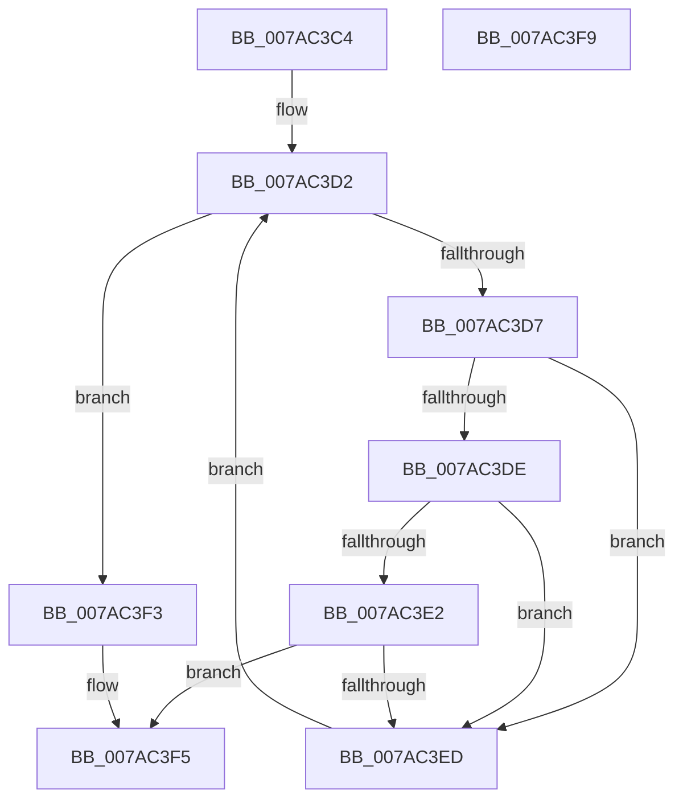

# SmcStoreEntryFind

- RVA: `0x007AC3C4`–`0x007AC3FA` (길이 `54` bytes)
- VA: `0x00000001407AC3C4`
- 실행 섹션: `PAGE`
- PDB 이름 있음: `예`; PDB Function 태그: `아니요`
- unwind 정보 RVA: `0x000DB714`
- 디코드: `19`개 명령, `54/54` bytes 표시
- 미해석 바이트: `0` (있으면 어셈블리에 `.byte`로 보존)

> 이 문서는 커널 이미지의 기계어와 PDB 기호를 분석해 생성했습니다. 4번과 5번은 함수 원형과 자료형을 바이너리 사용 방식에서 추정한 C 해석이며 원본 소스 복구 결과는 아닙니다.

## 1. Dependencies

- 직접 호출 지점: **0**; 고유 호출 대상: **0**
- 직접 호출자로 확인된 함수: **2**
- RIP 상대 이미지 참조: **0**

### Outgoing calls
- 직접 디코드된 call 명령이 없습니다.

### Direct callers
- [SmcStoreDelete](SmcStoreDelete_function_007AC214.md) at `0x007AC2AB`
- [SmcStoreResize](SmcStoreResize_function_007AC500.md) at `0x007AC62B`

### Static image references
- 디코드된 RIP-relative 메모리 참조가 없습니다.

## 2. Other-region calls and transfers

- 다른 실행 섹션으로 향하는 call: **0**
- 별도 외부 분기/꼬리 이동을 확인하지 못했습니다.

## 3. Assembly (complete function range)

```asm
007AC3C4  48 81 C1 A8 00 00 00            add rcx, 0xa8
007AC3CB  4C 8D 89 80 01 00 00            lea r9, [rcx + 0x180]
007AC3D2  49 3B C9                        cmp rcx, r9
007AC3D5  73 1C                           jae 0x1407ac3f3
007AC3D7  8B 01                           mov eax, dword ptr [rcx]
007AC3D9  83 F8 FF                        cmp eax, -1
007AC3DC  74 0F                           je 0x1407ac3ed
007AC3DE  3B C2                           cmp eax, edx
007AC3E0  75 0B                           jne 0x1407ac3ed
007AC3E2  8B 41 04                        mov eax, dword ptr [rcx + 4]
007AC3E5  83 E0 03                        and eax, 3
007AC3E8  41 3B C0                        cmp eax, r8d
007AC3EB  74 08                           je 0x1407ac3f5
007AC3ED  48 83 C1 18                     add rcx, 0x18
007AC3F1  EB DF                           jmp 0x1407ac3d2
007AC3F3  33 C9                           xor ecx, ecx
007AC3F5  48 8B C1                        mov rax, rcx
007AC3F8  C3                              ret
007AC3F9  CC                              int3
```

## 4. C-style interpretation (structured pseudocode)

```c
__int64 __fastcall SmcStoreEntryFind(__int64 a1, int a2, int a3)
{
    __int64 result;

    a1 = (a1) + (168);
loc_007AC3D2:
    if (a1 >= (a1 + 384)) goto loc_007AC3F3;
    if (((unsigned int)((unsigned int)(*(unsigned int *)(a1)))) == -1) goto loc_007AC3ED;
    if (((unsigned int)((unsigned int)(*(unsigned int *)(a1)))) != a2) goto loc_007AC3ED;
    result = (unsigned int)(((unsigned int)(*(unsigned int *)(a1 + 4))) & (3));
    if (((unsigned int)(result)) == a3) goto loc_007AC3F5;
loc_007AC3ED:
    a1 = (a1) + (24);
    goto loc_007AC3D2;
loc_007AC3F3:
    a1 = 0;
loc_007AC3F5:
    return 0;
}
```

## 5. (Beta) C Style

```c
int64_t SmcStoreEntryFind(void *Arg1, int32_t Arg2, int32_t Arg3)
{
    uint8_t *arg1 = (uint8_t *)Arg1;

    int64_t result;

    Arg1 = (Arg1) + (168);
loc_007AC3D2:
    if (Arg1 >= (Arg1 + 384)) goto loc_007AC3F3;
    if (((uint32_t)((uint32_t)(*(uint32_t *)(arg1)))) == -1) goto loc_007AC3ED;
    if (((uint32_t)((uint32_t)(*(uint32_t *)(arg1)))) != Arg2) goto loc_007AC3ED;
    result = (uint32_t)(((uint32_t)(*(uint32_t *)(arg1 + 0x4))) & (3));
    if (((uint32_t)(result)) == Arg3) goto loc_007AC3F5;
loc_007AC3ED:
    Arg1 = (Arg1) + (24);
    goto loc_007AC3D2;
loc_007AC3F3:
    Arg1 = 0;
loc_007AC3F5:
    return 0;
}
```

### 관측된 메모리 오프셋

구조체 형식이 확인되지 않은 접근은 인자 기준의 오프셋으로만 기록했습니다.

| 기준 인자 | 오프셋 표현 | 폭 (bit) | 접근 |
|---|---:|---:|---|
| `Arg1` | `+ 0x180` | `64` | `R` |

## 6. Execution-region graph

[열기: 2D/3D 그래프와 함수 탐색 컨트롤 패널](../../../control-panel.html?section=page&rva=0x007AC3C4&view=graph)

- 2D 그래프는 위에서 아래로 흐르고, 3D 그래프는 빈 공간을 드래그해 회전합니다. Shift+드래그는 이동, 휠은 확대·축소, 함수 노드 선택은 대상 보고서 이동입니다.

### Static fallback


