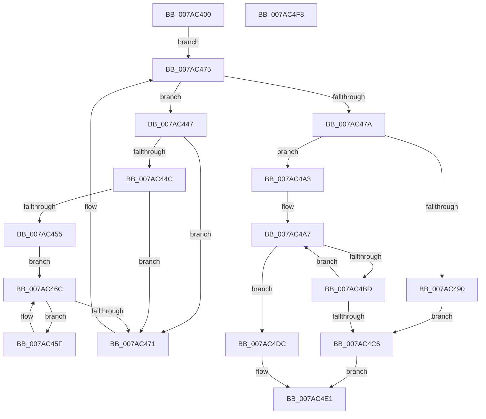

# SmcStorePlacementGet

- RVA: `0x007AC400`–`0x007AC4F9` (길이 `249` bytes)
- VA: `0x00000001407AC400`
- 실행 섹션: `PAGE`
- PDB 이름 있음: `예`; PDB Function 태그: `아니요`
- unwind 정보 RVA: `0x00066400`
- 디코드: `76`개 명령, `249/249` bytes 표시
- 미해석 바이트: `0` (있으면 어셈블리에 `.byte`로 보존)

> 이 문서는 커널 이미지의 기계어와 PDB 기호를 분석해 생성했습니다. 4번과 5번은 함수 원형과 자료형을 바이너리 사용 방식에서 추정한 C 해석이며 원본 소스 복구 결과는 아닙니다.

## 1. Dependencies

- 직접 호출 지점: **4**; 고유 호출 대상: **2**
- 직접 호출자로 확인된 함수: **2**
- RIP 상대 이미지 참조: **0**

### Outgoing calls
- `0x007AC484` → [RtlFindSetBits](../../text/3F/RtlFindSetBits_function_003F0610.md) (function, `0x003F0610`)
- `0x007AC49A` → [RtlClearBits](../../text/3E/RtlClearBits_function_003E1A90.md) (function, `0x003E1A90`)
- `0x007AC4B4` → [RtlFindSetBits](../../text/3F/RtlFindSetBits_function_003F0610.md) (function, `0x003F0610`)
- `0x007AC4D5` → [RtlClearBits](../../text/3E/RtlClearBits_function_003E1A90.md) (function, `0x003E1A90`)

### Direct callers
- [SmcStoreResize](SmcStoreResize_function_007AC500.md) at `0x007AC66B`
- [SmcStoreSlotReserve](SmcStoreSlotReserve_function_007AC978.md) at `0x007ACA8A`

### Static image references
- 디코드된 RIP-relative 메모리 참조가 없습니다.

## 2. Other-region calls and transfers

- 다른 실행 섹션으로 향하는 call: **4**
  - `0x007AC484` → [RtlFindSetBits](../../text/3F/RtlFindSetBits_function_003F0610.md) (`PAGE` → `.text`)
  - `0x007AC49A` → [RtlClearBits](../../text/3E/RtlClearBits_function_003E1A90.md) (`PAGE` → `.text`)
  - `0x007AC4B4` → [RtlFindSetBits](../../text/3F/RtlFindSetBits_function_003F0610.md) (`PAGE` → `.text`)
  - `0x007AC4D5` → [RtlClearBits](../../text/3E/RtlClearBits_function_003E1A90.md) (`PAGE` → `.text`)
- 별도 외부 분기/꼬리 이동을 확인하지 못했습니다.

## 3. Assembly (complete function range)

```asm
007AC400  48 8B C4                        mov rax, rsp
007AC403  48 89 58 08                     mov qword ptr [rax + 8], rbx
007AC407  48 89 68 10                     mov qword ptr [rax + 0x10], rbp
007AC40B  48 89 70 18                     mov qword ptr [rax + 0x18], rsi
007AC40F  57                              push rdi
007AC410  48 83 EC 30                     sub rsp, 0x30
007AC414  44 8B 49 08                     mov r9d, dword ptr [rcx + 8]
007AC418  33 FF                           xor edi, edi
007AC41A  44 89 48 E8                     mov dword ptr [rax - 0x18], r9d
007AC41E  8B EA                           mov ebp, edx
007AC420  89 78 EC                        mov dword ptr [rax - 0x14], edi
007AC423  48 8D 91 A8 00 00 00            lea rdx, [rcx + 0xa8]
007AC42A  49 8B 40 08                     mov rax, qword ptr [r8 + 8]
007AC42E  48 8D 9A 80 01 00 00            lea rbx, [rdx + 0x180]
007AC435  49 83 C1 1F                     add r9, 0x1f
007AC439  48 89 44 24 28                  mov qword ptr [rsp + 0x28], rax
007AC43E  49 C1 E9 05                     shr r9, 5
007AC442  4D 8B D8                        mov r11, r8
007AC445  EB 2E                           jmp 0x1407ac475
007AC447  49 3B D3                        cmp rdx, r11
007AC44A  74 25                           je 0x1407ac471
007AC44C  48 8B 4A 08                     mov rcx, qword ptr [rdx + 8]
007AC450  48 85 C9                        test rcx, rcx
007AC453  74 1C                           je 0x1407ac471
007AC455  4D 8B 43 08                     mov r8, qword ptr [r11 + 8]
007AC459  4E 8D 14 89                     lea r10, [rcx + r9*4]
007AC45D  EB 0D                           jmp 0x1407ac46c
007AC45F  8B 01                           mov eax, dword ptr [rcx]
007AC461  41 31 00                        xor dword ptr [r8], eax
007AC464  4D 8D 40 04                     lea r8, [r8 + 4]
007AC468  48 83 C1 04                     add rcx, 4
007AC46C  49 3B CA                        cmp rcx, r10
007AC46F  72 EE                           jb 0x1407ac45f
007AC471  48 83 C2 18                     add rdx, 0x18
007AC475  48 3B D3                        cmp rdx, rbx
007AC478  72 CD                           jb 0x1407ac447
007AC47A  45 33 C0                        xor r8d, r8d
007AC47D  48 8D 4C 24 20                  lea rcx, [rsp + 0x20]
007AC482  8B D5                           mov edx, ebp
007AC484  E8 87 41 C4 FF                  call 0x1403f0610
007AC489  8B D8                           mov ebx, eax
007AC48B  83 F8 FF                        cmp eax, -1
007AC48E  74 13                           je 0x1407ac4a3
007AC490  44 8B C0                        mov r8d, eax
007AC493  48 8D 4C 24 20                  lea rcx, [rsp + 0x20]
007AC498  33 D2                           xor edx, edx
007AC49A  E8 F1 55 C3 FF                  call 0x1403e1a90
007AC49F  03 DD                           add ebx, ebp
007AC4A1  EB 23                           jmp 0x1407ac4c6
007AC4A3  8B DF                           mov ebx, edi
007AC4A5  8B F7                           mov esi, edi
007AC4A7  44 8B C3                        mov r8d, ebx
007AC4AA  48 8D 4C 24 20                  lea rcx, [rsp + 0x20]
007AC4AF  BA 01 00 00 00                  mov edx, 1
007AC4B4  E8 57 41 C4 FF                  call 0x1403f0610
007AC4B9  3B C3                           cmp eax, ebx
007AC4BB  7C 1F                           jl 0x1407ac4dc
007AC4BD  FF C6                           inc esi
007AC4BF  8D 58 01                        lea ebx, [rax + 1]
007AC4C2  3B F5                           cmp esi, ebp
007AC4C4  75 E1                           jne 0x1407ac4a7
007AC4C6  44 8B 44 24 20                  mov r8d, dword ptr [rsp + 0x20]
007AC4CB  48 8D 4C 24 20                  lea rcx, [rsp + 0x20]
007AC4D0  44 2B C3                        sub r8d, ebx
007AC4D3  8B D3                           mov edx, ebx
007AC4D5  E8 B6 55 C3 FF                  call 0x1403e1a90
007AC4DA  EB 05                           jmp 0x1407ac4e1
007AC4DC  BF 7F 00 00 C0                  mov edi, 0xc000007f
007AC4E1  48 8B 5C 24 40                  mov rbx, qword ptr [rsp + 0x40]
007AC4E6  8B C7                           mov eax, edi
007AC4E8  48 8B 6C 24 48                  mov rbp, qword ptr [rsp + 0x48]
007AC4ED  48 8B 74 24 50                  mov rsi, qword ptr [rsp + 0x50]
007AC4F2  48 83 C4 30                     add rsp, 0x30
007AC4F6  5F                              pop rdi
007AC4F7  C3                              ret
007AC4F8  CC                              int3
```

## 4. C-style interpretation (structured pseudocode)

```c
__int64 __fastcall SmcStorePlacementGet(__int64 a1, int a2, __int64 a3)
{
    __int64 result;
    __int64 v_rbx;
    __int64 v_rdi;
    __int64 v_rsi;
    __int64 v_rsp;
    unsigned __int64 v_stack_m10;
    unsigned __int64 v_stack_m18;
    unsigned __int64 v_stack_p10;
    unsigned __int64 v_stack_p18;
    unsigned __int64 v_stack_p8;

    *(unsigned __int64 *)(v_rsp + 8) = v_rbx;
    *(unsigned __int64 *)(v_rsp + 16) = v_rbp;
    *(unsigned __int64 *)(v_rsp + 24) = v_rsi;
    v_rsp = (v_rsp) - (48);
    v_rdi = 0;
    *(unsigned int *)(v_rsp - 24) = (unsigned int)((unsigned int)(*(unsigned int *)(a1 + 8)));
    *(unsigned int *)(v_rsp - 20) = 0;
    a4 = ((unsigned int)(*(unsigned int *)(a1 + 8))) + (31);
    v_stack_m10 = *(unsigned __int64 *)(a3 + 8);
    a4 = (a4) >> (5);
    goto loc_007AC475;
loc_007AC447:
    if ((a1 + 168) == a3) goto loc_007AC471;
    if (*(unsigned __int64 *)(a1 + 168 + 8) == 0) goto loc_007AC471;
    goto loc_007AC46C;
loc_007AC45F:
    a1 = (*(unsigned __int64 *)(a1 + 168 + 8)) + (4);
loc_007AC46C:
    if (a1 < (*(unsigned __int64 *)(a1 + 168 + 8) + a4 * 4)) goto loc_007AC45F;
loc_007AC471:
    a2 = (a1 + 168) + (24);
loc_007AC475:
    if (a2 < (a1 + 168 + 384)) goto loc_007AC447;
    a3 = 0;
    result = RtlFindSetBits(v_stack_m18, (unsigned int)((unsigned int)((unsigned int)(a2))), a3, a4);
    if (((unsigned int)(result)) == -1) goto loc_007AC4A3;
    a2 = 0;
    result = RtlClearBits(v_stack_m18, a2, (unsigned int)((unsigned int)(result)), a4);
    v_rbx = (unsigned int)(((unsigned int)((unsigned int)(result))) + ((unsigned int)((unsigned int)(a2))));
    goto loc_007AC4C6;
loc_007AC4A3:
loc_007AC4A7:
    result = RtlFindSetBits(v_stack_m18, 1, 0, a4);
    if (((unsigned int)(result)) < 0) goto loc_007AC4DC;
    v_rsi = (unsigned int)((0) + 1);
    if (((unsigned int)(v_rsi)) != ((unsigned int)((unsigned int)(a2)))) goto loc_007AC4A7;
loc_007AC4C6:
    a3 = (unsigned int)(((unsigned int)(v_stack_m18)) - ((unsigned int)(result + 1)));
    result = RtlClearBits(v_stack_m18, (unsigned int)((unsigned int)(result + 1)), a3, a4);
    goto loc_007AC4E1;
loc_007AC4DC:
loc_007AC4E1:
    v_rsp = (v_rsp) + (48);
    return (unsigned int)((unsigned int)((unsigned int)(0xC000007FULL)));
}
```

## 5. (Beta) C Style

```c
int64_t SmcStorePlacementGet(void *Arg1, int32_t Arg2, void *Arg3)
{
    uint8_t *arg1 = (uint8_t *)Arg1;
    uint8_t *arg3 = (uint8_t *)Arg3;

    int64_t result;
    int64_t local_rbx;
    int64_t local_rdi;
    int64_t local_rsi;
    int64_t local_rsp;
    uint64_t v_stack_m10;
    uint64_t v_stack_m18;
    uint64_t v_stack_p10;
    uint64_t v_stack_p18;
    uint64_t v_stack_p8;

    *(uint64_t *)(local_rsp + 0x8) = local_rbx;
    *(uint64_t *)(local_rsp + 0x10) = local_rbp;
    *(uint64_t *)(local_rsp + 0x18) = local_rsi;
    local_rsp = (local_rsp) - (48);
    local_rdi = 0;
    *(uint32_t *)(local_rsp - 0x18) = (uint32_t)((uint32_t)(*(uint32_t *)(arg1 + 0x8)));
    *(uint32_t *)(local_rsp - 0x14) = 0;
    a4 = ((uint32_t)(*(uint32_t *)(arg1 + 0x8))) + (31);
    v_stack_m10 = *(uint64_t *)(arg3 + 0x8);
    a4 = (a4) >> (5);
    goto loc_007AC475;
loc_007AC447:
    if ((Arg1 + 168) == Arg3) goto loc_007AC471;
    if (*(uint64_t *)(arg1 + 0xA8 + 0x8) == 0) goto loc_007AC471;
    goto loc_007AC46C;
loc_007AC45F:
    Arg1 = (*(uint64_t *)(arg1 + 0xA8 + 0x8)) + (4);
loc_007AC46C:
    if (Arg1 < (*(uint64_t *)(arg1 + 0xA8 + 0x8) + a4 * 4)) goto loc_007AC45F;
loc_007AC471:
    Arg2 = (Arg1 + 168) + (24);
loc_007AC475:
    if (Arg2 < (Arg1 + 168 + 384)) goto loc_007AC447;
    Arg3 = 0;
    result = RtlFindSetBits(v_stack_m18, (uint32_t)((uint32_t)((uint32_t)(Arg2))), Arg3, a4);
    if (((uint32_t)(result)) == -1) goto loc_007AC4A3;
    Arg2 = 0;
    result = RtlClearBits(v_stack_m18, Arg2, (uint32_t)((uint32_t)(result)), a4);
    local_rbx = (uint32_t)(((uint32_t)((uint32_t)(result))) + ((uint32_t)((uint32_t)(Arg2))));
    goto loc_007AC4C6;
loc_007AC4A3:
loc_007AC4A7:
    result = RtlFindSetBits(v_stack_m18, 1, 0, a4);
    if (((uint32_t)(result)) < 0) goto loc_007AC4DC;
    local_rsi = (uint32_t)((0) + 1);
    if (((uint32_t)(local_rsi)) != ((uint32_t)((uint32_t)(Arg2)))) goto loc_007AC4A7;
loc_007AC4C6:
    Arg3 = (uint32_t)(((uint32_t)(v_stack_m18)) - ((uint32_t)(result + 1)));
    result = RtlClearBits(v_stack_m18, (uint32_t)((uint32_t)(result + 1)), Arg3, a4);
    goto loc_007AC4E1;
loc_007AC4DC:
loc_007AC4E1:
    local_rsp = (local_rsp) + (48);
    return (uint32_t)((uint32_t)((uint32_t)(0xC000007FULL)));
}
```

### 관측된 메모리 오프셋

구조체 형식이 확인되지 않은 접근은 인자 기준의 오프셋으로만 기록했습니다.

| 기준 인자 | 오프셋 표현 | 폭 (bit) | 접근 |
|---|---:|---:|---|
| `Arg1` | `+ 0x8` | `32` | `R` |
| `Arg1` | `+ 0xA8` | `64` | `R` |
| `Arg1` | `+ 0x180` | `64` | `R` |
| `Arg3` | `+ 0x8` | `64` | `R` |

## 6. Execution-region graph

[열기: 2D/3D 그래프와 함수 탐색 컨트롤 패널](../../../control-panel.html?section=page&rva=0x007AC400&view=graph)

- 2D 그래프는 위에서 아래로 흐르고, 3D 그래프는 빈 공간을 드래그해 회전합니다. Shift+드래그는 이동, 휠은 확대·축소, 함수 노드 선택은 대상 보고서 이동입니다.

### Static fallback


