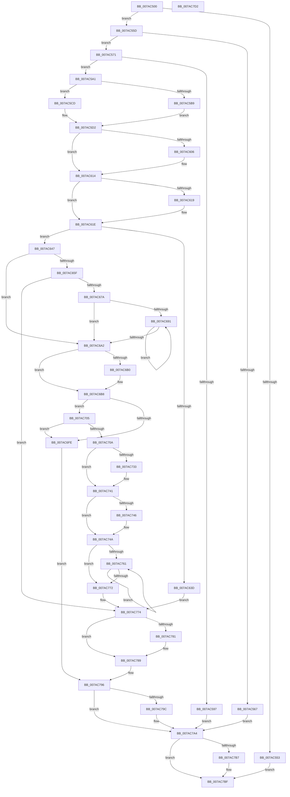

# SmcStoreResize

- RVA: `0x007AC500`–`0x007AC7D3` (길이 `723` bytes)
- VA: `0x00000001407AC500`
- 실행 섹션: `PAGE`
- PDB 이름 있음: `예`; PDB Function 태그: `아니요`
- unwind 정보 RVA: `0x000BE9B4`
- 디코드: `203`개 명령, `723/723` bytes 표시
- 미해석 바이트: `0` (있으면 어셈블리에 `.byte`로 보존)

> 이 문서는 커널 이미지의 기계어와 PDB 기호를 분석해 생성했습니다. 4번과 5번은 함수 원형과 자료형을 바이너리 사용 방식에서 추정한 C 해석이며 원본 소스 복구 결과는 아닙니다.

## 1. Dependencies

- 직접 호출 지점: **21**; 고유 호출 대상: **16**
- 직접 호출자로 확인된 함수: **1**
- RIP 상대 이미지 참조: **0**

### Outgoing calls
- `0x007AC546` → [SmcCacheReference](SmcCacheReference_function_007ABAF8.md) (function, `0x007ABAF8`)
- `0x007AC58A` → [SmAllocEx](../../text/34/SmAllocEx_function_0034C794.md) (function, `0x0034C794`)
- `0x007AC5B9` → [RtlSetAllBits](../../text/36/RtlSetAllBits_function_00362490.md) (function, `0x00362490`)
- `0x007AC5CD` → [RtlClearAllBits](../../text/45/RtlClearAllBits_function_00450230.md) (function, `0x00450230`)
- `0x007AC5F6` → [KeAbPreAcquire](../../text/21/KeAbPreAcquire_function_00210230.md) (function, `0x00210230`)
- `0x007AC60F` → [ExfAcquirePushLockExclusiveEx](../../text/20/ExfAcquirePushLockExclusiveEx_function_0020FC90.md) (function, `0x0020FC90`)
- `0x007AC62B` → [SmcStoreEntryFind](SmcStoreEntryFind_function_007AC3C4.md) (function, `0x007AC3C4`)
- `0x007AC64A` → [ExAcquireRundownProtection](../../text/21/ExAcquireRundownProtection_function_00216620.md) (function, `0x00216620`)
- `0x007AC66B` → [SmcStorePlacementGet](SmcStorePlacementGet_function_007AC400.md) (function, `0x007AC400`)
- `0x007AC6B3` → [ExfTryToWakePushLock](../../text/26/ExfTryToWakePushLock_function_00265DD0.md) (function, `0x00265DD0`)
- `0x007AC6BB` → [KeAbPostRelease](../../text/2E/KeAbPostRelease_function_002E1600.md) (function, `0x002E1600`)
- `0x007AC6C0` → [KeLeaveCriticalRegion](../../text/25/KeLeaveCriticalRegion_function_0025D8B0.md) (function, `0x0025D8B0`)
- `0x007AC6EF` → [SmStoreResize](SmStoreResize_function_007A748C.md) (function, `0x007A748C`)
- `0x007AC723` → [KeAbPreAcquire](../../text/21/KeAbPreAcquire_function_00210230.md) (function, `0x00210230`)
- `0x007AC73C` → [ExfAcquirePushLockExclusiveEx](../../text/20/ExfAcquirePushLockExclusiveEx_function_0020FC90.md) (function, `0x0020FC90`)
- `0x007AC784` → [ExfTryToWakePushLock](../../text/26/ExfTryToWakePushLock_function_00265DD0.md) (function, `0x00265DD0`)
- `0x007AC78C` → [KeAbPostRelease](../../text/2E/KeAbPostRelease_function_002E1600.md) (function, `0x002E1600`)
- `0x007AC791` → [KeLeaveCriticalRegion](../../text/25/KeLeaveCriticalRegion_function_0025D8B0.md) (function, `0x0025D8B0`)
- `0x007AC79F` → [ExReleaseRundownProtection](../../text/34/ExReleaseRundownProtection_function_00349E80.md) (function, `0x00349E80`)
- `0x007AC7AD` → [SmcCacheDereference](SmcCacheDereference_function_007AB8A8.md) (function, `0x007AB8A8`)
- `0x007AC7BA` → [CmSiFreeMemory](../../text/47/CmSiFreeMemory_function_00475D80.md) (function, `0x00475D80`)

### Direct callers
- [SmcProcessResizeRequest](SmcProcessResizeRequest_function_007A7B1C.md) at `0x007A7BC7`

### Static image references
- 디코드된 RIP-relative 메모리 참조가 없습니다.

## 2. Other-region calls and transfers

- 다른 실행 섹션으로 향하는 call: **16**
  - `0x007AC58A` → [SmAllocEx](../../text/34/SmAllocEx_function_0034C794.md) (`PAGE` → `.text`)
  - `0x007AC5B9` → [RtlSetAllBits](../../text/36/RtlSetAllBits_function_00362490.md) (`PAGE` → `.text`)
  - `0x007AC5CD` → [RtlClearAllBits](../../text/45/RtlClearAllBits_function_00450230.md) (`PAGE` → `.text`)
  - `0x007AC5F6` → [KeAbPreAcquire](../../text/21/KeAbPreAcquire_function_00210230.md) (`PAGE` → `.text`)
  - `0x007AC60F` → [ExfAcquirePushLockExclusiveEx](../../text/20/ExfAcquirePushLockExclusiveEx_function_0020FC90.md) (`PAGE` → `.text`)
  - `0x007AC64A` → [ExAcquireRundownProtection](../../text/21/ExAcquireRundownProtection_function_00216620.md) (`PAGE` → `.text`)
  - `0x007AC6B3` → [ExfTryToWakePushLock](../../text/26/ExfTryToWakePushLock_function_00265DD0.md) (`PAGE` → `.text`)
  - `0x007AC6BB` → [KeAbPostRelease](../../text/2E/KeAbPostRelease_function_002E1600.md) (`PAGE` → `.text`)
  - `0x007AC6C0` → [KeLeaveCriticalRegion](../../text/25/KeLeaveCriticalRegion_function_0025D8B0.md) (`PAGE` → `.text`)
  - `0x007AC723` → [KeAbPreAcquire](../../text/21/KeAbPreAcquire_function_00210230.md) (`PAGE` → `.text`)
  - `0x007AC73C` → [ExfAcquirePushLockExclusiveEx](../../text/20/ExfAcquirePushLockExclusiveEx_function_0020FC90.md) (`PAGE` → `.text`)
  - `0x007AC784` → [ExfTryToWakePushLock](../../text/26/ExfTryToWakePushLock_function_00265DD0.md) (`PAGE` → `.text`)
  - `0x007AC78C` → [KeAbPostRelease](../../text/2E/KeAbPostRelease_function_002E1600.md) (`PAGE` → `.text`)
  - `0x007AC791` → [KeLeaveCriticalRegion](../../text/25/KeLeaveCriticalRegion_function_0025D8B0.md) (`PAGE` → `.text`)
  - `0x007AC79F` → [ExReleaseRundownProtection](../../text/34/ExReleaseRundownProtection_function_00349E80.md) (`PAGE` → `.text`)
  - `0x007AC7BA` → [CmSiFreeMemory](../../text/47/CmSiFreeMemory_function_00475D80.md) (`PAGE` → `.text`)
- 별도 외부 분기/꼬리 이동을 확인하지 못했습니다.

## 3. Assembly (complete function range)

```asm
007AC500  48 89 4C 24 08                  mov qword ptr [rsp + 8], rcx
007AC505  55                              push rbp
007AC506  53                              push rbx
007AC507  56                              push rsi
007AC508  57                              push rdi
007AC509  41 54                           push r12
007AC50B  41 55                           push r13
007AC50D  41 56                           push r14
007AC50F  41 57                           push r15
007AC511  48 8B EC                        mov rbp, rsp
007AC514  48 83 EC 68                     sub rsp, 0x68
007AC518  48 8B C1                        mov rax, rcx
007AC51B  0F 57 C0                        xorps xmm0, xmm0
007AC51E  33 C9                           xor ecx, ecx
007AC520  4C 8B E2                        mov r12, rdx
007AC523  21 4D 50                        and dword ptr [rbp + 0x50], ecx
007AC526  45 33 F6                        xor r14d, r14d
007AC529  8B 52 04                        mov edx, dword ptr [rdx + 4]
007AC52C  48 89 4D E8                     mov qword ptr [rbp - 0x18], rcx
007AC530  48 8D 88 10 F7 FF FF            lea rcx, [rax - 0x8f0]
007AC537  48 89 4D 60                     mov qword ptr [rbp + 0x60], rcx
007AC53B  48 8B C8                        mov rcx, rax
007AC53E  0F 11 45 D8                     movups xmmword ptr [rbp - 0x28], xmm0
007AC542  0F 11 45 C8                     movups xmmword ptr [rbp - 0x38], xmm0
007AC546  E8 AD F5 FF FF                  call 0x1407abaf8
007AC54B  48 8B F8                        mov rdi, rax
007AC54E  48 85 C0                        test rax, rax
007AC551  75 0A                           jne 0x1407ac55d
007AC553  BF 98 00 00 C0                  mov edi, 0xc0000098
007AC558  E9 62 02 00 00                  jmp 0x1407ac7bf
007AC55D  8B 40 08                        mov eax, dword ptr [rax + 8]
007AC560  41 39 44 24 10                  cmp dword ptr [r12 + 0x10], eax
007AC565  76 0A                           jbe 0x1407ac571
007AC567  BF 0D 00 00 C0                  mov edi, 0xc000000d
007AC56C  E9 33 02 00 00                  jmp 0x1407ac7a4
007AC571  4C 8D 68 1F                     lea r13, [rax + 0x1f]
007AC575  41 83 C8 FF                     or r8d, 0xffffffff
007AC579  49 C1 ED 05                     shr r13, 5
007AC57D  BA 73 6D 43 72                  mov edx, 0x72436d73
007AC582  42 8D 0C AD 00 00 00 00         lea ecx, [r13*4]
007AC58A  E8 05 02 BA FF                  call 0x14034c794
007AC58F  4C 8B F0                        mov r14, rax
007AC592  48 85 C0                        test rax, rax
007AC595  75 0A                           jne 0x1407ac5a1
007AC597  BF 9A 00 00 C0                  mov edi, 0xc000009a
007AC59C  E9 03 02 00 00                  jmp 0x1407ac7a4
007AC5A1  41 F7 04 24 00 01 00 00         test dword ptr [r12], 0x100
007AC5A9  48 8D 4D C8                     lea rcx, [rbp - 0x38]
007AC5AD  8B 47 08                        mov eax, dword ptr [rdi + 8]
007AC5B0  89 45 C8                        mov dword ptr [rbp - 0x38], eax
007AC5B3  4C 89 75 D0                     mov qword ptr [rbp - 0x30], r14
007AC5B7  74 14                           je 0x1407ac5cd
007AC5B9  E8 D2 5E BB FF                  call 0x140362490
007AC5BE  48 83 65 E8 00                  and qword ptr [rbp - 0x18], 0
007AC5C3  83 4D DC 04                     or dword ptr [rbp - 0x24], 4
007AC5C7  4C 89 75 E0                     mov qword ptr [rbp - 0x20], r14
007AC5CB  EB 05                           jmp 0x1407ac5d2
007AC5CD  E8 5E 3C CA FF                  call 0x140450230
007AC5D2  65 48 8B 04 25 88 01 00 00      mov rax, qword ptr gs:[0x188]
007AC5DB  48 8D B7 A0 00 00 00            lea rsi, [rdi + 0xa0]
007AC5E2  48 83 CB FF                     or rbx, 0xffffffffffffffff
007AC5E6  45 33 C0                        xor r8d, r8d
007AC5E9  33 D2                           xor edx, edx
007AC5EB  48 8B CE                        mov rcx, rsi
007AC5EE  66 01 98 E4 01 00 00            add word ptr [rax + 0x1e4], bx
007AC5F5  90                              nop
007AC5F6  E8 35 3C A6 FF                  call 0x140210230
007AC5FB  F0 48 0F BA 2E 00               lock bts qword ptr [rsi], 0
007AC601  4C 8B F8                        mov r15, rax
007AC604  73 0E                           jae 0x1407ac614
007AC606  4C 8B C6                        mov r8, rsi
007AC609  48 8B D0                        mov rdx, rax
007AC60C  48 8B CE                        mov rcx, rsi
007AC60F  E8 7C 36 A6 FF                  call 0x14020fc90
007AC614  4D 85 FF                        test r15, r15
007AC617  74 05                           je 0x1407ac61e
007AC619  41 C6 47 0A 01                  mov byte ptr [r15 + 0xa], 1
007AC61E  45 8B 44 24 0C                  mov r8d, dword ptr [r12 + 0xc]
007AC623  48 8B CF                        mov rcx, rdi
007AC626  41 8B 54 24 08                  mov edx, dword ptr [r12 + 8]
007AC62B  E8 94 FD FF FF                  call 0x1407ac3c4
007AC630  48 89 45 58                     mov qword ptr [rbp + 0x58], rax
007AC634  4C 8D 78 10                     lea r15, [rax + 0x10]
007AC638  48 85 C0                        test rax, rax
007AC63B  75 0A                           jne 0x1407ac647
007AC63D  BF 98 00 00 C0                  mov edi, 0xc0000098
007AC642  E9 2D 01 00 00                  jmp 0x1407ac774
007AC647  49 8B CF                        mov rcx, r15
007AC64A  E8 D1 9F A6 FF                  call 0x140216620
007AC64F  41 F7 04 24 00 01 00 00         test dword ptr [r12], 0x100
007AC657  0F B6 C0                        movzx eax, al
007AC65A  89 45 50                        mov dword ptr [rbp + 0x50], eax
007AC65D  74 43                           je 0x1407ac6a2
007AC65F  41 8B 54 24 10                  mov edx, dword ptr [r12 + 0x10]
007AC664  4C 8D 45 D8                     lea r8, [rbp - 0x28]
007AC668  48 8B CF                        mov rcx, rdi
007AC66B  E8 90 FD FF FF                  call 0x1407ac400
007AC670  8B F8                           mov edi, eax
007AC672  85 C0                           test eax, eax
007AC674  0F 88 FA 00 00 00               js 0x1407ac774
007AC67A  48 8B 55 58                     mov rdx, qword ptr [rbp + 0x58]
007AC67E  49 8B CE                        mov rcx, r14
007AC681  41 8B C5                        mov eax, r13d
007AC684  48 8B 52 08                     mov rdx, qword ptr [rdx + 8]
007AC688  4D 8D 04 86                     lea r8, [r14 + rax*4]
007AC68C  4D 3B F0                        cmp r14, r8
007AC68F  73 11                           jae 0x1407ac6a2
007AC691  8B 01                           mov eax, dword ptr [rcx]
007AC693  48 83 C1 04                     add rcx, 4
007AC697  09 02                           or dword ptr [rdx], eax
007AC699  48 8D 52 04                     lea rdx, [rdx + 4]
007AC69D  49 3B C8                        cmp rcx, r8
007AC6A0  72 EF                           jb 0x1407ac691
007AC6A2  48 8B C3                        mov rax, rbx
007AC6A5  F0 48 0F C1 06                  lock xadd qword ptr [rsi], rax
007AC6AA  24 06                           and al, 6
007AC6AC  3C 02                           cmp al, 2
007AC6AE  75 08                           jne 0x1407ac6b8
007AC6B0  48 8B CE                        mov rcx, rsi
007AC6B3  E8 18 97 AB FF                  call 0x140265dd0
007AC6B8  48 8B CE                        mov rcx, rsi
007AC6BB  E8 40 4F B3 FF                  call 0x1402e1600
007AC6C0  E8 EB 11 AB FF                  call 0x14025d8b0
007AC6C5  41 8B 04 24                     mov eax, dword ptr [r12]
007AC6C9  49 8D 7C 24 10                  lea rdi, [r12 + 0x10]
007AC6CE  45 8B 44 24 08                  mov r8d, dword ptr [r12 + 8]
007AC6D3  4C 8D 4D C8                     lea r9, [rbp - 0x38]
007AC6D7  41 8B 54 24 0C                  mov edx, dword ptr [r12 + 0xc]
007AC6DC  48 8B 4D 60                     mov rcx, qword ptr [rbp + 0x60]
007AC6E0  C1 E8 08                        shr eax, 8
007AC6E3  83 E0 01                        and eax, 1
007AC6E6  89 44 24 28                     mov dword ptr [rsp + 0x28], eax
007AC6EA  48 89 7C 24 20                  mov qword ptr [rsp + 0x20], rdi
007AC6EF  E8 98 AD FF FF                  call 0x1407a748c
007AC6F4  41 F7 04 24 00 01 00 00         test dword ptr [r12], 0x100
007AC6FC  74 07                           je 0x1407ac705
007AC6FE  33 FF                           xor edi, edi
007AC700  E9 91 00 00 00                  jmp 0x1407ac796
007AC705  83 3F 00                        cmp dword ptr [rdi], 0
007AC708  74 F4                           je 0x1407ac6fe
007AC70A  65 48 8B 04 25 88 01 00 00      mov rax, qword ptr gs:[0x188]
007AC713  45 33 C0                        xor r8d, r8d
007AC716  33 D2                           xor edx, edx
007AC718  48 8B CE                        mov rcx, rsi
007AC71B  66 01 98 E4 01 00 00            add word ptr [rax + 0x1e4], bx
007AC722  90                              nop
007AC723  E8 08 3B A6 FF                  call 0x140210230
007AC728  F0 48 0F BA 2E 00               lock bts qword ptr [rsi], 0
007AC72E  48 8B F8                        mov rdi, rax
007AC731  73 0E                           jae 0x1407ac741
007AC733  4C 8B C6                        mov r8, rsi
007AC736  48 8B D0                        mov rdx, rax
007AC739  48 8B CE                        mov rcx, rsi
007AC73C  E8 4F 35 A6 FF                  call 0x14020fc90
007AC741  48 85 FF                        test rdi, rdi
007AC744  74 04                           je 0x1407ac74a
007AC746  C6 47 0A 01                     mov byte ptr [rdi + 0xa], 1
007AC74A  48 8B 45 58                     mov rax, qword ptr [rbp + 0x58]
007AC74E  49 8B CE                        mov rcx, r14
007AC751  48 8B 50 08                     mov rdx, qword ptr [rax + 8]
007AC755  41 8B C5                        mov eax, r13d
007AC758  4D 8D 04 86                     lea r8, [r14 + rax*4]
007AC75C  4D 3B F0                        cmp r14, r8
007AC75F  73 11                           jae 0x1407ac772
007AC761  8B 01                           mov eax, dword ptr [rcx]
007AC763  48 83 C1 04                     add rcx, 4
007AC767  31 02                           xor dword ptr [rdx], eax
007AC769  48 8D 52 04                     lea rdx, [rdx + 4]
007AC76D  49 3B C8                        cmp rcx, r8
007AC770  72 EF                           jb 0x1407ac761
007AC772  33 FF                           xor edi, edi
007AC774  F0 48 0F C1 1E                  lock xadd qword ptr [rsi], rbx
007AC779  80 E3 06                        and bl, 6
007AC77C  80 FB 02                        cmp bl, 2
007AC77F  75 08                           jne 0x1407ac789
007AC781  48 8B CE                        mov rcx, rsi
007AC784  E8 47 96 AB FF                  call 0x140265dd0
007AC789  48 8B CE                        mov rcx, rsi
007AC78C  E8 6F 4E B3 FF                  call 0x1402e1600
007AC791  E8 1A 11 AB FF                  call 0x14025d8b0
007AC796  83 7D 50 00                     cmp dword ptr [rbp + 0x50], 0
007AC79A  74 08                           je 0x1407ac7a4
007AC79C  49 8B CF                        mov rcx, r15
007AC79F  E8 DC D6 B9 FF                  call 0x140349e80
007AC7A4  41 8B 54 24 04                  mov edx, dword ptr [r12 + 4]
007AC7A9  48 8B 4D 48                     mov rcx, qword ptr [rbp + 0x48]
007AC7AD  E8 F6 F0 FF FF                  call 0x1407ab8a8
007AC7B2  4D 85 F6                        test r14, r14
007AC7B5  74 08                           je 0x1407ac7bf
007AC7B7  49 8B CE                        mov rcx, r14
007AC7BA  E8 C1 95 CC FF                  call 0x140475d80
007AC7BF  8B C7                           mov eax, edi
007AC7C1  48 83 C4 68                     add rsp, 0x68
007AC7C5  41 5F                           pop r15
007AC7C7  41 5E                           pop r14
007AC7C9  41 5D                           pop r13
007AC7CB  41 5C                           pop r12
007AC7CD  5F                              pop rdi
007AC7CE  5E                              pop rsi
007AC7CF  5B                              pop rbx
007AC7D0  5D                              pop rbp
007AC7D1  C3                              ret
007AC7D2  CC                              int3
```

## 4. C-style interpretation (structured pseudocode)

```c
__int64 __fastcall SmcStoreResize(__int64 a1, __int64 a2, int a3)
{
    __int64 result;
    __int64 v_r13;
    __int64 v_r14;
    __int64 v_rbx;
    __int64 v_rdi;
    __int64 v_rsp;
    unsigned __int64 v_stack_m58;
    unsigned __int64 v_stack_m60;
    unsigned int v_stack_m64;
    unsigned __int64 v_stack_m68;
    unsigned __int64 v_stack_m70;
    unsigned __int64 v_stack_m78;
    unsigned int v_stack_m80;
    unsigned __int64 v_stack_m88;
    unsigned int v_stack_p10;
    unsigned __int64 v_stack_p18;
    unsigned __int64 v_stack_p20;
    unsigned __int64 v_stack_p8;

    v_stack_p8 = a1;
    v_rsp = (v_rsp) - (104);
    a1 = 0;
    v_r14 = 0;
    v_stack_m58 = 0;
    v_stack_p20 = a1 - 2288;
    v_stack_m68 = v_xmm0;
    v_stack_m78 = v_xmm0;
    result = SmcCacheReference(0, (unsigned int)(*(unsigned int *)(a2 + 4)), a3, a4);
    if (result != 0) goto loc_007AC55D;
    goto loc_007AC7BF;
loc_007AC55D:
    if ((*(unsigned int *)(a2 + 16)) <= ((unsigned int)((unsigned int)(*(unsigned int *)(result + 8))))) goto loc_007AC571;
    goto loc_007AC7A4;
loc_007AC571:
    a3 = (unsigned int)((a3) | (0xFFFFFFFFULL));
    v_r13 = ((unsigned int)(*(unsigned int *)(result + 8)) + 31) >> (5);
    result = SmAllocEx(v_r13 * 4, (unsigned int)(0x72436D73ULL), a3, a4);
    if (result != 0) goto loc_007AC5A1;
    goto loc_007AC7A4;
loc_007AC5A1:
    v_stack_m78 = (unsigned int)((unsigned int)(*(unsigned int *)((unsigned int)(0xC000009AULL) + 8)));
    v_stack_m70 = result;
    if (((*(unsigned int *)(a2)) & (256)) == 0) goto loc_007AC5CD;
    result = RtlSetAllBits(v_stack_m78, (unsigned int)(0x72436D73ULL), a3, a4);
    v_stack_m60 = result;
    goto loc_007AC5D2;
loc_007AC5CD:
    result = RtlClearAllBits(v_stack_m78, (unsigned int)(0x72436D73ULL), a3, a4);
loc_007AC5D2:
    v_rbx = (v_rbx) | (-1);
    a3 = 0;
    a2 = 0;
    result = KeAbPreAcquire((unsigned int)(0xC000009AULL) + 160, a2, a3, a4);
    if (!(condition_is_above_or_equal)) {
        a3 = (unsigned int)(0xC000009AULL) + 160;
        a2 = result;
        a1 = (unsigned int)(0xC000009AULL) + 160;
        result = ExfAcquirePushLockExclusiveEx(a1, a2, a3, a4);
    }
    if (result != 0) {
        *(unsigned __int8 *)(result + 10) = 1;
    }
    result = SmcStoreEntryFind((unsigned int)(0xC000009AULL), (unsigned int)(*(unsigned int *)(a2 + 8)), (unsigned int)(*(unsigned int *)(a2 + 12)), a4);
    v_stack_p18 = result;
    if (result != 0) goto loc_007AC647;
    goto loc_007AC774;
loc_007AC647:
    result = ExAcquireRundownProtection(result + 16, (unsigned int)(*(unsigned int *)(a2 + 8)), (unsigned int)(*(unsigned int *)(a2 + 12)), a4);
    v_stack_p10 = (unsigned int)((unsigned __int8)(result));
    if (((*(unsigned int *)(a2)) & (256)) == 0) goto loc_007AC6A2;
    result = SmcStorePlacementGet((unsigned int)(0xC0000098ULL), (unsigned int)(*(unsigned int *)(a2 + 16)), v_stack_m68, a4);
    if (sign_flag) goto loc_007AC774;
    if (result >= (result + (unsigned int)((unsigned int)(v_r13)) * 4)) goto loc_007AC6A2;
loc_007AC691:
    a1 = (result) + (4);
    if (a1 < (result + (unsigned int)((unsigned int)(v_r13)) * 4)) goto loc_007AC691;
loc_007AC6A2:
    result = (unsigned __int8)((v_rbx) & (6));
    if (((unsigned __int8)(result)) == 2) {
        a1 = (unsigned int)(0xC000009AULL) + 160;
        result = ExfTryToWakePushLock(a1, *(unsigned __int64 *)(v_stack_p18 + 8) + 4, result + (unsigned int)((unsigned int)(v_r13)) * 4, a4);
    }
    result = KeAbPostRelease((unsigned int)(0xC000009AULL) + 160, *(unsigned __int64 *)(v_stack_p18 + 8) + 4, result + (unsigned int)((unsigned int)(v_r13)) * 4, a4);
    result = KeLeaveCriticalRegion((unsigned int)(0xC000009AULL) + 160, *(unsigned __int64 *)(v_stack_p18 + 8) + 4, result + (unsigned int)((unsigned int)(v_r13)) * 4, a4);
    result = (unsigned int)(((unsigned int)(*(unsigned int *)(a2))) >> (8));
    result = (unsigned int)((result) & (1));
    v_stack_m80 = (unsigned int)(result);
    v_stack_m88 = a2 + 16;
    result = SmStoreResize(v_stack_p20, (unsigned int)(*(unsigned int *)(a2 + 12)), (unsigned int)(*(unsigned int *)(a2 + 8)), v_stack_m78);
    if (((*(unsigned int *)(a2)) & (256)) == 0) goto loc_007AC705;
loc_007AC6FE:
    v_rdi = 0;
    goto loc_007AC796;
loc_007AC705:
    if ((*(unsigned int *)(v_rdi)) == 0) goto loc_007AC6FE;
    a3 = 0;
    a2 = 0;
    result = KeAbPreAcquire((unsigned int)(0xC000009AULL) + 160, a2, a3, v_stack_m78);
    if (!(condition_is_above_or_equal)) {
        a3 = (unsigned int)(0xC000009AULL) + 160;
        a2 = result;
        a1 = (unsigned int)(0xC000009AULL) + 160;
        result = ExfAcquirePushLockExclusiveEx(a1, a2, a3, v_stack_m78);
    }
    if (result != 0) {
        *(unsigned __int8 *)(result + 10) = 1;
    }
    if (result >= (result + (unsigned int)((unsigned int)(v_r13)) * 4)) goto loc_007AC772;
loc_007AC761:
    a1 = (result) + (4);
    if (a1 < (result + (unsigned int)((unsigned int)(v_r13)) * 4)) goto loc_007AC761;
loc_007AC772:
    v_rdi = 0;
loc_007AC774:
    v_rbx = (unsigned __int8)((v_rbx) & (6));
    result = (unsigned int)(*(unsigned int *)(result));
    if (((unsigned __int8)(v_rbx)) == 2) {
        a1 = (unsigned int)(0xC000009AULL) + 160;
        result = ExfTryToWakePushLock(a1, *(unsigned __int64 *)(v_stack_p18 + 8) + 4, result + (unsigned int)((unsigned int)(v_r13)) * 4, v_stack_m78);
    }
    result = KeAbPostRelease((unsigned int)(0xC000009AULL) + 160, *(unsigned __int64 *)(v_stack_p18 + 8) + 4, result + (unsigned int)((unsigned int)(v_r13)) * 4, v_stack_m78);
    result = KeLeaveCriticalRegion((unsigned int)(0xC000009AULL) + 160, *(unsigned __int64 *)(v_stack_p18 + 8) + 4, result + (unsigned int)((unsigned int)(v_r13)) * 4, v_stack_m78);
loc_007AC796:
    if (v_stack_p10 != 0) {
        a1 = result + 16;
        result = ExReleaseRundownProtection(a1, *(unsigned __int64 *)(v_stack_p18 + 8) + 4, result + (unsigned int)((unsigned int)(v_r13)) * 4, v_stack_m78);
    }
    result = SmcCacheDereference(v_stack_p8, (unsigned int)(*(unsigned int *)(a2 + 4)), result + (unsigned int)((unsigned int)(v_r13)) * 4, v_stack_m78);
    if (result != 0) {
        a1 = result;
        result = CmSiFreeMemory(a1, (unsigned int)(*(unsigned int *)(a2 + 4)), result + (unsigned int)((unsigned int)(v_r13)) * 4, v_stack_m78);
    }
    v_rsp = (v_rsp) + (104);
    return 0;
}
```

## 5. (Beta) C Style

```c
int64_t SmcStoreResize(void *Arg1, void *Arg2, int32_t Arg3)
{
    uint8_t *arg1 = (uint8_t *)Arg1;
    uint8_t *arg2 = (uint8_t *)Arg2;

    int64_t result;
    int64_t local_r13;
    int64_t local_r14;
    int64_t local_rbx;
    int64_t local_rdi;
    int64_t local_rsp;
    uint64_t v_stack_m58;
    uint64_t v_stack_m60;
    uint32_t v_stack_m64;
    uint64_t v_stack_m68;
    uint64_t v_stack_m70;
    uint64_t v_stack_m78;
    uint32_t v_stack_m80;
    uint64_t v_stack_m88;
    uint32_t v_stack_p10;
    uint64_t v_stack_p18;
    uint64_t v_stack_p20;
    uint64_t v_stack_p8;

    v_stack_p8 = Arg1;
    local_rsp = (local_rsp) - (104);
    Arg1 = 0;
    local_r14 = 0;
    v_stack_m58 = 0;
    v_stack_p20 = Arg1 - 2288;
    v_stack_m68 = v_xmm0;
    v_stack_m78 = v_xmm0;
    result = SmcCacheReference(0, (uint32_t)(*(uint32_t *)(arg2 + 0x4)), Arg3, a4);
    if (result != 0) goto loc_007AC55D;
    goto loc_007AC7BF;
loc_007AC55D:
    if ((*(uint32_t *)(arg2 + 0x10)) <= ((uint32_t)((uint32_t)(*(uint32_t *)(result + 0x8))))) goto loc_007AC571;
    goto loc_007AC7A4;
loc_007AC571:
    Arg3 = (uint32_t)((Arg3) | (0xFFFFFFFFULL));
    local_r13 = ((uint32_t)(*(uint32_t *)(result + 0x8)) + 31) >> (5);
    result = SmAllocEx(local_r13 * 4, (uint32_t)(0x72436D73ULL), Arg3, a4);
    if (result != 0) goto loc_007AC5A1;
    goto loc_007AC7A4;
loc_007AC5A1:
    v_stack_m78 = (uint32_t)((uint32_t)(*(uint32_t *)((uint32_t)(0xC000009AULL) + 0x8)));
    v_stack_m70 = result;
    if (((*(uint32_t *)(arg2)) & (256)) == 0) goto loc_007AC5CD;
    result = RtlSetAllBits(v_stack_m78, (uint32_t)(0x72436D73ULL), Arg3, a4);
    v_stack_m60 = result;
    goto loc_007AC5D2;
loc_007AC5CD:
    result = RtlClearAllBits(v_stack_m78, (uint32_t)(0x72436D73ULL), Arg3, a4);
loc_007AC5D2:
    local_rbx = (local_rbx) | (-1);
    Arg3 = 0;
    Arg2 = 0;
    result = KeAbPreAcquire((uint32_t)(0xC000009AULL) + 160, Arg2, Arg3, a4);
    if (!(condition_is_above_or_equal)) {
        Arg3 = (uint32_t)(0xC000009AULL) + 160;
        Arg2 = result;
        Arg1 = (uint32_t)(0xC000009AULL) + 160;
        result = ExfAcquirePushLockExclusiveEx(Arg1, Arg2, Arg3, a4);
    }
    if (result != 0) {
        *(uint8_t *)(result + 0xA) = 1;
    }
    result = SmcStoreEntryFind((uint32_t)(0xC000009AULL), (uint32_t)(*(uint32_t *)(arg2 + 0x8)), (uint32_t)(*(uint32_t *)(arg2 + 0xC)), a4);
    v_stack_p18 = result;
    if (result != 0) goto loc_007AC647;
    goto loc_007AC774;
loc_007AC647:
    result = ExAcquireRundownProtection(result + 16, (uint32_t)(*(uint32_t *)(arg2 + 0x8)), (uint32_t)(*(uint32_t *)(arg2 + 0xC)), a4);
    v_stack_p10 = (uint32_t)((uint8_t)(result));
    if (((*(uint32_t *)(arg2)) & (256)) == 0) goto loc_007AC6A2;
    result = SmcStorePlacementGet((uint32_t)(0xC0000098ULL), (uint32_t)(*(uint32_t *)(arg2 + 0x10)), v_stack_m68, a4);
    if (sign_flag) goto loc_007AC774;
    if (result >= (result + (uint32_t)((uint32_t)(local_r13)) * 4)) goto loc_007AC6A2;
loc_007AC691:
    Arg1 = (result) + (4);
    if (Arg1 < (result + (uint32_t)((uint32_t)(local_r13)) * 4)) goto loc_007AC691;
loc_007AC6A2:
    result = (uint8_t)((local_rbx) & (6));
    if (((uint8_t)(result)) == 2) {
        Arg1 = (uint32_t)(0xC000009AULL) + 160;
        result = ExfTryToWakePushLock(Arg1, *(uint64_t *)(v_stack_p18 + 0x8) + 4, result + (uint32_t)((uint32_t)(local_r13)) * 4, a4);
    }
    result = KeAbPostRelease((uint32_t)(0xC000009AULL) + 160, *(uint64_t *)(v_stack_p18 + 0x8) + 4, result + (uint32_t)((uint32_t)(local_r13)) * 4, a4);
    result = KeLeaveCriticalRegion((uint32_t)(0xC000009AULL) + 160, *(uint64_t *)(v_stack_p18 + 0x8) + 4, result + (uint32_t)((uint32_t)(local_r13)) * 4, a4);
    result = (uint32_t)(((uint32_t)(*(uint32_t *)(arg2))) >> (8));
    result = (uint32_t)((result) & (1));
    v_stack_m80 = (uint32_t)(result);
    v_stack_m88 = Arg2 + 16;
    result = SmStoreResize(v_stack_p20, (uint32_t)(*(uint32_t *)(arg2 + 0xC)), (uint32_t)(*(uint32_t *)(arg2 + 0x8)), v_stack_m78);
    if (((*(uint32_t *)(arg2)) & (256)) == 0) goto loc_007AC705;
loc_007AC6FE:
    local_rdi = 0;
    goto loc_007AC796;
loc_007AC705:
    if ((*(uint32_t *)(local_rdi)) == 0) goto loc_007AC6FE;
    Arg3 = 0;
    Arg2 = 0;
    result = KeAbPreAcquire((uint32_t)(0xC000009AULL) + 160, Arg2, Arg3, v_stack_m78);
    if (!(condition_is_above_or_equal)) {
        Arg3 = (uint32_t)(0xC000009AULL) + 160;
        Arg2 = result;
        Arg1 = (uint32_t)(0xC000009AULL) + 160;
        result = ExfAcquirePushLockExclusiveEx(Arg1, Arg2, Arg3, v_stack_m78);
    }
    if (result != 0) {
        *(uint8_t *)(result + 0xA) = 1;
    }
    if (result >= (result + (uint32_t)((uint32_t)(local_r13)) * 4)) goto loc_007AC772;
loc_007AC761:
    Arg1 = (result) + (4);
    if (Arg1 < (result + (uint32_t)((uint32_t)(local_r13)) * 4)) goto loc_007AC761;
loc_007AC772:
    local_rdi = 0;
loc_007AC774:
    local_rbx = (uint8_t)((local_rbx) & (6));
    result = (uint32_t)(*(uint32_t *)(result));
    if (((uint8_t)(local_rbx)) == 2) {
        Arg1 = (uint32_t)(0xC000009AULL) + 160;
        result = ExfTryToWakePushLock(Arg1, *(uint64_t *)(v_stack_p18 + 0x8) + 4, result + (uint32_t)((uint32_t)(local_r13)) * 4, v_stack_m78);
    }
    result = KeAbPostRelease((uint32_t)(0xC000009AULL) + 160, *(uint64_t *)(v_stack_p18 + 0x8) + 4, result + (uint32_t)((uint32_t)(local_r13)) * 4, v_stack_m78);
    result = KeLeaveCriticalRegion((uint32_t)(0xC000009AULL) + 160, *(uint64_t *)(v_stack_p18 + 0x8) + 4, result + (uint32_t)((uint32_t)(local_r13)) * 4, v_stack_m78);
loc_007AC796:
    if (v_stack_p10 != 0) {
        Arg1 = result + 16;
        result = ExReleaseRundownProtection(Arg1, *(uint64_t *)(v_stack_p18 + 0x8) + 4, result + (uint32_t)((uint32_t)(local_r13)) * 4, v_stack_m78);
    }
    result = SmcCacheDereference(v_stack_p8, (uint32_t)(*(uint32_t *)(arg2 + 0x4)), result + (uint32_t)((uint32_t)(local_r13)) * 4, v_stack_m78);
    if (result != 0) {
        Arg1 = result;
        result = CmSiFreeMemory(Arg1, (uint32_t)(*(uint32_t *)(arg2 + 0x4)), result + (uint32_t)((uint32_t)(local_r13)) * 4, v_stack_m78);
    }
    local_rsp = (local_rsp) + (104);
    return 0;
}
```

### 관측된 메모리 오프셋

구조체 형식이 확인되지 않은 접근은 인자 기준의 오프셋으로만 기록했습니다.

| 기준 인자 | 오프셋 표현 | 폭 (bit) | 접근 |
|---|---:|---:|---|
| `Arg1` | `- 0x8F0` | `64` | `R` |
| `Arg2` | `+ 0x0` | `32` | `R` |
| `Arg2` | `+ 0x4` | `32` | `R` |
| `Arg2` | `+ 0x8` | `32` | `R` |
| `Arg2` | `+ 0xC` | `32` | `R` |
| `Arg2` | `+ 0x10` | `32` | `R` |
| `Arg2` | `+ 0x10` | `64` | `R` |

## 6. Execution-region graph

[열기: 2D/3D 그래프와 함수 탐색 컨트롤 패널](../../../control-panel.html?section=page&rva=0x007AC500&view=graph)

- 2D 그래프는 위에서 아래로 흐르고, 3D 그래프는 빈 공간을 드래그해 회전합니다. Shift+드래그는 이동, 휠은 확대·축소, 함수 노드 선택은 대상 보고서 이동입니다.

### Static fallback


