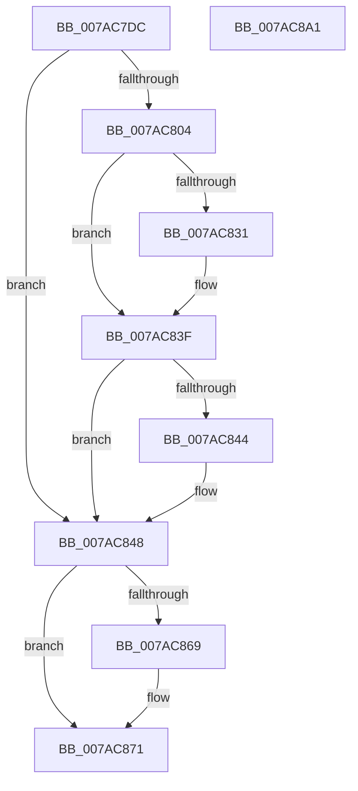

# SmcStoreSlotAbort

- RVA: `0x007AC7DC`–`0x007AC8A2` (길이 `198` bytes)
- VA: `0x00000001407AC7DC`
- 실행 섹션: `PAGE`
- PDB 이름 있음: `예`; PDB Function 태그: `아니요`
- unwind 정보 RVA: `0x0005E6B4`
- 디코드: `52`개 명령, `198/198` bytes 표시
- 미해석 바이트: `0` (있으면 어셈블리에 `.byte`로 보존)

> 이 문서는 커널 이미지의 기계어와 PDB 기호를 분석해 생성했습니다. 4번과 5번은 함수 원형과 자료형을 바이너리 사용 방식에서 추정한 C 해석이며 원본 소스 복구 결과는 아닙니다.

## 1. Dependencies

- 직접 호출 지점: **6**; 고유 호출 대상: **6**
- 직접 호출자로 확인된 함수: **2**
- RIP 상대 이미지 참조: **0**

### Outgoing calls
- `0x007AC821` → [KeAbPreAcquire](../../text/21/KeAbPreAcquire_function_00210230.md) (function, `0x00210230`)
- `0x007AC83A` → [ExfAcquirePushLockExclusiveEx](../../text/20/ExfAcquirePushLockExclusiveEx_function_0020FC90.md) (function, `0x0020FC90`)
- `0x007AC86C` → [ExfTryToWakePushLock](../../text/26/ExfTryToWakePushLock_function_00265DD0.md) (function, `0x00265DD0`)
- `0x007AC874` → [KeAbPostRelease](../../text/2E/KeAbPostRelease_function_002E1600.md) (function, `0x002E1600`)
- `0x007AC879` → [KeLeaveCriticalRegion](../../text/25/KeLeaveCriticalRegion_function_0025D8B0.md) (function, `0x0025D8B0`)
- `0x007AC881` → [CmSiFreeMemory](../../text/47/CmSiFreeMemory_function_00475D80.md) (function, `0x00475D80`)

### Direct callers
- [SmcStoreCreate](SmcStoreCreate_function_007ABFB4.md) at `0x007AC147`
- [SmcStoreSlotReserve](SmcStoreSlotReserve_function_007AC978.md) at `0x007ACAF7`

### Static image references
- 디코드된 RIP-relative 메모리 참조가 없습니다.

## 2. Other-region calls and transfers

- 다른 실행 섹션으로 향하는 call: **6**
  - `0x007AC821` → [KeAbPreAcquire](../../text/21/KeAbPreAcquire_function_00210230.md) (`PAGE` → `.text`)
  - `0x007AC83A` → [ExfAcquirePushLockExclusiveEx](../../text/20/ExfAcquirePushLockExclusiveEx_function_0020FC90.md) (`PAGE` → `.text`)
  - `0x007AC86C` → [ExfTryToWakePushLock](../../text/26/ExfTryToWakePushLock_function_00265DD0.md) (`PAGE` → `.text`)
  - `0x007AC874` → [KeAbPostRelease](../../text/2E/KeAbPostRelease_function_002E1600.md) (`PAGE` → `.text`)
  - `0x007AC879` → [KeLeaveCriticalRegion](../../text/25/KeLeaveCriticalRegion_function_0025D8B0.md) (`PAGE` → `.text`)
  - `0x007AC881` → [CmSiFreeMemory](../../text/47/CmSiFreeMemory_function_00475D80.md) (`PAGE` → `.text`)
- 별도 외부 분기/꼬리 이동을 확인하지 못했습니다.

## 3. Assembly (complete function range)

```asm
007AC7DC  48 8B C4                        mov rax, rsp
007AC7DF  48 89 58 08                     mov qword ptr [rax + 8], rbx
007AC7E3  48 89 68 10                     mov qword ptr [rax + 0x10], rbp
007AC7E7  48 89 70 18                     mov qword ptr [rax + 0x18], rsi
007AC7EB  48 89 78 20                     mov qword ptr [rax + 0x20], rdi
007AC7EF  41 56                           push r14
007AC7F1  48 83 EC 20                     sub rsp, 0x20
007AC7F5  48 83 CB FF                     or rbx, 0xffffffffffffffff
007AC7F9  48 8B EA                        mov rbp, rdx
007AC7FC  4C 8B F1                        mov r14, rcx
007AC7FF  45 85 C0                        test r8d, r8d
007AC802  75 44                           jne 0x1407ac848
007AC804  65 48 8B 04 25 88 01 00 00      mov rax, qword ptr gs:[0x188]
007AC80D  48 8D B1 A0 00 00 00            lea rsi, [rcx + 0xa0]
007AC814  33 D2                           xor edx, edx
007AC816  48 8B CE                        mov rcx, rsi
007AC819  66 01 98 E4 01 00 00            add word ptr [rax + 0x1e4], bx
007AC820  90                              nop
007AC821  E8 0A 3A A6 FF                  call 0x140210230
007AC826  F0 48 0F BA 2E 00               lock bts qword ptr [rsi], 0
007AC82C  48 8B F8                        mov rdi, rax
007AC82F  73 0E                           jae 0x1407ac83f
007AC831  4C 8B C6                        mov r8, rsi
007AC834  48 8B D0                        mov rdx, rax
007AC837  48 8B CE                        mov rcx, rsi
007AC83A  E8 51 34 A6 FF                  call 0x14020fc90
007AC83F  48 85 FF                        test rdi, rdi
007AC842  74 04                           je 0x1407ac848
007AC844  C6 47 0A 01                     mov byte ptr [rdi + 0xa], 1
007AC848  83 65 04 FB                     and dword ptr [rbp + 4], 0xfffffffb
007AC84C  49 8D BE A0 00 00 00            lea rdi, [r14 + 0xa0]
007AC853  48 8B 75 08                     mov rsi, qword ptr [rbp + 8]
007AC857  48 83 65 08 00                  and qword ptr [rbp + 8], 0
007AC85C  F0 48 0F C1 1F                  lock xadd qword ptr [rdi], rbx
007AC861  80 E3 06                        and bl, 6
007AC864  80 FB 02                        cmp bl, 2
007AC867  75 08                           jne 0x1407ac871
007AC869  48 8B CF                        mov rcx, rdi
007AC86C  E8 5F 95 AB FF                  call 0x140265dd0
007AC871  48 8B CF                        mov rcx, rdi
007AC874  E8 87 4D B3 FF                  call 0x1402e1600
007AC879  E8 32 10 AB FF                  call 0x14025d8b0
007AC87E  48 8B CE                        mov rcx, rsi
007AC881  E8 FA 94 CC FF                  call 0x140475d80
007AC886  48 8B 5C 24 30                  mov rbx, qword ptr [rsp + 0x30]
007AC88B  48 8B 6C 24 38                  mov rbp, qword ptr [rsp + 0x38]
007AC890  48 8B 74 24 40                  mov rsi, qword ptr [rsp + 0x40]
007AC895  48 8B 7C 24 48                  mov rdi, qword ptr [rsp + 0x48]
007AC89A  48 83 C4 20                     add rsp, 0x20
007AC89E  41 5E                           pop r14
007AC8A0  C3                              ret
007AC8A1  CC                              int3
```

## 4. C-style interpretation (structured pseudocode)

```c
__int64 __fastcall SmcStoreSlotAbort(__int64 a1, __int64 a2, int a3)
{
    __int64 result;
    __int64 v_rbx;
    __int64 v_rsp;
    unsigned __int64 v_stack_p10;
    unsigned __int64 v_stack_p18;
    unsigned __int64 v_stack_p20;
    unsigned __int64 v_stack_p8;

    *(unsigned __int64 *)(v_rsp + 8) = v_rbx;
    *(unsigned __int64 *)(v_rsp + 16) = v_rbp;
    *(unsigned __int64 *)(v_rsp + 24) = v_rsi;
    *(unsigned __int64 *)(v_rsp + 32) = v_rdi;
    v_rsp = (v_rsp) - (32);
    v_rbx = (v_rbx) | (-1);
    if (a3 != 0) goto loc_007AC848;
    a2 = 0;
    result = KeAbPreAcquire(a1 + 160, a2, a3, a4);
    if (!(condition_is_above_or_equal)) {
        a3 = a1 + 160;
        a2 = result;
        a1 = a1 + 160;
        result = ExfAcquirePushLockExclusiveEx(a1, a2, a3, a4);
    }
    if (result != 0) {
        *(unsigned __int8 *)(result + 10) = 1;
    }
    v_rbx = (unsigned __int8)((v_rbx) & (6));
    if (((unsigned __int8)(v_rbx)) == 2) {
        a1 = a1 + 160;
        result = ExfTryToWakePushLock(a1, a2, a3, a4);
    }
    result = KeAbPostRelease(a1 + 160, a2, a3, a4);
    result = KeLeaveCriticalRegion(a1 + 160, a2, a3, a4);
    result = CmSiFreeMemory(*(unsigned __int64 *)(a2 + 8), a2, a3, a4);
    v_rsp = (v_rsp) + (32);
    return result;
}
```

## 5. (Beta) C Style

```c
int64_t SmcStoreSlotAbort(void *Arg1, void *Arg2, int32_t Arg3)
{
    uint8_t *arg1 = (uint8_t *)Arg1;
    uint8_t *arg2 = (uint8_t *)Arg2;

    int64_t result;
    int64_t local_rbx;
    int64_t local_rsp;
    uint64_t v_stack_p10;
    uint64_t v_stack_p18;
    uint64_t v_stack_p20;
    uint64_t v_stack_p8;

    *(uint64_t *)(local_rsp + 0x8) = local_rbx;
    *(uint64_t *)(local_rsp + 0x10) = local_rbp;
    *(uint64_t *)(local_rsp + 0x18) = local_rsi;
    *(uint64_t *)(local_rsp + 0x20) = local_rdi;
    local_rsp = (local_rsp) - (32);
    local_rbx = (local_rbx) | (-1);
    if (Arg3 != 0) goto loc_007AC848;
    Arg2 = 0;
    result = KeAbPreAcquire(Arg1 + 160, Arg2, Arg3, a4);
    if (!(condition_is_above_or_equal)) {
        Arg3 = Arg1 + 160;
        Arg2 = result;
        Arg1 = Arg1 + 160;
        result = ExfAcquirePushLockExclusiveEx(Arg1, Arg2, Arg3, a4);
    }
    if (result != 0) {
        *(uint8_t *)(result + 0xA) = 1;
    }
    local_rbx = (uint8_t)((local_rbx) & (6));
    if (((uint8_t)(local_rbx)) == 2) {
        Arg1 = Arg1 + 160;
        result = ExfTryToWakePushLock(Arg1, Arg2, Arg3, a4);
    }
    result = KeAbPostRelease(Arg1 + 160, Arg2, Arg3, a4);
    result = KeLeaveCriticalRegion(Arg1 + 160, Arg2, Arg3, a4);
    result = CmSiFreeMemory(*(uint64_t *)(arg2 + 0x8), Arg2, Arg3, a4);
    local_rsp = (local_rsp) + (32);
    return result;
}
```

### 관측된 메모리 오프셋

구조체 형식이 확인되지 않은 접근은 인자 기준의 오프셋으로만 기록했습니다.

| 기준 인자 | 오프셋 표현 | 폭 (bit) | 접근 |
|---|---:|---:|---|
| `Arg1` | `+ 0x0` | `64` | `R/W` |
| `Arg1` | `+ 0xA0` | `64` | `R` |
| `Arg2` | `+ 0x4` | `32` | `R/W` |
| `Arg2` | `+ 0x8` | `64` | `R` |
| `Arg2` | `+ 0x8` | `64` | `R/W` |

## 6. Execution-region graph

[열기: 2D/3D 그래프와 함수 탐색 컨트롤 패널](../../../control-panel.html?section=page&rva=0x007AC7DC&view=graph)

- 2D 그래프는 위에서 아래로 흐르고, 3D 그래프는 빈 공간을 드래그해 회전합니다. Shift+드래그는 이동, 휠은 확대·축소, 함수 노드 선택은 대상 보고서 이동입니다.

### Static fallback


