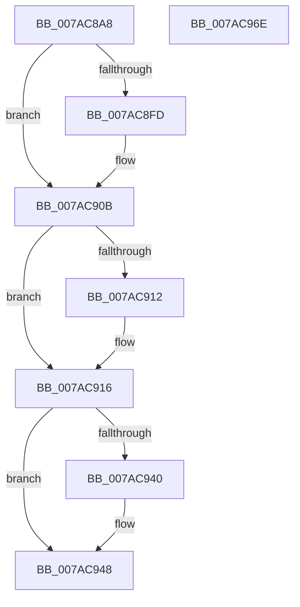

# SmcStoreSlotCommit

- RVA: `0x007AC8A8`–`0x007AC96F` (길이 `199` bytes)
- VA: `0x00000001407AC8A8`
- 실행 섹션: `PAGE`
- PDB 이름 있음: `예`; PDB Function 태그: `아니요`
- unwind 정보 RVA: `0x00060300`
- 디코드: `57`개 명령, `199/199` bytes 표시
- 미해석 바이트: `0` (있으면 어셈블리에 `.byte`로 보존)

> 이 문서는 커널 이미지의 기계어와 PDB 기호를 분석해 생성했습니다. 4번과 5번은 함수 원형과 자료형을 바이너리 사용 방식에서 추정한 C 해석이며 원본 소스 복구 결과는 아닙니다.

## 1. Dependencies

- 직접 호출 지점: **5**; 고유 호출 대상: **5**
- 직접 호출자로 확인된 함수: **1**
- RIP 상대 이미지 참조: **0**

### Outgoing calls
- `0x007AC8ED` → [KeAbPreAcquire](../../text/21/KeAbPreAcquire_function_00210230.md) (function, `0x00210230`)
- `0x007AC906` → [ExfAcquirePushLockExclusiveEx](../../text/20/ExfAcquirePushLockExclusiveEx_function_0020FC90.md) (function, `0x0020FC90`)
- `0x007AC943` → [ExfTryToWakePushLock](../../text/26/ExfTryToWakePushLock_function_00265DD0.md) (function, `0x00265DD0`)
- `0x007AC94B` → [KeAbPostRelease](../../text/2E/KeAbPostRelease_function_002E1600.md) (function, `0x002E1600`)
- `0x007AC950` → [KeLeaveCriticalRegion](../../text/25/KeLeaveCriticalRegion_function_0025D8B0.md) (function, `0x0025D8B0`)

### Direct callers
- [SmcStoreCreate](SmcStoreCreate_function_007ABFB4.md) at `0x007AC1F9`

### Static image references
- 디코드된 RIP-relative 메모리 참조가 없습니다.

## 2. Other-region calls and transfers

- 다른 실행 섹션으로 향하는 call: **5**
  - `0x007AC8ED` → [KeAbPreAcquire](../../text/21/KeAbPreAcquire_function_00210230.md) (`PAGE` → `.text`)
  - `0x007AC906` → [ExfAcquirePushLockExclusiveEx](../../text/20/ExfAcquirePushLockExclusiveEx_function_0020FC90.md) (`PAGE` → `.text`)
  - `0x007AC943` → [ExfTryToWakePushLock](../../text/26/ExfTryToWakePushLock_function_00265DD0.md) (`PAGE` → `.text`)
  - `0x007AC94B` → [KeAbPostRelease](../../text/2E/KeAbPostRelease_function_002E1600.md) (`PAGE` → `.text`)
  - `0x007AC950` → [KeLeaveCriticalRegion](../../text/25/KeLeaveCriticalRegion_function_0025D8B0.md) (`PAGE` → `.text`)
- 별도 외부 분기/꼬리 이동을 확인하지 못했습니다.

## 3. Assembly (complete function range)

```asm
007AC8A8  48 89 5C 24 08                  mov qword ptr [rsp + 8], rbx
007AC8AD  48 89 6C 24 10                  mov qword ptr [rsp + 0x10], rbp
007AC8B2  48 89 74 24 18                  mov qword ptr [rsp + 0x18], rsi
007AC8B7  57                              push rdi
007AC8B8  41 56                           push r14
007AC8BA  41 57                           push r15
007AC8BC  48 83 EC 20                     sub rsp, 0x20
007AC8C0  65 48 8B 04 25 88 01 00 00      mov rax, qword ptr gs:[0x188]
007AC8C9  48 8D B9 A0 00 00 00            lea rdi, [rcx + 0xa0]
007AC8D0  45 8B F8                        mov r15d, r8d
007AC8D3  4C 8B F2                        mov r14, rdx
007AC8D6  48 83 CB FF                     or rbx, 0xffffffffffffffff
007AC8DA  45 33 C0                        xor r8d, r8d
007AC8DD  33 D2                           xor edx, edx
007AC8DF  48 8B CF                        mov rcx, rdi
007AC8E2  66 01 98 E4 01 00 00            add word ptr [rax + 0x1e4], bx
007AC8E9  41 8B E9                        mov ebp, r9d
007AC8EC  90                              nop
007AC8ED  E8 3E 39 A6 FF                  call 0x140210230
007AC8F2  F0 48 0F BA 2F 00               lock bts qword ptr [rdi], 0
007AC8F8  48 8B F0                        mov rsi, rax
007AC8FB  73 0E                           jae 0x1407ac90b
007AC8FD  4C 8B C7                        mov r8, rdi
007AC900  48 8B D0                        mov rdx, rax
007AC903  48 8B CF                        mov rcx, rdi
007AC906  E8 85 33 A6 FF                  call 0x14020fc90
007AC90B  33 C9                           xor ecx, ecx
007AC90D  48 85 F6                        test rsi, rsi
007AC910  74 04                           je 0x1407ac916
007AC912  C6 46 0A 01                     mov byte ptr [rsi + 0xa], 1
007AC916  41 83 66 04 FB                  and dword ptr [r14 + 4], 0xfffffffb
007AC91B  45 89 3E                        mov dword ptr [r14], r15d
007AC91E  49 87 4E 10                     xchg qword ptr [r14 + 0x10], rcx
007AC922  41 8B 46 04                     mov eax, dword ptr [r14 + 4]
007AC926  8B C8                           mov ecx, eax
007AC928  33 CD                           xor ecx, ebp
007AC92A  83 E1 03                        and ecx, 3
007AC92D  33 C8                           xor ecx, eax
007AC92F  41 89 4E 04                     mov dword ptr [r14 + 4], ecx
007AC933  F0 48 0F C1 1F                  lock xadd qword ptr [rdi], rbx
007AC938  80 E3 06                        and bl, 6
007AC93B  80 FB 02                        cmp bl, 2
007AC93E  75 08                           jne 0x1407ac948
007AC940  48 8B CF                        mov rcx, rdi
007AC943  E8 88 94 AB FF                  call 0x140265dd0
007AC948  48 8B CF                        mov rcx, rdi
007AC94B  E8 B0 4C B3 FF                  call 0x1402e1600
007AC950  E8 5B 0F AB FF                  call 0x14025d8b0
007AC955  48 8B 5C 24 40                  mov rbx, qword ptr [rsp + 0x40]
007AC95A  48 8B 6C 24 48                  mov rbp, qword ptr [rsp + 0x48]
007AC95F  48 8B 74 24 50                  mov rsi, qword ptr [rsp + 0x50]
007AC964  48 83 C4 20                     add rsp, 0x20
007AC968  41 5F                           pop r15
007AC96A  41 5E                           pop r14
007AC96C  5F                              pop rdi
007AC96D  C3                              ret
007AC96E  CC                              int3
```

## 4. C-style interpretation (structured pseudocode)

```c
__int64 __fastcall SmcStoreSlotCommit(__int64 a1, __int64 a2, int a3, int a4)
{
    __int64 result;
    __int64 v_rbx;
    __int64 v_rsp;
    unsigned __int64 v_stack_p10;
    unsigned __int64 v_stack_p18;
    unsigned __int64 v_stack_p8;

    v_stack_p8 = v_rbx;
    v_stack_p10 = v_rbp;
    v_stack_p18 = v_rsi;
    v_rsp = (v_rsp) - (32);
    v_rbx = (v_rbx) | (-1);
    a3 = 0;
    a2 = 0;
    result = KeAbPreAcquire(a1 + 160, a2, a3, a4);
    if (!(condition_is_above_or_equal)) {
        a3 = a1 + 160;
        a2 = result;
        a1 = a1 + 160;
        result = ExfAcquirePushLockExclusiveEx(a1, a2, a3, a4);
    }
    a1 = 0;
    if (result != 0) {
        *(unsigned __int8 *)(result + 10) = 1;
    }
    *(unsigned int *)(a2) = (unsigned int)((unsigned int)(a3));
    a1 = (unsigned int)(((unsigned int)((unsigned int)((unsigned int)(*(unsigned int *)(a2 + 4))))) ^ ((unsigned int)((unsigned int)(a4))));
    a1 = (unsigned int)((a1) & (3));
    a1 = (unsigned int)((a1) ^ ((unsigned int)((unsigned int)(*(unsigned int *)(a2 + 4)))));
    *(unsigned int *)(a2 + 4) = (unsigned int)(a1);
    v_rbx = (unsigned __int8)((v_rbx) & (6));
    result = (unsigned int)(*(unsigned int *)(a2 + 4));
    if (((unsigned __int8)(v_rbx)) == 2) {
        a1 = a1 + 160;
        result = ExfTryToWakePushLock(a1, a2, a3, a4);
    }
    result = KeAbPostRelease(a1 + 160, a2, a3, a4);
    result = KeLeaveCriticalRegion(a1 + 160, a2, a3, a4);
    v_rsp = (v_rsp) + (32);
    return result;
}
```

## 5. (Beta) C Style

```c
int64_t SmcStoreSlotCommit(void *Arg1, void *Arg2, int32_t Arg3, int32_t Arg4)
{
    uint8_t *arg1 = (uint8_t *)Arg1;
    uint8_t *arg2 = (uint8_t *)Arg2;

    int64_t result;
    int64_t local_rbx;
    int64_t local_rsp;
    uint64_t v_stack_p10;
    uint64_t v_stack_p18;
    uint64_t v_stack_p8;

    v_stack_p8 = local_rbx;
    v_stack_p10 = local_rbp;
    v_stack_p18 = local_rsi;
    local_rsp = (local_rsp) - (32);
    local_rbx = (local_rbx) | (-1);
    Arg3 = 0;
    Arg2 = 0;
    result = KeAbPreAcquire(Arg1 + 160, Arg2, Arg3, Arg4);
    if (!(condition_is_above_or_equal)) {
        Arg3 = Arg1 + 160;
        Arg2 = result;
        Arg1 = Arg1 + 160;
        result = ExfAcquirePushLockExclusiveEx(Arg1, Arg2, Arg3, Arg4);
    }
    Arg1 = 0;
    if (result != 0) {
        *(uint8_t *)(result + 0xA) = 1;
    }
    *(uint32_t *)(arg2) = (uint32_t)((uint32_t)(Arg3));
    Arg1 = (uint32_t)(((uint32_t)((uint32_t)((uint32_t)(*(uint32_t *)(arg2 + 0x4))))) ^ ((uint32_t)((uint32_t)(Arg4))));
    Arg1 = (uint32_t)((Arg1) & (3));
    Arg1 = (uint32_t)((Arg1) ^ ((uint32_t)((uint32_t)(*(uint32_t *)(arg2 + 0x4)))));
    *(uint32_t *)(arg2 + 0x4) = (uint32_t)(Arg1);
    local_rbx = (uint8_t)((local_rbx) & (6));
    result = (uint32_t)(*(uint32_t *)(arg2 + 0x4));
    if (((uint8_t)(local_rbx)) == 2) {
        Arg1 = Arg1 + 160;
        result = ExfTryToWakePushLock(Arg1, Arg2, Arg3, Arg4);
    }
    result = KeAbPostRelease(Arg1 + 160, Arg2, Arg3, Arg4);
    result = KeLeaveCriticalRegion(Arg1 + 160, Arg2, Arg3, Arg4);
    local_rsp = (local_rsp) + (32);
    return result;
}
```

### 관측된 메모리 오프셋

구조체 형식이 확인되지 않은 접근은 인자 기준의 오프셋으로만 기록했습니다.

| 기준 인자 | 오프셋 표현 | 폭 (bit) | 접근 |
|---|---:|---:|---|
| `Arg1` | `+ 0x0` | `64` | `R/W` |
| `Arg1` | `+ 0xA0` | `64` | `R` |
| `Arg2` | `+ 0x0` | `32` | `W` |
| `Arg2` | `+ 0x4` | `32` | `R` |
| `Arg2` | `+ 0x4` | `32` | `R/W` |
| `Arg2` | `+ 0x4` | `32` | `W` |
| `Arg2` | `+ 0x10` | `64` | `R/W` |

## 6. Execution-region graph

[열기: 2D/3D 그래프와 함수 탐색 컨트롤 패널](../../../control-panel.html?section=page&rva=0x007AC8A8&view=graph)

- 2D 그래프는 위에서 아래로 흐르고, 3D 그래프는 빈 공간을 드래그해 회전합니다. Shift+드래그는 이동, 휠은 확대·축소, 함수 노드 선택은 대상 보고서 이동입니다.

### Static fallback


