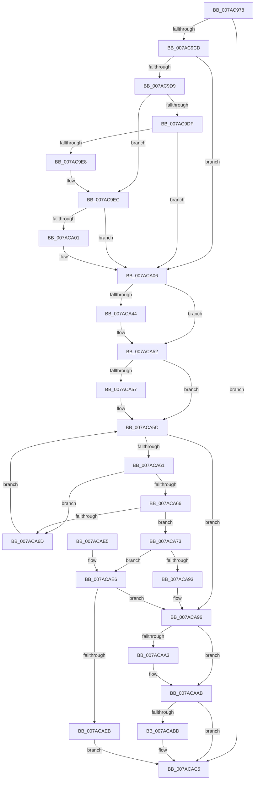

# SmcStoreSlotReserve

- RVA: `0x007AC978`–`0x007ACAFE` (길이 `390` bytes)
- VA: `0x00000001407AC978`
- 실행 섹션: `PAGE`
- PDB 이름 있음: `예`; PDB Function 태그: `아니요`
- unwind 정보 RVA: `0x000D20E4`
- 디코드: `114`개 명령, `390/390` bytes 표시
- 미해석 바이트: `0` (있으면 어셈블리에 `.byte`로 보존)

> 이 문서는 커널 이미지의 기계어와 PDB 기호를 분석해 생성했습니다. 4번과 5번은 함수 원형과 자료형을 바이너리 사용 방식에서 추정한 C 해석이며 원본 소스 복구 결과는 아닙니다.

## 1. Dependencies

- 직접 호출 지점: **9**; 고유 호출 대상: **9**
- 직접 호출자로 확인된 함수: **1**
- RIP 상대 이미지 참조: **0**

### Outgoing calls
- `0x007AC9BC` → [SmAllocEx](../../text/34/SmAllocEx_function_0034C794.md) (function, `0x0034C794`)
- `0x007ACA34` → [KeAbPreAcquire](../../text/21/KeAbPreAcquire_function_00210230.md) (function, `0x00210230`)
- `0x007ACA4D` → [ExfAcquirePushLockExclusiveEx](../../text/20/ExfAcquirePushLockExclusiveEx_function_0020FC90.md) (function, `0x0020FC90`)
- `0x007ACA8A` → [SmcStorePlacementGet](SmcStorePlacementGet_function_007AC400.md) (function, `0x007AC400`)
- `0x007ACAA6` → [ExfTryToWakePushLock](../../text/26/ExfTryToWakePushLock_function_00265DD0.md) (function, `0x00265DD0`)
- `0x007ACAAE` → [KeAbPostRelease](../../text/2E/KeAbPostRelease_function_002E1600.md) (function, `0x002E1600`)
- `0x007ACAB3` → [KeLeaveCriticalRegion](../../text/25/KeLeaveCriticalRegion_function_0025D8B0.md) (function, `0x0025D8B0`)
- `0x007ACAC0` → [CmSiFreeMemory](../../text/47/CmSiFreeMemory_function_00475D80.md) (function, `0x00475D80`)
- `0x007ACAF7` → [SmcStoreSlotAbort](SmcStoreSlotAbort_function_007AC7DC.md) (function, `0x007AC7DC`)

### Direct callers
- [SmcStoreCreate](SmcStoreCreate_function_007ABFB4.md) at `0x007AC05E`

### Static image references
- 디코드된 RIP-relative 메모리 참조가 없습니다.

## 2. Other-region calls and transfers

- 다른 실행 섹션으로 향하는 call: **7**
  - `0x007AC9BC` → [SmAllocEx](../../text/34/SmAllocEx_function_0034C794.md) (`PAGE` → `.text`)
  - `0x007ACA34` → [KeAbPreAcquire](../../text/21/KeAbPreAcquire_function_00210230.md) (`PAGE` → `.text`)
  - `0x007ACA4D` → [ExfAcquirePushLockExclusiveEx](../../text/20/ExfAcquirePushLockExclusiveEx_function_0020FC90.md) (`PAGE` → `.text`)
  - `0x007ACAA6` → [ExfTryToWakePushLock](../../text/26/ExfTryToWakePushLock_function_00265DD0.md) (`PAGE` → `.text`)
  - `0x007ACAAE` → [KeAbPostRelease](../../text/2E/KeAbPostRelease_function_002E1600.md) (`PAGE` → `.text`)
  - `0x007ACAB3` → [KeLeaveCriticalRegion](../../text/25/KeLeaveCriticalRegion_function_0025D8B0.md) (`PAGE` → `.text`)
  - `0x007ACAC0` → [CmSiFreeMemory](../../text/47/CmSiFreeMemory_function_00475D80.md) (`PAGE` → `.text`)
- 별도 외부 분기/꼬리 이동을 확인하지 못했습니다.

## 3. Assembly (complete function range)

```asm
007AC978  48 8B C4                        mov rax, rsp
007AC97B  48 89 58 08                     mov qword ptr [rax + 8], rbx
007AC97F  48 89 68 10                     mov qword ptr [rax + 0x10], rbp
007AC983  48 89 70 20                     mov qword ptr [rax + 0x20], rsi
007AC987  44 89 40 18                     mov dword ptr [rax + 0x18], r8d
007AC98B  57                              push rdi
007AC98C  41 54                           push r12
007AC98E  41 55                           push r13
007AC990  41 56                           push r14
007AC992  41 57                           push r15
007AC994  48 83 EC 20                     sub rsp, 0x20
007AC998  8B 71 08                        mov esi, dword ptr [rcx + 8]
007AC99B  4C 8B E9                        mov r13, rcx
007AC99E  48 83 C6 1F                     add rsi, 0x1f
007AC9A2  41 83 CF FF                     or r15d, 0xffffffff
007AC9A6  48 C1 EE 05                     shr rsi, 5
007AC9AA  45 8B C7                        mov r8d, r15d
007AC9AD  BA 73 6D 43 72                  mov edx, 0x72436d73
007AC9B2  33 ED                           xor ebp, ebp
007AC9B4  48 8D 0C B5 00 00 00 00         lea rcx, [rsi*4]
007AC9BC  E8 D3 FD B9 FF                  call 0x14034c794
007AC9C1  4C 8B F0                        mov r14, rax
007AC9C4  48 85 C0                        test rax, rax
007AC9C7  0F 84 F8 00 00 00               je 0x1407acac5
007AC9CD  48 83 CB FF                     or rbx, 0xffffffffffffffff
007AC9D1  48 8B D0                        mov rdx, rax
007AC9D4  48 85 F6                        test rsi, rsi
007AC9D7  74 2D                           je 0x1407aca06
007AC9D9  41 F6 C6 04                     test r14b, 4
007AC9DD  74 0D                           je 0x1407ac9ec
007AC9DF  44 89 38                        mov dword ptr [rax], r15d
007AC9E2  48 83 EE 01                     sub rsi, 1
007AC9E6  74 1E                           je 0x1407aca06
007AC9E8  48 8D 50 04                     lea rdx, [rax + 4]
007AC9EC  48 8B CE                        mov rcx, rsi
007AC9EF  48 8B FA                        mov rdi, rdx
007AC9F2  48 D1 E9                        shr rcx, 1
007AC9F5  48 8B C3                        mov rax, rbx
007AC9F8  F3 48 AB                        rep stosq qword ptr [rdi], rax
007AC9FB  40 F6 C6 01                     test sil, 1
007AC9FF  74 05                           je 0x1407aca06
007ACA01  44 89 7C B2 FC                  mov dword ptr [rdx + rsi*4 - 4], r15d
007ACA06  65 48 8B 04 25 88 01 00 00      mov rax, qword ptr gs:[0x188]
007ACA0F  49 8D B5 A0 00 00 00            lea rsi, [r13 + 0xa0]
007ACA16  49 8D BD A8 00 00 00            lea rdi, [r13 + 0xa8]
007ACA1D  45 33 C0                        xor r8d, r8d
007ACA20  33 D2                           xor edx, edx
007ACA22  4C 8D A7 80 01 00 00            lea r12, [rdi + 0x180]
007ACA29  48 8B CE                        mov rcx, rsi
007ACA2C  66 01 98 E4 01 00 00            add word ptr [rax + 0x1e4], bx
007ACA33  90                              nop
007ACA34  E8 F7 37 A6 FF                  call 0x140210230
007ACA39  F0 48 0F BA 2E 00               lock bts qword ptr [rsi], 0
007ACA3F  4C 8B F8                        mov r15, rax
007ACA42  73 0E                           jae 0x1407aca52
007ACA44  4C 8B C6                        mov r8, rsi
007ACA47  48 8B D0                        mov rdx, rax
007ACA4A  48 8B CE                        mov rcx, rsi
007ACA4D  E8 3E 32 A6 FF                  call 0x14020fc90
007ACA52  4D 85 FF                        test r15, r15
007ACA55  74 05                           je 0x1407aca5c
007ACA57  41 C6 47 0A 01                  mov byte ptr [r15 + 0xa], 1
007ACA5C  49 3B FC                        cmp rdi, r12
007ACA5F  73 35                           jae 0x1407aca96
007ACA61  83 3F FF                        cmp dword ptr [rdi], -1
007ACA64  75 07                           jne 0x1407aca6d
007ACA66  8B 47 04                        mov eax, dword ptr [rdi + 4]
007ACA69  A8 04                           test al, 4
007ACA6B  74 06                           je 0x1407aca73
007ACA6D  48 83 C7 18                     add rdi, 0x18
007ACA71  EB E9                           jmp 0x1407aca5c
007ACA73  8B 54 24 60                     mov edx, dword ptr [rsp + 0x60]
007ACA77  83 C8 04                        or eax, 4
007ACA7A  4C 89 77 08                     mov qword ptr [rdi + 8], r14
007ACA7E  4C 8B C7                        mov r8, rdi
007ACA81  49 8B CD                        mov rcx, r13
007ACA84  89 47 04                        mov dword ptr [rdi + 4], eax
007ACA87  45 33 F6                        xor r14d, r14d
007ACA8A  E8 71 F9 FF FF                  call 0x1407ac400
007ACA8F  85 C0                           test eax, eax
007ACA91  78 53                           js 0x1407acae6
007ACA93  48 8B EF                        mov rbp, rdi
007ACA96  F0 48 0F C1 1E                  lock xadd qword ptr [rsi], rbx
007ACA9B  80 E3 06                        and bl, 6
007ACA9E  80 FB 02                        cmp bl, 2
007ACAA1  75 08                           jne 0x1407acaab
007ACAA3  48 8B CE                        mov rcx, rsi
007ACAA6  E8 25 93 AB FF                  call 0x140265dd0
007ACAAB  48 8B CE                        mov rcx, rsi
007ACAAE  E8 4D 4B B3 FF                  call 0x1402e1600
007ACAB3  E8 F8 0D AB FF                  call 0x14025d8b0
007ACAB8  4D 85 F6                        test r14, r14
007ACABB  74 08                           je 0x1407acac5
007ACABD  49 8B CE                        mov rcx, r14
007ACAC0  E8 BB 92 CC FF                  call 0x140475d80
007ACAC5  48 8B 5C 24 50                  mov rbx, qword ptr [rsp + 0x50]
007ACACA  48 8B C5                        mov rax, rbp
007ACACD  48 8B 6C 24 58                  mov rbp, qword ptr [rsp + 0x58]
007ACAD2  48 8B 74 24 68                  mov rsi, qword ptr [rsp + 0x68]
007ACAD7  48 83 C4 20                     add rsp, 0x20
007ACADB  41 5F                           pop r15
007ACADD  41 5E                           pop r14
007ACADF  41 5D                           pop r13
007ACAE1  41 5C                           pop r12
007ACAE3  5F                              pop rdi
007ACAE4  C3                              ret
007ACAE5  CC                              int3
007ACAE6  48 85 FF                        test rdi, rdi
007ACAE9  74 AB                           je 0x1407aca96
007ACAEB  41 B8 01 00 00 00               mov r8d, 1
007ACAF1  48 8B D7                        mov rdx, rdi
007ACAF4  49 8B CD                        mov rcx, r13
007ACAF7  E8 E0 FC FF FF                  call 0x1407ac7dc
007ACAFC  EB C7                           jmp 0x1407acac5
```

## 4. C-style interpretation (structured pseudocode)

```c
__int64 __fastcall SmcStoreSlotReserve(__int64 a1, __int64 a2, int a3)
{
    __int64 result;
    __int64 v_r14;
    __int64 v_r15;
    __int64 v_rbp;
    __int64 v_rbx;
    __int64 v_rdi;
    __int64 v_rsi;
    __int64 v_rsp;
    unsigned __int64 v_stack_p10;
    unsigned int v_stack_p18;
    unsigned __int64 v_stack_p20;
    unsigned __int64 v_stack_p8;

    *(unsigned __int64 *)(v_rsp + 8) = v_rbx;
    *(unsigned __int64 *)(v_rsp + 16) = v_rbp;
    *(unsigned __int64 *)(v_rsp + 32) = v_rsi;
    *(unsigned int *)(v_rsp + 24) = a3;
    v_rsp = (v_rsp) - (32);
    v_rsi = ((unsigned int)(*(unsigned int *)(a1 + 8))) + (31);
    v_r15 = (unsigned int)((v_r15) | (0xFFFFFFFFULL));
    v_rsi = (v_rsi) >> (5);
    v_rbp = 0;
    result = SmAllocEx(v_rsi * 4, (unsigned int)(0x72436D73ULL), (unsigned int)((unsigned int)(v_r15)), a4);
    if (result == 0) goto loc_007ACAC5;
    v_rbx = (v_rbx) | (-1);
    if (v_rsi == 0) goto loc_007ACA06;
    if ((((unsigned __int8)(result)) & (4)) == 0) goto loc_007AC9EC;
    *(unsigned int *)(result) = (unsigned int)(v_r15);
    v_rsi = (v_rsi) - (1);
    if (condition_is_equal) goto loc_007ACA06;
loc_007AC9EC:
    a1 = (v_rsi) >> (1);
    if ((((unsigned __int8)(v_rsi)) & (1)) != 0) {
        *(unsigned int *)(result + 4 + v_rsi * 4 - 4) = (unsigned int)(v_r15);
    }
    a3 = 0;
    a2 = 0;
    result = KeAbPreAcquire(a1 + 160, a2, a3, a4);
    if (!(condition_is_above_or_equal)) {
        a3 = a1 + 160;
        a2 = result;
        a1 = a1 + 160;
        result = ExfAcquirePushLockExclusiveEx(a1, a2, a3, a4);
    }
    if (result != 0) {
        *(unsigned __int8 *)(result + 10) = 1;
    }
    if ((a1 + 168) >= (a1 + 168 + 384)) goto loc_007ACA96;
    if ((*(unsigned int *)(a1 + 168)) != -1) goto loc_007ACA6D;
    if ((((unsigned __int8)((unsigned int)(*(unsigned int *)(a1 + 168 + 4)))) & (4)) == 0) goto loc_007ACA73;
loc_007ACA6D:
    v_rdi = (a1 + 168) + (24);
    goto loc_007ACA5C;
loc_007ACA73:
    result = (unsigned int)(((unsigned int)(*(unsigned int *)(a1 + 168 + 4))) | (4));
    *(unsigned __int64 *)(v_rdi + 8) = result;
    *(unsigned int *)(v_rdi + 4) = (unsigned int)(result);
    v_r14 = 0;
    result = SmcStorePlacementGet(a1, (unsigned int)(v_stack_p18), v_rdi, a4);
    if (sign_flag) goto loc_007ACAE6;
loc_007ACA96:
    v_rbx = (unsigned __int8)((v_rbx) & (6));
    if (((unsigned __int8)(v_rbx)) == 2) {
        a1 = a1 + 160;
        result = ExfTryToWakePushLock(a1, (unsigned int)(v_stack_p18), v_rdi, a4);
    }
    result = KeAbPostRelease(a1 + 160, (unsigned int)(v_stack_p18), v_rdi, a4);
    result = KeLeaveCriticalRegion(a1 + 160, (unsigned int)(v_stack_p18), v_rdi, a4);
    if (0 != 0) {
        a1 = 0;
        result = CmSiFreeMemory(a1, (unsigned int)(v_stack_p18), v_rdi, a4);
    }
    v_rsp = (v_rsp) + (32);
    return v_rdi;
loc_007ACAE6:
    if (v_rdi == 0) goto loc_007ACA96;
    result = SmcStoreSlotAbort(a1, v_rdi, 1, a4);
    goto loc_007ACAC5;
}
```

## 5. (Beta) C Style

```c
int64_t SmcStoreSlotReserve(void *Arg1, int64_t Arg2, int32_t Arg3)
{
    uint8_t *arg1 = (uint8_t *)Arg1;

    int64_t result;
    int64_t local_r14;
    int64_t local_r15;
    int64_t local_rbp;
    int64_t local_rbx;
    int64_t local_rdi;
    int64_t local_rsi;
    int64_t local_rsp;
    uint64_t v_stack_p10;
    uint32_t v_stack_p18;
    uint64_t v_stack_p20;
    uint64_t v_stack_p8;

    *(uint64_t *)(local_rsp + 0x8) = local_rbx;
    *(uint64_t *)(local_rsp + 0x10) = local_rbp;
    *(uint64_t *)(local_rsp + 0x20) = local_rsi;
    *(uint32_t *)(local_rsp + 0x18) = Arg3;
    local_rsp = (local_rsp) - (32);
    local_rsi = ((uint32_t)(*(uint32_t *)(arg1 + 0x8))) + (31);
    local_r15 = (uint32_t)((local_r15) | (0xFFFFFFFFULL));
    local_rsi = (local_rsi) >> (5);
    local_rbp = 0;
    result = SmAllocEx(local_rsi * 4, (uint32_t)(0x72436D73ULL), (uint32_t)((uint32_t)(local_r15)), a4);
    if (result == 0) goto loc_007ACAC5;
    local_rbx = (local_rbx) | (-1);
    if (local_rsi == 0) goto loc_007ACA06;
    if ((((uint8_t)(result)) & (4)) == 0) goto loc_007AC9EC;
    *(uint32_t *)(result) = (uint32_t)(local_r15);
    local_rsi = (local_rsi) - (1);
    if (condition_is_equal) goto loc_007ACA06;
loc_007AC9EC:
    Arg1 = (local_rsi) >> (1);
    if ((((uint8_t)(local_rsi)) & (1)) != 0) {
        *(uint32_t *)(result + 0x4 + local_rsi * 4 - 0x4) = (uint32_t)(local_r15);
    }
    Arg3 = 0;
    Arg2 = 0;
    result = KeAbPreAcquire(Arg1 + 160, Arg2, Arg3, a4);
    if (!(condition_is_above_or_equal)) {
        Arg3 = Arg1 + 160;
        Arg2 = result;
        Arg1 = Arg1 + 160;
        result = ExfAcquirePushLockExclusiveEx(Arg1, Arg2, Arg3, a4);
    }
    if (result != 0) {
        *(uint8_t *)(result + 0xA) = 1;
    }
    if ((Arg1 + 168) >= (Arg1 + 168 + 384)) goto loc_007ACA96;
    if ((*(uint32_t *)(arg1 + 0xA8)) != -1) goto loc_007ACA6D;
    if ((((uint8_t)((uint32_t)(*(uint32_t *)(arg1 + 0xA8 + 0x4)))) & (4)) == 0) goto loc_007ACA73;
loc_007ACA6D:
    local_rdi = (Arg1 + 168) + (24);
    goto loc_007ACA5C;
loc_007ACA73:
    result = (uint32_t)(((uint32_t)(*(uint32_t *)(arg1 + 0xA8 + 0x4))) | (4));
    *(uint64_t *)(local_rdi + 0x8) = result;
    *(uint32_t *)(local_rdi + 0x4) = (uint32_t)(result);
    local_r14 = 0;
    result = SmcStorePlacementGet(Arg1, (uint32_t)(v_stack_p18), local_rdi, a4);
    if (sign_flag) goto loc_007ACAE6;
loc_007ACA96:
    local_rbx = (uint8_t)((local_rbx) & (6));
    if (((uint8_t)(local_rbx)) == 2) {
        Arg1 = Arg1 + 160;
        result = ExfTryToWakePushLock(Arg1, (uint32_t)(v_stack_p18), local_rdi, a4);
    }
    result = KeAbPostRelease(Arg1 + 160, (uint32_t)(v_stack_p18), local_rdi, a4);
    result = KeLeaveCriticalRegion(Arg1 + 160, (uint32_t)(v_stack_p18), local_rdi, a4);
    if (0 != 0) {
        Arg1 = 0;
        result = CmSiFreeMemory(Arg1, (uint32_t)(v_stack_p18), local_rdi, a4);
    }
    local_rsp = (local_rsp) + (32);
    return local_rdi;
loc_007ACAE6:
    if (local_rdi == 0) goto loc_007ACA96;
    result = SmcStoreSlotAbort(Arg1, local_rdi, 1, a4);
    goto loc_007ACAC5;
}
```

### 관측된 메모리 오프셋

구조체 형식이 확인되지 않은 접근은 인자 기준의 오프셋으로만 기록했습니다.

| 기준 인자 | 오프셋 표현 | 폭 (bit) | 접근 |
|---|---:|---:|---|
| `Arg1` | `+ 0x0` | `64` | `R/W` |
| `Arg1` | `+ 0x8` | `32` | `R` |
| `Arg1` | `+ 0xA0` | `64` | `R` |
| `Arg1` | `+ 0xA8` | `64` | `R` |
| `Arg1` | `+ 0x180` | `64` | `R` |

## 6. Execution-region graph

[열기: 2D/3D 그래프와 함수 탐색 컨트롤 패널](../../../control-panel.html?section=page&rva=0x007AC978&view=graph)

- 2D 그래프는 위에서 아래로 흐르고, 3D 그래프는 빈 공간을 드래그해 회전합니다. Shift+드래그는 이동, 휠은 확대·축소, 함수 노드 선택은 대상 보고서 이동입니다.

### Static fallback


