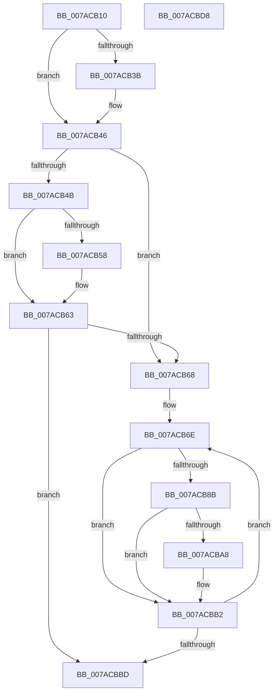

# SmcVolumePnpNotification

- RVA: `0x007ACB10`–`0x007ACBD9` (길이 `201` bytes)
- VA: `0x00000001407ACB10`
- 실행 섹션: `PAGE`
- PDB 이름 있음: `예`; PDB Function 태그: `아니요`
- unwind 정보 RVA: `0x00060300`
- 디코드: `60`개 명령, `201/201` bytes 표시
- 미해석 바이트: `0` (있으면 어셈블리에 `.byte`로 보존)

> 이 문서는 커널 이미지의 기계어와 PDB 기호를 분석해 생성했습니다. 4번과 5번은 함수 원형과 자료형을 바이너리 사용 방식에서 추정한 C 해석이며 원본 소스 복구 결과는 아닙니다.

## 1. Dependencies

- 직접 호출 지점: **3**; 고유 호출 대상: **3**
- 직접 호출자로 확인된 함수: **0**
- RIP 상대 이미지 참조: **4**

### Outgoing calls
- `0x007ACB81` → [SmcCacheReference](SmcCacheReference_function_007ABAF8.md) (function, `0x007ABAF8`)
- `0x007ACB9E` → [SmcCacheDereference](SmcCacheDereference_function_007AB8A8.md) (function, `0x007AB8A8`)
- `0x007ACBAD` → [SmcCacheDelete](SmcCacheDelete_function_007AB84C.md) (function, `0x007AB84C`)

### Direct callers
- 이 함수 시작 RVA로 연결되는 직접 call은 확인되지 않았습니다. 간접 호출은 완전히 역산할 수 없습니다.

### Static image references
- `0x007ACB2F` → RVA `0x0001A210` (`.rdata`; read)
- `0x007ACB3F` → RVA `0x0001A218` (`.rdata`; read)
- `0x007ACB4F` → RVA `0x0001A220` (`.rdata`; read)
- `0x007ACB5C` → RVA `0x0001A228` (`.rdata`; read)

## 2. Other-region calls and transfers

- 다른 실행 섹션으로 향하는 call: **0**
- 별도 외부 분기/꼬리 이동을 확인하지 못했습니다.

## 3. Assembly (complete function range)

```asm
007ACB10  48 89 5C 24 08                  mov qword ptr [rsp + 8], rbx
007ACB15  48 89 6C 24 10                  mov qword ptr [rsp + 0x10], rbp
007ACB1A  48 89 74 24 18                  mov qword ptr [rsp + 0x18], rsi
007ACB1F  57                              push rdi
007ACB20  41 56                           push r14
007ACB22  41 57                           push r15
007ACB24  48 83 EC 20                     sub rsp, 0x20
007ACB28  48 8B 41 04                     mov rax, qword ptr [rcx + 4]
007ACB2C  4C 8B FA                        mov r15, rdx
007ACB2F  48 2B 05 DA D6 86 FF            sub rax, qword ptr [rip - 0x792926]
007ACB36  48 8B F1                        mov rsi, rcx
007ACB39  75 0B                           jne 0x1407acb46
007ACB3B  48 8B 41 0C                     mov rax, qword ptr [rcx + 0xc]
007ACB3F  48 2B 05 D2 D6 86 FF            sub rax, qword ptr [rip - 0x79292e]
007ACB46  48 85 C0                        test rax, rax
007ACB49  74 1D                           je 0x1407acb68
007ACB4B  48 8B 41 04                     mov rax, qword ptr [rcx + 4]
007ACB4F  48 2B 05 CA D6 86 FF            sub rax, qword ptr [rip - 0x792936]
007ACB56  75 0B                           jne 0x1407acb63
007ACB58  48 8B 41 0C                     mov rax, qword ptr [rcx + 0xc]
007ACB5C  48 2B 05 C5 D6 86 FF            sub rax, qword ptr [rip - 0x79293b]
007ACB63  48 85 C0                        test rax, rax
007ACB66  75 55                           jne 0x1407acbbd
007ACB68  33 FF                           xor edi, edi
007ACB6A  4C 8D 72 18                     lea r14, [rdx + 0x18]
007ACB6E  41 8B 2E                        mov ebp, dword ptr [r14]
007ACB71  49 8B CF                        mov rcx, r15
007ACB74  81 E5 FF 0F 00 00               and ebp, 0xfff
007ACB7A  C1 E5 04                        shl ebp, 4
007ACB7D  0B EF                           or ebp, edi
007ACB7F  8B D5                           mov edx, ebp
007ACB81  E8 72 EF FF FF                  call 0x1407abaf8
007ACB86  48 85 C0                        test rax, rax
007ACB89  74 27                           je 0x1407acbb2
007ACB8B  48 8B 48 30                     mov rcx, qword ptr [rax + 0x30]
007ACB8F  33 DB                           xor ebx, ebx
007ACB91  48 3B 4E 18                     cmp rcx, qword ptr [rsi + 0x18]
007ACB95  8B D5                           mov edx, ebp
007ACB97  49 8B CF                        mov rcx, r15
007ACB9A  48 0F 44 D8                     cmove rbx, rax
007ACB9E  E8 05 ED FF FF                  call 0x1407ab8a8
007ACBA3  48 85 DB                        test rbx, rbx
007ACBA6  74 0A                           je 0x1407acbb2
007ACBA8  8B D5                           mov edx, ebp
007ACBAA  49 8B CF                        mov rcx, r15
007ACBAD  E8 9A EC FF FF                  call 0x1407ab84c
007ACBB2  FF C7                           inc edi
007ACBB4  49 83 C6 20                     add r14, 0x20
007ACBB8  83 FF 10                        cmp edi, 0x10
007ACBBB  72 B1                           jb 0x1407acb6e
007ACBBD  48 8B 5C 24 40                  mov rbx, qword ptr [rsp + 0x40]
007ACBC2  33 C0                           xor eax, eax
007ACBC4  48 8B 6C 24 48                  mov rbp, qword ptr [rsp + 0x48]
007ACBC9  48 8B 74 24 50                  mov rsi, qword ptr [rsp + 0x50]
007ACBCE  48 83 C4 20                     add rsp, 0x20
007ACBD2  41 5F                           pop r15
007ACBD4  41 5E                           pop r14
007ACBD6  5F                              pop rdi
007ACBD7  C3                              ret
007ACBD8  CC                              int3
```

## 4. C-style interpretation (structured pseudocode)

```c
__int64 __fastcall SmcVolumePnpNotification(__int64 a1, __int64 a2)
{
    __int64 result;
    __int64 v_r14;
    __int64 v_rbp;
    __int64 v_rbx;
    __int64 v_rdi;
    __int64 v_rsp;
    unsigned __int64 v_stack_p10;
    unsigned __int64 v_stack_p18;
    unsigned __int64 v_stack_p8;

    v_stack_p8 = v_rbx;
    v_stack_p10 = v_rbp;
    v_stack_p18 = v_rsi;
    v_rsp = (v_rsp) - (32);
    result = (*(unsigned __int64 *)(a1 + 4)) - (*(unsigned __int64 *)(v_rip - 7940390));
    if (!(condition_is_not_equal)) {
        result = *(unsigned __int64 *)(a1 + 12);
        result = (result) - (*(unsigned __int64 *)(v_rip - 7940398));
    }
    if (result == 0) goto loc_007ACB68;
    result = (*(unsigned __int64 *)(a1 + 4)) - (*(unsigned __int64 *)(v_rip - 7940406));
    if (!(condition_is_not_equal)) {
        result = *(unsigned __int64 *)(a1 + 12);
        result = (result) - (*(unsigned __int64 *)(v_rip - 7940411));
    }
    if (result != 0) goto loc_007ACBBD;
loc_007ACB68:
    v_rdi = 0;
loc_007ACB6E:
    v_rbp = (unsigned int)(((unsigned int)(*(unsigned int *)(a2 + 24))) & (0xFFFULL));
    v_rbp = (unsigned int)((v_rbp) << (4));
    v_rbp = (unsigned int)((v_rbp) | (0));
    result = SmcCacheReference(a2, (unsigned int)((unsigned int)(v_rbp)), a3, a4);
    if (result == 0) goto loc_007ACBB2;
    v_rbx = 0;
    if ((*(unsigned __int64 *)(result + 48)) == (*(unsigned __int64 *)(a1 + 24))) { v_rbx = result; }
    result = SmcCacheDereference(a2, (unsigned int)((unsigned int)(v_rbp)), a3, a4);
    if (v_rbx != 0) {
        a2 = (unsigned int)(v_rbp);
        a1 = a2;
        result = SmcCacheDelete(a1, a2, a3, a4);
    }
    v_rdi = (unsigned int)((v_rdi) + 1);
    v_r14 = (a2 + 24) + (32);
    if (((unsigned int)(v_rdi)) < 16) goto loc_007ACB6E;
loc_007ACBBD:
    result = 0;
    v_rsp = (v_rsp) + (32);
    return result;
}
```

## 5. (Beta) C Style

```c
int64_t SmcVolumePnpNotification(void *Arg1, void *Arg2)
{
    uint8_t *arg1 = (uint8_t *)Arg1;
    uint8_t *arg2 = (uint8_t *)Arg2;

    int64_t result;
    int64_t local_r14;
    int64_t local_rbp;
    int64_t local_rbx;
    int64_t local_rdi;
    int64_t local_rsp;
    uint64_t v_stack_p10;
    uint64_t v_stack_p18;
    uint64_t v_stack_p8;

    v_stack_p8 = local_rbx;
    v_stack_p10 = local_rbp;
    v_stack_p18 = local_rsi;
    local_rsp = (local_rsp) - (32);
    result = (*(uint64_t *)(arg1 + 0x4)) - (*(uint64_t *)(v_rip - 0x792926));
    if (!(condition_is_not_equal)) {
        result = *(uint64_t *)(arg1 + 0xC);
        result = (result) - (*(uint64_t *)(v_rip - 0x79292E));
    }
    if (result == 0) goto loc_007ACB68;
    result = (*(uint64_t *)(arg1 + 0x4)) - (*(uint64_t *)(v_rip - 0x792936));
    if (!(condition_is_not_equal)) {
        result = *(uint64_t *)(arg1 + 0xC);
        result = (result) - (*(uint64_t *)(v_rip - 0x79293B));
    }
    if (result != 0) goto loc_007ACBBD;
loc_007ACB68:
    local_rdi = 0;
loc_007ACB6E:
    local_rbp = (uint32_t)(((uint32_t)(*(uint32_t *)(arg2 + 0x18))) & (0xFFFULL));
    local_rbp = (uint32_t)((local_rbp) << (4));
    local_rbp = (uint32_t)((local_rbp) | (0));
    result = SmcCacheReference(Arg2, (uint32_t)((uint32_t)(local_rbp)), a3, a4);
    if (result == 0) goto loc_007ACBB2;
    local_rbx = 0;
    if ((*(uint64_t *)(result + 0x30)) == (*(uint64_t *)(arg1 + 0x18))) { local_rbx = result; }
    result = SmcCacheDereference(Arg2, (uint32_t)((uint32_t)(local_rbp)), a3, a4);
    if (local_rbx != 0) {
        Arg2 = (uint32_t)(local_rbp);
        Arg1 = Arg2;
        result = SmcCacheDelete(Arg1, Arg2, a3, a4);
    }
    local_rdi = (uint32_t)((local_rdi) + 1);
    local_r14 = (Arg2 + 24) + (32);
    if (((uint32_t)(local_rdi)) < 16) goto loc_007ACB6E;
loc_007ACBBD:
    result = 0;
    local_rsp = (local_rsp) + (32);
    return result;
}
```

### 관측된 메모리 오프셋

구조체 형식이 확인되지 않은 접근은 인자 기준의 오프셋으로만 기록했습니다.

| 기준 인자 | 오프셋 표현 | 폭 (bit) | 접근 |
|---|---:|---:|---|
| `Arg1` | `+ 0x4` | `64` | `R` |
| `Arg1` | `+ 0xC` | `64` | `R` |
| `Arg1` | `+ 0x18` | `64` | `R` |
| `Arg2` | `+ 0x0` | `32` | `R` |
| `Arg2` | `+ 0x18` | `64` | `R` |

## 6. Execution-region graph

[열기: 2D/3D 그래프와 함수 탐색 컨트롤 패널](../../../control-panel.html?section=page&rva=0x007ACB10&view=graph)

- 2D 그래프는 위에서 아래로 흐르고, 3D 그래프는 빈 공간을 드래그해 회전합니다. Shift+드래그는 이동, 휠은 확대·축소, 함수 노드 선택은 대상 보고서 이동입니다.

### Static fallback


