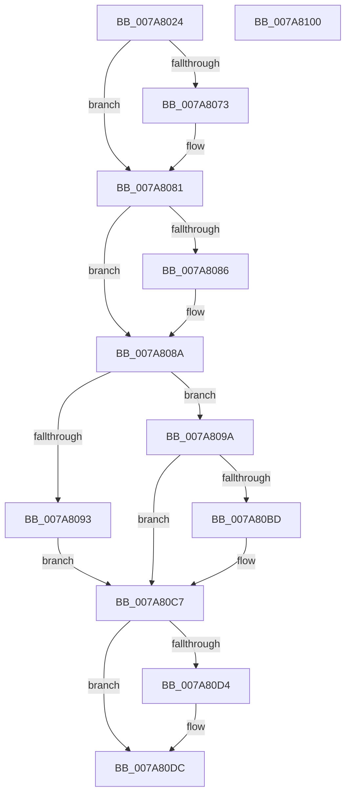

# SmpSystemStoreCreate

- RVA: `0x007A8024`–`0x007A8101` (길이 `221` bytes)
- VA: `0x00000001407A8024`
- 실행 섹션: `PAGE`
- PDB 이름 있음: `예`; PDB Function 태그: `아니요`
- unwind 정보 RVA: `0x0006C8E8`
- 디코드: `61`개 명령, `221/221` bytes 표시
- 미해석 바이트: `0` (있으면 어셈블리에 `.byte`로 보존)

> 이 문서는 커널 이미지의 기계어와 PDB 기호를 분석해 생성했습니다. 4번과 5번은 함수 원형과 자료형을 바이너리 사용 방식에서 추정한 C 해석이며 원본 소스 복구 결과는 아닙니다.

## 1. Dependencies

- 직접 호출 지점: **7**; 고유 호출 대상: **7**
- 직접 호출자로 확인된 함수: **3**
- RIP 상대 이미지 참조: **0**

### Outgoing calls
- `0x007A8063` → [KeAbPreAcquire](../../text/21/KeAbPreAcquire_function_00210230.md) (function, `0x00210230`)
- `0x007A807C` → [ExfAcquirePushLockExclusiveEx](../../text/20/ExfAcquirePushLockExclusiveEx_function_0020FC90.md) (function, `0x0020FC90`)
- `0x007A809C` → [MmGetNumberOfPhysicalPages](../../text/46/MmGetNumberOfPhysicalPages_function_00467F80.md) (function, `0x00467F80`)
- `0x007A80B2` → [SmpDirtyStoreCreate](../A5/SmpDirtyStoreCreate_function_00A50CB8.md) (function, `0x00A50CB8`)
- `0x007A80D7` → [ExfTryToWakePushLock](../../text/26/ExfTryToWakePushLock_function_00265DD0.md) (function, `0x00265DD0`)
- `0x007A80DF` → [KeAbPostRelease](../../text/2E/KeAbPostRelease_function_002E1600.md) (function, `0x002E1600`)
- `0x007A80E4` → [KeLeaveCriticalRegion](../../text/25/KeLeaveCriticalRegion_function_0025D8B0.md) (function, `0x0025D8B0`)

### Direct callers
- [SmProcessConfigRequest](SmProcessConfigRequest_function_007A62E4.md) at `0x007A66D6`
- [Phase1InitializationIoReady](../../init/C7/Phase1InitializationIoReady_function_00C70458.md) at `0x00C70568`
- [SmInitSystem](../../init/C7/SmInitSystem_function_00C7673C.md) at `0x00C7687A`

### Static image references
- 디코드된 RIP-relative 메모리 참조가 없습니다.

## 2. Other-region calls and transfers

- 다른 실행 섹션으로 향하는 call: **6**
  - `0x007A8063` → [KeAbPreAcquire](../../text/21/KeAbPreAcquire_function_00210230.md) (`PAGE` → `.text`)
  - `0x007A807C` → [ExfAcquirePushLockExclusiveEx](../../text/20/ExfAcquirePushLockExclusiveEx_function_0020FC90.md) (`PAGE` → `.text`)
  - `0x007A809C` → [MmGetNumberOfPhysicalPages](../../text/46/MmGetNumberOfPhysicalPages_function_00467F80.md) (`PAGE` → `.text`)
  - `0x007A80D7` → [ExfTryToWakePushLock](../../text/26/ExfTryToWakePushLock_function_00265DD0.md) (`PAGE` → `.text`)
  - `0x007A80DF` → [KeAbPostRelease](../../text/2E/KeAbPostRelease_function_002E1600.md) (`PAGE` → `.text`)
  - `0x007A80E4` → [KeLeaveCriticalRegion](../../text/25/KeLeaveCriticalRegion_function_0025D8B0.md) (`PAGE` → `.text`)
- 별도 외부 분기/꼬리 이동을 확인하지 못했습니다.

## 3. Assembly (complete function range)

```asm
007A8024  48 8B C4                        mov rax, rsp
007A8027  48 89 58 10                     mov qword ptr [rax + 0x10], rbx
007A802B  48 89 68 18                     mov qword ptr [rax + 0x18], rbp
007A802F  48 89 70 20                     mov qword ptr [rax + 0x20], rsi
007A8033  57                              push rdi
007A8034  48 83 EC 20                     sub rsp, 0x20
007A8038  83 60 08 00                     and dword ptr [rax + 8], 0
007A803C  48 8D B9 E8 08 00 00            lea rdi, [rcx + 0x8e8]
007A8043  65 48 8B 04 25 88 01 00 00      mov rax, qword ptr gs:[0x188]
007A804C  48 8B E9                        mov rbp, rcx
007A804F  48 83 CB FF                     or rbx, 0xffffffffffffffff
007A8053  45 33 C0                        xor r8d, r8d
007A8056  33 D2                           xor edx, edx
007A8058  48 8B CF                        mov rcx, rdi
007A805B  66 01 98 E4 01 00 00            add word ptr [rax + 0x1e4], bx
007A8062  90                              nop
007A8063  E8 C8 81 A6 FF                  call 0x140210230
007A8068  F0 48 0F BA 2F 00               lock bts qword ptr [rdi], 0
007A806E  48 8B F0                        mov rsi, rax
007A8071  73 0E                           jae 0x1407a8081
007A8073  4C 8B C7                        mov r8, rdi
007A8076  48 8B D0                        mov rdx, rax
007A8079  48 8B CF                        mov rcx, rdi
007A807C  E8 0F 7C A6 FF                  call 0x14020fc90
007A8081  48 85 F6                        test rsi, rsi
007A8084  74 04                           je 0x1407a808a
007A8086  C6 46 0A 01                     mov byte ptr [rsi + 0xa], 1
007A808A  83 BD E0 08 00 00 FF            cmp dword ptr [rbp + 0x8e0], -1
007A8091  74 07                           je 0x1407a809a
007A8093  BE 18 07 00 C0                  mov esi, 0xc0000718
007A8098  EB 2D                           jmp 0x1407a80c7
007A809A  33 C9                           xor ecx, ecx
007A809C  E8 DF FE CB FF                  call 0x140467f80
007A80A1  48 C1 E8 08                     shr rax, 8
007A80A5  4C 8D 4C 24 30                  lea r9, [rsp + 0x30]
007A80AA  8B D0                           mov edx, eax
007A80AC  45 33 C0                        xor r8d, r8d
007A80AF  48 8B CD                        mov rcx, rbp
007A80B2  E8 01 8C 2A 00                  call 0x140a50cb8
007A80B7  8B F0                           mov esi, eax
007A80B9  85 C0                           test eax, eax
007A80BB  78 0A                           js 0x1407a80c7
007A80BD  8B 4C 24 30                     mov ecx, dword ptr [rsp + 0x30]
007A80C1  89 8D E0 08 00 00               mov dword ptr [rbp + 0x8e0], ecx
007A80C7  F0 48 0F C1 1F                  lock xadd qword ptr [rdi], rbx
007A80CC  80 E3 06                        and bl, 6
007A80CF  80 FB 02                        cmp bl, 2
007A80D2  75 08                           jne 0x1407a80dc
007A80D4  48 8B CF                        mov rcx, rdi
007A80D7  E8 F4 DC AB FF                  call 0x140265dd0
007A80DC  48 8B CF                        mov rcx, rdi
007A80DF  E8 1C 95 B3 FF                  call 0x1402e1600
007A80E4  E8 C7 57 AB FF                  call 0x14025d8b0
007A80E9  48 8B 5C 24 38                  mov rbx, qword ptr [rsp + 0x38]
007A80EE  8B C6                           mov eax, esi
007A80F0  48 8B 74 24 48                  mov rsi, qword ptr [rsp + 0x48]
007A80F5  48 8B 6C 24 40                  mov rbp, qword ptr [rsp + 0x40]
007A80FA  48 83 C4 20                     add rsp, 0x20
007A80FE  5F                              pop rdi
007A80FF  C3                              ret
007A8100  CC                              int3
```

## 4. C-style interpretation (structured pseudocode)

```c
__int64 __fastcall SmpSystemStoreCreate(__int64 a1, int a2, int a3)
{
    __int64 result;
    __int64 v_rbx;
    __int64 v_rsp;
    unsigned __int64 v_stack_p10;
    unsigned __int64 v_stack_p18;
    unsigned __int64 v_stack_p20;
    unsigned __int64 v_stack_p8;

    *(unsigned __int64 *)(v_rsp + 16) = v_rbx;
    *(unsigned __int64 *)(v_rsp + 24) = v_rbp;
    *(unsigned __int64 *)(v_rsp + 32) = v_rsi;
    v_rsp = (v_rsp) - (32);
    v_rbx = (v_rbx) | (-1);
    a3 = 0;
    a2 = 0;
    result = KeAbPreAcquire(a1 + 2280, a2, a3, a4);
    if (!(condition_is_above_or_equal)) {
        a3 = a1 + 2280;
        a2 = result;
        a1 = a1 + 2280;
        result = ExfAcquirePushLockExclusiveEx(a1, a2, a3, a4);
    }
    if (result != 0) {
        *(unsigned __int8 *)(result + 10) = 1;
    }
    if ((*(unsigned int *)(a1 + 2272)) == -1) goto loc_007A809A;
    goto loc_007A80C7;
loc_007A809A:
    a1 = 0;
    result = MmGetNumberOfPhysicalPages(a1, a2, a3, a4);
    result = (result) >> (8);
    a3 = 0;
    result = SmpDirtyStoreCreate(0, (unsigned int)((unsigned int)(result)), a3, v_stack_p8);
    if (!(sign_flag)) {
        a1 = v_stack_p8;
        *(unsigned int *)(a1 + 2272) = (unsigned int)(a1);
    }
    v_rbx = (unsigned __int8)((v_rbx) & (6));
    if (((unsigned __int8)(v_rbx)) == 2) {
        a1 = a1 + 2280;
        result = ExfTryToWakePushLock(a1, (unsigned int)((unsigned int)(result)), a3, v_stack_p8);
    }
    result = KeAbPostRelease(a1 + 2280, (unsigned int)((unsigned int)(result)), a3, v_stack_p8);
    result = KeLeaveCriticalRegion(a1 + 2280, (unsigned int)((unsigned int)(result)), a3, v_stack_p8);
    v_rsp = (v_rsp) + (32);
    return (unsigned int)((unsigned int)((unsigned int)((unsigned int)(result))));
}
```

## 5. (Beta) C Style

```c
int64_t SmpSystemStoreCreate(void *Arg1, int32_t Arg2, int32_t Arg3)
{
    uint8_t *arg1 = (uint8_t *)Arg1;

    int64_t result;
    int64_t local_rbx;
    int64_t local_rsp;
    uint64_t v_stack_p10;
    uint64_t v_stack_p18;
    uint64_t v_stack_p20;
    uint64_t v_stack_p8;

    *(uint64_t *)(local_rsp + 0x10) = local_rbx;
    *(uint64_t *)(local_rsp + 0x18) = local_rbp;
    *(uint64_t *)(local_rsp + 0x20) = local_rsi;
    local_rsp = (local_rsp) - (32);
    local_rbx = (local_rbx) | (-1);
    Arg3 = 0;
    Arg2 = 0;
    result = KeAbPreAcquire(Arg1 + 2280, Arg2, Arg3, a4);
    if (!(condition_is_above_or_equal)) {
        Arg3 = Arg1 + 2280;
        Arg2 = result;
        Arg1 = Arg1 + 2280;
        result = ExfAcquirePushLockExclusiveEx(Arg1, Arg2, Arg3, a4);
    }
    if (result != 0) {
        *(uint8_t *)(result + 0xA) = 1;
    }
    if ((*(uint32_t *)(arg1 + 0x8E0)) == -1) goto loc_007A809A;
    goto loc_007A80C7;
loc_007A809A:
    Arg1 = 0;
    result = MmGetNumberOfPhysicalPages(Arg1, Arg2, Arg3, a4);
    result = (result) >> (8);
    Arg3 = 0;
    result = SmpDirtyStoreCreate(0, (uint32_t)((uint32_t)(result)), Arg3, v_stack_p8);
    if (!(sign_flag)) {
        Arg1 = v_stack_p8;
        *(uint32_t *)(arg1 + 0x8E0) = (uint32_t)(Arg1);
    }
    local_rbx = (uint8_t)((local_rbx) & (6));
    if (((uint8_t)(local_rbx)) == 2) {
        Arg1 = Arg1 + 2280;
        result = ExfTryToWakePushLock(Arg1, (uint32_t)((uint32_t)(result)), Arg3, v_stack_p8);
    }
    result = KeAbPostRelease(Arg1 + 2280, (uint32_t)((uint32_t)(result)), Arg3, v_stack_p8);
    result = KeLeaveCriticalRegion(Arg1 + 2280, (uint32_t)((uint32_t)(result)), Arg3, v_stack_p8);
    local_rsp = (local_rsp) + (32);
    return (uint32_t)((uint32_t)((uint32_t)((uint32_t)(result))));
}
```

### 관측된 메모리 오프셋

구조체 형식이 확인되지 않은 접근은 인자 기준의 오프셋으로만 기록했습니다.

| 기준 인자 | 오프셋 표현 | 폭 (bit) | 접근 |
|---|---:|---:|---|
| `Arg1` | `+ 0x0` | `64` | `R/W` |
| `Arg1` | `+ 0x8E0` | `32` | `R` |
| `Arg1` | `+ 0x8E0` | `32` | `W` |
| `Arg1` | `+ 0x8E8` | `64` | `R` |

## 6. Execution-region graph

[열기: 2D/3D 그래프와 함수 탐색 컨트롤 패널](../../../control-panel.html?section=page&rva=0x007A8024&view=graph)

- 2D 그래프는 위에서 아래로 흐르고, 3D 그래프는 빈 공간을 드래그해 회전합니다. Shift+드래그는 이동, 휠은 확대·축소, 함수 노드 선택은 대상 보고서 이동입니다.

### Static fallback


