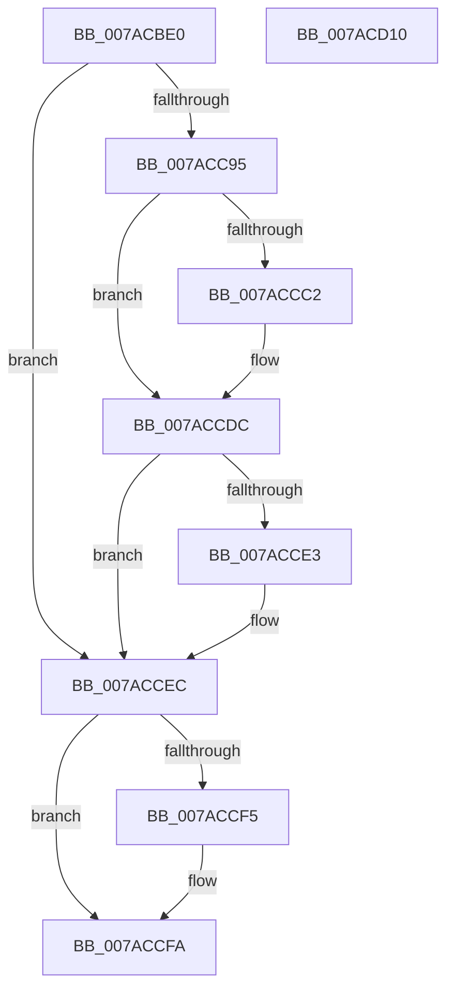

# SmpUtilsGetControlDevice

- RVA: `0x007ACBE0`–`0x007ACD11` (길이 `305` bytes)
- VA: `0x00000001407ACBE0`
- 실행 섹션: `PAGE`
- PDB 이름 있음: `예`; PDB Function 태그: `아니요`
- unwind 정보 RVA: `0x000D215C`
- 디코드: `75`개 명령, `305/305` bytes 표시
- 미해석 바이트: `0` (있으면 어셈블리에 `.byte`로 보존)

> 이 문서는 커널 이미지의 기계어와 PDB 기호를 분석해 생성했습니다. 4번과 5번은 함수 원형과 자료형을 바이너리 사용 방식에서 추정한 C 해석이며 원본 소스 복구 결과는 아닙니다.

## 1. Dependencies

- 직접 호출 지점: **6**; 고유 호출 대상: **6**
- 직접 호출자로 확인된 함수: **1**
- RIP 상대 이미지 참조: **1**

### Outgoing calls
- `0x007ACC23` → [RtlInitUnicodeString](../../text/42/RtlInitUnicodeString_function_0042A780.md) (function, `0x0042A780`)
- `0x007ACC8A` → [ZwCreateFile](../../text/6A/ZwCreateFile_function_006ADB70.md) (function, `0x006ADB70`)
- `0x007ACCB7` → [ObReferenceObjectByHandle](../86/ObReferenceObjectByHandle_function_00868DB0.md) (function, `0x00868DB0`)
- `0x007ACCC6` → [IoGetRelatedDeviceObject](../../text/29/IoGetRelatedDeviceObject_function_0029B120.md) (function, `0x0029B120`)
- `0x007ACCE7` → [ObfDereferenceObject](../../text/2F/ObfDereferenceObject_function_002F9350.md) (function, `0x002F9350`)
- `0x007ACCF5` → [ZwClose](../../text/6A/ZwClose_function_006AD2B0.md) (function, `0x006AD2B0`)

### Direct callers
- [SmcCacheManagerStart](SmcCacheManagerStart_function_007AB958.md) at `0x007AB9C8`

### Static image references
- `0x007ACC11` → RVA `0x00B063A0` (` ?? ::NNGAKEGL::`string'`; read)

## 2. Other-region calls and transfers

- 다른 실행 섹션으로 향하는 call: **5**
  - `0x007ACC23` → [RtlInitUnicodeString](../../text/42/RtlInitUnicodeString_function_0042A780.md) (`PAGE` → `.text`)
  - `0x007ACC8A` → [ZwCreateFile](../../text/6A/ZwCreateFile_function_006ADB70.md) (`PAGE` → `.text`)
  - `0x007ACCC6` → [IoGetRelatedDeviceObject](../../text/29/IoGetRelatedDeviceObject_function_0029B120.md) (`PAGE` → `.text`)
  - `0x007ACCE7` → [ObfDereferenceObject](../../text/2F/ObfDereferenceObject_function_002F9350.md) (`PAGE` → `.text`)
  - `0x007ACCF5` → [ZwClose](../../text/6A/ZwClose_function_006AD2B0.md) (`PAGE` → `.text`)
- 별도 외부 분기/꼬리 이동을 확인하지 못했습니다.

## 3. Assembly (complete function range)

```asm
007ACBE0  48 89 5C 24 10                  mov qword ptr [rsp + 0x10], rbx
007ACBE5  48 89 4C 24 08                  mov qword ptr [rsp + 8], rcx
007ACBEA  55                              push rbp
007ACBEB  56                              push rsi
007ACBEC  41 56                           push r14
007ACBEE  48 8D 6C 24 B9                  lea rbp, [rsp - 0x47]
007ACBF3  48 81 EC B0 00 00 00            sub rsp, 0xb0
007ACBFA  83 65 1B 00                     and dword ptr [rbp + 0x1b], 0
007ACBFE  48 8D 4D F7                     lea rcx, [rbp - 9]
007ACC02  83 65 33 00                     and dword ptr [rbp + 0x33], 0
007ACC06  0F 57 C0                        xorps xmm0, xmm0
007ACC09  48 83 65 67 00                  and qword ptr [rbp + 0x67], 0
007ACC0E  4C 8B F2                        mov r14, rdx
007ACC11  48 8D 15 88 97 35 00            lea rdx, [rip + 0x359788]
007ACC18  49 8B F0                        mov rsi, r8
007ACC1B  0F 11 45 F7                     movups xmmword ptr [rbp - 9], xmm0
007ACC1F  0F 11 45 07                     movups xmmword ptr [rbp + 7], xmm0
007ACC23  E8 58 DB C7 FF                  call 0x14042a780
007ACC28  83 64 24 50 00                  and dword ptr [rsp + 0x50], 0
007ACC2D  48 8D 45 F7                     lea rax, [rbp - 9]
007ACC31  48 83 64 24 48 00               and qword ptr [rsp + 0x48], 0
007ACC37  4C 8D 4D 07                     lea r9, [rbp + 7]
007ACC3B  48 83 65 1F 00                  and qword ptr [rbp + 0x1f], 0
007ACC40  4C 8D 45 17                     lea r8, [rbp + 0x17]
007ACC44  C7 44 24 40 20 00 00 00         mov dword ptr [rsp + 0x40], 0x20
007ACC4C  48 8D 4D 67                     lea rcx, [rbp + 0x67]
007ACC50  C7 44 24 38 01 00 00 00         mov dword ptr [rsp + 0x38], 1
007ACC58  0F 57 C0                        xorps xmm0, xmm0
007ACC5B  C7 44 24 30 07 00 00 00         mov dword ptr [rsp + 0x30], 7
007ACC63  BA 9F 01 12 00                  mov edx, 0x12019f
007ACC68  83 64 24 28 00                  and dword ptr [rsp + 0x28], 0
007ACC6D  48 83 64 24 20 00               and qword ptr [rsp + 0x20], 0
007ACC73  C7 45 17 30 00 00 00            mov dword ptr [rbp + 0x17], 0x30
007ACC7A  C7 45 2F 40 02 00 00            mov dword ptr [rbp + 0x2f], 0x240
007ACC81  48 89 45 27                     mov qword ptr [rbp + 0x27], rax
007ACC85  F3 0F 7F 45 37                  movdqu xmmword ptr [rbp + 0x37], xmm0
007ACC8A  E8 E1 0E F0 FF                  call 0x1406adb70
007ACC8F  8B D8                           mov ebx, eax
007ACC91  85 C0                           test eax, eax
007ACC93  78 57                           js 0x1407accec
007ACC95  48 83 64 24 28 00               and qword ptr [rsp + 0x28], 0
007ACC9B  48 8D 45 7F                     lea rax, [rbp + 0x7f]
007ACC9F  48 8B 4D 67                     mov rcx, qword ptr [rbp + 0x67]
007ACCA3  45 33 C9                        xor r9d, r9d
007ACCA6  48 83 65 7F 00                  and qword ptr [rbp + 0x7f], 0
007ACCAB  45 33 C0                        xor r8d, r8d
007ACCAE  48 89 44 24 20                  mov qword ptr [rsp + 0x20], rax
007ACCB3  41 8D 51 03                     lea edx, [r9 + 3]
007ACCB7  E8 F4 C0 0B 00                  call 0x140868db0
007ACCBC  8B D8                           mov ebx, eax
007ACCBE  85 C0                           test eax, eax
007ACCC0  78 1A                           js 0x1407accdc
007ACCC2  48 8B 4D 7F                     mov rcx, qword ptr [rbp + 0x7f]
007ACCC6  E8 55 E4 AE FF                  call 0x14029b120
007ACCCB  48 89 06                        mov qword ptr [rsi], rax
007ACCCE  48 8B 45 67                     mov rax, qword ptr [rbp + 0x67]
007ACCD2  48 83 65 67 00                  and qword ptr [rbp + 0x67], 0
007ACCD7  33 DB                           xor ebx, ebx
007ACCD9  49 89 06                        mov qword ptr [r14], rax
007ACCDC  48 83 7D 7F 00                  cmp qword ptr [rbp + 0x7f], 0
007ACCE1  74 09                           je 0x1407accec
007ACCE3  48 8B 4D 7F                     mov rcx, qword ptr [rbp + 0x7f]
007ACCE7  E8 64 C6 B4 FF                  call 0x1402f9350
007ACCEC  48 8B 4D 67                     mov rcx, qword ptr [rbp + 0x67]
007ACCF0  48 85 C9                        test rcx, rcx
007ACCF3  74 05                           je 0x1407accfa
007ACCF5  E8 B6 05 F0 FF                  call 0x1406ad2b0
007ACCFA  8B C3                           mov eax, ebx
007ACCFC  48 8B 9C 24 D8 00 00 00         mov rbx, qword ptr [rsp + 0xd8]
007ACD04  48 81 C4 B0 00 00 00            add rsp, 0xb0
007ACD0B  41 5E                           pop r14
007ACD0D  5E                              pop rsi
007ACD0E  5D                              pop rbp
007ACD0F  C3                              ret
007ACD10  CC                              int3
```

## 4. C-style interpretation (structured pseudocode)

```c
__int64 __fastcall SmpUtilsGetControlDevice(__int64 a1, __int64 a2, __int64 a3)
{
    __int64 result;
    __int64 v_rbx;
    __int64 v_rsp;
    unsigned __int64 v_stack_m28;
    unsigned int v_stack_m2C;
    unsigned int v_stack_m30;
    unsigned __int64 v_stack_m38;
    unsigned __int64 v_stack_m40;
    unsigned int v_stack_m44;
    unsigned __int64 v_stack_m48;
    unsigned __int64 v_stack_m58;
    unsigned __int64 v_stack_m5F;
    unsigned __int64 v_stack_m68;
    unsigned int v_stack_m78;
    unsigned __int64 v_stack_m80;
    unsigned int v_stack_m88;
    unsigned int v_stack_m90;
    unsigned int v_stack_m98;
    unsigned int v_stack_mA0;
    unsigned __int64 v_stack_mA8;
    unsigned __int64 v_stack_p10;
    unsigned __int64 v_stack_p20;
    unsigned __int64 v_stack_p8;

    v_stack_p10 = v_rbx;
    v_stack_p8 = a1;
    v_rsp = (v_rsp) - (176);
    v_stack_m68 = v_xmm0;
    v_stack_m58 = v_xmm0;
    result = RtlInitUnicodeString(v_stack_m68, v_rip + 3512200, a3, a4);
    v_stack_m88 = 32;
    v_stack_m90 = 1;
    v_stack_m98 = 7;
    v_stack_m48 = 48;
    v_stack_m30 = 576;
    v_stack_m38 = v_stack_m68;
    v_stack_m28 = v_xmm0;
    result = ZwCreateFile(v_stack_p8, (unsigned int)(0x12019FULL), v_stack_m48, v_stack_m58);
    if (sign_flag) goto loc_007ACCEC;
    a4 = 0;
    a3 = 0;
    v_stack_mA8 = v_stack_p20;
    result = ObReferenceObjectByHandle(v_stack_p8, a4 + 3, a3, a4);
    v_rbx = (unsigned int)((unsigned int)(result));
    if (!(sign_flag)) {
        a1 = v_stack_p20;
        result = IoGetRelatedDeviceObject(a1, a4 + 3, a3, a4);
        *(unsigned __int64 *)(a3) = result;
        result = v_stack_p8;
        v_rbx = 0;
        *(unsigned __int64 *)(a2) = result;
    }
    if (v_stack_p20 != 0) {
        a1 = v_stack_p20;
        result = ObfDereferenceObject(a1, a4 + 3, a3, a4);
    }
    if (v_stack_p8 != 0) {
        result = ZwClose(v_stack_p8, a4 + 3, a3, a4);
    }
    v_rsp = (v_rsp) + (176);
    return 0;
}
```

## 5. (Beta) C Style

```c
int64_t SmpUtilsGetControlDevice(int64_t Arg1, void *Arg2, void *Arg3)
{
    uint8_t *arg2 = (uint8_t *)Arg2;
    uint8_t *arg3 = (uint8_t *)Arg3;

    int64_t result;
    int64_t local_rbx;
    int64_t local_rsp;
    uint64_t v_stack_m28;
    uint32_t v_stack_m2C;
    uint32_t v_stack_m30;
    uint64_t v_stack_m38;
    uint64_t v_stack_m40;
    uint32_t v_stack_m44;
    uint64_t v_stack_m48;
    uint64_t v_stack_m58;
    uint64_t v_stack_m5F;
    uint64_t v_stack_m68;
    uint32_t v_stack_m78;
    uint64_t v_stack_m80;
    uint32_t v_stack_m88;
    uint32_t v_stack_m90;
    uint32_t v_stack_m98;
    uint32_t v_stack_mA0;
    uint64_t v_stack_mA8;
    uint64_t v_stack_p10;
    uint64_t v_stack_p20;
    uint64_t v_stack_p8;

    v_stack_p10 = local_rbx;
    v_stack_p8 = Arg1;
    local_rsp = (local_rsp) - (176);
    v_stack_m68 = v_xmm0;
    v_stack_m58 = v_xmm0;
    result = RtlInitUnicodeString(v_stack_m68, v_rip + 3512200, Arg3, a4);
    v_stack_m88 = 32;
    v_stack_m90 = 1;
    v_stack_m98 = 7;
    v_stack_m48 = 48;
    v_stack_m30 = 576;
    v_stack_m38 = v_stack_m68;
    v_stack_m28 = v_xmm0;
    result = ZwCreateFile(v_stack_p8, (uint32_t)(0x12019FULL), v_stack_m48, v_stack_m58);
    if (sign_flag) goto loc_007ACCEC;
    a4 = 0;
    Arg3 = 0;
    v_stack_mA8 = v_stack_p20;
    result = ObReferenceObjectByHandle(v_stack_p8, a4 + 3, Arg3, a4);
    local_rbx = (uint32_t)((uint32_t)(result));
    if (!(sign_flag)) {
        Arg1 = v_stack_p20;
        result = IoGetRelatedDeviceObject(Arg1, a4 + 3, Arg3, a4);
        *(uint64_t *)(arg3) = result;
        result = v_stack_p8;
        local_rbx = 0;
        *(uint64_t *)(arg2) = result;
    }
    if (v_stack_p20 != 0) {
        Arg1 = v_stack_p20;
        result = ObfDereferenceObject(Arg1, a4 + 3, Arg3, a4);
    }
    if (v_stack_p8 != 0) {
        result = ZwClose(v_stack_p8, a4 + 3, Arg3, a4);
    }
    local_rsp = (local_rsp) + (176);
    return 0;
}
```

### 관측된 메모리 오프셋

구조체 형식이 확인되지 않은 접근은 인자 기준의 오프셋으로만 기록했습니다.

| 기준 인자 | 오프셋 표현 | 폭 (bit) | 접근 |
|---|---:|---:|---|
| `Arg2` | `+ 0x0` | `64` | `W` |
| `Arg3` | `+ 0x0` | `64` | `W` |

## 6. Execution-region graph

[열기: 2D/3D 그래프와 함수 탐색 컨트롤 패널](../../../control-panel.html?section=page&rva=0x007ACBE0&view=graph)

- 2D 그래프는 위에서 아래로 흐르고, 3D 그래프는 빈 공간을 드래그해 회전합니다. Shift+드래그는 이동, 휠은 확대·축소, 함수 노드 선택은 대상 보고서 이동입니다.

### Static fallback


