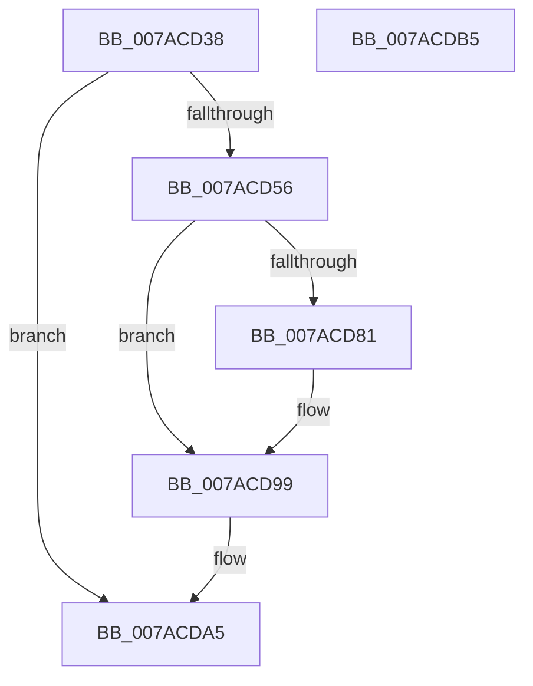

# VmCleanProcessAddressSpace

- RVA: `0x007ACD38`–`0x007ACDB6` (길이 `126` bytes)
- VA: `0x00000001407ACD38`
- 실행 섹션: `PAGE`
- PDB 이름 있음: `예`; PDB Function 태그: `아니요`
- unwind 정보 RVA: `0x00060BC4`
- 디코드: `30`개 명령, `126/126` bytes 표시
- 미해석 바이트: `0` (있으면 어셈블리에 `.byte`로 보존)

> 이 문서는 커널 이미지의 기계어와 PDB 기호를 분석해 생성했습니다. 4번과 5번은 함수 원형과 자료형을 바이너리 사용 방식에서 추정한 C 해석이며 원본 소스 복구 결과는 아닙니다.

## 1. Dependencies

- 직접 호출 지점: **6**; 고유 호출 대상: **6**
- 직접 호출자로 확인된 함수: **1**
- RIP 상대 이미지 참조: **1**

### Outgoing calls
- `0x007ACD5A` → [FsRtlAcquirePushLockExclusive](../../text/4A/FsRtlAcquirePushLockExclusive_function_004A05F4.md) (function, `0x004A05F4`)
- `0x007ACD6B` → [PfLockExclusiveRelease](../../text/49/PfLockExclusiveRelease_function_00491D88.md) (function, `0x00491D88`)
- `0x007ACD77` → [ExGetExtensionTable](../../text/42/ExGetExtensionTable_function_00428814.md) (function, `0x00428814`)
- `0x007ACD88` → [guard_dispatch_icall](../../text/6B/guard_dispatch_icall_function_006BAAD0.md) (function, `0x006BAAD0`)
- `0x007ACD94` → [ExReleaseExtensionTable](../../text/45/ExReleaseExtensionTable_function_00456DC0.md) (function, `0x00456DC0`)
- `0x007ACDA0` → [ExWaitForRundownProtectionRelease](../../text/2A/ExWaitForRundownProtectionRelease_function_002A4CB0.md) (function, `0x002A4CB0`)

### Direct callers
- [MmCleanProcessAddressSpace](../A1/MmCleanProcessAddressSpace_function_00A17EC0.md) at `0x00A18123`

### Static image references
- `0x007ACD70` → RVA `0x00F02460` (`.data`; read)

## 2. Other-region calls and transfers

- 다른 실행 섹션으로 향하는 call: **6**
  - `0x007ACD5A` → [FsRtlAcquirePushLockExclusive](../../text/4A/FsRtlAcquirePushLockExclusive_function_004A05F4.md) (`PAGE` → `.text`)
  - `0x007ACD6B` → [PfLockExclusiveRelease](../../text/49/PfLockExclusiveRelease_function_00491D88.md) (`PAGE` → `.text`)
  - `0x007ACD77` → [ExGetExtensionTable](../../text/42/ExGetExtensionTable_function_00428814.md) (`PAGE` → `.text`)
  - `0x007ACD88` → [guard_dispatch_icall](../../text/6B/guard_dispatch_icall_function_006BAAD0.md) (`PAGE` → `.text`)
  - `0x007ACD94` → [ExReleaseExtensionTable](../../text/45/ExReleaseExtensionTable_function_00456DC0.md) (`PAGE` → `.text`)
  - `0x007ACDA0` → [ExWaitForRundownProtectionRelease](../../text/2A/ExWaitForRundownProtectionRelease_function_002A4CB0.md) (`PAGE` → `.text`)
- 별도 외부 분기/꼬리 이동을 확인하지 못했습니다.

## 3. Assembly (complete function range)

```asm
007ACD38  48 89 5C 24 08                  mov qword ptr [rsp + 8], rbx
007ACD3D  48 89 74 24 10                  mov qword ptr [rsp + 0x10], rsi
007ACD42  57                              push rdi
007ACD43  48 83 EC 20                     sub rsp, 0x20
007ACD47  48 8B B9 70 06 00 00            mov rdi, qword ptr [rcx + 0x670]
007ACD4E  48 8B F1                        mov rsi, rcx
007ACD51  48 85 FF                        test rdi, rdi
007ACD54  74 4F                           je 0x1407acda5
007ACD56  48 8D 4F 78                     lea rcx, [rdi + 0x78]
007ACD5A  E8 95 38 CF FF                  call 0x1404a05f4
007ACD5F  66 83 8F 8A 00 00 00 01         or word ptr [rdi + 0x8a], 1
007ACD67  48 8D 4F 78                     lea rcx, [rdi + 0x78]
007ACD6B  E8 18 50 CE FF                  call 0x140491d88
007ACD70  48 8B 0D E9 56 75 00            mov rcx, qword ptr [rip + 0x7556e9]
007ACD77  E8 98 BA C7 FF                  call 0x140428814
007ACD7C  48 85 C0                        test rax, rax
007ACD7F  74 18                           je 0x1407acd99
007ACD81  48 8B 40 08                     mov rax, qword ptr [rax + 8]
007ACD85  48 8B CE                        mov rcx, rsi
007ACD88  E8 43 DD F0 FF                  call 0x1406baad0
007ACD8D  48 8B 0D CC 56 75 00            mov rcx, qword ptr [rip + 0x7556cc]
007ACD94  E8 27 A0 CA FF                  call 0x140456dc0
007ACD99  48 8D 8F 80 00 00 00            lea rcx, [rdi + 0x80]
007ACDA0  E8 0B 7F AF FF                  call 0x1402a4cb0
007ACDA5  48 8B 5C 24 30                  mov rbx, qword ptr [rsp + 0x30]
007ACDAA  48 8B 74 24 38                  mov rsi, qword ptr [rsp + 0x38]
007ACDAF  48 83 C4 20                     add rsp, 0x20
007ACDB3  5F                              pop rdi
007ACDB4  C3                              ret
007ACDB5  CC                              int3
```

## 4. C-style interpretation (structured pseudocode)

```c
__int64 __fastcall VmCleanProcessAddressSpace(__int64 a1)
{
    __int64 result;
    __int64 v_rsp;
    unsigned __int64 v_stack_p10;
    unsigned __int64 v_stack_p8;

    v_stack_p8 = v_rbx;
    v_stack_p10 = v_rsi;
    v_rsp = (v_rsp) - (32);
    if (*(unsigned __int64 *)(a1 + 1648) == 0) goto loc_007ACDA5;
    result = FsRtlAcquirePushLockExclusive(*(unsigned __int64 *)(a1 + 1648) + 120, a2, a3, a4);
    result = PfLockExclusiveRelease(*(unsigned __int64 *)(a1 + 1648) + 120, a2, a3, a4);
    result = ExGetExtensionTable(*(unsigned __int64 *)(v_rip + 7689961), a2, a3, a4);
    if (result != 0) {
        result = *(unsigned __int64 *)(result + 8);
        a1 = a1;
        result = guard_dispatch_icall(a1, a2, a3, a4);
        a1 = *(unsigned __int64 *)(v_rip + 7689932);
        result = ExReleaseExtensionTable(a1, a2, a3, a4);
    }
    result = ExWaitForRundownProtectionRelease(*(unsigned __int64 *)(a1 + 1648) + 128, a2, a3, a4);
loc_007ACDA5:
    v_rsp = (v_rsp) + (32);
    return result;
}
```

## 5. (Beta) C Style

```c
int64_t VmCleanProcessAddressSpace(void *Arg1)
{
    uint8_t *arg1 = (uint8_t *)Arg1;

    int64_t result;
    int64_t local_rsp;
    uint64_t v_stack_p10;
    uint64_t v_stack_p8;

    v_stack_p8 = local_rbx;
    v_stack_p10 = local_rsi;
    local_rsp = (local_rsp) - (32);
    if (*(uint64_t *)(arg1 + 0x670) == 0) goto loc_007ACDA5;
    result = FsRtlAcquirePushLockExclusive(*(uint64_t *)(arg1 + 0x670) + 120, a2, a3, a4);
    result = PfLockExclusiveRelease(*(uint64_t *)(arg1 + 0x670) + 120, a2, a3, a4);
    result = ExGetExtensionTable(*(uint64_t *)(v_rip + 0x7556E9), a2, a3, a4);
    if (result != 0) {
        result = *(uint64_t *)(result + 0x8);
        Arg1 = Arg1;
        result = guard_dispatch_icall(Arg1, a2, a3, a4);
        Arg1 = *(uint64_t *)(v_rip + 0x7556CC);
        result = ExReleaseExtensionTable(Arg1, a2, a3, a4);
    }
    result = ExWaitForRundownProtectionRelease(*(uint64_t *)(arg1 + 0x670) + 128, a2, a3, a4);
loc_007ACDA5:
    local_rsp = (local_rsp) + (32);
    return result;
}
```

### 관측된 메모리 오프셋

구조체 형식이 확인되지 않은 접근은 인자 기준의 오프셋으로만 기록했습니다.

| 기준 인자 | 오프셋 표현 | 폭 (bit) | 접근 |
|---|---:|---:|---|
| `Arg1` | `+ 0x670` | `64` | `R` |

## 6. Execution-region graph

[열기: 2D/3D 그래프와 함수 탐색 컨트롤 패널](../../../control-panel.html?section=page&rva=0x007ACD38&view=graph)

- 2D 그래프는 위에서 아래로 흐르고, 3D 그래프는 빈 공간을 드래그해 회전합니다. Shift+드래그는 이동, 휠은 확대·축소, 함수 노드 선택은 대상 보고서 이동입니다.

### Static fallback


