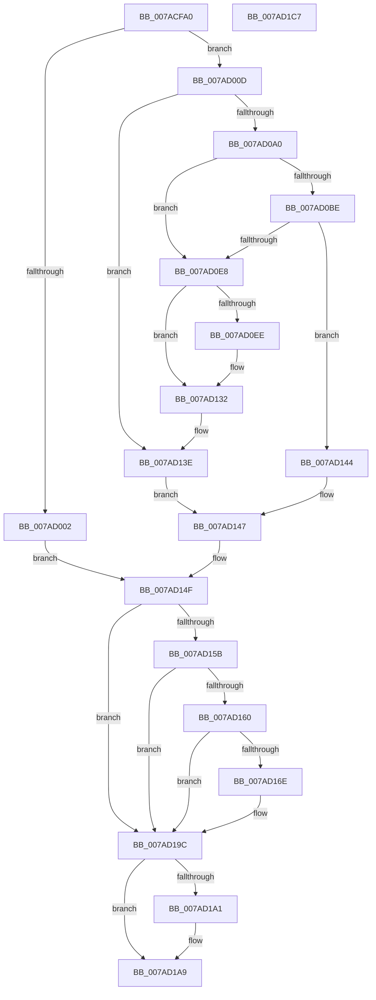

# VmCreateMemoryProcess

- RVA: `0x007ACFA0`–`0x007AD1C8` (길이 `552` bytes)
- VA: `0x00000001407ACFA0`
- 실행 섹션: `PAGE`
- PDB 이름 있음: `예`; PDB Function 태그: `아니요`
- unwind 정보 RVA: `0x000D2EAC`
- 디코드: `147`개 명령, `552/552` bytes 표시
- 미해석 바이트: `0` (있으면 어셈블리에 `.byte`로 보존)

> 이 문서는 커널 이미지의 기계어와 PDB 기호를 분석해 생성했습니다. 4번과 5번은 함수 원형과 자료형을 바이너리 사용 방식에서 추정한 C 해석이며 원본 소스 복구 결과는 아닙니다.

## 1. Dependencies

- 직접 호출 지점: **7**; 고유 호출 대상: **7**
- 직접 호출자로 확인된 함수: **0**
- RIP 상대 이미지 참조: **2**

### Outgoing calls
- `0x007AD08C` → [PsCreateMinimalProcess](../78/PsCreateMinimalProcess_function_00786D14.md) (function, `0x00786D14`)
- `0x007AD0DC` → [ZwAllocateVirtualMemory](../../text/6A/ZwAllocateVirtualMemory_function_006AD3D0.md) (function, `0x006AD3D0`)
- `0x007AD111` → [ObReferenceObjectByHandle](../86/ObReferenceObjectByHandle_function_00868DB0.md) (function, `0x00868DB0`)
- `0x007AD129` → [ObfDereferenceObject](../../text/2F/ObfDereferenceObject_function_002F9350.md) (function, `0x002F9350`)
- `0x007AD165` → [tlgKeywordOn](../../text/42/tlgKeywordOn_function_0042EAA0.md) (function, `0x0042EAA0`)
- `0x007AD197` → [VmpLogCreateMemoryProcess](VmpLogCreateMemoryProcess_function_007AE668.md) (function, `0x007AE668`)
- `0x007AD1A4` → [ZwClose](../../text/6A/ZwClose_function_006AD2B0.md) (function, `0x006AD2B0`)

### Direct callers
- 이 함수 시작 RVA로 연결되는 직접 call은 확인되지 않았습니다. 간접 호출은 완전히 역산할 수 없습니다.

### Static image references
- `0x007AD100` → RVA `0x00FC6A98` (`ALMOSTRO`; read)
- `0x007AD14F` → RVA `0x00F02458` (`.data`; read)

## 2. Other-region calls and transfers

- 다른 실행 섹션으로 향하는 call: **4**
  - `0x007AD0DC` → [ZwAllocateVirtualMemory](../../text/6A/ZwAllocateVirtualMemory_function_006AD3D0.md) (`PAGE` → `.text`)
  - `0x007AD129` → [ObfDereferenceObject](../../text/2F/ObfDereferenceObject_function_002F9350.md) (`PAGE` → `.text`)
  - `0x007AD165` → [tlgKeywordOn](../../text/42/tlgKeywordOn_function_0042EAA0.md) (`PAGE` → `.text`)
  - `0x007AD1A4` → [ZwClose](../../text/6A/ZwClose_function_006AD2B0.md) (`PAGE` → `.text`)
- 별도 외부 분기/꼬리 이동을 확인하지 못했습니다.

## 3. Assembly (complete function range)

```asm
007ACFA0  48 89 5C 24 20                  mov qword ptr [rsp + 0x20], rbx
007ACFA5  4C 89 44 24 18                  mov qword ptr [rsp + 0x18], r8
007ACFAA  48 89 54 24 10                  mov qword ptr [rsp + 0x10], rdx
007ACFAF  55                              push rbp
007ACFB0  56                              push rsi
007ACFB1  57                              push rdi
007ACFB2  41 54                           push r12
007ACFB4  41 55                           push r13
007ACFB6  41 56                           push r14
007ACFB8  41 57                           push r15
007ACFBA  48 8B EC                        mov rbp, rsp
007ACFBD  48 81 EC 80 00 00 00            sub rsp, 0x80
007ACFC4  48 83 65 F8 00                  and qword ptr [rbp - 8], 0
007ACFC9  33 FF                           xor edi, edi
007ACFCB  48 83 65 F0 00                  and qword ptr [rbp - 0x10], 0
007ACFD0  45 33 D2                        xor r10d, r10d
007ACFD3  8A 99 FA 05 00 00               mov bl, byte ptr [rcx + 0x5fa]
007ACFD9  41 8B F1                        mov esi, r9d
007ACFDC  83 E6 20                        and esi, 0x20
007ACFDF  48 89 7D 40                     mov qword ptr [rbp + 0x40], rdi
007ACFE3  83 CE 40                        or esi, 0x40
007ACFE6  4C 89 55 E0                     mov qword ptr [rbp - 0x20], r10
007ACFEA  C1 EE 03                        shr esi, 3
007ACFED  45 33 E4                        xor r12d, r12d
007ACFF0  45 8B F9                        mov r15d, r9d
007ACFF3  4C 8B DA                        mov r11, rdx
007ACFF6  4C 8B E9                        mov r13, rcx
007ACFF9  41 F7 C1 80 FF FF FF            test r9d, 0xffffff80
007AD000  74 0B                           je 0x1407ad00d
007AD002  41 BE 0D 00 00 C0               mov r14d, 0xc000000d
007AD008  E9 42 01 00 00                  jmp 0x1407ad14f
007AD00D  41 8B CF                        mov ecx, r15d
007AD010  48 8D 45 40                     lea rax, [rbp + 0x40]
007AD014  83 E1 01                        and ecx, 1
007AD017  48 89 44 24 58                  mov qword ptr [rsp + 0x58], rax
007AD01C  48 8B 45 68                     mov rax, qword ptr [rbp + 0x68]
007AD020  44 8A CB                        mov r9b, bl
007AD023  C1 E1 0D                        shl ecx, 0xd
007AD026  8B D1                           mov edx, ecx
007AD028  48 89 44 24 50                  mov qword ptr [rsp + 0x50], rax
007AD02D  48 8B 45 60                     mov rax, qword ptr [rbp + 0x60]
007AD031  0F BA EA 0E                     bts edx, 0xe
007AD035  41 F6 C7 02                     test r15b, 2
007AD039  0F 44 D1                        cmove edx, ecx
007AD03C  8B CA                           mov ecx, edx
007AD03E  0F BA E9 11                     bts ecx, 0x11
007AD042  41 F6 C7 04                     test r15b, 4
007AD046  0F 44 CA                        cmove ecx, edx
007AD049  8B D1                           mov edx, ecx
007AD04B  0F BA EA 0A                     bts edx, 0xa
007AD04F  41 F6 C7 10                     test r15b, 0x10
007AD053  0F 44 D1                        cmove edx, ecx
007AD056  49 8B CD                        mov rcx, r13
007AD059  44 8B E2                        mov r12d, edx
007AD05C  41 0F BA EC 16                  bts r12d, 0x16
007AD061  41 F6 C7 40                     test r15b, 0x40
007AD065  44 0F 44 E2                     cmove r12d, edx
007AD069  48 21 7C 24 48                  and qword ptr [rsp + 0x48], rdi
007AD06E  48 89 44 24 40                  mov qword ptr [rsp + 0x40], rax
007AD073  49 8B D3                        mov rdx, r11
007AD076  48 21 7C 24 38                  and qword ptr [rsp + 0x38], rdi
007AD07B  89 74 24 30                     mov dword ptr [rsp + 0x30], esi
007AD07F  44 89 64 24 28                  mov dword ptr [rsp + 0x28], r12d
007AD084  4C 89 44 24 20                  mov qword ptr [rsp + 0x20], r8
007AD089  45 33 C0                        xor r8d, r8d
007AD08C  E8 83 9C FD FF                  call 0x140786d14
007AD091  48 8B 7D 40                     mov rdi, qword ptr [rbp + 0x40]
007AD095  44 8B F0                        mov r14d, eax
007AD098  85 C0                           test eax, eax
007AD09A  0F 88 9E 00 00 00               js 0x1407ad13e
007AD0A0  48 89 7D E0                     mov qword ptr [rbp - 0x20], rdi
007AD0A4  B8 00 00 FF FF                  mov eax, 0xffff0000
007AD0A9  48 89 45 F0                     mov qword ptr [rbp - 0x10], rax
007AD0AD  48 C7 45 F8 00 00 01 00         mov qword ptr [rbp - 8], 0x10000
007AD0B5  41 F7 C4 00 60 00 00            test r12d, 0x6000
007AD0BC  75 2A                           jne 0x1407ad0e8
007AD0BE  C7 44 24 28 01 00 00 00         mov dword ptr [rsp + 0x28], 1
007AD0C6  4C 8D 4D F0                     lea r9, [rbp - 0x10]
007AD0CA  45 33 C0                        xor r8d, r8d
007AD0CD  C7 44 24 20 00 20 00 00         mov dword ptr [rsp + 0x20], 0x2000
007AD0D5  48 8D 55 F8                     lea rdx, [rbp - 8]
007AD0D9  48 8B CF                        mov rcx, rdi
007AD0DC  E8 EF 02 F0 FF                  call 0x1406ad3d0
007AD0E1  44 8B F0                        mov r14d, eax
007AD0E4  85 C0                           test eax, eax
007AD0E6  78 5C                           js 0x1407ad144
007AD0E8  41 F6 C7 08                     test r15b, 8
007AD0EC  75 44                           jne 0x1407ad132
007AD0EE  48 83 64 24 28 00               and qword ptr [rsp + 0x28], 0
007AD0F4  48 8D 45 E8                     lea rax, [rbp - 0x18]
007AD0F8  48 83 65 E8 00                  and qword ptr [rbp - 0x18], 0
007AD0FD  45 33 C9                        xor r9d, r9d
007AD100  4C 8B 05 91 99 81 00            mov r8, qword ptr [rip + 0x819991]
007AD107  33 D2                           xor edx, edx
007AD109  48 8B CF                        mov rcx, rdi
007AD10C  48 89 44 24 20                  mov qword ptr [rsp + 0x20], rax
007AD111  E8 9A BC 0B 00                  call 0x140868db0
007AD116  48 8B 45 E8                     mov rax, qword ptr [rbp - 0x18]
007AD11A  F0 81 88 FC 05 00 00 00 20 00 00  lock or dword ptr [rax + 0x5fc], 0x2000
007AD125  48 8B 4D E8                     mov rcx, qword ptr [rbp - 0x18]
007AD129  E8 22 C2 B4 FF                  call 0x1402f9350
007AD12E  48 8B 7D 40                     mov rdi, qword ptr [rbp + 0x40]
007AD132  48 8B 45 70                     mov rax, qword ptr [rbp + 0x70]
007AD136  48 89 38                        mov qword ptr [rax], rdi
007AD139  33 FF                           xor edi, edi
007AD13B  45 33 F6                        xor r14d, r14d
007AD13E  4C 8B 55 E0                     mov r10, qword ptr [rbp - 0x20]
007AD142  EB 03                           jmp 0x1407ad147
007AD144  4C 8B D7                        mov r10, rdi
007AD147  4C 8B 45 50                     mov r8, qword ptr [rbp + 0x50]
007AD14B  4C 8B 5D 48                     mov r11, qword ptr [rbp + 0x48]
007AD14F  48 8B 0D 02 53 75 00            mov rcx, qword ptr [rip + 0x755302]
007AD156  48 85 C9                        test rcx, rcx
007AD159  74 41                           je 0x1407ad19c
007AD15B  83 39 00                        cmp dword ptr [rcx], 0
007AD15E  76 3C                           jbe 0x1407ad19c
007AD160  BA 80 00 00 00                  mov edx, 0x80
007AD165  E8 36 19 C8 FF                  call 0x14042eaa0
007AD16A  84 C0                           test al, al
007AD16C  74 2E                           je 0x1407ad19c
007AD16E  48 8B 45 60                     mov rax, qword ptr [rbp + 0x60]
007AD172  45 8B CC                        mov r9d, r12d
007AD175  44 89 74 24 48                  mov dword ptr [rsp + 0x48], r14d
007AD17A  49 8B D2                        mov rdx, r10
007AD17D  4C 89 6C 24 40                  mov qword ptr [rsp + 0x40], r13
007AD182  4C 89 44 24 38                  mov qword ptr [rsp + 0x38], r8
007AD187  4D 8B C3                        mov r8, r11
007AD18A  88 5C 24 30                     mov byte ptr [rsp + 0x30], bl
007AD18E  48 89 44 24 28                  mov qword ptr [rsp + 0x28], rax
007AD193  89 74 24 20                     mov dword ptr [rsp + 0x20], esi
007AD197  E8 CC 14 00 00                  call 0x1407ae668
007AD19C  48 85 FF                        test rdi, rdi
007AD19F  74 08                           je 0x1407ad1a9
007AD1A1  48 8B CF                        mov rcx, rdi
007AD1A4  E8 07 01 F0 FF                  call 0x1406ad2b0
007AD1A9  48 8B 9C 24 D8 00 00 00         mov rbx, qword ptr [rsp + 0xd8]
007AD1B1  41 8B C6                        mov eax, r14d
007AD1B4  48 81 C4 80 00 00 00            add rsp, 0x80
007AD1BB  41 5F                           pop r15
007AD1BD  41 5E                           pop r14
007AD1BF  41 5D                           pop r13
007AD1C1  41 5C                           pop r12
007AD1C3  5F                              pop rdi
007AD1C4  5E                              pop rsi
007AD1C5  5D                              pop rbp
007AD1C6  C3                              ret
007AD1C7  CC                              int3
```

## 4. C-style interpretation (structured pseudocode)

```c
__int64 __fastcall VmCreateMemoryProcess(__int64 a1, __int64 a2, __int64 a3, int a4, __int64 a5, __int64 a6, __int64 a7)
{
    __int64 result;
    __int64 v_r10;
    __int64 v_r12;
    __int64 v_r14;
    __int64 v_rdi;
    __int64 v_rsi;
    __int64 v_rsp;
    unsigned __int64 v_stack_m40;
    unsigned __int64 v_stack_m48;
    unsigned __int64 v_stack_m50;
    unsigned __int64 v_stack_m58;
    unsigned __int64 v_stack_m60;
    unsigned __int64 v_stack_m68;
    unsigned __int64 v_stack_m70;
    unsigned __int64 v_stack_m78;
    unsigned __int64 v_stack_m80;
    unsigned int v_stack_m88;
    unsigned int v_stack_m90;
    unsigned __int64 v_stack_m98;
    unsigned __int64 v_stack_p10;
    unsigned __int64 v_stack_p18;
    unsigned __int64 v_stack_p20;
    unsigned __int64 v_stack_p8;

    v_stack_p20 = v_rbx;
    v_stack_p18 = a3;
    v_stack_p10 = a2;
    v_rsp = (v_rsp) - (128);
    v_rdi = 0;
    v_r10 = 0;
    v_rsi = (unsigned int)(((unsigned int)(a4)) & (32));
    v_stack_p8 = 0;
    v_rsi = (unsigned int)((v_rsi) | (64));
    v_stack_m58 = 0;
    v_rsi = (unsigned int)((v_rsi) >> (3));
    v_r12 = 0;
    if (((a4) & (0xFFFFFF80ULL)) == 0) goto loc_007AD00D;
    goto loc_007AD14F;
loc_007AD00D:
    a1 = (unsigned int)(((unsigned int)((unsigned int)((unsigned int)(a4)))) & (1));
    v_stack_m60 = v_stack_p8;
    a1 = (unsigned int)((a1) << (13));
    v_stack_m68 = a6;
    a2 = (unsigned int)((unsigned int)(a1));
    if ((((unsigned __int8)((unsigned int)(a4))) & (2)) == 0) { a2 = (unsigned int)(a1); }
    a1 = (unsigned int)((unsigned int)(a2));
    if ((((unsigned __int8)((unsigned int)(a4))) & (4)) == 0) { a1 = (unsigned int)(a2); }
    a2 = (unsigned int)((unsigned int)(a1));
    if ((((unsigned __int8)((unsigned int)(a4))) & (16)) == 0) { a2 = (unsigned int)(a1); }
    v_r12 = (unsigned int)((unsigned int)(a2));
    if ((((unsigned __int8)((unsigned int)(a4))) & (64)) == 0) { v_r12 = (unsigned int)(a2); }
    v_stack_m78 = a5;
    v_stack_m88 = (unsigned int)(v_rsi);
    v_stack_m90 = (unsigned int)(v_r12);
    v_stack_m98 = a3;
    a3 = 0;
    result = PsCreateMinimalProcess(a1, a2, a3, (unsigned __int8)(*(unsigned __int8 *)(a1 + 1530)));
    if (sign_flag) goto loc_007AD13E;
    v_stack_m58 = v_stack_p8;
    v_stack_m48 = (unsigned int)(0xFFFF0000ULL);
    v_stack_m40 = 0x10000ULL;
    if ((((unsigned int)(v_r12)) & (0x6000ULL)) != 0) goto loc_007AD0E8;
    v_stack_m90 = 1;
    a3 = 0;
    v_stack_m98 = 0x2000ULL;
    result = ZwAllocateVirtualMemory(v_stack_p8, v_stack_m40, a3, v_stack_m48);
    if (sign_flag) goto loc_007AD144;
loc_007AD0E8:
    v_rdi = v_stack_p8;
    if ((((unsigned __int8)((unsigned int)(a4))) & (8)) == 0) {
        result = v_stack_m50;
        a4 = 0;
        a3 = *(unsigned __int64 *)(v_rip + 8493457);
        a2 = 0;
        a1 = v_stack_p8;
        v_stack_m98 = result;
        result = ObReferenceObjectByHandle(a1, a2, a3, a4);
        result = v_stack_m50;
        a1 = v_stack_m50;
        result = ObfDereferenceObject(a1, a2, a3, a4);
        v_rdi = v_stack_p8;
    }
    *(unsigned __int64 *)(a7) = v_rdi;
    v_rdi = 0;
    v_r14 = 0;
loc_007AD13E:
    goto loc_007AD147;
loc_007AD144:
loc_007AD147:
loc_007AD14F:
    if (*(unsigned __int64 *)(v_rip + 7688962) == 0) goto loc_007AD19C;
    if ((*(unsigned int *)(*(unsigned __int64 *)(v_rip + 7688962))) <= 0) goto loc_007AD19C;
    result = tlgKeywordOn(*(unsigned __int64 *)(v_rip + 7688962), 128, v_stack_p18, a4);
    if ((unsigned __int8)(result) != 0) {
        result = a5;
        a4 = (unsigned int)(v_r12);
        v_stack_m70 = 0;
        a2 = 0;
        v_stack_m78 = a1;
        v_stack_m80 = v_stack_p18;
        a3 = v_stack_p10;
        v_stack_m88 = (unsigned __int8)(*(unsigned __int8 *)(a1 + 1530));
        v_stack_m90 = result;
        v_stack_m98 = (unsigned int)(v_rsi);
        result = VmpLogCreateMemoryProcess(*(unsigned __int64 *)(v_rip + 7688962), a2, a3, a4);
    }
    if (0 != 0) {
        a1 = 0;
        result = ZwClose(a1, a2, a3, a4);
    }
    v_rsp = (v_rsp) + (128);
    return 0;
}
```

## 5. (Beta) C Style

```c
int64_t VmCreateMemoryProcess(void *Arg1, int64_t Arg2, int64_t Arg3, int32_t Arg4, int64_t Arg5, int64_t Arg6, void *Arg7)
{
    uint8_t *arg1 = (uint8_t *)Arg1;
    uint8_t *arg7 = (uint8_t *)Arg7;

    int64_t result;
    int64_t local_r10;
    int64_t local_r12;
    int64_t local_r14;
    int64_t local_rdi;
    int64_t local_rsi;
    int64_t local_rsp;
    uint64_t v_stack_m40;
    uint64_t v_stack_m48;
    uint64_t v_stack_m50;
    uint64_t v_stack_m58;
    uint64_t v_stack_m60;
    uint64_t v_stack_m68;
    uint64_t v_stack_m70;
    uint64_t v_stack_m78;
    uint64_t v_stack_m80;
    uint32_t v_stack_m88;
    uint32_t v_stack_m90;
    uint64_t v_stack_m98;
    uint64_t v_stack_p10;
    uint64_t v_stack_p18;
    uint64_t v_stack_p20;
    uint64_t v_stack_p8;

    v_stack_p20 = local_rbx;
    v_stack_p18 = Arg3;
    v_stack_p10 = Arg2;
    local_rsp = (local_rsp) - (128);
    local_rdi = 0;
    local_r10 = 0;
    local_rsi = (uint32_t)(((uint32_t)(Arg4)) & (32));
    v_stack_p8 = 0;
    local_rsi = (uint32_t)((local_rsi) | (64));
    v_stack_m58 = 0;
    local_rsi = (uint32_t)((local_rsi) >> (3));
    local_r12 = 0;
    if (((Arg4) & (0xFFFFFF80ULL)) == 0) goto loc_007AD00D;
    goto loc_007AD14F;
loc_007AD00D:
    Arg1 = (uint32_t)(((uint32_t)((uint32_t)((uint32_t)(Arg4)))) & (1));
    v_stack_m60 = v_stack_p8;
    Arg1 = (uint32_t)((Arg1) << (13));
    v_stack_m68 = Arg6;
    Arg2 = (uint32_t)((uint32_t)(Arg1));
    if ((((uint8_t)((uint32_t)(Arg4))) & (2)) == 0) { Arg2 = (uint32_t)(Arg1); }
    Arg1 = (uint32_t)((uint32_t)(Arg2));
    if ((((uint8_t)((uint32_t)(Arg4))) & (4)) == 0) { Arg1 = (uint32_t)(Arg2); }
    Arg2 = (uint32_t)((uint32_t)(Arg1));
    if ((((uint8_t)((uint32_t)(Arg4))) & (16)) == 0) { Arg2 = (uint32_t)(Arg1); }
    local_r12 = (uint32_t)((uint32_t)(Arg2));
    if ((((uint8_t)((uint32_t)(Arg4))) & (64)) == 0) { local_r12 = (uint32_t)(Arg2); }
    v_stack_m78 = Arg5;
    v_stack_m88 = (uint32_t)(local_rsi);
    v_stack_m90 = (uint32_t)(local_r12);
    v_stack_m98 = Arg3;
    Arg3 = 0;
    result = PsCreateMinimalProcess(Arg1, Arg2, Arg3, (uint8_t)(*(uint8_t *)(arg1 + 0x5FA)));
    if (sign_flag) goto loc_007AD13E;
    v_stack_m58 = v_stack_p8;
    v_stack_m48 = (uint32_t)(0xFFFF0000ULL);
    v_stack_m40 = 0x10000ULL;
    if ((((uint32_t)(local_r12)) & (0x6000ULL)) != 0) goto loc_007AD0E8;
    v_stack_m90 = 1;
    Arg3 = 0;
    v_stack_m98 = 0x2000ULL;
    result = ZwAllocateVirtualMemory(v_stack_p8, v_stack_m40, Arg3, v_stack_m48);
    if (sign_flag) goto loc_007AD144;
loc_007AD0E8:
    local_rdi = v_stack_p8;
    if ((((uint8_t)((uint32_t)(Arg4))) & (8)) == 0) {
        result = v_stack_m50;
        Arg4 = 0;
        Arg3 = *(uint64_t *)(v_rip + 0x819991);
        Arg2 = 0;
        Arg1 = v_stack_p8;
        v_stack_m98 = result;
        result = ObReferenceObjectByHandle(Arg1, Arg2, Arg3, Arg4);
        result = v_stack_m50;
        Arg1 = v_stack_m50;
        result = ObfDereferenceObject(Arg1, Arg2, Arg3, Arg4);
        local_rdi = v_stack_p8;
    }
    *(uint64_t *)(arg7) = local_rdi;
    local_rdi = 0;
    local_r14 = 0;
loc_007AD13E:
    goto loc_007AD147;
loc_007AD144:
loc_007AD147:
loc_007AD14F:
    if (*(uint64_t *)(v_rip + 0x755302) == 0) goto loc_007AD19C;
    if ((*(uint32_t *)(*(uint64_t *)(v_rip + 0x755302))) <= 0) goto loc_007AD19C;
    result = tlgKeywordOn(*(uint64_t *)(v_rip + 0x755302), 128, v_stack_p18, Arg4);
    if ((uint8_t)(result) != 0) {
        result = Arg5;
        Arg4 = (uint32_t)(local_r12);
        v_stack_m70 = 0;
        Arg2 = 0;
        v_stack_m78 = Arg1;
        v_stack_m80 = v_stack_p18;
        Arg3 = v_stack_p10;
        v_stack_m88 = (uint8_t)(*(uint8_t *)(arg1 + 0x5FA));
        v_stack_m90 = result;
        v_stack_m98 = (uint32_t)(local_rsi);
        result = VmpLogCreateMemoryProcess(*(uint64_t *)(v_rip + 0x755302), Arg2, Arg3, Arg4);
    }
    if (0 != 0) {
        Arg1 = 0;
        result = ZwClose(Arg1, Arg2, Arg3, Arg4);
    }
    local_rsp = (local_rsp) + (128);
    return 0;
}
```

### 관측된 메모리 오프셋

구조체 형식이 확인되지 않은 접근은 인자 기준의 오프셋으로만 기록했습니다.

| 기준 인자 | 오프셋 표현 | 폭 (bit) | 접근 |
|---|---:|---:|---|
| `Arg1` | `+ 0x5FA` | `8` | `R` |
| `Arg7` | `+ 0x0` | `64` | `W` |

## 6. Execution-region graph

[열기: 2D/3D 그래프와 함수 탐색 컨트롤 패널](../../../control-panel.html?section=page&rva=0x007ACFA0&view=graph)

- 2D 그래프는 위에서 아래로 흐르고, 3D 그래프는 빈 공간을 드래그해 회전합니다. Shift+드래그는 이동, 휠은 확대·축소, 함수 노드 선택은 대상 보고서 이동입니다.

### Static fallback


