# VmCreateMemoryRange

- RVA: `0x007AD1D0`–`0x007AD3B5` (길이 `485` bytes)
- VA: `0x00000001407AD1D0`
- 실행 섹션: `PAGE`
- PDB 이름 있음: `예`; PDB Function 태그: `아니요`
- unwind 정보 RVA: `0x000D2EC8`
- 디코드: `135`개 명령, `485/485` bytes 표시
- 미해석 바이트: `0` (있으면 어셈블리에 `.byte`로 보존)

> 이 문서는 커널 이미지의 기계어와 PDB 기호를 분석해 생성했습니다. 4번과 5번은 함수 원형과 자료형을 바이너리 사용 방식에서 추정한 C 해석이며 원본 소스 복구 결과는 아닙니다.

## 1. Dependencies

- 직접 호출 지점: **10**; 고유 호출 대상: **10**
- 직접 호출자로 확인된 함수: **0**
- RIP 상대 이미지 참조: **3**

### Outgoing calls
- `0x007AD239` → [VmpProcessContextSetup](VmpProcessContextSetup_function_007ADDC0.md) (function, `0x007ADDC0`)
- `0x007AD25E` → [VmpDecodePreallocationRangeHandle](VmpDecodePreallocationRangeHandle_function_007AD9AC.md) (function, `0x007AD9AC`)
- `0x007AD272` → [VmpValidateMemoryRangeParameters](../A7/VmpValidateMemoryRangeParameters_function_00A7AD6C.md) (function, `0x00A7AD6C`)
- `0x007AD2B4` → [VmpAllocateMemoryRanges](../A7/VmpAllocateMemoryRanges_function_00A75660.md) (function, `0x00A75660`)
- `0x007AD2D5` → [FsRtlAcquirePushLockExclusive](../../text/4A/FsRtlAcquirePushLockExclusive_function_004A05F4.md) (function, `0x004A05F4`)
- `0x007AD324` → [VmpInsertMemoryRange](../../text/64/VmpInsertMemoryRange_function_0064C9F0.md) (function, `0x0064C9F0`)
- `0x007AD351` → [tlgKeywordOn](../../text/42/tlgKeywordOn_function_0042EAA0.md) (function, `0x0042EAA0`)
- `0x007AD375` → [VmpLogCreateDeleteMemoryRange](VmpLogCreateDeleteMemoryRange_function_007AE428.md) (function, `0x007AE428`)
- `0x007AD382` → [PfLockExclusiveRelease](../../text/49/PfLockExclusiveRelease_function_00491D88.md) (function, `0x00491D88`)
- `0x007AD38F` → [VmpFreeMemoryRanges](../A7/VmpFreeMemoryRanges_function_00A75744.md) (function, `0x00A75744`)

### Direct callers
- 이 함수 시작 RVA로 연결되는 직접 call은 확인되지 않았습니다. 간접 호출은 완전히 역산할 수 없습니다.

### Static image references
- `0x007AD202` → RVA `0x00FC5004` (`ALMOSTRO`; read)
- `0x007AD21B` → RVA `0x00FC5004` (`ALMOSTRO`; write)
- `0x007AD33B` → RVA `0x00F02458` (`.data`; read)

## 2. Other-region calls and transfers

- 다른 실행 섹션으로 향하는 call: **4**
  - `0x007AD2D5` → [FsRtlAcquirePushLockExclusive](../../text/4A/FsRtlAcquirePushLockExclusive_function_004A05F4.md) (`PAGE` → `.text`)
  - `0x007AD324` → [VmpInsertMemoryRange](../../text/64/VmpInsertMemoryRange_function_0064C9F0.md) (`PAGE` → `.text`)
  - `0x007AD351` → [tlgKeywordOn](../../text/42/tlgKeywordOn_function_0042EAA0.md) (`PAGE` → `.text`)
  - `0x007AD382` → [PfLockExclusiveRelease](../../text/49/PfLockExclusiveRelease_function_00491D88.md) (`PAGE` → `.text`)
- 별도 외부 분기/꼬리 이동을 확인하지 못했습니다.

## 3. Assembly (complete function range)

```asm
007AD1D0  48 8B C4                        mov rax, rsp
007AD1D3  48 89 58 10                     mov qword ptr [rax + 0x10], rbx
007AD1D7  48 89 68 18                     mov qword ptr [rax + 0x18], rbp
007AD1DB  48 89 70 20                     mov qword ptr [rax + 0x20], rsi
007AD1DF  48 89 48 08                     mov qword ptr [rax + 8], rcx
007AD1E3  57                              push rdi
007AD1E4  41 54                           push r12
007AD1E6  41 55                           push r13
007AD1E8  41 56                           push r14
007AD1EA  41 57                           push r15
007AD1EC  48 83 EC 50                     sub rsp, 0x50
007AD1F0  65 48 8B 04 25 88 01 00 00      mov rax, qword ptr gs:[0x188]
007AD1F9  33 FF                           xor edi, edi
007AD1FB  21 7C 24 40                     and dword ptr [rsp + 0x40], edi
007AD1FF  4D 8B F1                        mov r14, r9
007AD202  40 38 3D FB 7D 81 00            cmp byte ptr [rip + 0x817dfb], dil
007AD209  4D 8B E0                        mov r12, r8
007AD20C  4C 8B EA                        mov r13, rdx
007AD20F  4C 8B D9                        mov r11, rcx
007AD212  48 8B A8 B8 00 00 00            mov rbp, qword ptr [rax + 0xb8]
007AD219  75 07                           jne 0x1407ad222
007AD21B  C6 05 E2 7D 81 00 01            mov byte ptr [rip + 0x817de2], 1
007AD222  48 8B B5 70 06 00 00            mov rsi, qword ptr [rbp + 0x670]
007AD229  4C 8B BC 24 A0 00 00 00         mov r15, qword ptr [rsp + 0xa0]
007AD231  48 85 F6                        test rsi, rsi
007AD234  75 1D                           jne 0x1407ad253
007AD236  49 8B CE                        mov rcx, r14
007AD239  E8 82 0B 00 00                  call 0x1407addc0
007AD23E  4C 8B 9C 24 80 00 00 00         mov r11, qword ptr [rsp + 0x80]
007AD246  8B D8                           mov ebx, eax
007AD248  85 C0                           test eax, eax
007AD24A  78 34                           js 0x1407ad280
007AD24C  48 8B B5 70 06 00 00            mov rsi, qword ptr [rbp + 0x670]
007AD253  4D 85 FF                        test r15, r15
007AD256  74 0E                           je 0x1407ad266
007AD258  49 8B D7                        mov rdx, r15
007AD25B  48 8B CE                        mov rcx, rsi
007AD25E  E8 49 07 00 00                  call 0x1407ad9ac
007AD263  48 8B F8                        mov rdi, rax
007AD266  4D 8B CE                        mov r9, r14
007AD269  4D 8B C4                        mov r8, r12
007AD26C  49 8B D5                        mov rdx, r13
007AD26F  49 8B CB                        mov rcx, r11
007AD272  E8 F5 DA 2C 00                  call 0x140a7ad6c
007AD277  85 C0                           test eax, eax
007AD279  74 0E                           je 0x1407ad289
007AD27B  BB 0D 00 00 C0                  mov ebx, 0xc000000d
007AD280  8B 6C 24 40                     mov ebp, dword ptr [rsp + 0x40]
007AD284  E9 B2 00 00 00                  jmp 0x1407ad33b
007AD289  F7 84 24 A8 00 00 00 FE FF FF FF  test dword ptr [rsp + 0xa8], 0xfffffffe
007AD294  75 E5                           jne 0x1407ad27b
007AD296  48 8B 46 68                     mov rax, qword ptr [rsi + 0x68]
007AD29A  48 83 F8 FF                     cmp rax, -1
007AD29E  74 0C                           je 0x1407ad2ac
007AD2A0  49 3B C6                        cmp rax, r14
007AD2A3  74 07                           je 0x1407ad2ac
007AD2A5  BB 19 07 00 C0                  mov ebx, 0xc0000719
007AD2AA  EB D4                           jmp 0x1407ad280
007AD2AC  48 85 FF                        test rdi, rdi
007AD2AF  75 1B                           jne 0x1407ad2cc
007AD2B1  8D 4F 01                        lea ecx, [rdi + 1]
007AD2B4  E8 A7 83 2C 00                  call 0x140a75660
007AD2B9  48 8B F8                        mov rdi, rax
007AD2BC  48 85 C0                        test rax, rax
007AD2BF  75 0B                           jne 0x1407ad2cc
007AD2C1  8B 6C 24 40                     mov ebp, dword ptr [rsp + 0x40]
007AD2C5  BB 9A 00 00 C0                  mov ebx, 0xc000009a
007AD2CA  EB 67                           jmp 0x1407ad333
007AD2CC  48 8D 4E 78                     lea rcx, [rsi + 0x78]
007AD2D0  BD 01 00 00 00                  mov ebp, 1
007AD2D5  E8 1A 33 CF FF                  call 0x1404a05f4
007AD2DA  49 8B C5                        mov rax, r13
007AD2DD  48 C1 E8 0C                     shr rax, 0xc
007AD2E1  48 89 47 18                     mov qword ptr [rdi + 0x18], rax
007AD2E5  48 FF C8                        dec rax
007AD2E8  49 03 C4                        add rax, r12
007AD2EB  48 89 47 20                     mov qword ptr [rdi + 0x20], rax
007AD2EF  40 84 AC 24 A8 00 00 00         test byte ptr [rsp + 0xa8], bpl
007AD2F7  74 04                           je 0x1407ad2fd
007AD2F9  83 4F 48 02                     or dword ptr [rdi + 0x48], 2
007AD2FD  48 8B 4F 28                     mov rcx, qword ptr [rdi + 0x28]
007AD301  4D 8B C6                        mov r8, r14
007AD304  48 8B 84 24 80 00 00 00         mov rax, qword ptr [rsp + 0x80]
007AD30C  48 8B D7                        mov rdx, rdi
007AD30F  48 C1 E8 0C                     shr rax, 0xc
007AD313  48 89 41 30                     mov qword ptr [rcx + 0x30], rax
007AD317  48 FF C8                        dec rax
007AD31A  49 03 C4                        add rax, r12
007AD31D  48 89 41 38                     mov qword ptr [rcx + 0x38], rax
007AD321  48 8B CE                        mov rcx, rsi
007AD324  E8 C7 F6 E9 FF                  call 0x14064c9f0
007AD329  8B D8                           mov ebx, eax
007AD32B  85 C0                           test eax, eax
007AD32D  78 04                           js 0x1407ad333
007AD32F  33 FF                           xor edi, edi
007AD331  33 DB                           xor ebx, ebx
007AD333  4C 8B 9C 24 80 00 00 00         mov r11, qword ptr [rsp + 0x80]
007AD33B  48 8B 0D 16 51 75 00            mov rcx, qword ptr [rip + 0x755116]
007AD342  48 85 C9                        test rcx, rcx
007AD345  74 33                           je 0x1407ad37a
007AD347  83 39 00                        cmp dword ptr [rcx], 0
007AD34A  76 2E                           jbe 0x1407ad37a
007AD34C  BA 80 00 00 00                  mov edx, 0x80
007AD351  E8 4A 17 C8 FF                  call 0x14042eaa0
007AD356  84 C0                           test al, al
007AD358  74 20                           je 0x1407ad37a
007AD35A  89 5C 24 38                     mov dword ptr [rsp + 0x38], ebx
007AD35E  4D 8B CD                        mov r9, r13
007AD361  4C 89 74 24 30                  mov qword ptr [rsp + 0x30], r14
007AD366  4D 8B C3                        mov r8, r11
007AD369  4C 89 7C 24 28                  mov qword ptr [rsp + 0x28], r15
007AD36E  33 D2                           xor edx, edx
007AD370  4C 89 64 24 20                  mov qword ptr [rsp + 0x20], r12
007AD375  E8 AE 10 00 00                  call 0x1407ae428
007AD37A  85 ED                           test ebp, ebp
007AD37C  74 09                           je 0x1407ad387
007AD37E  48 8D 4E 78                     lea rcx, [rsi + 0x78]
007AD382  E8 01 4A CE FF                  call 0x140491d88
007AD387  48 85 FF                        test rdi, rdi
007AD38A  74 08                           je 0x1407ad394
007AD38C  48 8B CF                        mov rcx, rdi
007AD38F  E8 B0 83 2C 00                  call 0x140a75744
007AD394  4C 8D 5C 24 50                  lea r11, [rsp + 0x50]
007AD399  8B C3                           mov eax, ebx
007AD39B  49 8B 5B 38                     mov rbx, qword ptr [r11 + 0x38]
007AD39F  49 8B 6B 40                     mov rbp, qword ptr [r11 + 0x40]
007AD3A3  49 8B 73 48                     mov rsi, qword ptr [r11 + 0x48]
007AD3A7  49 8B E3                        mov rsp, r11
007AD3AA  41 5F                           pop r15
007AD3AC  41 5E                           pop r14
007AD3AE  41 5D                           pop r13
007AD3B0  41 5C                           pop r12
007AD3B2  5F                              pop rdi
007AD3B3  C3                              ret
007AD3B4  CC                              int3
```

## 4. C-style interpretation (structured pseudocode)

```c
__int64 __fastcall VmCreateMemoryRange(__int64 a1, __int64 a2, __int64 a3, __int64 a4, __int64 a5, unsigned int a6)
{
    __int64 result;
    __int64 v_rbx;
    __int64 v_rdi;
    __int64 v_rsp;
    unsigned __int64 v_stack_m28;
    unsigned int v_stack_m38;
    unsigned int v_stack_m40;
    unsigned __int64 v_stack_m48;
    unsigned __int64 v_stack_m50;
    unsigned __int64 v_stack_m58;
    unsigned __int8 v_stack_p30;
    unsigned __int64 v_stack_p8;

    *(unsigned __int64 *)(v_rsp + 16) = v_rbx;
    *(unsigned __int64 *)(v_rsp + 24) = v_rbp;
    *(unsigned __int64 *)(v_rsp + 32) = v_rsi;
    *(unsigned __int64 *)(v_rsp + 8) = a1;
    v_rsp = (v_rsp) - (80);
    v_rdi = 0;
    if ((*(unsigned __int8 *)(v_rip + 8486395)) == 0) {
        *(unsigned __int8 *)(v_rip + 8486370) = 1;
    }
    if (*(unsigned __int64 *)(*(unsigned __int64 *)(*(unsigned __int64 *)(gs_base + (0 + 392)) + 184) + 1648) != 0) goto loc_007AD253;
    result = VmpProcessContextSetup(a4, a2, a3, a4);
    if (sign_flag) goto loc_007AD280;
loc_007AD253:
    if (a5 != 0) {
        a2 = a5;
        a1 = *(unsigned __int64 *)(*(unsigned __int64 *)(*(unsigned __int64 *)(gs_base + (0 + 392)) + 184) + 1648);
        result = VmpDecodePreallocationRangeHandle(a1, a2, a3, a4);
        v_rdi = result;
    }
    result = VmpValidateMemoryRangeParameters(v_stack_p8, a2, a3, a4);
    if ((unsigned int)(result) == 0) goto loc_007AD289;
loc_007AD27B:
loc_007AD280:
    goto loc_007AD33B;
loc_007AD289:
    if (((a6) & (0xFFFFFFFEULL)) != 0) goto loc_007AD27B;
    if ((*(unsigned __int64 *)(*(unsigned __int64 *)(*(unsigned __int64 *)(*(unsigned __int64 *)(gs_base + (0 + 392)) + 184) + 1648) + 104)) == -1) goto loc_007AD2AC;
    if ((*(unsigned __int64 *)(*(unsigned __int64 *)(*(unsigned __int64 *)(*(unsigned __int64 *)(gs_base + (0 + 392)) + 184) + 1648) + 104)) == a4) goto loc_007AD2AC;
    goto loc_007AD280;
loc_007AD2AC:
    if (v_rdi != 0) goto loc_007AD2CC;
    result = VmpAllocateMemoryRanges(v_rdi + 1, a2, a3, a4);
    if (result != 0) goto loc_007AD2CC;
    goto loc_007AD333;
loc_007AD2CC:
    result = FsRtlAcquirePushLockExclusive(*(unsigned __int64 *)(*(unsigned __int64 *)(*(unsigned __int64 *)(gs_base + (0 + 392)) + 184) + 1648) + 120, a2, a3, a4);
    result = (a2) >> (12);
    *(unsigned __int64 *)(result + 24) = result;
    result = (result) - 1;
    result = (result) + (a3);
    *(unsigned __int64 *)(result + 32) = result;
    if (((v_stack_p30) & (1)) != 0) {
    }
    result = (v_stack_p8) >> (12);
    *(unsigned __int64 *)(*(unsigned __int64 *)(result + 40) + 48) = result;
    result = (result) - 1;
    result = (result) + (a3);
    *(unsigned __int64 *)(*(unsigned __int64 *)(result + 40) + 56) = result;
    result = VmpInsertMemoryRange(*(unsigned __int64 *)(*(unsigned __int64 *)(*(unsigned __int64 *)(gs_base + (0 + 392)) + 184) + 1648), result, a4, a4);
    v_rbx = (unsigned int)((unsigned int)(result));
    v_rdi = result;
    if (!(sign_flag)) {
        v_rdi = 0;
        v_rbx = 0;
    }
loc_007AD33B:
    if (*(unsigned __int64 *)(v_rip + 7688470) == 0) goto loc_007AD37A;
    if ((*(unsigned int *)(*(unsigned __int64 *)(v_rip + 7688470))) <= 0) goto loc_007AD37A;
    result = tlgKeywordOn(*(unsigned __int64 *)(v_rip + 7688470), 128, a4, a4);
    if ((unsigned __int8)(result) != 0) {
        v_stack_m40 = 0;
        a4 = a2;
        v_stack_m48 = a4;
        a3 = v_stack_p8;
        v_stack_m50 = a5;
        a2 = 0;
        v_stack_m58 = a3;
        result = VmpLogCreateDeleteMemoryRange(*(unsigned __int64 *)(v_rip + 7688470), a2, a3, a4);
    }
    if (1 != 0) {
        a1 = *(unsigned __int64 *)(*(unsigned __int64 *)(*(unsigned __int64 *)(gs_base + (0 + 392)) + 184) + 1648) + 120;
        result = PfLockExclusiveRelease(a1, a2, a3, a4);
    }
    if (0 != 0) {
        a1 = 0;
        result = VmpFreeMemoryRanges(a1, a2, a3, a4);
    }
    return 0;
}
```

## 5. (Beta) C Style

```c
int64_t VmCreateMemoryRange(int64_t Arg1, int64_t Arg2, int64_t Arg3, int64_t Arg4, int64_t Arg5, uint32_t Arg6)
{
    int64_t result;
    int64_t local_rbx;
    int64_t local_rdi;
    int64_t local_rsp;
    uint64_t v_stack_m28;
    uint32_t v_stack_m38;
    uint32_t v_stack_m40;
    uint64_t v_stack_m48;
    uint64_t v_stack_m50;
    uint64_t v_stack_m58;
    uint8_t v_stack_p30;
    uint64_t v_stack_p8;

    *(uint64_t *)(local_rsp + 0x10) = local_rbx;
    *(uint64_t *)(local_rsp + 0x18) = local_rbp;
    *(uint64_t *)(local_rsp + 0x20) = local_rsi;
    *(uint64_t *)(local_rsp + 0x8) = Arg1;
    local_rsp = (local_rsp) - (80);
    local_rdi = 0;
    if ((*(uint8_t *)(v_rip + 0x817DFB)) == 0) {
        *(uint8_t *)(v_rip + 0x817DE2) = 1;
    }
    if (*(uint64_t *)(*(uint64_t *)(*(uint64_t *)(gs_base + (0 + 0x188)) + 0xB8) + 0x670) != 0) goto loc_007AD253;
    result = VmpProcessContextSetup(Arg4, Arg2, Arg3, Arg4);
    if (sign_flag) goto loc_007AD280;
loc_007AD253:
    if (Arg5 != 0) {
        Arg2 = Arg5;
        Arg1 = *(uint64_t *)(*(uint64_t *)(*(uint64_t *)(gs_base + (0 + 0x188)) + 0xB8) + 0x670);
        result = VmpDecodePreallocationRangeHandle(Arg1, Arg2, Arg3, Arg4);
        local_rdi = result;
    }
    result = VmpValidateMemoryRangeParameters(v_stack_p8, Arg2, Arg3, Arg4);
    if ((uint32_t)(result) == 0) goto loc_007AD289;
loc_007AD27B:
loc_007AD280:
    goto loc_007AD33B;
loc_007AD289:
    if (((Arg6) & (0xFFFFFFFEULL)) != 0) goto loc_007AD27B;
    if ((*(uint64_t *)(*(uint64_t *)(*(uint64_t *)(*(uint64_t *)(gs_base + (0 + 0x188)) + 0xB8) + 0x670) + 0x68)) == -1) goto loc_007AD2AC;
    if ((*(uint64_t *)(*(uint64_t *)(*(uint64_t *)(*(uint64_t *)(gs_base + (0 + 0x188)) + 0xB8) + 0x670) + 0x68)) == Arg4) goto loc_007AD2AC;
    goto loc_007AD280;
loc_007AD2AC:
    if (local_rdi != 0) goto loc_007AD2CC;
    result = VmpAllocateMemoryRanges(local_rdi + 1, Arg2, Arg3, Arg4);
    if (result != 0) goto loc_007AD2CC;
    goto loc_007AD333;
loc_007AD2CC:
    result = FsRtlAcquirePushLockExclusive(*(uint64_t *)(*(uint64_t *)(*(uint64_t *)(gs_base + (0 + 0x188)) + 0xB8) + 0x670) + 120, Arg2, Arg3, Arg4);
    result = (Arg2) >> (12);
    *(uint64_t *)(result + 0x18) = result;
    result = (result) - 1;
    result = (result) + (Arg3);
    *(uint64_t *)(result + 0x20) = result;
    if (((v_stack_p30) & (1)) != 0) {
    }
    result = (v_stack_p8) >> (12);
    *(uint64_t *)(*(uint64_t *)(result + 0x28) + 0x30) = result;
    result = (result) - 1;
    result = (result) + (Arg3);
    *(uint64_t *)(*(uint64_t *)(result + 0x28) + 0x38) = result;
    result = VmpInsertMemoryRange(*(uint64_t *)(*(uint64_t *)(*(uint64_t *)(gs_base + (0 + 0x188)) + 0xB8) + 0x670), result, Arg4, Arg4);
    local_rbx = (uint32_t)((uint32_t)(result));
    local_rdi = result;
    if (!(sign_flag)) {
        local_rdi = 0;
        local_rbx = 0;
    }
loc_007AD33B:
    if (*(uint64_t *)(v_rip + 0x755116) == 0) goto loc_007AD37A;
    if ((*(uint32_t *)(*(uint64_t *)(v_rip + 0x755116))) <= 0) goto loc_007AD37A;
    result = tlgKeywordOn(*(uint64_t *)(v_rip + 0x755116), 128, Arg4, Arg4);
    if ((uint8_t)(result) != 0) {
        v_stack_m40 = 0;
        Arg4 = Arg2;
        v_stack_m48 = Arg4;
        Arg3 = v_stack_p8;
        v_stack_m50 = Arg5;
        Arg2 = 0;
        v_stack_m58 = Arg3;
        result = VmpLogCreateDeleteMemoryRange(*(uint64_t *)(v_rip + 0x755116), Arg2, Arg3, Arg4);
    }
    if (1 != 0) {
        Arg1 = *(uint64_t *)(*(uint64_t *)(*(uint64_t *)(gs_base + (0 + 0x188)) + 0xB8) + 0x670) + 120;
        result = PfLockExclusiveRelease(Arg1, Arg2, Arg3, Arg4);
    }
    if (0 != 0) {
        Arg1 = 0;
        result = VmpFreeMemoryRanges(Arg1, Arg2, Arg3, Arg4);
    }
    return 0;
}
```

## 6. Execution-region graph

[열기: 2D/3D 그래프와 함수 탐색 컨트롤 패널](../../../control-panel.html?section=page&rva=0x007AD1D0&view=graph)

- 2D 그래프는 위에서 아래로 흐르고, 3D 그래프는 빈 공간을 드래그해 회전합니다. Shift+드래그는 이동, 휠은 확대·축소, 함수 노드 선택은 대상 보고서 이동입니다.

### Static fallback

```mermaid
flowchart TD
  bb_007AD1D0[BB_007AD1D0]
  bb_007AD21B[BB_007AD21B]
  bb_007AD222[BB_007AD222]
  bb_007AD236[BB_007AD236]
  bb_007AD24C[BB_007AD24C]
  bb_007AD253[BB_007AD253]
  bb_007AD258[BB_007AD258]
  bb_007AD266[BB_007AD266]
  bb_007AD27B[BB_007AD27B]
  bb_007AD280[BB_007AD280]
  bb_007AD289[BB_007AD289]
  bb_007AD296[BB_007AD296]
  bb_007AD2A0[BB_007AD2A0]
  bb_007AD2A5[BB_007AD2A5]
  bb_007AD2AC[BB_007AD2AC]
  bb_007AD2B1[BB_007AD2B1]
  bb_007AD2C1[BB_007AD2C1]
  bb_007AD2CC[BB_007AD2CC]
  bb_007AD2F9[BB_007AD2F9]
  bb_007AD2FD[BB_007AD2FD]
  bb_007AD32F[BB_007AD32F]
  bb_007AD333[BB_007AD333]
  bb_007AD33B[BB_007AD33B]
  bb_007AD347[BB_007AD347]
  bb_007AD34C[BB_007AD34C]
  bb_007AD35A[BB_007AD35A]
  bb_007AD37A[BB_007AD37A]
  bb_007AD37E[BB_007AD37E]
  bb_007AD387[BB_007AD387]
  bb_007AD38C[BB_007AD38C]
  bb_007AD394[BB_007AD394]
  bb_007AD3B4[BB_007AD3B4]
  bb_007AD1D0 -->|branch| bb_007AD222
  bb_007AD1D0 -->|fallthrough| bb_007AD21B
  bb_007AD21B -->|flow| bb_007AD222
  bb_007AD222 -->|branch| bb_007AD253
  bb_007AD222 -->|fallthrough| bb_007AD236
  bb_007AD236 -->|branch| bb_007AD280
  bb_007AD236 -->|fallthrough| bb_007AD24C
  bb_007AD24C -->|flow| bb_007AD253
  bb_007AD253 -->|branch| bb_007AD266
  bb_007AD253 -->|fallthrough| bb_007AD258
  bb_007AD258 -->|flow| bb_007AD266
  bb_007AD266 -->|branch| bb_007AD289
  bb_007AD266 -->|fallthrough| bb_007AD27B
  bb_007AD27B -->|flow| bb_007AD280
  bb_007AD280 -->|branch| bb_007AD33B
  bb_007AD289 -->|branch| bb_007AD27B
  bb_007AD289 -->|fallthrough| bb_007AD296
  bb_007AD296 -->|branch| bb_007AD2AC
  bb_007AD296 -->|fallthrough| bb_007AD2A0
  bb_007AD2A0 -->|branch| bb_007AD2AC
  bb_007AD2A0 -->|fallthrough| bb_007AD2A5
  bb_007AD2A5 -->|branch| bb_007AD280
  bb_007AD2AC -->|branch| bb_007AD2CC
  bb_007AD2AC -->|fallthrough| bb_007AD2B1
  bb_007AD2B1 -->|branch| bb_007AD2CC
  bb_007AD2B1 -->|fallthrough| bb_007AD2C1
  bb_007AD2C1 -->|branch| bb_007AD333
  bb_007AD2CC -->|branch| bb_007AD2FD
  bb_007AD2CC -->|fallthrough| bb_007AD2F9
  bb_007AD2F9 -->|flow| bb_007AD2FD
  bb_007AD2FD -->|branch| bb_007AD333
  bb_007AD2FD -->|fallthrough| bb_007AD32F
  bb_007AD32F -->|flow| bb_007AD333
  bb_007AD333 -->|flow| bb_007AD33B
  bb_007AD33B -->|branch| bb_007AD37A
  bb_007AD33B -->|fallthrough| bb_007AD347
  bb_007AD347 -->|branch| bb_007AD37A
  bb_007AD347 -->|fallthrough| bb_007AD34C
  bb_007AD34C -->|branch| bb_007AD37A
  bb_007AD34C -->|fallthrough| bb_007AD35A
  bb_007AD35A -->|flow| bb_007AD37A
  bb_007AD37A -->|branch| bb_007AD387
  bb_007AD37A -->|fallthrough| bb_007AD37E
  bb_007AD37E -->|flow| bb_007AD387
  bb_007AD387 -->|branch| bb_007AD394
  bb_007AD387 -->|fallthrough| bb_007AD38C
  bb_007AD38C -->|flow| bb_007AD394
```


