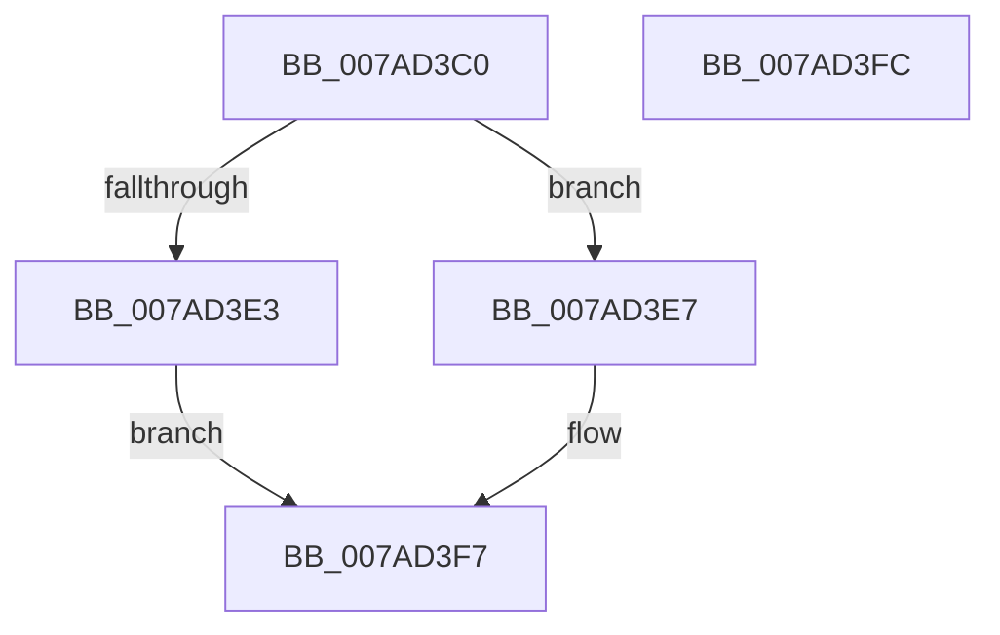

# VmFreePreallocationForRangeCreate

- RVA: `0x007AD3C0`–`0x007AD3FD` (길이 `61` bytes)
- VA: `0x00000001407AD3C0`
- 실행 섹션: `PAGE`
- PDB 이름 있음: `예`; PDB Function 태그: `아니요`
- unwind 정보 RVA: `0x0005C788`
- 디코드: `16`개 명령, `61/61` bytes 표시
- 미해석 바이트: `0` (있으면 어셈블리에 `.byte`로 보존)

> 이 문서는 커널 이미지의 기계어와 PDB 기호를 분석해 생성했습니다. 4번과 5번은 함수 원형과 자료형을 바이너리 사용 방식에서 추정한 C 해석이며 원본 소스 복구 결과는 아닙니다.

## 1. Dependencies

- 직접 호출 지점: **2**; 고유 호출 대상: **2**
- 직접 호출자로 확인된 함수: **0**
- RIP 상대 이미지 참조: **0**

### Outgoing calls
- `0x007AD3EA` → [VmpDecodePreallocationRangeHandle](VmpDecodePreallocationRangeHandle_function_007AD9AC.md) (function, `0x007AD9AC`)
- `0x007AD3F2` → [VmpFreeMemoryRanges](../A7/VmpFreeMemoryRanges_function_00A75744.md) (function, `0x00A75744`)

### Direct callers
- 이 함수 시작 RVA로 연결되는 직접 call은 확인되지 않았습니다. 간접 호출은 완전히 역산할 수 없습니다.

### Static image references
- 디코드된 RIP-relative 메모리 참조가 없습니다.

## 2. Other-region calls and transfers

- 다른 실행 섹션으로 향하는 call: **0**
- 별도 외부 분기/꼬리 이동을 확인하지 못했습니다.

## 3. Assembly (complete function range)

```asm
007AD3C0  48 83 EC 28                     sub rsp, 0x28
007AD3C4  65 48 8B 04 25 88 01 00 00      mov rax, qword ptr gs:[0x188]
007AD3CD  4C 8B C1                        mov r8, rcx
007AD3D0  48 8B 90 B8 00 00 00            mov rdx, qword ptr [rax + 0xb8]
007AD3D7  48 8B 8A 70 06 00 00            mov rcx, qword ptr [rdx + 0x670]
007AD3DE  48 85 C9                        test rcx, rcx
007AD3E1  75 04                           jne 0x1407ad3e7
007AD3E3  CD 2C                           int 0x2c
007AD3E5  EB 10                           jmp 0x1407ad3f7
007AD3E7  49 8B D0                        mov rdx, r8
007AD3EA  E8 BD 05 00 00                  call 0x1407ad9ac
007AD3EF  48 8B C8                        mov rcx, rax
007AD3F2  E8 4D 83 2C 00                  call 0x140a75744
007AD3F7  48 83 C4 28                     add rsp, 0x28
007AD3FB  C3                              ret
007AD3FC  CC                              int3
```

## 4. C-style interpretation (structured pseudocode)

```c
__int64 __fastcall VmFreePreallocationForRangeCreate(__int64 a1)
{
    __int64 result;
    __int64 v_rsp;

    v_rsp = (v_rsp) - (40);
    if (*(unsigned __int64 *)(*(unsigned __int64 *)(*(unsigned __int64 *)(gs_base + (0 + 392)) + 184) + 1648) != 0) goto loc_007AD3E7;
    goto loc_007AD3F7;
loc_007AD3E7:
    result = VmpDecodePreallocationRangeHandle(*(unsigned __int64 *)(*(unsigned __int64 *)(*(unsigned __int64 *)(gs_base + (0 + 392)) + 184) + 1648), a1, a1, a4);
    result = VmpFreeMemoryRanges(result, a1, a1, a4);
loc_007AD3F7:
    v_rsp = (v_rsp) + (40);
    return result;
}
```

## 5. (Beta) C Style

```c
int64_t VmFreePreallocationForRangeCreate(int64_t Arg1)
{
    int64_t result;
    int64_t local_rsp;

    local_rsp = (local_rsp) - (40);
    if (*(uint64_t *)(*(uint64_t *)(*(uint64_t *)(gs_base + (0 + 0x188)) + 0xB8) + 0x670) != 0) goto loc_007AD3E7;
    goto loc_007AD3F7;
loc_007AD3E7:
    result = VmpDecodePreallocationRangeHandle(*(uint64_t *)(*(uint64_t *)(*(uint64_t *)(gs_base + (0 + 0x188)) + 0xB8) + 0x670), Arg1, Arg1, a4);
    result = VmpFreeMemoryRanges(result, Arg1, Arg1, a4);
loc_007AD3F7:
    local_rsp = (local_rsp) + (40);
    return result;
}
```

## 6. Execution-region graph

[열기: 2D/3D 그래프와 함수 탐색 컨트롤 패널](../../../control-panel.html?section=page&rva=0x007AD3C0&view=graph)

- 2D 그래프는 위에서 아래로 흐르고, 3D 그래프는 빈 공간을 드래그해 회전합니다. Shift+드래그는 이동, 휠은 확대·축소, 함수 노드 선택은 대상 보고서 이동입니다.

### Static fallback


