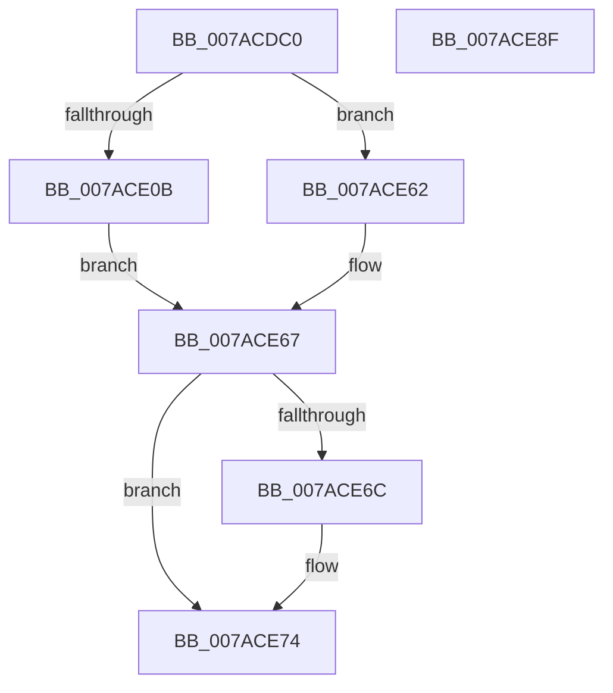

# VmMapSectionExecuteNoAcg

- RVA: `0x007ACDC0`–`0x007ACE90` (길이 `208` bytes)
- VA: `0x00000001407ACDC0`
- 실행 섹션: `PAGE`
- PDB 이름 있음: `예`; PDB Function 태그: `아니요`
- unwind 정보 RVA: `0x0007FA5C`
- 디코드: `51`개 명령, `208/208` bytes 표시
- 미해석 바이트: `0` (있으면 어셈블리에 `.byte`로 보존)

> 이 문서는 커널 이미지의 기계어와 PDB 기호를 분석해 생성했습니다. 4번과 5번은 함수 원형과 자료형을 바이너리 사용 방식에서 추정한 C 해석이며 원본 소스 복구 결과는 아닙니다.

## 1. Dependencies

- 직접 호출 지점: **3**; 고유 호출 대상: **3**
- 직접 호출자로 확인된 함수: **0**
- RIP 상대 이미지 참조: **1**

### Outgoing calls
- `0x007ACE00` → [ObReferenceObjectByHandle](../86/ObReferenceObjectByHandle_function_00868DB0.md) (function, `0x00868DB0`)
- `0x007ACE59` → [MmMapViewOfSectionEx](../../text/48/MmMapViewOfSectionEx_function_0048E244.md) (function, `0x0048E244`)
- `0x007ACE6F` → [ObfDereferenceObject](../../text/2F/ObfDereferenceObject_function_002F9350.md) (function, `0x002F9350`)

### Direct callers
- 이 함수 시작 RVA로 연결되는 직접 call은 확인되지 않았습니다. 간접 호출은 완전히 역산할 수 없습니다.

### Static image references
- `0x007ACDF5` → RVA `0x00FC6BD8` (`ALMOSTRO`; read)

## 2. Other-region calls and transfers

- 다른 실행 섹션으로 향하는 call: **2**
  - `0x007ACE59` → [MmMapViewOfSectionEx](../../text/48/MmMapViewOfSectionEx_function_0048E244.md) (`PAGE` → `.text`)
  - `0x007ACE6F` → [ObfDereferenceObject](../../text/2F/ObfDereferenceObject_function_002F9350.md) (`PAGE` → `.text`)
- 별도 외부 분기/꼬리 이동을 확인하지 못했습니다.

## 3. Assembly (complete function range)

```asm
007ACDC0  4C 8B DC                        mov r11, rsp
007ACDC3  49 89 5B 08                     mov qword ptr [r11 + 8], rbx
007ACDC7  49 89 6B 10                     mov qword ptr [r11 + 0x10], rbp
007ACDCB  49 89 73 18                     mov qword ptr [r11 + 0x18], rsi
007ACDCF  57                              push rdi
007ACDD0  48 81 EC 80 00 00 00            sub rsp, 0x80
007ACDD7  49 83 63 A0 00                  and qword ptr [r11 - 0x60], 0
007ACDDC  49 8D 43 E8                     lea rax, [r11 - 0x18]
007ACDE0  49 83 63 E8 00                  and qword ptr [r11 - 0x18], 0
007ACDE5  49 8B D9                        mov rbx, r9
007ACDE8  45 33 C9                        xor r9d, r9d
007ACDEB  49 89 43 98                     mov qword ptr [r11 - 0x68], rax
007ACDEF  49 8B F0                        mov rsi, r8
007ACDF2  48 8B EA                        mov rbp, rdx
007ACDF5  4C 8B 05 DC 9D 81 00            mov r8, qword ptr [rip + 0x819ddc]
007ACDFC  41 8D 51 08                     lea edx, [r9 + 8]
007ACE00  E8 AB BF 0B 00                  call 0x140868db0
007ACE05  8B F8                           mov edi, eax
007ACE07  85 C0                           test eax, eax
007ACE09  78 57                           js 0x1407ace62
007ACE0B  65 48 8B 04 25 88 01 00 00      mov rax, qword ptr gs:[0x188]
007ACE14  4C 8B CE                        mov r9, rsi
007ACE17  C7 44 24 60 00 00 00 20         mov dword ptr [rsp + 0x60], 0x20000000
007ACE1F  4C 8B C5                        mov r8, rbp
007ACE22  48 83 64 24 50 00               and qword ptr [rsp + 0x50], 0
007ACE28  83 64 24 48 00                  and dword ptr [rsp + 0x48], 0
007ACE2D  83 64 24 40 00                  and dword ptr [rsp + 0x40], 0
007ACE32  48 83 64 24 38 00               and qword ptr [rsp + 0x38], 0
007ACE38  48 8B 90 B8 00 00 00            mov rdx, qword ptr [rax + 0xb8]
007ACE3F  C7 44 24 30 10 00 00 00         mov dword ptr [rsp + 0x30], 0x10
007ACE47  83 64 24 28 00                  and dword ptr [rsp + 0x28], 0
007ACE4C  48 89 5C 24 20                  mov qword ptr [rsp + 0x20], rbx
007ACE51  48 8B 5C 24 70                  mov rbx, qword ptr [rsp + 0x70]
007ACE56  48 8B CB                        mov rcx, rbx
007ACE59  E8 E6 13 CE FF                  call 0x14048e244
007ACE5E  8B F8                           mov edi, eax
007ACE60  EB 05                           jmp 0x1407ace67
007ACE62  48 8B 5C 24 70                  mov rbx, qword ptr [rsp + 0x70]
007ACE67  48 85 DB                        test rbx, rbx
007ACE6A  74 08                           je 0x1407ace74
007ACE6C  48 8B CB                        mov rcx, rbx
007ACE6F  E8 DC C4 B4 FF                  call 0x1402f9350
007ACE74  4C 8D 9C 24 80 00 00 00         lea r11, [rsp + 0x80]
007ACE7C  8B C7                           mov eax, edi
007ACE7E  49 8B 5B 10                     mov rbx, qword ptr [r11 + 0x10]
007ACE82  49 8B 6B 18                     mov rbp, qword ptr [r11 + 0x18]
007ACE86  49 8B 73 20                     mov rsi, qword ptr [r11 + 0x20]
007ACE8A  49 8B E3                        mov rsp, r11
007ACE8D  5F                              pop rdi
007ACE8E  C3                              ret
007ACE8F  CC                              int3
```

## 4. C-style interpretation (structured pseudocode)

```c
__int64 __fastcall VmMapSectionExecuteNoAcg(__int64 a1, __int64 a2, __int64 a3, __int64 a4)
{
    __int64 result;
    __int64 v_rsp;
    unsigned __int64 v_stack_m18;
    unsigned int v_stack_m28;
    unsigned __int64 v_stack_m38;
    unsigned int v_stack_m40;
    unsigned int v_stack_m48;
    unsigned __int64 v_stack_m50;
    unsigned int v_stack_m58;
    unsigned int v_stack_m60;
    unsigned __int64 v_stack_m68;
    unsigned __int64 v_stack_m8;

    *(unsigned __int64 *)(v_rsp + 8) = v_rbx;
    *(unsigned __int64 *)(v_rsp + 16) = v_rbp;
    *(unsigned __int64 *)(v_rsp + 24) = v_rsi;
    v_rsp = (v_rsp) - (128);
    a4 = 0;
    *(unsigned __int64 *)(v_rsp - 104) = v_rsp - 24;
    result = ObReferenceObjectByHandle(a1, a4 + 8, *(unsigned __int64 *)(v_rip + 8494556), a4);
    if (sign_flag) goto loc_007ACE62;
    v_stack_m28 = 0x20000000ULL;
    v_stack_m58 = 16;
    v_stack_m68 = 0;
    result = MmMapViewOfSectionEx(v_stack_m18, *(unsigned __int64 *)(*(unsigned __int64 *)(gs_base + (0 + 392)) + 184), a2, a3);
    goto loc_007ACE67;
loc_007ACE62:
loc_007ACE67:
    if (v_stack_m18 != 0) {
        a1 = v_stack_m18;
        result = ObfDereferenceObject(a1, *(unsigned __int64 *)(*(unsigned __int64 *)(gs_base + (0 + 392)) + 184), a2, a3);
    }
    return (unsigned int)((unsigned int)((unsigned int)((unsigned int)(result))));
}
```

## 5. (Beta) C Style

```c
int64_t VmMapSectionExecuteNoAcg(int64_t Arg1, int64_t Arg2, int64_t Arg3, int64_t Arg4)
{
    int64_t result;
    int64_t local_rsp;
    uint64_t v_stack_m18;
    uint32_t v_stack_m28;
    uint64_t v_stack_m38;
    uint32_t v_stack_m40;
    uint32_t v_stack_m48;
    uint64_t v_stack_m50;
    uint32_t v_stack_m58;
    uint32_t v_stack_m60;
    uint64_t v_stack_m68;
    uint64_t v_stack_m8;

    *(uint64_t *)(local_rsp + 0x8) = local_rbx;
    *(uint64_t *)(local_rsp + 0x10) = local_rbp;
    *(uint64_t *)(local_rsp + 0x18) = local_rsi;
    local_rsp = (local_rsp) - (128);
    Arg4 = 0;
    *(uint64_t *)(local_rsp - 0x68) = local_rsp - 24;
    result = ObReferenceObjectByHandle(Arg1, Arg4 + 8, *(uint64_t *)(v_rip + 0x819DDC), Arg4);
    if (sign_flag) goto loc_007ACE62;
    v_stack_m28 = 0x20000000ULL;
    v_stack_m58 = 16;
    v_stack_m68 = 0;
    result = MmMapViewOfSectionEx(v_stack_m18, *(uint64_t *)(*(uint64_t *)(gs_base + (0 + 0x188)) + 0xB8), Arg2, Arg3);
    goto loc_007ACE67;
loc_007ACE62:
loc_007ACE67:
    if (v_stack_m18 != 0) {
        Arg1 = v_stack_m18;
        result = ObfDereferenceObject(Arg1, *(uint64_t *)(*(uint64_t *)(gs_base + (0 + 0x188)) + 0xB8), Arg2, Arg3);
    }
    return (uint32_t)((uint32_t)((uint32_t)((uint32_t)(result))));
}
```

## 6. Execution-region graph

[열기: 2D/3D 그래프와 함수 탐색 컨트롤 패널](../../../control-panel.html?section=page&rva=0x007ACDC0&view=graph)

- 2D 그래프는 위에서 아래로 흐르고, 3D 그래프는 빈 공간을 드래그해 회전합니다. Shift+드래그는 이동, 휠은 확대·축소, 함수 노드 선택은 대상 보고서 이동입니다.

### Static fallback


