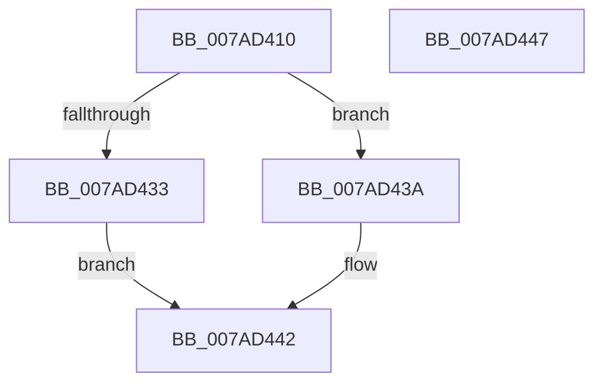

# VmPauseResumeNotify

- RVA: `0x007AD410`–`0x007AD448` (길이 `56` bytes)
- VA: `0x00000001407AD410`
- 실행 섹션: `PAGE`
- PDB 이름 있음: `예`; PDB Function 태그: `아니요`
- unwind 정보 RVA: `0x0005C788`
- 디코드: `14`개 명령, `56/56` bytes 표시
- 미해석 바이트: `0` (있으면 어셈블리에 `.byte`로 보존)

> 이 문서는 커널 이미지의 기계어와 PDB 기호를 분석해 생성했습니다. 4번과 5번은 함수 원형과 자료형을 바이너리 사용 방식에서 추정한 C 해석이며 원본 소스 복구 결과는 아닙니다.

## 1. Dependencies

- 직접 호출 지점: **1**; 고유 호출 대상: **1**
- 직접 호출자로 확인된 함수: **0**
- RIP 상대 이미지 참조: **0**

### Outgoing calls
- `0x007AD43D` → [VmpPauseResumeNotify](VmpPauseResumeNotify_function_007ADA08.md) (function, `0x007ADA08`)

### Direct callers
- 이 함수 시작 RVA로 연결되는 직접 call은 확인되지 않았습니다. 간접 호출은 완전히 역산할 수 없습니다.

### Static image references
- 디코드된 RIP-relative 메모리 참조가 없습니다.

## 2. Other-region calls and transfers

- 다른 실행 섹션으로 향하는 call: **0**
- 별도 외부 분기/꼬리 이동을 확인하지 못했습니다.

## 3. Assembly (complete function range)

```asm
007AD410  48 83 EC 28                     sub rsp, 0x28
007AD414  65 48 8B 04 25 88 01 00 00      mov rax, qword ptr gs:[0x188]
007AD41D  44 8B C1                        mov r8d, ecx
007AD420  48 8B 90 B8 00 00 00            mov rdx, qword ptr [rax + 0xb8]
007AD427  48 8B 8A 70 06 00 00            mov rcx, qword ptr [rdx + 0x670]
007AD42E  48 85 C9                        test rcx, rcx
007AD431  75 07                           jne 0x1407ad43a
007AD433  B8 88 00 00 C0                  mov eax, 0xc0000088
007AD438  EB 08                           jmp 0x1407ad442
007AD43A  41 8B D0                        mov edx, r8d
007AD43D  E8 C6 05 00 00                  call 0x1407ada08
007AD442  48 83 C4 28                     add rsp, 0x28
007AD446  C3                              ret
007AD447  CC                              int3
```

## 4. C-style interpretation (structured pseudocode)

```c
__int64 __fastcall VmPauseResumeNotify(int a1)
{
    __int64 result;
    __int64 v_rsp;

    v_rsp = (v_rsp) - (40);
    if (*(unsigned __int64 *)(*(unsigned __int64 *)(*(unsigned __int64 *)(gs_base + (0 + 392)) + 184) + 1648) != 0) goto loc_007AD43A;
    goto loc_007AD442;
loc_007AD43A:
    result = VmpPauseResumeNotify(*(unsigned __int64 *)(*(unsigned __int64 *)(*(unsigned __int64 *)(gs_base + (0 + 392)) + 184) + 1648), (unsigned int)((unsigned int)((unsigned int)(a1))), (unsigned int)(a1), a4);
loc_007AD442:
    v_rsp = (v_rsp) + (40);
    return result;
}
```

## 5. (Beta) C Style

```c
int64_t VmPauseResumeNotify(int32_t Arg1)
{
    int64_t result;
    int64_t local_rsp;

    local_rsp = (local_rsp) - (40);
    if (*(uint64_t *)(*(uint64_t *)(*(uint64_t *)(gs_base + (0 + 0x188)) + 0xB8) + 0x670) != 0) goto loc_007AD43A;
    goto loc_007AD442;
loc_007AD43A:
    result = VmpPauseResumeNotify(*(uint64_t *)(*(uint64_t *)(*(uint64_t *)(gs_base + (0 + 0x188)) + 0xB8) + 0x670), (uint32_t)((uint32_t)((uint32_t)(Arg1))), (uint32_t)(Arg1), a4);
loc_007AD442:
    local_rsp = (local_rsp) + (40);
    return result;
}
```

## 6. Execution-region graph

[열기: 2D/3D 그래프와 함수 탐색 컨트롤 패널](../../../control-panel.html?section=page&rva=0x007AD410&view=graph)

- 2D 그래프는 위에서 아래로 흐르고, 3D 그래프는 빈 공간을 드래그해 회전합니다. Shift+드래그는 이동, 휠은 확대·축소, 함수 노드 선택은 대상 보고서 이동입니다.

### Static fallback


