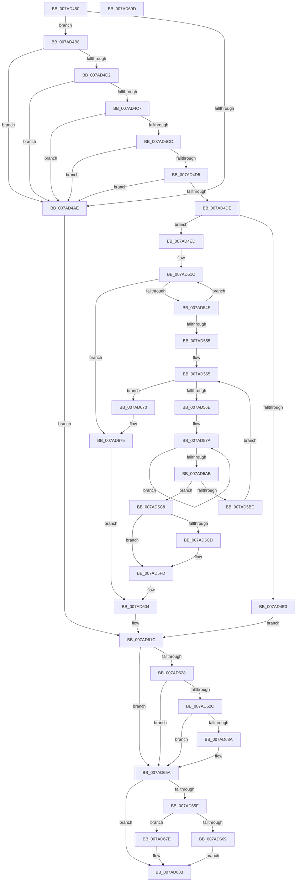

# VmPinMemoryRange

- RVA: `0x007AD450`–`0x007AD69E` (길이 `590` bytes)
- VA: `0x00000001407AD450`
- 실행 섹션: `PAGE`
- PDB 이름 있음: `예`; PDB Function 태그: `아니요`
- unwind 정보 RVA: `0x000D2E90`
- 디코드: `156`개 명령, `590/590` bytes 표시
- 미해석 바이트: `0` (있으면 어셈블리에 `.byte`로 보존)

> 이 문서는 커널 이미지의 기계어와 PDB 기호를 분석해 생성했습니다. 4번과 5번은 함수 원형과 자료형을 바이너리 사용 방식에서 추정한 C 해석이며 원본 소스 복구 결과는 아닙니다.

## 1. Dependencies

- 직접 호출 지점: **8**; 고유 호출 대상: **7**
- 직접 호출자로 확인된 함수: **0**
- RIP 상대 이미지 참조: **1**

### Outgoing calls
- `0x007AD50F` → [FsRtlAcquirePushLockShared](../../text/48/FsRtlAcquirePushLockShared_function_0048B034.md) (function, `0x0048B034`)
- `0x007AD53C` → [VmpPinMemoryRange](../../text/64/VmpPinMemoryRange_function_0064CCD0.md) (function, `0x0064CCD0`)
- `0x007AD59D` → [VmpPinMemoryRange](../../text/64/VmpPinMemoryRange_function_0064CCD0.md) (function, `0x0064CCD0`)
- `0x007AD5F8` → [VmpUnpinMemoryRange](VmpUnpinMemoryRange_function_007ADF6C.md) (function, `0x007ADF6C`)
- `0x007AD631` → [tlgKeywordOn](../../text/42/tlgKeywordOn_function_0042EAA0.md) (function, `0x0042EAA0`)
- `0x007AD655` → [VmpLogPin](VmpLogPin_function_007AE8A0.md) (function, `0x007AE8A0`)
- `0x007AD669` → [PfLockExclusiveRelease](../../text/49/PfLockExclusiveRelease_function_00491D88.md) (function, `0x00491D88`)
- `0x007AD67E` → [PfLockSharedRelease](../../text/48/PfLockSharedRelease_function_0048DF24.md) (function, `0x0048DF24`)

### Direct callers
- 이 함수 시작 RVA로 연결되는 직접 call은 확인되지 않았습니다. 간접 호출은 완전히 역산할 수 없습니다.

### Static image references
- `0x007AD61C` → RVA `0x00F02458` (`.data`; read)

## 2. Other-region calls and transfers

- 다른 실행 섹션으로 향하는 call: **6**
  - `0x007AD50F` → [FsRtlAcquirePushLockShared](../../text/48/FsRtlAcquirePushLockShared_function_0048B034.md) (`PAGE` → `.text`)
  - `0x007AD53C` → [VmpPinMemoryRange](../../text/64/VmpPinMemoryRange_function_0064CCD0.md) (`PAGE` → `.text`)
  - `0x007AD59D` → [VmpPinMemoryRange](../../text/64/VmpPinMemoryRange_function_0064CCD0.md) (`PAGE` → `.text`)
  - `0x007AD631` → [tlgKeywordOn](../../text/42/tlgKeywordOn_function_0042EAA0.md) (`PAGE` → `.text`)
  - `0x007AD669` → [PfLockExclusiveRelease](../../text/49/PfLockExclusiveRelease_function_00491D88.md) (`PAGE` → `.text`)
  - `0x007AD67E` → [PfLockSharedRelease](../../text/48/PfLockSharedRelease_function_0048DF24.md) (`PAGE` → `.text`)
- 별도 외부 분기/꼬리 이동을 확인하지 못했습니다.

## 3. Assembly (complete function range)

```asm
007AD450  48 8B C4                        mov rax, rsp
007AD453  48 89 58 20                     mov qword ptr [rax + 0x20], rbx
007AD457  4C 89 40 18                     mov qword ptr [rax + 0x18], r8
007AD45B  48 89 50 10                     mov qword ptr [rax + 0x10], rdx
007AD45F  48 89 48 08                     mov qword ptr [rax + 8], rcx
007AD463  55                              push rbp
007AD464  56                              push rsi
007AD465  57                              push rdi
007AD466  41 54                           push r12
007AD468  41 55                           push r13
007AD46A  41 56                           push r14
007AD46C  41 57                           push r15
007AD46E  48 83 EC 60                     sub rsp, 0x60
007AD472  33 FF                           xor edi, edi
007AD474  4D 8B E8                        mov r13, r8
007AD477  4C 8B 84 24 C0 00 00 00         mov r8, qword ptr [rsp + 0xc0]
007AD47F  45 8B F9                        mov r15d, r9d
007AD482  89 78 A8                        mov dword ptr [rax - 0x58], edi
007AD485  4C 8B CA                        mov r9, rdx
007AD488  89 78 B0                        mov dword ptr [rax - 0x50], edi
007AD48B  4C 8B D9                        mov r11, rcx
007AD48E  65 48 8B 04 25 88 01 00 00      mov rax, qword ptr gs:[0x188]
007AD497  44 8B E7                        mov r12d, edi
007AD49A  4C 8B 90 B8 00 00 00            mov r10, qword ptr [rax + 0xb8]
007AD4A1  4D 8B B2 70 06 00 00            mov r14, qword ptr [r10 + 0x670]
007AD4A8  49 83 F8 FF                     cmp r8, -1
007AD4AC  75 0A                           jne 0x1407ad4b8
007AD4AE  BB 0D 00 00 C0                  mov ebx, 0xc000000d
007AD4B3  E9 64 01 00 00                  jmp 0x1407ad61c
007AD4B8  B8 FF 0F 00 00                  mov eax, 0xfff
007AD4BD  48 85 D0                        test rax, rdx
007AD4C0  75 EC                           jne 0x1407ad4ae
007AD4C2  48 85 C8                        test rax, rcx
007AD4C5  75 E7                           jne 0x1407ad4ae
007AD4C7  4D 85 ED                        test r13, r13
007AD4CA  74 E2                           je 0x1407ad4ae
007AD4CC  41 F7 C7 78 FF FF FF            test r15d, 0xffffff78
007AD4D3  75 D9                           jne 0x1407ad4ae
007AD4D5  41 F7 C7 7F FF FF FF            test r15d, 0xffffff7f
007AD4DC  74 D0                           je 0x1407ad4ae
007AD4DE  4D 85 F6                        test r14, r14
007AD4E1  75 0A                           jne 0x1407ad4ed
007AD4E3  BB 88 00 00 C0                  mov ebx, 0xc0000088
007AD4E8  E9 2F 01 00 00                  jmp 0x1407ad61c
007AD4ED  48 8B F1                        mov rsi, rcx
007AD4F0  48 8B EA                        mov rbp, rdx
007AD4F3  48 C1 ED 0C                     shr rbp, 0xc
007AD4F7  49 8D 4E 78                     lea rcx, [r14 + 0x78]
007AD4FB  41 BC 01 00 00 00               mov r12d, 1
007AD501  48 C1 EE 0C                     shr rsi, 0xc
007AD505  48 89 6C 24 50                  mov qword ptr [rsp + 0x50], rbp
007AD50A  44 89 64 24 44                  mov dword ptr [rsp + 0x44], r12d
007AD50F  E8 20 DB CD FF                  call 0x14048b034
007AD514  48 8B BC 24 C0 00 00 00         mov rdi, qword ptr [rsp + 0xc0]
007AD51C  48 8D 44 24 40                  lea rax, [rsp + 0x40]
007AD521  4D 8B CD                        mov r9, r13
007AD524  48 89 44 24 30                  mov qword ptr [rsp + 0x30], rax
007AD529  4C 8B C5                        mov r8, rbp
007AD52C  48 89 7C 24 28                  mov qword ptr [rsp + 0x28], rdi
007AD531  48 8B D6                        mov rdx, rsi
007AD534  49 8B CE                        mov rcx, r14
007AD537  44 89 7C 24 20                  mov dword ptr [rsp + 0x20], r15d
007AD53C  E8 8F F7 E9 FF                  call 0x14064ccd0
007AD541  8B D8                           mov ebx, eax
007AD543  3D 2D 02 00 C0                  cmp eax, 0xc000022d
007AD548  0F 85 27 01 00 00               jne 0x1407ad675
007AD54E  83 7C 24 40 00                  cmp dword ptr [rsp + 0x40], 0
007AD553  74 C7                           je 0x1407ad51c
007AD555  49 8D 45 FF                     lea rax, [r13 - 1]
007AD559  4C 8B E5                        mov r12, rbp
007AD55C  48 03 C6                        add rax, rsi
007AD55F  48 8B FE                        mov rdi, rsi
007AD562  4C 2B E6                        sub r12, rsi
007AD565  48 3B F8                        cmp rdi, rax
007AD568  0F 87 02 01 00 00               ja 0x1407ad670
007AD56E  48 8B AC 24 C0 00 00 00         mov rbp, qword ptr [rsp + 0xc0]
007AD576  4D 8D 2C 3C                     lea r13, [r12 + rdi]
007AD57A  48 8D 44 24 40                  lea rax, [rsp + 0x40]
007AD57F  41 B9 01 00 00 00               mov r9d, 1
007AD585  48 89 44 24 30                  mov qword ptr [rsp + 0x30], rax
007AD58A  4D 8B C5                        mov r8, r13
007AD58D  48 89 6C 24 28                  mov qword ptr [rsp + 0x28], rbp
007AD592  48 8B D7                        mov rdx, rdi
007AD595  49 8B CE                        mov rcx, r14
007AD598  44 89 7C 24 20                  mov dword ptr [rsp + 0x20], r15d
007AD59D  E8 2E F7 E9 FF                  call 0x14064ccd0
007AD5A2  8B D8                           mov ebx, eax
007AD5A4  3D 2D 02 00 C0                  cmp eax, 0xc000022d
007AD5A9  74 CF                           je 0x1407ad57a
007AD5AB  48 8B 6C 24 50                  mov rbp, qword ptr [rsp + 0x50]
007AD5B0  4C 8B AC 24 B0 00 00 00         mov r13, qword ptr [rsp + 0xb0]
007AD5B8  85 C0                           test eax, eax
007AD5BA  78 0C                           js 0x1407ad5c8
007AD5BC  48 FF C7                        inc rdi
007AD5BF  49 8D 45 FF                     lea rax, [r13 - 1]
007AD5C3  48 03 C6                        add rax, rsi
007AD5C6  EB 9D                           jmp 0x1407ad565
007AD5C8  48 3B FE                        cmp rdi, rsi
007AD5CB  74 30                           je 0x1407ad5fd
007AD5CD  48 8D 44 24 48                  lea rax, [rsp + 0x48]
007AD5D2  48 2B FE                        sub rdi, rsi
007AD5D5  48 89 44 24 30                  mov qword ptr [rsp + 0x30], rax
007AD5DA  4C 8B CF                        mov r9, rdi
007AD5DD  48 8B 84 24 C0 00 00 00         mov rax, qword ptr [rsp + 0xc0]
007AD5E5  4C 8B C5                        mov r8, rbp
007AD5E8  83 64 24 28 00                  and dword ptr [rsp + 0x28], 0
007AD5ED  48 8B D6                        mov rdx, rsi
007AD5F0  49 8B CE                        mov rcx, r14
007AD5F3  48 89 44 24 20                  mov qword ptr [rsp + 0x20], rax
007AD5F8  E8 6F 09 00 00                  call 0x1407adf6c
007AD5FD  44 8B 64 24 44                  mov r12d, dword ptr [rsp + 0x44]
007AD602  33 FF                           xor edi, edi
007AD604  4C 8B 84 24 C0 00 00 00         mov r8, qword ptr [rsp + 0xc0]
007AD60C  4C 8B 8C 24 A8 00 00 00         mov r9, qword ptr [rsp + 0xa8]
007AD614  4C 8B 9C 24 A0 00 00 00         mov r11, qword ptr [rsp + 0xa0]
007AD61C  48 8B 0D 35 4E 75 00            mov rcx, qword ptr [rip + 0x754e35]
007AD623  48 85 C9                        test rcx, rcx
007AD626  74 32                           je 0x1407ad65a
007AD628  39 39                           cmp dword ptr [rcx], edi
007AD62A  76 2E                           jbe 0x1407ad65a
007AD62C  BA 20 00 00 00                  mov edx, 0x20
007AD631  E8 6A 14 C8 FF                  call 0x14042eaa0
007AD636  84 C0                           test al, al
007AD638  74 20                           je 0x1407ad65a
007AD63A  89 5C 24 38                     mov dword ptr [rsp + 0x38], ebx
007AD63E  BA 01 00 00 00                  mov edx, 1
007AD643  4C 89 44 24 30                  mov qword ptr [rsp + 0x30], r8
007AD648  4D 8B C3                        mov r8, r11
007AD64B  44 89 7C 24 28                  mov dword ptr [rsp + 0x28], r15d
007AD650  4C 89 6C 24 20                  mov qword ptr [rsp + 0x20], r13
007AD655  E8 46 12 00 00                  call 0x1407ae8a0
007AD65A  45 85 E4                        test r12d, r12d
007AD65D  74 24                           je 0x1407ad683
007AD65F  49 8D 4E 78                     lea rcx, [r14 + 0x78]
007AD663  39 7C 24 48                     cmp dword ptr [rsp + 0x48], edi
007AD667  74 15                           je 0x1407ad67e
007AD669  E8 1A 47 CE FF                  call 0x140491d88
007AD66E  EB 13                           jmp 0x1407ad683
007AD670  44 8B 64 24 44                  mov r12d, dword ptr [rsp + 0x44]
007AD675  33 FF                           xor edi, edi
007AD677  85 DB                           test ebx, ebx
007AD679  0F 49 DF                        cmovns ebx, edi
007AD67C  EB 86                           jmp 0x1407ad604
007AD67E  E8 A1 08 CE FF                  call 0x14048df24
007AD683  8B C3                           mov eax, ebx
007AD685  48 8B 9C 24 B8 00 00 00         mov rbx, qword ptr [rsp + 0xb8]
007AD68D  48 83 C4 60                     add rsp, 0x60
007AD691  41 5F                           pop r15
007AD693  41 5E                           pop r14
007AD695  41 5D                           pop r13
007AD697  41 5C                           pop r12
007AD699  5F                              pop rdi
007AD69A  5E                              pop rsi
007AD69B  5D                              pop rbp
007AD69C  C3                              ret
007AD69D  CC                              int3
```

## 4. C-style interpretation (structured pseudocode)

```c
__int64 __fastcall VmPinMemoryRange(__int64 a1, __int64 a2, __int64 a3, int a4, __int64 a5)
{
    __int64 result;
    __int64 v_r12;
    __int64 v_rbp;
    __int64 v_rbx;
    __int64 v_rdi;
    __int64 v_rsi;
    __int64 v_rsp;
    unsigned __int64 v_stack_m48;
    unsigned __int64 v_stack_m50;
    unsigned int v_stack_m54;
    unsigned __int64 v_stack_m58;
    unsigned int v_stack_m60;
    unsigned __int64 v_stack_m68;
    unsigned __int64 v_stack_m70;
    unsigned int v_stack_m78;
    unsigned __int64 v_stack_p10;
    unsigned __int64 v_stack_p18;
    unsigned __int64 v_stack_p20;
    unsigned __int64 v_stack_p8;

    *(unsigned __int64 *)(v_rsp + 32) = v_rbx;
    *(unsigned __int64 *)(v_rsp + 24) = a3;
    *(unsigned __int64 *)(v_rsp + 16) = a2;
    *(unsigned __int64 *)(v_rsp + 8) = a1;
    v_rsp = (v_rsp) - (96);
    v_rdi = 0;
    *(unsigned int *)(v_rsp - 88) = 0;
    *(unsigned int *)(v_rsp - 80) = 0;
    if (a5 != -1) goto loc_007AD4B8;
loc_007AD4AE:
    goto loc_007AD61C;
loc_007AD4B8:
    if ((((unsigned int)(0xFFFULL)) & (a2)) != 0) goto loc_007AD4AE;
    if ((((unsigned int)(0xFFFULL)) & (a1)) != 0) goto loc_007AD4AE;
    if (a3 == 0) goto loc_007AD4AE;
    if ((((unsigned int)((unsigned int)(a4))) & (0xFFFFFF78ULL)) != 0) goto loc_007AD4AE;
    if ((((unsigned int)((unsigned int)(a4))) & (0xFFFFFF7FULL)) == 0) goto loc_007AD4AE;
    if (*(unsigned __int64 *)(*(unsigned __int64 *)(*(unsigned __int64 *)(gs_base + (0 + 392)) + 184) + 1648) != 0) goto loc_007AD4ED;
    goto loc_007AD61C;
loc_007AD4ED:
    v_rbp = (a2) >> (12);
    v_rsi = (a1) >> (12);
    v_stack_m48 = v_rbp;
    v_stack_m54 = 1;
    result = FsRtlAcquirePushLockShared(*(unsigned __int64 *)(*(unsigned __int64 *)(*(unsigned __int64 *)(gs_base + (0 + 392)) + 184) + 1648) + 120, a2, a5, a2);
loc_007AD51C:
    v_stack_m68 = v_stack_m58;
    v_stack_m70 = a5;
    v_stack_m78 = (unsigned int)((unsigned int)(a4));
    result = VmpPinMemoryRange(*(unsigned __int64 *)(*(unsigned __int64 *)(*(unsigned __int64 *)(gs_base + (0 + 392)) + 184) + 1648), v_rsi, v_rbp, a3);
    if (((unsigned int)(result)) != 0xC000022DULL) goto loc_007AD675;
    if (v_stack_m58 == 0) goto loc_007AD51C;
    result = (a3 - 1) + (v_rsi);
    v_r12 = (v_rbp) - (v_rsi);
loc_007AD565:
    if (v_rsi > result) goto loc_007AD670;
loc_007AD57A:
    v_stack_m68 = v_stack_m58;
    v_stack_m70 = a5;
    v_stack_m78 = (unsigned int)((unsigned int)(a4));
    result = VmpPinMemoryRange(*(unsigned __int64 *)(*(unsigned __int64 *)(*(unsigned __int64 *)(gs_base + (0 + 392)) + 184) + 1648), v_rsi, v_r12 + v_rsi * 1, 1);
    if (((unsigned int)(result)) == 0xC000022DULL) goto loc_007AD57A;
    if (sign_flag) goto loc_007AD5C8;
    v_rdi = (v_rsi) + 1;
    result = (v_stack_p18 - 1) + (v_rsi);
    goto loc_007AD565;
loc_007AD5C8:
    if (v_rdi != v_rsi) {
        result = v_stack_m50;
        v_rdi = (v_rdi) - (v_rsi);
        v_stack_m68 = result;
        a4 = v_rdi;
        result = a5;
        a3 = v_stack_m48;
        a2 = v_rsi;
        a1 = *(unsigned __int64 *)(*(unsigned __int64 *)(*(unsigned __int64 *)(gs_base + (0 + 392)) + 184) + 1648);
        v_stack_m78 = result;
        result = VmpUnpinMemoryRange(a1, a2, a3, a4);
    }
    v_rdi = 0;
loc_007AD604:
loc_007AD61C:
    if (*(unsigned __int64 *)(v_rip + 7687733) == 0) goto loc_007AD65A;
    if ((*(unsigned int *)(*(unsigned __int64 *)(v_rip + 7687733))) <= 0) goto loc_007AD65A;
    result = tlgKeywordOn(*(unsigned __int64 *)(v_rip + 7687733), 32, a5, v_stack_p10);
    if ((unsigned __int8)(result) != 0) {
        v_stack_m60 = (unsigned int)((unsigned int)((unsigned int)(result)));
        a2 = 1;
        v_stack_m68 = a5;
        a3 = v_stack_p8;
        v_stack_m70 = (unsigned int)((unsigned int)(a4));
        v_stack_m78 = v_stack_p18;
        result = VmpLogPin(*(unsigned __int64 *)(v_rip + 7687733), a2, a3, v_stack_p10);
    }
    if ((unsigned int)((unsigned int)(v_stack_m54)) == 0) goto loc_007AD683;
    if (v_stack_m50 == 0) goto loc_007AD67E;
    result = PfLockExclusiveRelease(*(unsigned __int64 *)(*(unsigned __int64 *)(*(unsigned __int64 *)(gs_base + (0 + 392)) + 184) + 1648) + 120, a2, a3, v_stack_p10);
    goto loc_007AD683;
loc_007AD670:
loc_007AD675:
    v_rdi = 0;
    v_rbx = (unsigned int)((unsigned int)(result));
    if (!sign_flag) { v_rbx = 0; }
    goto loc_007AD604;
loc_007AD67E:
    result = PfLockSharedRelease(*(unsigned __int64 *)(*(unsigned __int64 *)(*(unsigned __int64 *)(gs_base + (0 + 392)) + 184) + 1648) + 120, a2, a3, v_stack_p10);
loc_007AD683:
    v_rsp = (v_rsp) + (96);
    return (unsigned int)((unsigned int)(v_rbx));
}
```

## 5. (Beta) C Style

```c
int64_t VmPinMemoryRange(int64_t Arg1, int64_t Arg2, int64_t Arg3, int32_t Arg4, int64_t Arg5)
{
    int64_t result;
    int64_t local_r12;
    int64_t local_rbp;
    int64_t local_rbx;
    int64_t local_rdi;
    int64_t local_rsi;
    int64_t local_rsp;
    uint64_t v_stack_m48;
    uint64_t v_stack_m50;
    uint32_t v_stack_m54;
    uint64_t v_stack_m58;
    uint32_t v_stack_m60;
    uint64_t v_stack_m68;
    uint64_t v_stack_m70;
    uint32_t v_stack_m78;
    uint64_t v_stack_p10;
    uint64_t v_stack_p18;
    uint64_t v_stack_p20;
    uint64_t v_stack_p8;

    *(uint64_t *)(local_rsp + 0x20) = local_rbx;
    *(uint64_t *)(local_rsp + 0x18) = Arg3;
    *(uint64_t *)(local_rsp + 0x10) = Arg2;
    *(uint64_t *)(local_rsp + 0x8) = Arg1;
    local_rsp = (local_rsp) - (96);
    local_rdi = 0;
    *(uint32_t *)(local_rsp - 0x58) = 0;
    *(uint32_t *)(local_rsp - 0x50) = 0;
    if (Arg5 != -1) goto loc_007AD4B8;
loc_007AD4AE:
    goto loc_007AD61C;
loc_007AD4B8:
    if ((((uint32_t)(0xFFFULL)) & (Arg2)) != 0) goto loc_007AD4AE;
    if ((((uint32_t)(0xFFFULL)) & (Arg1)) != 0) goto loc_007AD4AE;
    if (Arg3 == 0) goto loc_007AD4AE;
    if ((((uint32_t)((uint32_t)(Arg4))) & (0xFFFFFF78ULL)) != 0) goto loc_007AD4AE;
    if ((((uint32_t)((uint32_t)(Arg4))) & (0xFFFFFF7FULL)) == 0) goto loc_007AD4AE;
    if (*(uint64_t *)(*(uint64_t *)(*(uint64_t *)(gs_base + (0 + 0x188)) + 0xB8) + 0x670) != 0) goto loc_007AD4ED;
    goto loc_007AD61C;
loc_007AD4ED:
    local_rbp = (Arg2) >> (12);
    local_rsi = (Arg1) >> (12);
    v_stack_m48 = local_rbp;
    v_stack_m54 = 1;
    result = FsRtlAcquirePushLockShared(*(uint64_t *)(*(uint64_t *)(*(uint64_t *)(gs_base + (0 + 0x188)) + 0xB8) + 0x670) + 120, Arg2, Arg5, Arg2);
loc_007AD51C:
    v_stack_m68 = v_stack_m58;
    v_stack_m70 = Arg5;
    v_stack_m78 = (uint32_t)((uint32_t)(Arg4));
    result = VmpPinMemoryRange(*(uint64_t *)(*(uint64_t *)(*(uint64_t *)(gs_base + (0 + 0x188)) + 0xB8) + 0x670), local_rsi, local_rbp, Arg3);
    if (((uint32_t)(result)) != 0xC000022DULL) goto loc_007AD675;
    if (v_stack_m58 == 0) goto loc_007AD51C;
    result = (Arg3 - 1) + (local_rsi);
    local_r12 = (local_rbp) - (local_rsi);
loc_007AD565:
    if (local_rsi > result) goto loc_007AD670;
loc_007AD57A:
    v_stack_m68 = v_stack_m58;
    v_stack_m70 = Arg5;
    v_stack_m78 = (uint32_t)((uint32_t)(Arg4));
    result = VmpPinMemoryRange(*(uint64_t *)(*(uint64_t *)(*(uint64_t *)(gs_base + (0 + 0x188)) + 0xB8) + 0x670), local_rsi, local_r12 + local_rsi * 1, 1);
    if (((uint32_t)(result)) == 0xC000022DULL) goto loc_007AD57A;
    if (sign_flag) goto loc_007AD5C8;
    local_rdi = (local_rsi) + 1;
    result = (v_stack_p18 - 1) + (local_rsi);
    goto loc_007AD565;
loc_007AD5C8:
    if (local_rdi != local_rsi) {
        result = v_stack_m50;
        local_rdi = (local_rdi) - (local_rsi);
        v_stack_m68 = result;
        Arg4 = local_rdi;
        result = Arg5;
        Arg3 = v_stack_m48;
        Arg2 = local_rsi;
        Arg1 = *(uint64_t *)(*(uint64_t *)(*(uint64_t *)(gs_base + (0 + 0x188)) + 0xB8) + 0x670);
        v_stack_m78 = result;
        result = VmpUnpinMemoryRange(Arg1, Arg2, Arg3, Arg4);
    }
    local_rdi = 0;
loc_007AD604:
loc_007AD61C:
    if (*(uint64_t *)(v_rip + 0x754E35) == 0) goto loc_007AD65A;
    if ((*(uint32_t *)(*(uint64_t *)(v_rip + 0x754E35))) <= 0) goto loc_007AD65A;
    result = tlgKeywordOn(*(uint64_t *)(v_rip + 0x754E35), 32, Arg5, v_stack_p10);
    if ((uint8_t)(result) != 0) {
        v_stack_m60 = (uint32_t)((uint32_t)((uint32_t)(result)));
        Arg2 = 1;
        v_stack_m68 = Arg5;
        Arg3 = v_stack_p8;
        v_stack_m70 = (uint32_t)((uint32_t)(Arg4));
        v_stack_m78 = v_stack_p18;
        result = VmpLogPin(*(uint64_t *)(v_rip + 0x754E35), Arg2, Arg3, v_stack_p10);
    }
    if ((uint32_t)((uint32_t)(v_stack_m54)) == 0) goto loc_007AD683;
    if (v_stack_m50 == 0) goto loc_007AD67E;
    result = PfLockExclusiveRelease(*(uint64_t *)(*(uint64_t *)(*(uint64_t *)(gs_base + (0 + 0x188)) + 0xB8) + 0x670) + 120, Arg2, Arg3, v_stack_p10);
    goto loc_007AD683;
loc_007AD670:
loc_007AD675:
    local_rdi = 0;
    local_rbx = (uint32_t)((uint32_t)(result));
    if (!sign_flag) { local_rbx = 0; }
    goto loc_007AD604;
loc_007AD67E:
    result = PfLockSharedRelease(*(uint64_t *)(*(uint64_t *)(*(uint64_t *)(gs_base + (0 + 0x188)) + 0xB8) + 0x670) + 120, Arg2, Arg3, v_stack_p10);
loc_007AD683:
    local_rsp = (local_rsp) + (96);
    return (uint32_t)((uint32_t)(local_rbx));
}
```

## 6. Execution-region graph

[열기: 2D/3D 그래프와 함수 탐색 컨트롤 패널](../../../control-panel.html?section=page&rva=0x007AD450&view=graph)

- 2D 그래프는 위에서 아래로 흐르고, 3D 그래프는 빈 공간을 드래그해 회전합니다. Shift+드래그는 이동, 휠은 확대·축소, 함수 노드 선택은 대상 보고서 이동입니다.

### Static fallback


