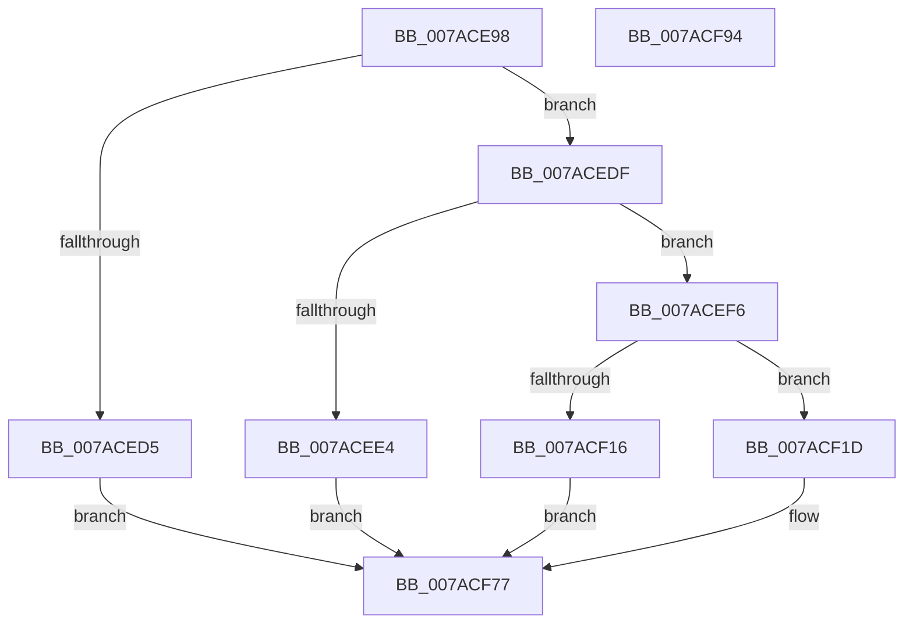

# VmPrefetchVirtualAddresses

- RVA: `0x007ACE98`–`0x007ACF95` (길이 `253` bytes)
- VA: `0x00000001407ACE98`
- 실행 섹션: `PAGE`
- PDB 이름 있음: `예`; PDB Function 태그: `아니요`
- unwind 정보 RVA: `0x0005E6B4`
- 디코드: `65`개 명령, `253/253` bytes 표시
- 미해석 바이트: `0` (있으면 어셈블리에 `.byte`로 보존)

> 이 문서는 커널 이미지의 기계어와 PDB 기호를 분석해 생성했습니다. 4번과 5번은 함수 원형과 자료형을 바이너리 사용 방식에서 추정한 C 해석이며 원본 소스 복구 결과는 아닙니다.

## 1. Dependencies

- 직접 호출 지점: **5**; 고유 호출 대상: **5**
- 직접 호출자로 확인된 함수: **2**
- RIP 상대 이미지 참조: **1**

### Outgoing calls
- `0x007ACEEA` → [VmpPrefetchVirtualAddresses](../../text/42/VmpPrefetchVirtualAddresses_function_00428844.md) (function, `0x00428844`)
- `0x007ACF09` → [ExAllocatePool2](../../poolcode/B8/ExAllocatePool2_function_00B820F0.md) (function, `0x00B820F0`)
- `0x007ACF42` → [ObfReferenceObject](../../text/20/ObfReferenceObject_function_0020FA20.md) (function, `0x0020FA20`)
- `0x007ACF65` → [memcpy](../../text/6C/memcpy_function_006C6840.md) (function, `0x006C6840`)
- `0x007ACF72` → [ExQueueWorkItem](../../text/2F/ExQueueWorkItem_function_002F9520.md) (function, `0x002F9520`)

### Direct callers
- [MmInSwapWorkingSet](../../text/45/MmInSwapWorkingSet_function_0045B6C4.md) at `0x0045B90C`
- [sub_00B31388](../B3/Unknown_function_00B31388.md) at `0x00B31416`

### Static image references
- `0x007ACF30` → RVA `0x007ADD20` (`VmpPrefetchWorker`; read)

## 2. Other-region calls and transfers

- 다른 실행 섹션으로 향하는 call: **5**
  - `0x007ACEEA` → [VmpPrefetchVirtualAddresses](../../text/42/VmpPrefetchVirtualAddresses_function_00428844.md) (`PAGE` → `.text`)
  - `0x007ACF09` → [ExAllocatePool2](../../poolcode/B8/ExAllocatePool2_function_00B820F0.md) (`PAGE` → `POOLCODE`)
  - `0x007ACF42` → [ObfReferenceObject](../../text/20/ObfReferenceObject_function_0020FA20.md) (`PAGE` → `.text`)
  - `0x007ACF65` → [memcpy](../../text/6C/memcpy_function_006C6840.md) (`PAGE` → `.text`)
  - `0x007ACF72` → [ExQueueWorkItem](../../text/2F/ExQueueWorkItem_function_002F9520.md) (`PAGE` → `.text`)
- 별도 외부 분기/꼬리 이동을 확인하지 못했습니다.

## 3. Assembly (complete function range)

```asm
007ACE98  48 8B C4                        mov rax, rsp
007ACE9B  48 89 58 08                     mov qword ptr [rax + 8], rbx
007ACE9F  48 89 68 10                     mov qword ptr [rax + 0x10], rbp
007ACEA3  48 89 70 18                     mov qword ptr [rax + 0x18], rsi
007ACEA7  48 89 78 20                     mov qword ptr [rax + 0x20], rdi
007ACEAB  41 56                           push r14
007ACEAD  48 83 EC 20                     sub rsp, 0x20
007ACEB1  65 48 8B 04 25 88 01 00 00      mov rax, qword ptr gs:[0x188]
007ACEBA  4C 8B F1                        mov r14, rcx
007ACEBD  33 DB                           xor ebx, ebx
007ACEBF  48 8B F2                        mov rsi, rdx
007ACEC2  48 8B A8 B8 00 00 00            mov rbp, qword ptr [rax + 0xb8]
007ACEC9  48 8B 8D 70 06 00 00            mov rcx, qword ptr [rbp + 0x670]
007ACED0  48 85 C9                        test rcx, rcx
007ACED3  75 0A                           jne 0x1407acedf
007ACED5  BB 9D 00 00 C0                  mov ebx, 0xc000009d
007ACEDA  E9 98 00 00 00                  jmp 0x1407acf77
007ACEDF  45 85 C0                        test r8d, r8d
007ACEE2  74 12                           je 0x1407acef6
007ACEE4  4C 8B C6                        mov r8, rsi
007ACEE7  49 8B D6                        mov rdx, r14
007ACEEA  E8 55 B9 C7 FF                  call 0x140428844
007ACEEF  8B D8                           mov ebx, eax
007ACEF1  E9 81 00 00 00                  jmp 0x1407acf77
007ACEF6  48 83 C2 04                     add rdx, 4
007ACEFA  B9 40 00 00 00                  mov ecx, 0x40
007ACEFF  48 C1 E2 04                     shl rdx, 4
007ACF03  41 B8 56 6D 50 63               mov r8d, 0x63506d56
007ACF09  E8 E2 51 3D 00                  call 0x140b820f0
007ACF0E  48 8B F8                        mov rdi, rax
007ACF11  48 85 C0                        test rax, rax
007ACF14  75 07                           jne 0x1407acf1d
007ACF16  BB 9A 00 00 C0                  mov ebx, 0xc000009a
007ACF1B  EB 5A                           jmp 0x1407acf77
007ACF1D  48 89 58 08                     mov qword ptr [rax + 8], rbx
007ACF21  48 8B CD                        mov rcx, rbp
007ACF24  48 89 58 20                     mov qword ptr [rax + 0x20], rbx
007ACF28  48 89 58 28                     mov qword ptr [rax + 0x28], rbx
007ACF2C  48 89 58 30                     mov qword ptr [rax + 0x30], rbx
007ACF30  48 8D 05 E9 0D 00 00            lea rax, [rip + 0xde9]
007ACF37  48 89 47 10                     mov qword ptr [rdi + 0x10], rax
007ACF3B  48 89 7F 18                     mov qword ptr [rdi + 0x18], rdi
007ACF3F  48 89 1F                        mov qword ptr [rdi], rbx
007ACF42  E8 D9 2A A6 FF                  call 0x14020fa20
007ACF47  48 89 77 30                     mov qword ptr [rdi + 0x30], rsi
007ACF4B  48 8D 4F 3F                     lea rcx, [rdi + 0x3f]
007ACF4F  48 83 E1 F8                     and rcx, 0xfffffffffffffff8
007ACF53  48 C1 E6 04                     shl rsi, 4
007ACF57  4C 8B C6                        mov r8, rsi
007ACF5A  48 89 4F 28                     mov qword ptr [rdi + 0x28], rcx
007ACF5E  49 8B D6                        mov rdx, r14
007ACF61  48 89 6F 20                     mov qword ptr [rdi + 0x20], rbp
007ACF65  E8 D6 98 F1 FF                  call 0x1406c6840
007ACF6A  BA 01 00 00 00                  mov edx, 1
007ACF6F  48 8B CF                        mov rcx, rdi
007ACF72  E8 A9 C5 B4 FF                  call 0x1402f9520
007ACF77  48 8B 6C 24 38                  mov rbp, qword ptr [rsp + 0x38]
007ACF7C  8B C3                           mov eax, ebx
007ACF7E  48 8B 5C 24 30                  mov rbx, qword ptr [rsp + 0x30]
007ACF83  48 8B 74 24 40                  mov rsi, qword ptr [rsp + 0x40]
007ACF88  48 8B 7C 24 48                  mov rdi, qword ptr [rsp + 0x48]
007ACF8D  48 83 C4 20                     add rsp, 0x20
007ACF91  41 5E                           pop r14
007ACF93  C3                              ret
007ACF94  CC                              int3
```

## 4. C-style interpretation (structured pseudocode)

```c
__int64 __fastcall VmPrefetchVirtualAddresses(__int64 a1, __int64 a2, int a3)
{
    __int64 result;
    __int64 v_rbx;
    __int64 v_rsi;
    __int64 v_rsp;
    unsigned __int64 v_stack_p10;
    unsigned __int64 v_stack_p18;
    unsigned __int64 v_stack_p20;
    unsigned __int64 v_stack_p8;

    *(unsigned __int64 *)(v_rsp + 8) = v_rbx;
    *(unsigned __int64 *)(v_rsp + 16) = v_rbp;
    *(unsigned __int64 *)(v_rsp + 24) = v_rsi;
    *(unsigned __int64 *)(v_rsp + 32) = v_rdi;
    v_rsp = (v_rsp) - (32);
    v_rbx = 0;
    if (*(unsigned __int64 *)(*(unsigned __int64 *)(*(unsigned __int64 *)(gs_base + (0 + 392)) + 184) + 1648) != 0) goto loc_007ACEDF;
    goto loc_007ACF77;
loc_007ACEDF:
    if (a3 == 0) goto loc_007ACEF6;
    result = VmpPrefetchVirtualAddresses(*(unsigned __int64 *)(*(unsigned __int64 *)(*(unsigned __int64 *)(gs_base + (0 + 392)) + 184) + 1648), a1, a2, a4);
    goto loc_007ACF77;
loc_007ACEF6:
    a2 = (a1) + (4);
    a2 = (a2) << (4);
    result = ExAllocatePool2(64, a2, (unsigned int)(0x63506D56ULL), a4);
    if (result != 0) goto loc_007ACF1D;
    goto loc_007ACF77;
loc_007ACF1D:
    *(unsigned __int64 *)(result + 8) = (unsigned int)(0xC000009AULL);
    *(unsigned __int64 *)(result + 32) = (unsigned int)(0xC000009AULL);
    *(unsigned __int64 *)(result + 40) = (unsigned int)(0xC000009AULL);
    *(unsigned __int64 *)(result + 48) = (unsigned int)(0xC000009AULL);
    *(unsigned __int64 *)(result + 16) = v_rip + 3561;
    *(unsigned __int64 *)(result + 24) = result;
    *(unsigned __int64 *)(result) = (unsigned int)(0xC000009AULL);
    result = ObfReferenceObject(*(unsigned __int64 *)(*(unsigned __int64 *)(gs_base + (0 + 392)) + 184), a2, (unsigned int)(0x63506D56ULL), a4);
    *(unsigned __int64 *)(result + 48) = a2;
    a1 = (result + 63) & (-8);
    v_rsi = (a2) << (4);
    *(unsigned __int64 *)(result + 40) = a1;
    *(unsigned __int64 *)(result + 32) = *(unsigned __int64 *)(*(unsigned __int64 *)(gs_base + (0 + 392)) + 184);
    result = memcpy(a1, a1, v_rsi, a4);
    result = ExQueueWorkItem(result, 1, v_rsi, a4);
loc_007ACF77:
    v_rsp = (v_rsp) + (32);
    return (unsigned int)((unsigned int)((unsigned int)(0xC000009AULL)));
}
```

## 5. (Beta) C Style

```c
int64_t VmPrefetchVirtualAddresses(int64_t Arg1, int64_t Arg2, int32_t Arg3)
{
    int64_t result;
    int64_t local_rbx;
    int64_t local_rsi;
    int64_t local_rsp;
    uint64_t v_stack_p10;
    uint64_t v_stack_p18;
    uint64_t v_stack_p20;
    uint64_t v_stack_p8;

    *(uint64_t *)(local_rsp + 0x8) = local_rbx;
    *(uint64_t *)(local_rsp + 0x10) = local_rbp;
    *(uint64_t *)(local_rsp + 0x18) = local_rsi;
    *(uint64_t *)(local_rsp + 0x20) = local_rdi;
    local_rsp = (local_rsp) - (32);
    local_rbx = 0;
    if (*(uint64_t *)(*(uint64_t *)(*(uint64_t *)(gs_base + (0 + 0x188)) + 0xB8) + 0x670) != 0) goto loc_007ACEDF;
    goto loc_007ACF77;
loc_007ACEDF:
    if (Arg3 == 0) goto loc_007ACEF6;
    result = VmpPrefetchVirtualAddresses(*(uint64_t *)(*(uint64_t *)(*(uint64_t *)(gs_base + (0 + 0x188)) + 0xB8) + 0x670), Arg1, Arg2, a4);
    goto loc_007ACF77;
loc_007ACEF6:
    Arg2 = (Arg1) + (4);
    Arg2 = (Arg2) << (4);
    result = ExAllocatePool2(64, Arg2, (uint32_t)(0x63506D56ULL), a4);
    if (result != 0) goto loc_007ACF1D;
    goto loc_007ACF77;
loc_007ACF1D:
    *(uint64_t *)(result + 0x8) = (uint32_t)(0xC000009AULL);
    *(uint64_t *)(result + 0x20) = (uint32_t)(0xC000009AULL);
    *(uint64_t *)(result + 0x28) = (uint32_t)(0xC000009AULL);
    *(uint64_t *)(result + 0x30) = (uint32_t)(0xC000009AULL);
    *(uint64_t *)(result + 0x10) = v_rip + 3561;
    *(uint64_t *)(result + 0x18) = result;
    *(uint64_t *)(result) = (uint32_t)(0xC000009AULL);
    result = ObfReferenceObject(*(uint64_t *)(*(uint64_t *)(gs_base + (0 + 0x188)) + 0xB8), Arg2, (uint32_t)(0x63506D56ULL), a4);
    *(uint64_t *)(result + 0x30) = Arg2;
    Arg1 = (result + 63) & (-8);
    local_rsi = (Arg2) << (4);
    *(uint64_t *)(result + 0x28) = Arg1;
    *(uint64_t *)(result + 0x20) = *(uint64_t *)(*(uint64_t *)(gs_base + (0 + 0x188)) + 0xB8);
    result = memcpy(Arg1, Arg1, local_rsi, a4);
    result = ExQueueWorkItem(result, 1, local_rsi, a4);
loc_007ACF77:
    local_rsp = (local_rsp) + (32);
    return (uint32_t)((uint32_t)((uint32_t)(0xC000009AULL)));
}
```

## 6. Execution-region graph

[열기: 2D/3D 그래프와 함수 탐색 컨트롤 패널](../../../control-panel.html?section=page&rva=0x007ACE98&view=graph)

- 2D 그래프는 위에서 아래로 흐르고, 3D 그래프는 빈 공간을 드래그해 회전합니다. Shift+드래그는 이동, 휠은 확대·축소, 함수 노드 선택은 대상 보고서 이동입니다.

### Static fallback


