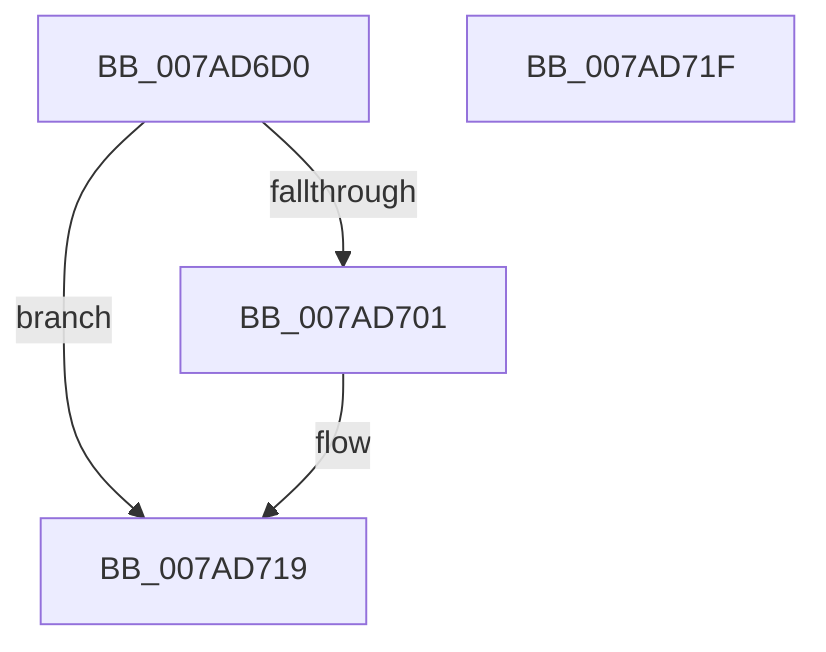

# VmTerminateMemoryProcess

- RVA: `0x007AD6D0`–`0x007AD720` (길이 `80` bytes)
- VA: `0x00000001407AD6D0`
- 실행 섹션: `PAGE`
- PDB 이름 있음: `예`; PDB Function 태그: `아니요`
- unwind 정보 RVA: `0x000AA39C`
- 디코드: `24`개 명령, `80/80` bytes 표시
- 미해석 바이트: `0` (있으면 어셈블리에 `.byte`로 보존)

> 이 문서는 커널 이미지의 기계어와 PDB 기호를 분석해 생성했습니다. 4번과 5번은 함수 원형과 자료형을 바이너리 사용 방식에서 추정한 C 해석이며 원본 소스 복구 결과는 아닙니다.

## 1. Dependencies

- 직접 호출 지점: **3**; 고유 호출 대상: **3**
- 직접 호출자로 확인된 함수: **0**
- RIP 상대 이미지 참조: **1**

### Outgoing calls
- `0x007AD6F8` → [ObReferenceObjectByHandle](../86/ObReferenceObjectByHandle_function_00868DB0.md) (function, `0x00868DB0`)
- `0x007AD708` → [PsTerminateMinimalProcess](../78/PsTerminateMinimalProcess_function_007861A8.md) (function, `0x007861A8`)
- `0x007AD712` → [ObfDereferenceObject](../../text/2F/ObfDereferenceObject_function_002F9350.md) (function, `0x002F9350`)

### Direct callers
- 이 함수 시작 RVA로 연결되는 직접 call은 확인되지 않았습니다. 간접 호출은 완전히 역산할 수 없습니다.

### Static image references
- `0x007AD6E1` → RVA `0x00FC6A98` (`ALMOSTRO`; read)

## 2. Other-region calls and transfers

- 다른 실행 섹션으로 향하는 call: **1**
  - `0x007AD712` → [ObfDereferenceObject](../../text/2F/ObfDereferenceObject_function_002F9350.md) (`PAGE` → `.text`)
- 별도 외부 분기/꼬리 이동을 확인하지 못했습니다.

## 3. Assembly (complete function range)

```asm
007AD6D0  4C 8B DC                        mov r11, rsp
007AD6D3  53                              push rbx
007AD6D4  48 83 EC 30                     sub rsp, 0x30
007AD6D8  49 83 63 F0 00                  and qword ptr [r11 - 0x10], 0
007AD6DD  49 8D 43 18                     lea rax, [r11 + 0x18]
007AD6E1  4C 8B 05 B0 93 81 00            mov r8, qword ptr [rip + 0x8193b0]
007AD6E8  8B DA                           mov ebx, edx
007AD6EA  49 83 63 18 00                  and qword ptr [r11 + 0x18], 0
007AD6EF  33 D2                           xor edx, edx
007AD6F1  45 33 C9                        xor r9d, r9d
007AD6F4  49 89 43 E8                     mov qword ptr [r11 - 0x18], rax
007AD6F8  E8 B3 B6 0B 00                  call 0x140868db0
007AD6FD  85 C0                           test eax, eax
007AD6FF  78 18                           js 0x1407ad719
007AD701  48 8B 4C 24 50                  mov rcx, qword ptr [rsp + 0x50]
007AD706  8B D3                           mov edx, ebx
007AD708  E8 9B 8A FD FF                  call 0x1407861a8
007AD70D  48 8B 4C 24 50                  mov rcx, qword ptr [rsp + 0x50]
007AD712  E8 39 BC B4 FF                  call 0x1402f9350
007AD717  33 C0                           xor eax, eax
007AD719  48 83 C4 30                     add rsp, 0x30
007AD71D  5B                              pop rbx
007AD71E  C3                              ret
007AD71F  CC                              int3
```

## 4. C-style interpretation (structured pseudocode)

```c
__int64 __fastcall VmTerminateMemoryProcess(__int64 a1, int a2, __int64 a3, int a4)
{
    __int64 result;
    __int64 v_rsp;
    unsigned __int64 v_stack_p18;

    v_rsp = (v_rsp) - (48);
    a2 = 0;
    a4 = 0;
    *(unsigned __int64 *)(v_rsp - 24) = v_rsp + 24;
    result = ObReferenceObjectByHandle(a1, a2, *(unsigned __int64 *)(v_rip + 8491952), a4);
    if (!(sign_flag)) {
        a1 = v_stack_p18;
        a2 = (unsigned int)((unsigned int)(a2));
        result = PsTerminateMinimalProcess(a1, a2, *(unsigned __int64 *)(v_rip + 8491952), a4);
        a1 = v_stack_p18;
        result = ObfDereferenceObject(a1, a2, *(unsigned __int64 *)(v_rip + 8491952), a4);
        result = 0;
    }
    v_rsp = (v_rsp) + (48);
    return result;
}
```

## 5. (Beta) C Style

```c
int64_t VmTerminateMemoryProcess(int64_t Arg1, int32_t Arg2, int64_t Arg3, int32_t Arg4)
{
    int64_t result;
    int64_t local_rsp;
    uint64_t v_stack_p18;

    local_rsp = (local_rsp) - (48);
    Arg2 = 0;
    Arg4 = 0;
    *(uint64_t *)(local_rsp - 0x18) = local_rsp + 24;
    result = ObReferenceObjectByHandle(Arg1, Arg2, *(uint64_t *)(v_rip + 0x8193B0), Arg4);
    if (!(sign_flag)) {
        Arg1 = v_stack_p18;
        Arg2 = (uint32_t)((uint32_t)(Arg2));
        result = PsTerminateMinimalProcess(Arg1, Arg2, *(uint64_t *)(v_rip + 0x8193B0), Arg4);
        Arg1 = v_stack_p18;
        result = ObfDereferenceObject(Arg1, Arg2, *(uint64_t *)(v_rip + 0x8193B0), Arg4);
        result = 0;
    }
    local_rsp = (local_rsp) + (48);
    return result;
}
```

## 6. Execution-region graph

[열기: 2D/3D 그래프와 함수 탐색 컨트롤 패널](../../../control-panel.html?section=page&rva=0x007AD6D0&view=graph)

- 2D 그래프는 위에서 아래로 흐르고, 3D 그래프는 빈 공간을 드래그해 회전합니다. Shift+드래그는 이동, 휠은 확대·축소, 함수 노드 선택은 대상 보고서 이동입니다.

### Static fallback


