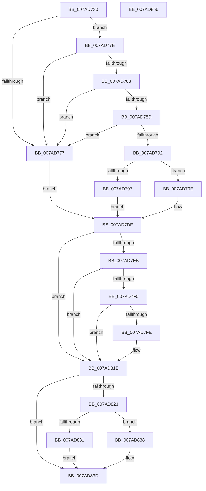

# VmUnpinMemoryRange

- RVA: `0x007AD730`–`0x007AD857` (길이 `295` bytes)
- VA: `0x00000001407AD730`
- 실행 섹션: `PAGE`
- PDB 이름 있음: `예`; PDB Function 태그: `아니요`
- unwind 정보 RVA: `0x000BCA90`
- 디코드: `84`개 명령, `295/295` bytes 표시
- 미해석 바이트: `0` (있으면 어셈블리에 `.byte`로 보존)

> 이 문서는 커널 이미지의 기계어와 PDB 기호를 분석해 생성했습니다. 4번과 5번은 함수 원형과 자료형을 바이너리 사용 방식에서 추정한 C 해석이며 원본 소스 복구 결과는 아닙니다.

## 1. Dependencies

- 직접 호출 지점: **6**; 고유 호출 대상: **6**
- 직접 호출자로 확인된 함수: **0**
- RIP 상대 이미지 참조: **1**

### Outgoing calls
- `0x007AD7A8` → [FsRtlAcquirePushLockShared](../../text/48/FsRtlAcquirePushLockShared_function_0048B034.md) (function, `0x0048B034`)
- `0x007AD7D8` → [VmpUnpinMemoryRange](VmpUnpinMemoryRange_function_007ADF6C.md) (function, `0x007ADF6C`)
- `0x007AD7F5` → [tlgKeywordOn](../../text/42/tlgKeywordOn_function_0042EAA0.md) (function, `0x0042EAA0`)
- `0x007AD819` → [VmpLogPin](VmpLogPin_function_007AE8A0.md) (function, `0x007AE8A0`)
- `0x007AD831` → [PfLockExclusiveRelease](../../text/49/PfLockExclusiveRelease_function_00491D88.md) (function, `0x00491D88`)
- `0x007AD838` → [PfLockSharedRelease](../../text/48/PfLockSharedRelease_function_0048DF24.md) (function, `0x0048DF24`)

### Direct callers
- 이 함수 시작 RVA로 연결되는 직접 call은 확인되지 않았습니다. 간접 호출은 완전히 역산할 수 없습니다.

### Static image references
- `0x007AD7DF` → RVA `0x00F02458` (`.data`; read)

## 2. Other-region calls and transfers

- 다른 실행 섹션으로 향하는 call: **4**
  - `0x007AD7A8` → [FsRtlAcquirePushLockShared](../../text/48/FsRtlAcquirePushLockShared_function_0048B034.md) (`PAGE` → `.text`)
  - `0x007AD7F5` → [tlgKeywordOn](../../text/42/tlgKeywordOn_function_0042EAA0.md) (`PAGE` → `.text`)
  - `0x007AD831` → [PfLockExclusiveRelease](../../text/49/PfLockExclusiveRelease_function_00491D88.md) (`PAGE` → `.text`)
  - `0x007AD838` → [PfLockSharedRelease](../../text/48/PfLockSharedRelease_function_0048DF24.md) (`PAGE` → `.text`)
- 별도 외부 분기/꼬리 이동을 확인하지 못했습니다.

## 3. Assembly (complete function range)

```asm
007AD730  48 8B C4                        mov rax, rsp
007AD733  48 89 58 08                     mov qword ptr [rax + 8], rbx
007AD737  48 89 68 10                     mov qword ptr [rax + 0x10], rbp
007AD73B  56                              push rsi
007AD73C  57                              push rdi
007AD73D  41 54                           push r12
007AD73F  41 56                           push r14
007AD741  41 57                           push r15
007AD743  48 83 EC 40                     sub rsp, 0x40
007AD747  45 33 E4                        xor r12d, r12d
007AD74A  4D 8B F9                        mov r15, r9
007AD74D  44 21 60 20                     and dword ptr [rax + 0x20], r12d
007AD751  49 8B F0                        mov rsi, r8
007AD754  65 48 8B 04 25 88 01 00 00      mov rax, qword ptr gs:[0x188]
007AD75D  48 8B EA                        mov rbp, rdx
007AD760  4C 8B F1                        mov r14, rcx
007AD763  4C 8B 90 B8 00 00 00            mov r10, qword ptr [rax + 0xb8]
007AD76A  49 8B BA 70 06 00 00            mov rdi, qword ptr [r10 + 0x670]
007AD771  49 83 F9 FF                     cmp r9, -1
007AD775  75 07                           jne 0x1407ad77e
007AD777  BB 0D 00 00 C0                  mov ebx, 0xc000000d
007AD77C  EB 61                           jmp 0x1407ad7df
007AD77E  B8 FF 0F 00 00                  mov eax, 0xfff
007AD783  48 85 E8                        test rax, rbp
007AD786  75 EF                           jne 0x1407ad777
007AD788  4C 85 F0                        test rax, r14
007AD78B  75 EA                           jne 0x1407ad777
007AD78D  48 85 F6                        test rsi, rsi
007AD790  74 E5                           je 0x1407ad777
007AD792  48 85 FF                        test rdi, rdi
007AD795  75 07                           jne 0x1407ad79e
007AD797  BB 88 00 00 C0                  mov ebx, 0xc0000088
007AD79C  EB 41                           jmp 0x1407ad7df
007AD79E  48 8D 4F 78                     lea rcx, [rdi + 0x78]
007AD7A2  41 BC 01 00 00 00               mov r12d, 1
007AD7A8  E8 87 D8 CD FF                  call 0x14048b034
007AD7AD  48 8D 84 24 88 00 00 00         lea rax, [rsp + 0x88]
007AD7B5  4C 8B C5                        mov r8, rbp
007AD7B8  48 89 44 24 30                  mov qword ptr [rsp + 0x30], rax
007AD7BD  49 8B D6                        mov rdx, r14
007AD7C0  83 64 24 28 00                  and dword ptr [rsp + 0x28], 0
007AD7C5  4C 8B CE                        mov r9, rsi
007AD7C8  49 C1 E8 0C                     shr r8, 0xc
007AD7CC  48 8B CF                        mov rcx, rdi
007AD7CF  48 C1 EA 0C                     shr rdx, 0xc
007AD7D3  4C 89 7C 24 20                  mov qword ptr [rsp + 0x20], r15
007AD7D8  E8 8F 07 00 00                  call 0x1407adf6c
007AD7DD  8B D8                           mov ebx, eax
007AD7DF  48 8B 0D 72 4C 75 00            mov rcx, qword ptr [rip + 0x754c72]
007AD7E6  48 85 C9                        test rcx, rcx
007AD7E9  74 33                           je 0x1407ad81e
007AD7EB  83 39 00                        cmp dword ptr [rcx], 0
007AD7EE  76 2E                           jbe 0x1407ad81e
007AD7F0  BA 20 00 00 00                  mov edx, 0x20
007AD7F5  E8 A6 12 C8 FF                  call 0x14042eaa0
007AD7FA  84 C0                           test al, al
007AD7FC  74 20                           je 0x1407ad81e
007AD7FE  89 5C 24 38                     mov dword ptr [rsp + 0x38], ebx
007AD802  4C 8B CD                        mov r9, rbp
007AD805  4C 89 7C 24 30                  mov qword ptr [rsp + 0x30], r15
007AD80A  4D 8B C6                        mov r8, r14
007AD80D  83 64 24 28 00                  and dword ptr [rsp + 0x28], 0
007AD812  33 D2                           xor edx, edx
007AD814  48 89 74 24 20                  mov qword ptr [rsp + 0x20], rsi
007AD819  E8 82 10 00 00                  call 0x1407ae8a0
007AD81E  45 85 E4                        test r12d, r12d
007AD821  74 1A                           je 0x1407ad83d
007AD823  83 BC 24 88 00 00 00 00         cmp dword ptr [rsp + 0x88], 0
007AD82B  48 8D 4F 78                     lea rcx, [rdi + 0x78]
007AD82F  74 07                           je 0x1407ad838
007AD831  E8 52 45 CE FF                  call 0x140491d88
007AD836  EB 05                           jmp 0x1407ad83d
007AD838  E8 E7 06 CE FF                  call 0x14048df24
007AD83D  48 8B 6C 24 78                  mov rbp, qword ptr [rsp + 0x78]
007AD842  8B C3                           mov eax, ebx
007AD844  48 8B 5C 24 70                  mov rbx, qword ptr [rsp + 0x70]
007AD849  48 83 C4 40                     add rsp, 0x40
007AD84D  41 5F                           pop r15
007AD84F  41 5E                           pop r14
007AD851  41 5C                           pop r12
007AD853  5F                              pop rdi
007AD854  5E                              pop rsi
007AD855  C3                              ret
007AD856  CC                              int3
```

## 4. C-style interpretation (structured pseudocode)

```c
__int64 __fastcall VmUnpinMemoryRange(__int64 a1, __int64 a2, __int64 a3, __int64 a4)
{
    __int64 result;
    __int64 v_r12;
    __int64 v_rsp;
    unsigned int v_stack_m30;
    unsigned __int64 v_stack_m38;
    unsigned int v_stack_m40;
    unsigned __int64 v_stack_m48;
    unsigned __int64 v_stack_p10;
    unsigned __int64 v_stack_p20;
    unsigned __int64 v_stack_p8;

    *(unsigned __int64 *)(v_rsp + 8) = v_rbx;
    *(unsigned __int64 *)(v_rsp + 16) = v_rbp;
    v_rsp = (v_rsp) - (64);
    v_r12 = 0;
    if (a4 != -1) goto loc_007AD77E;
loc_007AD777:
    goto loc_007AD7DF;
loc_007AD77E:
    if ((((unsigned int)(0xFFFULL)) & (a2)) != 0) goto loc_007AD777;
    if ((((unsigned int)(0xFFFULL)) & (a1)) != 0) goto loc_007AD777;
    if (a3 == 0) goto loc_007AD777;
    if (*(unsigned __int64 *)(*(unsigned __int64 *)(*(unsigned __int64 *)(gs_base + (0 + 392)) + 184) + 1648) != 0) goto loc_007AD79E;
    goto loc_007AD7DF;
loc_007AD79E:
    result = FsRtlAcquirePushLockShared(*(unsigned __int64 *)(*(unsigned __int64 *)(*(unsigned __int64 *)(gs_base + (0 + 392)) + 184) + 1648) + 120, a2, a3, a4);
    v_stack_m38 = v_stack_p20;
    a3 = (a2) >> (12);
    a2 = (a1) >> (12);
    v_stack_m48 = a4;
    result = VmpUnpinMemoryRange(*(unsigned __int64 *)(*(unsigned __int64 *)(*(unsigned __int64 *)(gs_base + (0 + 392)) + 184) + 1648), a2, a3, a3);
loc_007AD7DF:
    if (*(unsigned __int64 *)(v_rip + 7687282) == 0) goto loc_007AD81E;
    if ((*(unsigned int *)(*(unsigned __int64 *)(v_rip + 7687282))) <= 0) goto loc_007AD81E;
    result = tlgKeywordOn(*(unsigned __int64 *)(v_rip + 7687282), 32, a3, a3);
    if ((unsigned __int8)(result) != 0) {
        v_stack_m30 = (unsigned int)((unsigned int)((unsigned int)(result)));
        a4 = a2;
        v_stack_m38 = a4;
        a3 = a1;
        a2 = 0;
        v_stack_m48 = a3;
        result = VmpLogPin(*(unsigned __int64 *)(v_rip + 7687282), a2, a3, a4);
    }
    if (1 == 0) goto loc_007AD83D;
    if (v_stack_p20 == 0) goto loc_007AD838;
    result = PfLockExclusiveRelease(*(unsigned __int64 *)(*(unsigned __int64 *)(*(unsigned __int64 *)(gs_base + (0 + 392)) + 184) + 1648) + 120, a2, a3, a4);
    goto loc_007AD83D;
loc_007AD838:
    result = PfLockSharedRelease(*(unsigned __int64 *)(*(unsigned __int64 *)(*(unsigned __int64 *)(gs_base + (0 + 392)) + 184) + 1648) + 120, a2, a3, a4);
loc_007AD83D:
    v_rsp = (v_rsp) + (64);
    return (unsigned int)((unsigned int)((unsigned int)((unsigned int)(result))));
}
```

## 5. (Beta) C Style

```c
int64_t VmUnpinMemoryRange(int64_t Arg1, int64_t Arg2, int64_t Arg3, int64_t Arg4)
{
    int64_t result;
    int64_t local_r12;
    int64_t local_rsp;
    uint32_t v_stack_m30;
    uint64_t v_stack_m38;
    uint32_t v_stack_m40;
    uint64_t v_stack_m48;
    uint64_t v_stack_p10;
    uint64_t v_stack_p20;
    uint64_t v_stack_p8;

    *(uint64_t *)(local_rsp + 0x8) = local_rbx;
    *(uint64_t *)(local_rsp + 0x10) = local_rbp;
    local_rsp = (local_rsp) - (64);
    local_r12 = 0;
    if (Arg4 != -1) goto loc_007AD77E;
loc_007AD777:
    goto loc_007AD7DF;
loc_007AD77E:
    if ((((uint32_t)(0xFFFULL)) & (Arg2)) != 0) goto loc_007AD777;
    if ((((uint32_t)(0xFFFULL)) & (Arg1)) != 0) goto loc_007AD777;
    if (Arg3 == 0) goto loc_007AD777;
    if (*(uint64_t *)(*(uint64_t *)(*(uint64_t *)(gs_base + (0 + 0x188)) + 0xB8) + 0x670) != 0) goto loc_007AD79E;
    goto loc_007AD7DF;
loc_007AD79E:
    result = FsRtlAcquirePushLockShared(*(uint64_t *)(*(uint64_t *)(*(uint64_t *)(gs_base + (0 + 0x188)) + 0xB8) + 0x670) + 120, Arg2, Arg3, Arg4);
    v_stack_m38 = v_stack_p20;
    Arg3 = (Arg2) >> (12);
    Arg2 = (Arg1) >> (12);
    v_stack_m48 = Arg4;
    result = VmpUnpinMemoryRange(*(uint64_t *)(*(uint64_t *)(*(uint64_t *)(gs_base + (0 + 0x188)) + 0xB8) + 0x670), Arg2, Arg3, Arg3);
loc_007AD7DF:
    if (*(uint64_t *)(v_rip + 0x754C72) == 0) goto loc_007AD81E;
    if ((*(uint32_t *)(*(uint64_t *)(v_rip + 0x754C72))) <= 0) goto loc_007AD81E;
    result = tlgKeywordOn(*(uint64_t *)(v_rip + 0x754C72), 32, Arg3, Arg3);
    if ((uint8_t)(result) != 0) {
        v_stack_m30 = (uint32_t)((uint32_t)((uint32_t)(result)));
        Arg4 = Arg2;
        v_stack_m38 = Arg4;
        Arg3 = Arg1;
        Arg2 = 0;
        v_stack_m48 = Arg3;
        result = VmpLogPin(*(uint64_t *)(v_rip + 0x754C72), Arg2, Arg3, Arg4);
    }
    if (1 == 0) goto loc_007AD83D;
    if (v_stack_p20 == 0) goto loc_007AD838;
    result = PfLockExclusiveRelease(*(uint64_t *)(*(uint64_t *)(*(uint64_t *)(gs_base + (0 + 0x188)) + 0xB8) + 0x670) + 120, Arg2, Arg3, Arg4);
    goto loc_007AD83D;
loc_007AD838:
    result = PfLockSharedRelease(*(uint64_t *)(*(uint64_t *)(*(uint64_t *)(gs_base + (0 + 0x188)) + 0xB8) + 0x670) + 120, Arg2, Arg3, Arg4);
loc_007AD83D:
    local_rsp = (local_rsp) + (64);
    return (uint32_t)((uint32_t)((uint32_t)((uint32_t)(result))));
}
```

## 6. Execution-region graph

[열기: 2D/3D 그래프와 함수 탐색 컨트롤 패널](../../../control-panel.html?section=page&rva=0x007AD730&view=graph)

- 2D 그래프는 위에서 아래로 흐르고, 3D 그래프는 빈 공간을 드래그해 회전합니다. Shift+드래그는 이동, 휠은 확대·축소, 함수 노드 선택은 대상 보고서 이동입니다.

### Static fallback


