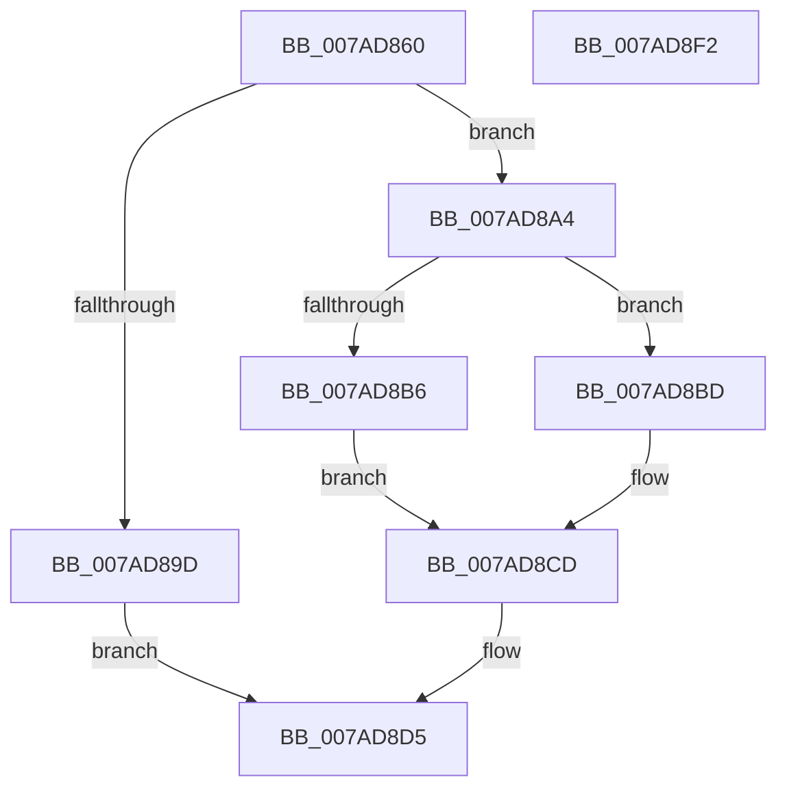

# VmUpdateCommitMemoryRange

- RVA: `0x007AD860`–`0x007AD8F3` (길이 `147` bytes)
- VA: `0x00000001407AD860`
- 실행 섹션: `PAGE`
- PDB 이름 있음: `예`; PDB Function 태그: `아니요`
- unwind 정보 RVA: `0x0005E6B4`
- 디코드: `40`개 명령, `147/147` bytes 표시
- 미해석 바이트: `0` (있으면 어셈블리에 `.byte`로 보존)

> 이 문서는 커널 이미지의 기계어와 PDB 기호를 분석해 생성했습니다. 4번과 5번은 함수 원형과 자료형을 바이너리 사용 방식에서 추정한 C 해석이며 원본 소스 복구 결과는 아닙니다.

## 1. Dependencies

- 직접 호출 지점: **3**; 고유 호출 대상: **3**
- 직접 호출자로 확인된 함수: **0**
- RIP 상대 이미지 참조: **0**

### Outgoing calls
- `0x007AD8AB` → [FsRtlAcquirePushLockExclusive](../../text/4A/FsRtlAcquirePushLockExclusive_function_004A05F4.md) (function, `0x004A05F4`)
- `0x007AD8C6` → [VmpUpdateCommitStateMemoryRange](../../text/64/VmpUpdateCommitStateMemoryRange_function_0064D5D0.md) (function, `0x0064D5D0`)
- `0x007AD8D0` → [PfLockExclusiveRelease](../../text/49/PfLockExclusiveRelease_function_00491D88.md) (function, `0x00491D88`)

### Direct callers
- 이 함수 시작 RVA로 연결되는 직접 call은 확인되지 않았습니다. 간접 호출은 완전히 역산할 수 없습니다.

### Static image references
- 디코드된 RIP-relative 메모리 참조가 없습니다.

## 2. Other-region calls and transfers

- 다른 실행 섹션으로 향하는 call: **3**
  - `0x007AD8AB` → [FsRtlAcquirePushLockExclusive](../../text/4A/FsRtlAcquirePushLockExclusive_function_004A05F4.md) (`PAGE` → `.text`)
  - `0x007AD8C6` → [VmpUpdateCommitStateMemoryRange](../../text/64/VmpUpdateCommitStateMemoryRange_function_0064D5D0.md) (`PAGE` → `.text`)
  - `0x007AD8D0` → [PfLockExclusiveRelease](../../text/49/PfLockExclusiveRelease_function_00491D88.md) (`PAGE` → `.text`)
- 별도 외부 분기/꼬리 이동을 확인하지 못했습니다.

## 3. Assembly (complete function range)

```asm
007AD860  48 8B C4                        mov rax, rsp
007AD863  48 89 58 08                     mov qword ptr [rax + 8], rbx
007AD867  48 89 68 10                     mov qword ptr [rax + 0x10], rbp
007AD86B  48 89 70 18                     mov qword ptr [rax + 0x18], rsi
007AD86F  48 89 78 20                     mov qword ptr [rax + 0x20], rdi
007AD873  41 56                           push r14
007AD875  48 83 EC 20                     sub rsp, 0x20
007AD879  65 48 8B 04 25 88 01 00 00      mov rax, qword ptr gs:[0x188]
007AD882  49 8B F0                        mov rsi, r8
007AD885  8B EA                           mov ebp, edx
007AD887  4C 8B F1                        mov r14, rcx
007AD88A  4C 8B 88 B8 00 00 00            mov r9, qword ptr [rax + 0xb8]
007AD891  49 8B 99 70 06 00 00            mov rbx, qword ptr [r9 + 0x670]
007AD898  48 85 DB                        test rbx, rbx
007AD89B  75 07                           jne 0x1407ad8a4
007AD89D  BB 88 00 00 C0                  mov ebx, 0xc0000088
007AD8A2  EB 31                           jmp 0x1407ad8d5
007AD8A4  48 8D 7B 78                     lea rdi, [rbx + 0x78]
007AD8A8  48 8B CF                        mov rcx, rdi
007AD8AB  E8 44 2D CF FF                  call 0x1404a05f4
007AD8B0  48 39 73 68                     cmp qword ptr [rbx + 0x68], rsi
007AD8B4  74 07                           je 0x1407ad8bd
007AD8B6  BB 19 07 00 C0                  mov ebx, 0xc0000719
007AD8BB  EB 10                           jmp 0x1407ad8cd
007AD8BD  44 8B C5                        mov r8d, ebp
007AD8C0  49 8B D6                        mov rdx, r14
007AD8C3  48 8B CB                        mov rcx, rbx
007AD8C6  E8 05 FD E9 FF                  call 0x14064d5d0
007AD8CB  8B D8                           mov ebx, eax
007AD8CD  48 8B CF                        mov rcx, rdi
007AD8D0  E8 B3 44 CE FF                  call 0x140491d88
007AD8D5  48 8B 6C 24 38                  mov rbp, qword ptr [rsp + 0x38]
007AD8DA  8B C3                           mov eax, ebx
007AD8DC  48 8B 5C 24 30                  mov rbx, qword ptr [rsp + 0x30]
007AD8E1  48 8B 74 24 40                  mov rsi, qword ptr [rsp + 0x40]
007AD8E6  48 8B 7C 24 48                  mov rdi, qword ptr [rsp + 0x48]
007AD8EB  48 83 C4 20                     add rsp, 0x20
007AD8EF  41 5E                           pop r14
007AD8F1  C3                              ret
007AD8F2  CC                              int3
```

## 4. C-style interpretation (structured pseudocode)

```c
__int64 __fastcall VmUpdateCommitMemoryRange(__int64 a1, int a2, __int64 a3)
{
    __int64 result;
    __int64 v_rsp;
    unsigned __int64 v_stack_p10;
    unsigned __int64 v_stack_p18;
    unsigned __int64 v_stack_p20;
    unsigned __int64 v_stack_p8;

    *(unsigned __int64 *)(v_rsp + 8) = v_rbx;
    *(unsigned __int64 *)(v_rsp + 16) = v_rbp;
    *(unsigned __int64 *)(v_rsp + 24) = v_rsi;
    *(unsigned __int64 *)(v_rsp + 32) = v_rdi;
    v_rsp = (v_rsp) - (32);
    if (*(unsigned __int64 *)(*(unsigned __int64 *)(*(unsigned __int64 *)(gs_base + (0 + 392)) + 184) + 1648) != 0) goto loc_007AD8A4;
    goto loc_007AD8D5;
loc_007AD8A4:
    result = FsRtlAcquirePushLockExclusive((unsigned int)(0xC0000088ULL) + 120, a2, a3, *(unsigned __int64 *)(*(unsigned __int64 *)(gs_base + (0 + 392)) + 184));
    if ((*(unsigned __int64 *)((unsigned int)(0xC0000088ULL) + 104)) == a3) goto loc_007AD8BD;
    goto loc_007AD8CD;
loc_007AD8BD:
    result = VmpUpdateCommitStateMemoryRange((unsigned int)(0xC0000719ULL), a1, (unsigned int)((unsigned int)((unsigned int)(a2))), *(unsigned __int64 *)(*(unsigned __int64 *)(gs_base + (0 + 392)) + 184));
loc_007AD8CD:
    result = PfLockExclusiveRelease((unsigned int)(0xC0000088ULL) + 120, a1, (unsigned int)((unsigned int)((unsigned int)(a2))), *(unsigned __int64 *)(*(unsigned __int64 *)(gs_base + (0 + 392)) + 184));
loc_007AD8D5:
    v_rsp = (v_rsp) + (32);
    return (unsigned int)((unsigned int)((unsigned int)((unsigned int)(result))));
}
```

## 5. (Beta) C Style

```c
int64_t VmUpdateCommitMemoryRange(int64_t Arg1, int32_t Arg2, int64_t Arg3)
{
    int64_t result;
    int64_t local_rsp;
    uint64_t v_stack_p10;
    uint64_t v_stack_p18;
    uint64_t v_stack_p20;
    uint64_t v_stack_p8;

    *(uint64_t *)(local_rsp + 0x8) = local_rbx;
    *(uint64_t *)(local_rsp + 0x10) = local_rbp;
    *(uint64_t *)(local_rsp + 0x18) = local_rsi;
    *(uint64_t *)(local_rsp + 0x20) = local_rdi;
    local_rsp = (local_rsp) - (32);
    if (*(uint64_t *)(*(uint64_t *)(*(uint64_t *)(gs_base + (0 + 0x188)) + 0xB8) + 0x670) != 0) goto loc_007AD8A4;
    goto loc_007AD8D5;
loc_007AD8A4:
    result = FsRtlAcquirePushLockExclusive((uint32_t)(0xC0000088ULL) + 120, Arg2, Arg3, *(uint64_t *)(*(uint64_t *)(gs_base + (0 + 0x188)) + 0xB8));
    if ((*(uint64_t *)((uint32_t)(0xC0000088ULL) + 0x68)) == Arg3) goto loc_007AD8BD;
    goto loc_007AD8CD;
loc_007AD8BD:
    result = VmpUpdateCommitStateMemoryRange((uint32_t)(0xC0000719ULL), Arg1, (uint32_t)((uint32_t)((uint32_t)(Arg2))), *(uint64_t *)(*(uint64_t *)(gs_base + (0 + 0x188)) + 0xB8));
loc_007AD8CD:
    result = PfLockExclusiveRelease((uint32_t)(0xC0000088ULL) + 120, Arg1, (uint32_t)((uint32_t)((uint32_t)(Arg2))), *(uint64_t *)(*(uint64_t *)(gs_base + (0 + 0x188)) + 0xB8));
loc_007AD8D5:
    local_rsp = (local_rsp) + (32);
    return (uint32_t)((uint32_t)((uint32_t)((uint32_t)(result))));
}
```

## 6. Execution-region graph

[열기: 2D/3D 그래프와 함수 탐색 컨트롤 패널](../../../control-panel.html?section=page&rva=0x007AD860&view=graph)

- 2D 그래프는 위에서 아래로 흐르고, 3D 그래프는 빈 공간을 드래그해 회전합니다. Shift+드래그는 이동, 휠은 확대·축소, 함수 노드 선택은 대상 보고서 이동입니다.

### Static fallback


