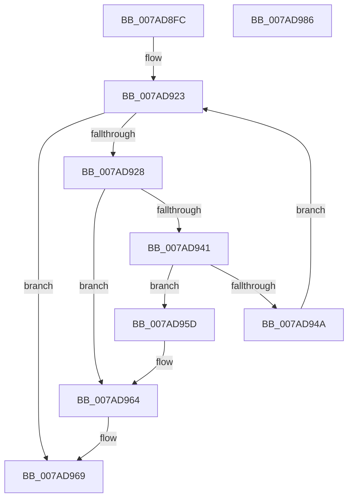

# VmpAllocatePinnedRanges

- RVA: `0x007AD8FC`–`0x007AD987` (길이 `139` bytes)
- VA: `0x00000001407AD8FC`
- 실행 섹션: `PAGE`
- PDB 이름 있음: `예`; PDB Function 태그: `아니요`
- unwind 정보 RVA: `0x0005E6B4`
- 디코드: `41`개 명령, `139/139` bytes 표시
- 미해석 바이트: `0` (있으면 어셈블리에 `.byte`로 보존)

> 이 문서는 커널 이미지의 기계어와 PDB 기호를 분석해 생성했습니다. 4번과 5번은 함수 원형과 자료형을 바이너리 사용 방식에서 추정한 C 해석이며 원본 소스 복구 결과는 아닙니다.

## 1. Dependencies

- 직접 호출 지점: **1**; 고유 호출 대상: **1**
- 직접 호출자로 확인된 함수: **1**
- RIP 상대 이미지 참조: **0**

### Outgoing calls
- `0x007AD937` → [ExAllocatePool2](../../poolcode/B8/ExAllocatePool2_function_00B820F0.md) (function, `0x00B820F0`)

### Direct callers
- [VmpPinMemoryRange](../../text/64/VmpPinMemoryRange_function_0064CCD0.md) at `0x0064CE73`

### Static image references
- 디코드된 RIP-relative 메모리 참조가 없습니다.

## 2. Other-region calls and transfers

- 다른 실행 섹션으로 향하는 call: **1**
  - `0x007AD937` → [ExAllocatePool2](../../poolcode/B8/ExAllocatePool2_function_00B820F0.md) (`PAGE` → `POOLCODE`)
- 별도 외부 분기/꼬리 이동을 확인하지 못했습니다.

## 3. Assembly (complete function range)

```asm
007AD8FC  48 8B C4                        mov rax, rsp
007AD8FF  48 89 58 08                     mov qword ptr [rax + 8], rbx
007AD903  48 89 68 10                     mov qword ptr [rax + 0x10], rbp
007AD907  48 89 70 18                     mov qword ptr [rax + 0x18], rsi
007AD90B  48 89 78 20                     mov qword ptr [rax + 0x20], rdi
007AD90F  41 56                           push r14
007AD911  48 83 EC 20                     sub rsp, 0x20
007AD915  48 8B 69 40                     mov rbp, qword ptr [rcx + 0x40]
007AD919  33 DB                           xor ebx, ebx
007AD91B  8B F3                           mov esi, ebx
007AD91D  4D 8B F0                        mov r14, r8
007AD920  48 8B FA                        mov rdi, rdx
007AD923  49 3B F6                        cmp rsi, r14
007AD926  73 41                           jae 0x1407ad969
007AD928  41 B8 56 6D 50 67               mov r8d, 0x67506d56
007AD92E  48 8D 55 28                     lea rdx, [rbp + 0x28]
007AD932  B9 40 00 00 00                  mov ecx, 0x40
007AD937  E8 B4 47 3D 00                  call 0x140b820f0
007AD93C  48 85 C0                        test rax, rax
007AD93F  74 23                           je 0x1407ad964
007AD941  48 8B 4F 08                     mov rcx, qword ptr [rdi + 8]
007AD945  48 39 39                        cmp qword ptr [rcx], rdi
007AD948  75 13                           jne 0x1407ad95d
007AD94A  48 89 38                        mov qword ptr [rax], rdi
007AD94D  48 FF C6                        inc rsi
007AD950  48 89 48 08                     mov qword ptr [rax + 8], rcx
007AD954  48 89 01                        mov qword ptr [rcx], rax
007AD957  48 89 47 08                     mov qword ptr [rdi + 8], rax
007AD95B  EB C6                           jmp 0x1407ad923
007AD95D  B9 03 00 00 00                  mov ecx, 3
007AD962  CD 29                           int 0x29
007AD964  BB 9A 00 00 C0                  mov ebx, 0xc000009a
007AD969  48 8B 6C 24 38                  mov rbp, qword ptr [rsp + 0x38]
007AD96E  8B C3                           mov eax, ebx
007AD970  48 8B 5C 24 30                  mov rbx, qword ptr [rsp + 0x30]
007AD975  48 8B 74 24 40                  mov rsi, qword ptr [rsp + 0x40]
007AD97A  48 8B 7C 24 48                  mov rdi, qword ptr [rsp + 0x48]
007AD97F  48 83 C4 20                     add rsp, 0x20
007AD983  41 5E                           pop r14
007AD985  C3                              ret
007AD986  CC                              int3
```

## 4. C-style interpretation (structured pseudocode)

```c
__int64 __fastcall VmpAllocatePinnedRanges(__int64 a1, __int64 a2, __int64 a3)
{
    __int64 result;
    __int64 v_rbx;
    __int64 v_rsi;
    __int64 v_rsp;
    unsigned __int64 v_stack_p10;
    unsigned __int64 v_stack_p18;
    unsigned __int64 v_stack_p20;
    unsigned __int64 v_stack_p8;

    *(unsigned __int64 *)(v_rsp + 8) = v_rbx;
    *(unsigned __int64 *)(v_rsp + 16) = v_rbp;
    *(unsigned __int64 *)(v_rsp + 24) = v_rsi;
    *(unsigned __int64 *)(v_rsp + 32) = v_rdi;
    v_rsp = (v_rsp) - (32);
    v_rbx = 0;
loc_007AD923:
    if (0 >= a3) goto loc_007AD969;
    result = ExAllocatePool2(64, *(unsigned __int64 *)(a1 + 64) + 40, (unsigned int)(0x67506D56ULL), a4);
    if (result == 0) goto loc_007AD964;
    if ((*(unsigned __int64 *)(*(unsigned __int64 *)(a2 + 8))) != a2) goto loc_007AD95D;
    *(unsigned __int64 *)(result) = a2;
    v_rsi = (0) + 1;
    *(unsigned __int64 *)(result + 8) = *(unsigned __int64 *)(a2 + 8);
    *(unsigned __int64 *)(*(unsigned __int64 *)(a2 + 8)) = result;
    *(unsigned __int64 *)(a2 + 8) = result;
    goto loc_007AD923;
loc_007AD95D:
loc_007AD964:
loc_007AD969:
    v_rsp = (v_rsp) + (32);
    return (unsigned int)((unsigned int)((unsigned int)(0xC000009AULL)));
}
```

## 5. (Beta) C Style

```c
int64_t VmpAllocatePinnedRanges(void *Arg1, void *Arg2, int64_t Arg3)
{
    uint8_t *arg1 = (uint8_t *)Arg1;
    uint8_t *arg2 = (uint8_t *)Arg2;

    int64_t result;
    int64_t local_rbx;
    int64_t local_rsi;
    int64_t local_rsp;
    uint64_t v_stack_p10;
    uint64_t v_stack_p18;
    uint64_t v_stack_p20;
    uint64_t v_stack_p8;

    *(uint64_t *)(local_rsp + 0x8) = local_rbx;
    *(uint64_t *)(local_rsp + 0x10) = local_rbp;
    *(uint64_t *)(local_rsp + 0x18) = local_rsi;
    *(uint64_t *)(local_rsp + 0x20) = local_rdi;
    local_rsp = (local_rsp) - (32);
    local_rbx = 0;
loc_007AD923:
    if (0 >= Arg3) goto loc_007AD969;
    result = ExAllocatePool2(64, *(uint64_t *)(arg1 + 0x40) + 40, (uint32_t)(0x67506D56ULL), a4);
    if (result == 0) goto loc_007AD964;
    if ((*(uint64_t *)(*(uint64_t *)(arg2 + 0x8))) != Arg2) goto loc_007AD95D;
    *(void **)(result) = Arg2;
    local_rsi = (0) + 1;
    *(uint64_t *)(result + 0x8) = *(uint64_t *)(arg2 + 0x8);
    *(uint64_t *)(*(uint64_t *)(arg2 + 0x8)) = result;
    *(uint64_t *)(arg2 + 0x8) = result;
    goto loc_007AD923;
loc_007AD95D:
loc_007AD964:
loc_007AD969:
    local_rsp = (local_rsp) + (32);
    return (uint32_t)((uint32_t)((uint32_t)(0xC000009AULL)));
}
```

### 관측된 메모리 오프셋

구조체 형식이 확인되지 않은 접근은 인자 기준의 오프셋으로만 기록했습니다.

| 기준 인자 | 오프셋 표현 | 폭 (bit) | 접근 |
|---|---:|---:|---|
| `Arg1` | `+ 0x40` | `64` | `R` |
| `Arg2` | `+ 0x8` | `64` | `R` |
| `Arg2` | `+ 0x8` | `64` | `W` |

## 6. Execution-region graph

[열기: 2D/3D 그래프와 함수 탐색 컨트롤 패널](../../../control-panel.html?section=page&rva=0x007AD8FC&view=graph)

- 2D 그래프는 위에서 아래로 흐르고, 3D 그래프는 빈 공간을 드래그해 회전합니다. Shift+드래그는 이동, 휠은 확대·축소, 함수 노드 선택은 대상 보고서 이동입니다.

### Static fallback


