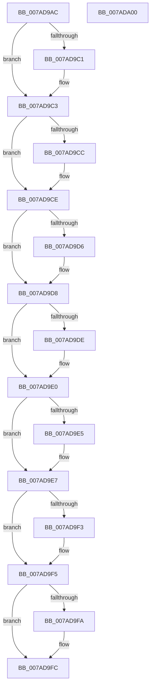

# VmpDecodePreallocationRangeHandle

- RVA: `0x007AD9AC`–`0x007ADA01` (길이 `85` bytes)
- VA: `0x00000001407AD9AC`
- 실행 섹션: `PAGE`
- PDB 이름 있음: `예`; PDB Function 태그: `아니요`
- unwind 정보 RVA: `0x000DB714`
- 디코드: `32`개 명령, `85/85` bytes 표시
- 미해석 바이트: `0` (있으면 어셈블리에 `.byte`로 보존)

> 이 문서는 커널 이미지의 기계어와 PDB 기호를 분석해 생성했습니다. 4번과 5번은 함수 원형과 자료형을 바이너리 사용 방식에서 추정한 C 해석이며 원본 소스 복구 결과는 아닙니다.

## 1. Dependencies

- 직접 호출 지점: **0**; 고유 호출 대상: **0**
- 직접 호출자로 확인된 함수: **2**
- RIP 상대 이미지 참조: **0**

### Outgoing calls
- 직접 디코드된 call 명령이 없습니다.

### Direct callers
- [VmCreateMemoryRange](VmCreateMemoryRange_function_007AD1D0.md) at `0x007AD25E`
- [VmFreePreallocationForRangeCreate](VmFreePreallocationForRangeCreate_function_007AD3C0.md) at `0x007AD3EA`

### Static image references
- 디코드된 RIP-relative 메모리 참조가 없습니다.

## 2. Other-region calls and transfers

- 다른 실행 섹션으로 향하는 call: **0**
- 별도 외부 분기/꼬리 이동을 확인하지 못했습니다.

## 3. Assembly (complete function range)

```asm
007AD9AC  49 83 C8 FF                     or r8, 0xffffffffffffffff
007AD9B0  49 8B C0                        mov rax, r8
007AD9B3  F0 48 0F C1 41 70               lock xadd qword ptr [rcx + 0x70], rax
007AD9B9  49 03 C0                        add rax, r8
007AD9BC  49 3B C0                        cmp rax, r8
007AD9BF  75 02                           jne 0x1407ad9c3
007AD9C1  CD 2C                           int 0x2c
007AD9C3  48 33 CA                        xor rcx, rdx
007AD9C6  4C 39 41 10                     cmp qword ptr [rcx + 0x10], r8
007AD9CA  74 02                           je 0x1407ad9ce
007AD9CC  CD 2C                           int 0x2c
007AD9CE  33 C0                           xor eax, eax
007AD9D0  48 39 41 18                     cmp qword ptr [rcx + 0x18], rax
007AD9D4  74 02                           je 0x1407ad9d8
007AD9D6  CD 2C                           int 0x2c
007AD9D8  48 39 41 20                     cmp qword ptr [rcx + 0x20], rax
007AD9DC  74 02                           je 0x1407ad9e0
007AD9DE  CD 2C                           int 0x2c
007AD9E0  39 41 48                        cmp dword ptr [rcx + 0x48], eax
007AD9E3  74 02                           je 0x1407ad9e7
007AD9E5  CD 2C                           int 0x2c
007AD9E7  48 8D 41 28                     lea rax, [rcx + 0x28]
007AD9EB  48 8B 10                        mov rdx, qword ptr [rax]
007AD9EE  48 3B D0                        cmp rdx, rax
007AD9F1  75 02                           jne 0x1407ad9f5
007AD9F3  CD 2C                           int 0x2c
007AD9F5  48 39 02                        cmp qword ptr [rdx], rax
007AD9F8  74 02                           je 0x1407ad9fc
007AD9FA  CD 2C                           int 0x2c
007AD9FC  48 8B C1                        mov rax, rcx
007AD9FF  C3                              ret
007ADA00  CC                              int3
```

## 4. C-style interpretation (structured pseudocode)

```c
__int64 __fastcall VmpDecodePreallocationRangeHandle(__int64 a1, __int64 a2, __int64 a3)
{
    __int64 result;

    a3 = (a3) | (-1);
    result = (a3) + (a3);
    if (result == a3) {
    }
    a1 = (a1) ^ (a2);
    if ((*(unsigned __int64 *)(a1 + 16)) != a3) {
    }
    result = 0;
    if ((*(unsigned __int64 *)(a1 + 24)) != 0) {
    }
    if ((*(unsigned __int64 *)(a1 + 32)) != 0) {
    }
    if ((*(unsigned int *)(a1 + 72)) != 0) {
    }
    if ((*(unsigned __int64 *)(a1 + 40)) == (a1 + 40)) {
    }
    if ((*(unsigned __int64 *)(*(unsigned __int64 *)(a1 + 40))) != (a1 + 40)) {
    }
    return a1;
}
```

## 5. (Beta) C Style

```c
void *VmpDecodePreallocationRangeHandle(void *Arg1, int64_t Arg2, int64_t Arg3)
{
    uint8_t *arg1 = (uint8_t *)Arg1;

    int64_t result;

    Arg3 = (Arg3) | (-1);
    result = (Arg3) + (Arg3);
    if (result == Arg3) {
    }
    Arg1 = (Arg1) ^ (Arg2);
    if ((*(uint64_t *)(arg1 + 0x10)) != Arg3) {
    }
    result = 0;
    if ((*(uint64_t *)(arg1 + 0x18)) != 0) {
    }
    if ((*(uint64_t *)(arg1 + 0x20)) != 0) {
    }
    if ((*(uint32_t *)(arg1 + 0x48)) != 0) {
    }
    if ((*(uint64_t *)(arg1 + 0x28)) == (Arg1 + 40)) {
    }
    if ((*(uint64_t *)(*(uint64_t *)(arg1 + 0x28))) != (Arg1 + 40)) {
    }
    return Arg1;
}
```

### 관측된 메모리 오프셋

구조체 형식이 확인되지 않은 접근은 인자 기준의 오프셋으로만 기록했습니다.

| 기준 인자 | 오프셋 표현 | 폭 (bit) | 접근 |
|---|---:|---:|---|
| `Arg1` | `+ 0x0` | `64` | `R` |
| `Arg1` | `+ 0x10` | `64` | `R` |
| `Arg1` | `+ 0x18` | `64` | `R` |
| `Arg1` | `+ 0x20` | `64` | `R` |
| `Arg1` | `+ 0x28` | `64` | `R` |
| `Arg1` | `+ 0x48` | `32` | `R` |
| `Arg1` | `+ 0x70` | `64` | `R/W` |

## 6. Execution-region graph

[열기: 2D/3D 그래프와 함수 탐색 컨트롤 패널](../../../control-panel.html?section=page&rva=0x007AD9AC&view=graph)

- 2D 그래프는 위에서 아래로 흐르고, 3D 그래프는 빈 공간을 드래그해 회전합니다. Shift+드래그는 이동, 휠은 확대·축소, 함수 노드 선택은 대상 보고서 이동입니다.

### Static fallback


