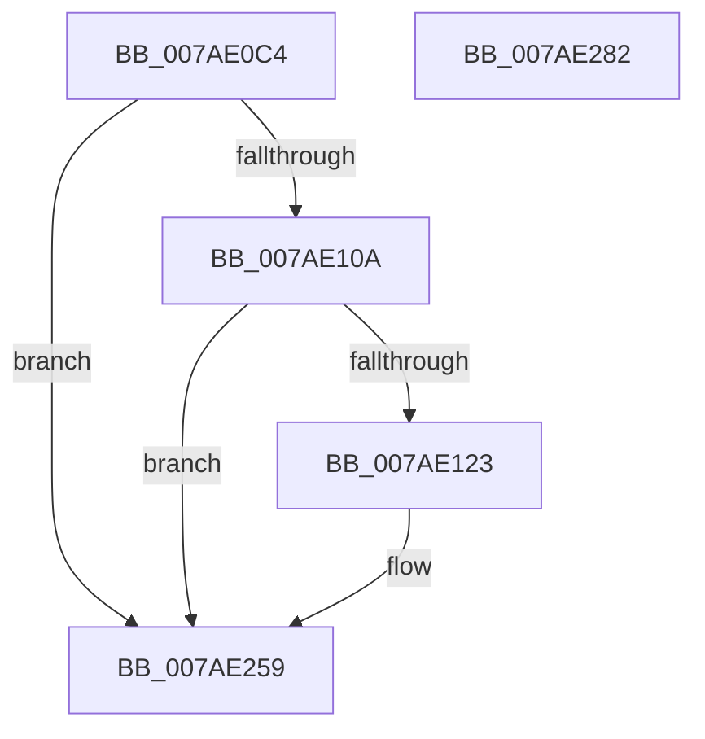

# VmpLogAccessFault

- RVA: `0x007AE0C4`–`0x007AE283` (길이 `447` bytes)
- VA: `0x00000001407AE0C4`
- 실행 섹션: `PAGE`
- PDB 이름 있음: `예`; PDB Function 태그: `아니요`
- unwind 정보 RVA: `0x000D2F0C`
- 디코드: `104`개 명령, `447/447` bytes 표시
- 미해석 바이트: `0` (있으면 어셈블리에 `.byte`로 보존)

> 이 문서는 커널 이미지의 기계어와 PDB 기호를 분석해 생성했습니다. 4번과 5번은 함수 원형과 자료형을 바이너리 사용 방식에서 추정한 C 해석이며 원본 소스 복구 결과는 아닙니다.

## 1. Dependencies

- 직접 호출 지점: **4**; 고유 호출 대상: **4**
- 직접 호출자로 확인된 함수: **1**
- RIP 상대 이미지 참조: **3**

### Outgoing calls
- `0x007AE116` → [tlgKeywordOn](../../text/42/tlgKeywordOn_function_0042EAA0.md) (function, `0x0042EAA0`)
- `0x007AE133` → [PsGetProcessId](../../text/43/PsGetProcessId_function_0043D910.md) (function, `0x0043D910`)
- `0x007AE254` → [tlgWriteEx_EtwWriteEx](../../text/4A/tlgWriteEx_EtwWriteEx_function_004AA348.md) (function, `0x004AA348`)
- `0x007AE260` → [_security_check_cookie](../../text/6A/_security_check_cookie_function_006AC640.md) (function, `0x006AC640`)

### Direct callers
- [sub_00B37256](../B3/Unknown_function_00B37256.md) at `0x00B372C1`

### Static image references
- `0x007AE0E3` → RVA `0x00E0A740` (`.data`; read)
- `0x007AE0F1` → RVA `0x00F02458` (`.data`; read)
- `0x007AE145` → RVA `0x00053528` (`.rdata`; read)

## 2. Other-region calls and transfers

- 다른 실행 섹션으로 향하는 call: **4**
  - `0x007AE116` → [tlgKeywordOn](../../text/42/tlgKeywordOn_function_0042EAA0.md) (`PAGE` → `.text`)
  - `0x007AE133` → [PsGetProcessId](../../text/43/PsGetProcessId_function_0043D910.md) (`PAGE` → `.text`)
  - `0x007AE254` → [tlgWriteEx_EtwWriteEx](../../text/4A/tlgWriteEx_EtwWriteEx_function_004AA348.md) (`PAGE` → `.text`)
  - `0x007AE260` → [_security_check_cookie](../../text/6A/_security_check_cookie_function_006AC640.md) (`PAGE` → `.text`)
- 별도 외부 분기/꼬리 이동을 확인하지 못했습니다.

## 3. Assembly (complete function range)

```asm
007AE0C4  48 8B C4                        mov rax, rsp
007AE0C7  48 89 58 08                     mov qword ptr [rax + 8], rbx
007AE0CB  48 89 70 10                     mov qword ptr [rax + 0x10], rsi
007AE0CF  48 89 78 18                     mov qword ptr [rax + 0x18], rdi
007AE0D3  55                              push rbp
007AE0D4  41 54                           push r12
007AE0D6  41 56                           push r14
007AE0D8  48 8D 68 98                     lea rbp, [rax - 0x68]
007AE0DC  48 81 EC 50 01 00 00            sub rsp, 0x150
007AE0E3  48 8B 05 56 C6 65 00            mov rax, qword ptr [rip + 0x65c656]
007AE0EA  48 33 C4                        xor rax, rsp
007AE0ED  48 89 45 40                     mov qword ptr [rbp + 0x40], rax
007AE0F1  48 8B 1D 60 43 75 00            mov rbx, qword ptr [rip + 0x754360]
007AE0F8  41 8B F9                        mov edi, r9d
007AE0FB  41 8B F0                        mov esi, r8d
007AE0FE  44 8B F2                        mov r14d, edx
007AE101  83 3B 05                        cmp dword ptr [rbx], 5
007AE104  0F 86 4F 01 00 00               jbe 0x1407ae259
007AE10A  41 BC 08 00 00 00               mov r12d, 8
007AE110  48 8B CB                        mov rcx, rbx
007AE113  41 8B D4                        mov edx, r12d
007AE116  E8 85 09 C8 FF                  call 0x14042eaa0
007AE11B  84 C0                           test al, al
007AE11D  0F 84 36 01 00 00               je 0x1407ae259
007AE123  65 48 8B 0C 25 88 01 00 00      mov rcx, qword ptr gs:[0x188]
007AE12C  48 8B 89 B8 00 00 00            mov rcx, qword ptr [rcx + 0xb8]
007AE133  E8 D8 F7 C8 FF                  call 0x14043d910
007AE138  83 65 AC 00                     and dword ptr [rbp - 0x54], 0
007AE13C  41 8D 4C 24 FC                  lea ecx, [r12 - 4]
007AE141  83 65 BC 00                     and dword ptr [rbp - 0x44], 0
007AE145  48 8D 15 DC 53 8A FF            lea rdx, [rip - 0x75ac24]
007AE14C  83 65 CC 00                     and dword ptr [rbp - 0x34], 0
007AE150  45 33 C9                        xor r9d, r9d
007AE153  83 65 DC 00                     and dword ptr [rbp - 0x24], 0
007AE157  83 65 EC 00                     and dword ptr [rbp - 0x14], 0
007AE15B  83 65 FC 00                     and dword ptr [rbp - 4], 0
007AE15F  83 65 0C 00                     and dword ptr [rbp + 0xc], 0
007AE163  83 65 1C 00                     and dword ptr [rbp + 0x1c], 0
007AE167  83 65 2C 00                     and dword ptr [rbp + 0x2c], 0
007AE16B  83 65 3C 00                     and dword ptr [rbp + 0x3c], 0
007AE16F  89 44 24 40                     mov dword ptr [rsp + 0x40], eax
007AE173  48 8D 44 24 40                  lea rax, [rsp + 0x40]
007AE178  48 89 45 A0                     mov qword ptr [rbp - 0x60], rax
007AE17C  8B 85 B8 00 00 00               mov eax, dword ptr [rbp + 0xb8]
007AE182  89 44 24 44                     mov dword ptr [rsp + 0x44], eax
007AE186  48 8D 44 24 44                  lea rax, [rsp + 0x44]
007AE18B  48 89 45 B0                     mov qword ptr [rbp - 0x50], rax
007AE18F  48 8D 44 24 48                  lea rax, [rsp + 0x48]
007AE194  48 89 45 C0                     mov qword ptr [rbp - 0x40], rax
007AE198  48 8D 44 24 4C                  lea rax, [rsp + 0x4c]
007AE19D  48 89 45 D0                     mov qword ptr [rbp - 0x30], rax
007AE1A1  48 8D 44 24 50                  lea rax, [rsp + 0x50]
007AE1A6  48 89 45 E0                     mov qword ptr [rbp - 0x20], rax
007AE1AA  48 8B 85 90 00 00 00            mov rax, qword ptr [rbp + 0x90]
007AE1B1  48 89 44 24 58                  mov qword ptr [rsp + 0x58], rax
007AE1B6  48 8D 44 24 58                  lea rax, [rsp + 0x58]
007AE1BB  48 89 45 F0                     mov qword ptr [rbp - 0x10], rax
007AE1BF  48 8B 85 98 00 00 00            mov rax, qword ptr [rbp + 0x98]
007AE1C6  48 89 44 24 60                  mov qword ptr [rsp + 0x60], rax
007AE1CB  48 8D 44 24 60                  lea rax, [rsp + 0x60]
007AE1D0  48 89 45 00                     mov qword ptr [rbp], rax
007AE1D4  48 8B 85 A8 00 00 00            mov rax, qword ptr [rbp + 0xa8]
007AE1DB  48 89 44 24 68                  mov qword ptr [rsp + 0x68], rax
007AE1E0  48 8D 44 24 68                  lea rax, [rsp + 0x68]
007AE1E5  48 89 45 10                     mov qword ptr [rbp + 0x10], rax
007AE1E9  8B 85 A0 00 00 00               mov eax, dword ptr [rbp + 0xa0]
007AE1EF  89 44 24 54                     mov dword ptr [rsp + 0x54], eax
007AE1F3  48 8D 44 24 54                  lea rax, [rsp + 0x54]
007AE1F8  48 89 45 20                     mov qword ptr [rbp + 0x20], rax
007AE1FC  48 8B 85 B0 00 00 00            mov rax, qword ptr [rbp + 0xb0]
007AE203  48 89 44 24 70                  mov qword ptr [rsp + 0x70], rax
007AE208  48 8D 44 24 70                  lea rax, [rsp + 0x70]
007AE20D  48 89 45 30                     mov qword ptr [rbp + 0x30], rax
007AE211  48 8D 45 80                     lea rax, [rbp - 0x80]
007AE215  89 4D A8                        mov dword ptr [rbp - 0x58], ecx
007AE218  89 4D B8                        mov dword ptr [rbp - 0x48], ecx
007AE21B  89 4D C8                        mov dword ptr [rbp - 0x38], ecx
007AE21E  89 4D D8                        mov dword ptr [rbp - 0x28], ecx
007AE221  89 4D E8                        mov dword ptr [rbp - 0x18], ecx
007AE224  89 4D 28                        mov dword ptr [rbp + 0x28], ecx
007AE227  48 8B CB                        mov rcx, rbx
007AE22A  48 89 44 24 38                  mov qword ptr [rsp + 0x38], rax
007AE22F  C7 44 24 30 0C 00 00 00         mov dword ptr [rsp + 0x30], 0xc
007AE237  44 89 74 24 48                  mov dword ptr [rsp + 0x48], r14d
007AE23C  89 74 24 4C                     mov dword ptr [rsp + 0x4c], esi
007AE240  89 7C 24 50                     mov dword ptr [rsp + 0x50], edi
007AE244  44 89 65 F8                     mov dword ptr [rbp - 8], r12d
007AE248  44 89 65 08                     mov dword ptr [rbp + 8], r12d
007AE24C  44 89 65 18                     mov dword ptr [rbp + 0x18], r12d
007AE250  44 89 65 38                     mov dword ptr [rbp + 0x38], r12d
007AE254  E8 EF C0 CF FF                  call 0x1404aa348
007AE259  48 8B 4D 40                     mov rcx, qword ptr [rbp + 0x40]
007AE25D  48 33 CC                        xor rcx, rsp
007AE260  E8 DB E3 EF FF                  call 0x1406ac640
007AE265  4C 8D 9C 24 50 01 00 00         lea r11, [rsp + 0x150]
007AE26D  49 8B 5B 20                     mov rbx, qword ptr [r11 + 0x20]
007AE271  49 8B 73 28                     mov rsi, qword ptr [r11 + 0x28]
007AE275  49 8B 7B 30                     mov rdi, qword ptr [r11 + 0x30]
007AE279  49 8B E3                        mov rsp, r11
007AE27C  41 5E                           pop r14
007AE27E  41 5C                           pop r12
007AE280  5D                              pop rbp
007AE281  C3                              ret
007AE282  CC                              int3
```

## 4. C-style interpretation (structured pseudocode)

```c
__int64 __fastcall VmpLogAccessFault(__int64 a1, int a2, int a3, int a4)
{
    __int64 result;
    __int64 v_rsp;
    unsigned __int64 v_stack_m100;
    unsigned __int64 v_stack_m108;
    unsigned __int64 v_stack_m110;
    unsigned int v_stack_m114;
    unsigned __int64 v_stack_m118;
    unsigned __int64 v_stack_m11C;
    unsigned __int64 v_stack_m120;
    unsigned int v_stack_m124;
    unsigned int v_stack_m128;
    unsigned __int64 v_stack_m130;
    unsigned int v_stack_m138;
    unsigned __int64 v_stack_m18;
    unsigned __int64 v_stack_mF8;

    *(unsigned __int64 *)(v_rsp + 8) = v_rbx;
    *(unsigned __int64 *)(v_rsp + 16) = v_rsi;
    *(unsigned __int64 *)(v_rsp + 24) = v_rdi;
    v_rsp = (v_rsp) - (336);
    result = (*(unsigned __int64 *)(v_rip + 6669910)) ^ (v_rsp);
    *(unsigned __int64 *)(v_rsp - 104 + 64) = result;
    if ((*(unsigned int *)(*(unsigned __int64 *)(v_rip + 7684960))) <= 5) goto loc_007AE259;
    result = tlgKeywordOn(*(unsigned __int64 *)(v_rip + 7684960), 8, a3, a4);
    if ((unsigned __int8)(result) != 0) {
        a1 = *(unsigned __int64 *)(gs_base + (0 + 392));
        a1 = *(unsigned __int64 *)(a1 + 184);
        result = PsGetProcessId(a1, 8, a3, a4);
        a1 = 8 - 4;
        a2 = v_rip - 7711780;
        a4 = 0;
        v_stack_m128 = (unsigned int)(result);
        result = v_stack_m128;
        *(unsigned __int64 *)(v_rsp - 104 - 96) = result;
        result = *(unsigned int *)(v_rsp - 104 + 184);
        v_stack_m124 = (unsigned int)(result);
        result = v_stack_m124;
        *(unsigned __int64 *)(v_rsp - 104 - 80) = result;
        result = v_stack_m120;
        *(unsigned __int64 *)(v_rsp - 104 - 64) = result;
        result = v_stack_m11C;
        *(unsigned __int64 *)(v_rsp - 104 - 48) = result;
        result = v_stack_m118;
        *(unsigned __int64 *)(v_rsp - 104 - 32) = result;
        result = *(unsigned __int64 *)(v_rsp - 104 + 144);
        v_stack_m110 = result;
        result = v_stack_m110;
        *(unsigned __int64 *)(v_rsp - 104 - 16) = result;
        result = *(unsigned __int64 *)(v_rsp - 104 + 152);
        v_stack_m108 = result;
        result = v_stack_m108;
        *(unsigned __int64 *)(v_rsp - 104) = result;
        result = *(unsigned __int64 *)(v_rsp - 104 + 168);
        v_stack_m100 = result;
        result = v_stack_m100;
        *(unsigned __int64 *)(v_rsp - 104 + 16) = result;
        result = *(unsigned int *)(v_rsp - 104 + 160);
        v_stack_m114 = (unsigned int)(result);
        result = v_stack_m114;
        *(unsigned __int64 *)(v_rsp - 104 + 32) = result;
        result = *(unsigned __int64 *)(v_rsp - 104 + 176);
        v_stack_mF8 = result;
        result = v_stack_mF8;
        *(unsigned __int64 *)(v_rsp - 104 + 48) = result;
        result = v_rsp - 104 - 128;
        *(unsigned int *)(v_rsp - 104 - 88) = (unsigned int)(a1);
        *(unsigned int *)(v_rsp - 104 - 72) = (unsigned int)(a1);
        *(unsigned int *)(v_rsp - 104 - 56) = (unsigned int)(a1);
        *(unsigned int *)(v_rsp - 104 - 40) = (unsigned int)(a1);
        *(unsigned int *)(v_rsp - 104 - 24) = (unsigned int)(a1);
        *(unsigned int *)(v_rsp - 104 + 40) = (unsigned int)(a1);
        a1 = *(unsigned __int64 *)(v_rip + 7684960);
        v_stack_m130 = result;
        v_stack_m138 = 12;
        v_stack_m120 = (unsigned int)((unsigned int)(a2));
        v_stack_m11C = (unsigned int)((unsigned int)(a3));
        v_stack_m118 = (unsigned int)((unsigned int)(a4));
        *(unsigned int *)(v_rsp - 104 - 8) = 8;
        *(unsigned int *)(v_rsp - 104 + 8) = 8;
        *(unsigned int *)(v_rsp - 104 + 24) = 8;
        *(unsigned int *)(v_rsp - 104 + 56) = 8;
        result = tlgWriteEx_EtwWriteEx(a1, a2, a3, a4);
    }
    a1 = (*(unsigned __int64 *)(v_rsp - 104 + 64)) ^ (v_rsp);
    result = _security_check_cookie(a1, a2, a3, a4);
    return result;
}
```

## 5. (Beta) C Style

```c
int64_t VmpLogAccessFault(int64_t Arg1, int32_t Arg2, int32_t Arg3, int32_t Arg4)
{
    int64_t result;
    int64_t local_rsp;
    uint64_t v_stack_m100;
    uint64_t v_stack_m108;
    uint64_t v_stack_m110;
    uint32_t v_stack_m114;
    uint64_t v_stack_m118;
    uint64_t v_stack_m11C;
    uint64_t v_stack_m120;
    uint32_t v_stack_m124;
    uint32_t v_stack_m128;
    uint64_t v_stack_m130;
    uint32_t v_stack_m138;
    uint64_t v_stack_m18;
    uint64_t v_stack_mF8;

    *(uint64_t *)(local_rsp + 0x8) = local_rbx;
    *(uint64_t *)(local_rsp + 0x10) = local_rsi;
    *(uint64_t *)(local_rsp + 0x18) = local_rdi;
    local_rsp = (local_rsp) - (336);
    result = (*(uint64_t *)(v_rip + 0x65C656)) ^ (local_rsp);
    *(uint64_t *)(local_rsp - 0x68 + 0x40) = result;
    if ((*(uint32_t *)(*(uint64_t *)(v_rip + 0x754360))) <= 5) goto loc_007AE259;
    result = tlgKeywordOn(*(uint64_t *)(v_rip + 0x754360), 8, Arg3, Arg4);
    if ((uint8_t)(result) != 0) {
        Arg1 = *(uint64_t *)(gs_base + (0 + 0x188));
        Arg1 = *(uint64_t *)(Arg1 + 0xB8);
        result = PsGetProcessId(Arg1, 8, Arg3, Arg4);
        Arg1 = 8 - 4;
        Arg2 = v_rip - 7711780;
        Arg4 = 0;
        v_stack_m128 = (uint32_t)(result);
        result = v_stack_m128;
        *(uint64_t *)(local_rsp - 0x68 - 0x60) = result;
        result = *(uint32_t *)(local_rsp - 0x68 + 0xB8);
        v_stack_m124 = (uint32_t)(result);
        result = v_stack_m124;
        *(uint64_t *)(local_rsp - 0x68 - 0x50) = result;
        result = v_stack_m120;
        *(uint64_t *)(local_rsp - 0x68 - 0x40) = result;
        result = v_stack_m11C;
        *(uint64_t *)(local_rsp - 0x68 - 0x30) = result;
        result = v_stack_m118;
        *(uint64_t *)(local_rsp - 0x68 - 0x20) = result;
        result = *(uint64_t *)(local_rsp - 0x68 + 0x90);
        v_stack_m110 = result;
        result = v_stack_m110;
        *(uint64_t *)(local_rsp - 0x68 - 0x10) = result;
        result = *(uint64_t *)(local_rsp - 0x68 + 0x98);
        v_stack_m108 = result;
        result = v_stack_m108;
        *(uint64_t *)(local_rsp - 0x68) = result;
        result = *(uint64_t *)(local_rsp - 0x68 + 0xA8);
        v_stack_m100 = result;
        result = v_stack_m100;
        *(uint64_t *)(local_rsp - 0x68 + 0x10) = result;
        result = *(uint32_t *)(local_rsp - 0x68 + 0xA0);
        v_stack_m114 = (uint32_t)(result);
        result = v_stack_m114;
        *(uint64_t *)(local_rsp - 0x68 + 0x20) = result;
        result = *(uint64_t *)(local_rsp - 0x68 + 0xB0);
        v_stack_mF8 = result;
        result = v_stack_mF8;
        *(uint64_t *)(local_rsp - 0x68 + 0x30) = result;
        result = local_rsp - 104 - 128;
        *(uint32_t *)(local_rsp - 0x68 - 0x58) = (uint32_t)(Arg1);
        *(uint32_t *)(local_rsp - 0x68 - 0x48) = (uint32_t)(Arg1);
        *(uint32_t *)(local_rsp - 0x68 - 0x38) = (uint32_t)(Arg1);
        *(uint32_t *)(local_rsp - 0x68 - 0x28) = (uint32_t)(Arg1);
        *(uint32_t *)(local_rsp - 0x68 - 0x18) = (uint32_t)(Arg1);
        *(uint32_t *)(local_rsp - 0x68 + 0x28) = (uint32_t)(Arg1);
        Arg1 = *(uint64_t *)(v_rip + 0x754360);
        v_stack_m130 = result;
        v_stack_m138 = 12;
        v_stack_m120 = (uint32_t)((uint32_t)(Arg2));
        v_stack_m11C = (uint32_t)((uint32_t)(Arg3));
        v_stack_m118 = (uint32_t)((uint32_t)(Arg4));
        *(uint32_t *)(local_rsp - 0x68 - 0x8) = 8;
        *(uint32_t *)(local_rsp - 0x68 + 0x8) = 8;
        *(uint32_t *)(local_rsp - 0x68 + 0x18) = 8;
        *(uint32_t *)(local_rsp - 0x68 + 0x38) = 8;
        result = tlgWriteEx_EtwWriteEx(Arg1, Arg2, Arg3, Arg4);
    }
    Arg1 = (*(uint64_t *)(local_rsp - 0x68 + 0x40)) ^ (local_rsp);
    result = _security_check_cookie(Arg1, Arg2, Arg3, Arg4);
    return result;
}
```

## 6. Execution-region graph

[열기: 2D/3D 그래프와 함수 탐색 컨트롤 패널](../../../control-panel.html?section=page&rva=0x007AE0C4&view=graph)

- 2D 그래프는 위에서 아래로 흐르고, 3D 그래프는 빈 공간을 드래그해 회전합니다. Shift+드래그는 이동, 휠은 확대·축소, 함수 노드 선택은 대상 보고서 이동입니다.

### Static fallback


