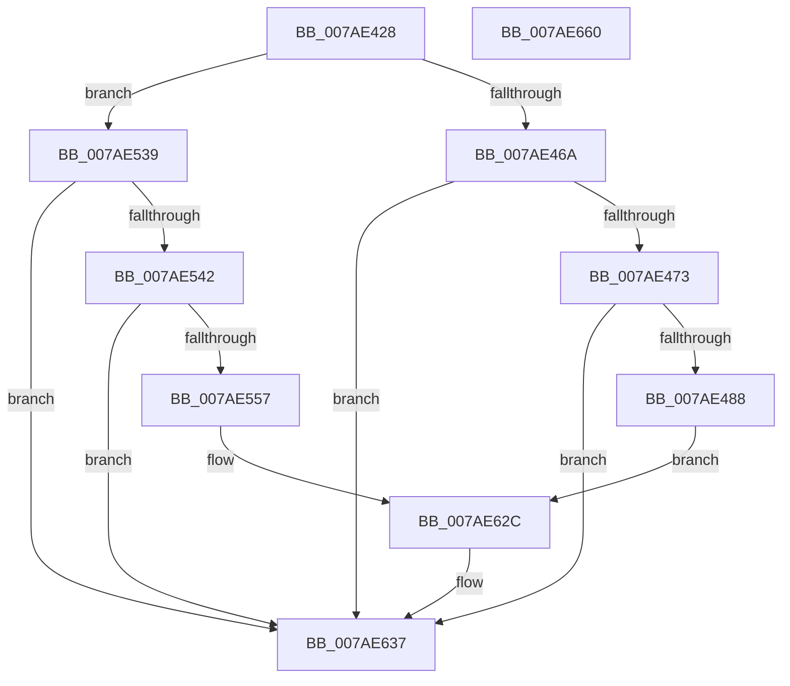

# VmpLogCreateDeleteMemoryRange

- RVA: `0x007AE428`–`0x007AE661` (길이 `569` bytes)
- VA: `0x00000001407AE428`
- 실행 섹션: `PAGE`
- PDB 이름 있음: `예`; PDB Function 태그: `아니요`
- unwind 정보 RVA: `0x000A7978`
- 디코드: `120`개 명령, `569/569` bytes 표시
- 미해석 바이트: `0` (있으면 어셈블리에 `.byte`로 보존)

> 이 문서는 커널 이미지의 기계어와 PDB 기호를 분석해 생성했습니다. 4번과 5번은 함수 원형과 자료형을 바이너리 사용 방식에서 추정한 C 해석이며 원본 소스 복구 결과는 아닙니다.

## 1. Dependencies

- 직접 호출 지점: **6**; 고유 호출 대상: **4**
- 직접 호출자로 확인된 함수: **2**
- RIP 상대 이미지 참조: **4**

### Outgoing calls
- `0x007AE47B` → [tlgKeywordOn](../../text/42/tlgKeywordOn_function_0042EAA0.md) (function, `0x0042EAA0`)
- `0x007AE498` → [PsGetProcessId](../../text/43/PsGetProcessId_function_0043D910.md) (function, `0x0043D910`)
- `0x007AE54A` → [tlgKeywordOn](../../text/42/tlgKeywordOn_function_0042EAA0.md) (function, `0x0042EAA0`)
- `0x007AE567` → [PsGetProcessId](../../text/43/PsGetProcessId_function_0043D910.md) (function, `0x0043D910`)
- `0x007AE632` → [tlgWriteEx_EtwWriteEx](../../text/4A/tlgWriteEx_EtwWriteEx_function_004AA348.md) (function, `0x004AA348`)
- `0x007AE63E` → [_security_check_cookie](../../text/6A/_security_check_cookie_function_006AC640.md) (function, `0x006AC640`)

### Direct callers
- [VmCreateMemoryRange](VmCreateMemoryRange_function_007AD1D0.md) at `0x007AD375`
- [VmDeleteMemoryRange](../A7/VmDeleteMemoryRange_function_00A7AC50.md) at `0x00A7AD55`

### Static image references
- `0x007AE447` → RVA `0x00E0A740` (`.data`; read)
- `0x007AE455` → RVA `0x00F02458` (`.data`; read)
- `0x007AE4A1` → RVA `0x00053C41` (`.rdata`; read)
- `0x007AE570` → RVA `0x00053A11` (`.rdata`; read)

## 2. Other-region calls and transfers

- 다른 실행 섹션으로 향하는 call: **6**
  - `0x007AE47B` → [tlgKeywordOn](../../text/42/tlgKeywordOn_function_0042EAA0.md) (`PAGE` → `.text`)
  - `0x007AE498` → [PsGetProcessId](../../text/43/PsGetProcessId_function_0043D910.md) (`PAGE` → `.text`)
  - `0x007AE54A` → [tlgKeywordOn](../../text/42/tlgKeywordOn_function_0042EAA0.md) (`PAGE` → `.text`)
  - `0x007AE567` → [PsGetProcessId](../../text/43/PsGetProcessId_function_0043D910.md) (`PAGE` → `.text`)
  - `0x007AE632` → [tlgWriteEx_EtwWriteEx](../../text/4A/tlgWriteEx_EtwWriteEx_function_004AA348.md) (`PAGE` → `.text`)
  - `0x007AE63E` → [_security_check_cookie](../../text/6A/_security_check_cookie_function_006AC640.md) (`PAGE` → `.text`)
- 별도 외부 분기/꼬리 이동을 확인하지 못했습니다.

## 3. Assembly (complete function range)

```asm
007AE428  48 8B C4                        mov rax, rsp
007AE42B  48 89 58 08                     mov qword ptr [rax + 8], rbx
007AE42F  48 89 70 10                     mov qword ptr [rax + 0x10], rsi
007AE433  48 89 78 18                     mov qword ptr [rax + 0x18], rdi
007AE437  4C 89 70 20                     mov qword ptr [rax + 0x20], r14
007AE43B  55                              push rbp
007AE43C  48 8D 68 E8                     lea rbp, [rax - 0x18]
007AE440  48 81 EC 10 01 00 00            sub rsp, 0x110
007AE447  48 8B 05 F2 C2 65 00            mov rax, qword ptr [rip + 0x65c2f2]
007AE44E  48 33 C4                        xor rax, rsp
007AE451  48 89 45 00                     mov qword ptr [rbp], rax
007AE455  48 8B 1D FC 3F 75 00            mov rbx, qword ptr [rip + 0x753ffc]
007AE45C  49 8B F9                        mov rdi, r9
007AE45F  49 8B F0                        mov rsi, r8
007AE462  85 D2                           test edx, edx
007AE464  0F 84 CF 00 00 00               je 0x1407ae539
007AE46A  83 3B 05                        cmp dword ptr [rbx], 5
007AE46D  0F 86 C4 01 00 00               jbe 0x1407ae637
007AE473  BA 80 00 00 00                  mov edx, 0x80
007AE478  48 8B CB                        mov rcx, rbx
007AE47B  E8 20 06 C8 FF                  call 0x14042eaa0
007AE480  84 C0                           test al, al
007AE482  0F 84 AF 01 00 00               je 0x1407ae637
007AE488  65 48 8B 0C 25 88 01 00 00      mov rcx, qword ptr gs:[0x188]
007AE491  48 8B 89 B8 00 00 00            mov rcx, qword ptr [rcx + 0xb8]
007AE498  E8 73 F4 C8 FF                  call 0x14043d910
007AE49D  89 44 24 40                     mov dword ptr [rsp + 0x40], eax
007AE4A1  48 8D 15 99 57 8A FF            lea rdx, [rip - 0x75a867]
007AE4A8  B9 08 00 00 00                  mov ecx, 8
007AE4AD  48 C7 45 98 04 00 00 00         mov qword ptr [rbp - 0x68], 4
007AE4B5  48 8D 44 24 40                  lea rax, [rsp + 0x40]
007AE4BA  48 89 74 24 48                  mov qword ptr [rsp + 0x48], rsi
007AE4BF  48 89 45 90                     mov qword ptr [rbp - 0x70], rax
007AE4C3  48 8D 44 24 48                  lea rax, [rsp + 0x48]
007AE4C8  48 89 45 A0                     mov qword ptr [rbp - 0x60], rax
007AE4CC  48 8D 44 24 50                  lea rax, [rsp + 0x50]
007AE4D1  48 89 45 B0                     mov qword ptr [rbp - 0x50], rax
007AE4D5  48 8B 45 40                     mov rax, qword ptr [rbp + 0x40]
007AE4D9  48 89 44 24 58                  mov qword ptr [rsp + 0x58], rax
007AE4DE  48 8D 44 24 58                  lea rax, [rsp + 0x58]
007AE4E3  48 89 45 C0                     mov qword ptr [rbp - 0x40], rax
007AE4E7  48 8B 45 50                     mov rax, qword ptr [rbp + 0x50]
007AE4EB  48 89 44 24 60                  mov qword ptr [rsp + 0x60], rax
007AE4F0  48 8D 44 24 60                  lea rax, [rsp + 0x60]
007AE4F5  48 89 45 D0                     mov qword ptr [rbp - 0x30], rax
007AE4F9  8B 45 58                        mov eax, dword ptr [rbp + 0x58]
007AE4FC  89 44 24 44                     mov dword ptr [rsp + 0x44], eax
007AE500  48 8D 44 24 44                  lea rax, [rsp + 0x44]
007AE505  48 89 45 E0                     mov qword ptr [rbp - 0x20], rax
007AE509  48 8D 44 24 70                  lea rax, [rsp + 0x70]
007AE50E  48 89 44 24 38                  mov qword ptr [rsp + 0x38], rax
007AE513  89 4C 24 30                     mov dword ptr [rsp + 0x30], ecx
007AE517  48 89 4D A8                     mov qword ptr [rbp - 0x58], rcx
007AE51B  48 89 7C 24 50                  mov qword ptr [rsp + 0x50], rdi
007AE520  48 89 4D B8                     mov qword ptr [rbp - 0x48], rcx
007AE524  48 89 4D C8                     mov qword ptr [rbp - 0x38], rcx
007AE528  48 89 4D D8                     mov qword ptr [rbp - 0x28], rcx
007AE52C  48 C7 45 E8 04 00 00 00         mov qword ptr [rbp - 0x18], 4
007AE534  E9 F3 00 00 00                  jmp 0x1407ae62c
007AE539  83 3B 05                        cmp dword ptr [rbx], 5
007AE53C  0F 86 F5 00 00 00               jbe 0x1407ae637
007AE542  BA 80 00 00 00                  mov edx, 0x80
007AE547  48 8B CB                        mov rcx, rbx
007AE54A  E8 51 05 C8 FF                  call 0x14042eaa0
007AE54F  84 C0                           test al, al
007AE551  0F 84 E0 00 00 00               je 0x1407ae637
007AE557  65 48 8B 0C 25 88 01 00 00      mov rcx, qword ptr gs:[0x188]
007AE560  48 8B 89 B8 00 00 00            mov rcx, qword ptr [rcx + 0xb8]
007AE567  E8 A4 F3 C8 FF                  call 0x14043d910
007AE56C  89 44 24 44                     mov dword ptr [rsp + 0x44], eax
007AE570  48 8D 15 9A 54 8A FF            lea rdx, [rip - 0x75ab66]
007AE577  48 8D 44 24 44                  lea rax, [rsp + 0x44]
007AE57C  48 C7 45 98 04 00 00 00         mov qword ptr [rbp - 0x68], 4
007AE584  48 89 45 90                     mov qword ptr [rbp - 0x70], rax
007AE588  48 8D 44 24 60                  lea rax, [rsp + 0x60]
007AE58D  48 89 45 A0                     mov qword ptr [rbp - 0x60], rax
007AE591  48 8D 44 24 58                  lea rax, [rsp + 0x58]
007AE596  48 89 45 B0                     mov qword ptr [rbp - 0x50], rax
007AE59A  48 8B 45 40                     mov rax, qword ptr [rbp + 0x40]
007AE59E  48 89 44 24 50                  mov qword ptr [rsp + 0x50], rax
007AE5A3  48 8D 44 24 50                  lea rax, [rsp + 0x50]
007AE5A8  48 89 45 C0                     mov qword ptr [rbp - 0x40], rax
007AE5AC  48 8B 45 48                     mov rax, qword ptr [rbp + 0x48]
007AE5B0  48 89 44 24 48                  mov qword ptr [rsp + 0x48], rax
007AE5B5  48 8D 44 24 48                  lea rax, [rsp + 0x48]
007AE5BA  48 89 45 D0                     mov qword ptr [rbp - 0x30], rax
007AE5BE  48 8B 45 50                     mov rax, qword ptr [rbp + 0x50]
007AE5C2  48 89 44 24 68                  mov qword ptr [rsp + 0x68], rax
007AE5C7  48 8D 44 24 68                  lea rax, [rsp + 0x68]
007AE5CC  48 89 45 E0                     mov qword ptr [rbp - 0x20], rax
007AE5D0  8B 45 58                        mov eax, dword ptr [rbp + 0x58]
007AE5D3  89 44 24 40                     mov dword ptr [rsp + 0x40], eax
007AE5D7  48 8D 44 24 40                  lea rax, [rsp + 0x40]
007AE5DC  48 89 45 F0                     mov qword ptr [rbp - 0x10], rax
007AE5E0  48 8D 44 24 70                  lea rax, [rsp + 0x70]
007AE5E5  48 89 44 24 38                  mov qword ptr [rsp + 0x38], rax
007AE5EA  C7 44 24 30 09 00 00 00         mov dword ptr [rsp + 0x30], 9
007AE5F2  48 89 74 24 60                  mov qword ptr [rsp + 0x60], rsi
007AE5F7  48 C7 45 A8 08 00 00 00         mov qword ptr [rbp - 0x58], 8
007AE5FF  48 89 7C 24 58                  mov qword ptr [rsp + 0x58], rdi
007AE604  48 C7 45 B8 08 00 00 00         mov qword ptr [rbp - 0x48], 8
007AE60C  48 C7 45 C8 08 00 00 00         mov qword ptr [rbp - 0x38], 8
007AE614  48 C7 45 D8 08 00 00 00         mov qword ptr [rbp - 0x28], 8
007AE61C  48 C7 45 E8 08 00 00 00         mov qword ptr [rbp - 0x18], 8
007AE624  48 C7 45 F8 04 00 00 00         mov qword ptr [rbp - 8], 4
007AE62C  45 33 C9                        xor r9d, r9d
007AE62F  48 8B CB                        mov rcx, rbx
007AE632  E8 11 BD CF FF                  call 0x1404aa348
007AE637  48 8B 4D 00                     mov rcx, qword ptr [rbp]
007AE63B  48 33 CC                        xor rcx, rsp
007AE63E  E8 FD DF EF FF                  call 0x1406ac640
007AE643  4C 8D 9C 24 10 01 00 00         lea r11, [rsp + 0x110]
007AE64B  49 8B 5B 10                     mov rbx, qword ptr [r11 + 0x10]
007AE64F  49 8B 73 18                     mov rsi, qword ptr [r11 + 0x18]
007AE653  49 8B 7B 20                     mov rdi, qword ptr [r11 + 0x20]
007AE657  4D 8B 73 28                     mov r14, qword ptr [r11 + 0x28]
007AE65B  49 8B E3                        mov rsp, r11
007AE65E  5D                              pop rbp
007AE65F  C3                              ret
007AE660  CC                              int3
```

## 4. C-style interpretation (structured pseudocode)

```c
__int64 __fastcall VmpLogCreateDeleteMemoryRange(__int64 a1, int a2, __int64 a3, __int64 a4)
{
    __int64 result;
    __int64 v_rsp;
    unsigned __int64 v_stack_m8;
    unsigned __int64 v_stack_mA8;
    unsigned __int64 v_stack_mB0;
    unsigned __int64 v_stack_mB8;
    unsigned __int64 v_stack_mC0;
    unsigned __int64 v_stack_mC8;
    unsigned __int64 v_stack_mD0;
    unsigned int v_stack_mD4;
    unsigned int v_stack_mD8;
    unsigned __int64 v_stack_mE0;
    unsigned int v_stack_mE8;

    *(unsigned __int64 *)(v_rsp + 8) = v_rbx;
    *(unsigned __int64 *)(v_rsp + 16) = v_rsi;
    *(unsigned __int64 *)(v_rsp + 24) = v_rdi;
    *(unsigned __int64 *)(v_rsp + 32) = v_r14;
    v_rsp = (v_rsp) - (272);
    result = (*(unsigned __int64 *)(v_rip + 6669042)) ^ (v_rsp);
    *(unsigned __int64 *)(v_rsp - 24) = result;
    if (a2 == 0) goto loc_007AE539;
    if ((*(unsigned int *)(*(unsigned __int64 *)(v_rip + 7684092))) <= 5) goto loc_007AE637;
    result = tlgKeywordOn(*(unsigned __int64 *)(v_rip + 7684092), 128, a3, a4);
    if ((unsigned __int8)(result) == 0) goto loc_007AE637;
    result = PsGetProcessId(*(unsigned __int64 *)(*(unsigned __int64 *)(gs_base + (0 + 392)) + 184), 128, a3, a4);
    v_stack_mD8 = (unsigned int)(result);
    *(unsigned __int64 *)(v_rsp - 24 - 104) = 4;
    v_stack_mD0 = a3;
    *(unsigned __int64 *)(v_rsp - 24 - 112) = v_stack_mD8;
    *(unsigned __int64 *)(v_rsp - 24 - 96) = v_stack_mD0;
    *(unsigned __int64 *)(v_rsp - 24 - 80) = v_stack_mC8;
    v_stack_mC0 = *(unsigned __int64 *)(v_rsp - 24 + 64);
    *(unsigned __int64 *)(v_rsp - 24 - 64) = v_stack_mC0;
    v_stack_mB8 = *(unsigned __int64 *)(v_rsp - 24 + 80);
    *(unsigned __int64 *)(v_rsp - 24 - 48) = v_stack_mB8;
    v_stack_mD4 = (unsigned int)((unsigned int)(*(unsigned int *)(v_rsp - 24 + 88)));
    *(unsigned __int64 *)(v_rsp - 24 - 32) = v_stack_mD4;
    v_stack_mE0 = v_stack_mA8;
    v_stack_mE8 = 8;
    *(unsigned __int64 *)(v_rsp - 24 - 88) = 8;
    v_stack_mC8 = a4;
    *(unsigned __int64 *)(v_rsp - 24 - 72) = 8;
    *(unsigned __int64 *)(v_rsp - 24 - 56) = 8;
    *(unsigned __int64 *)(v_rsp - 24 - 40) = 8;
    *(unsigned __int64 *)(v_rsp - 24 - 24) = 4;
    goto loc_007AE62C;
loc_007AE539:
    if ((*(unsigned int *)(*(unsigned __int64 *)(v_rip + 7684092))) <= 5) goto loc_007AE637;
    result = tlgKeywordOn(*(unsigned __int64 *)(v_rip + 7684092), 128, a3, a4);
    if ((unsigned __int8)(result) == 0) goto loc_007AE637;
    result = PsGetProcessId(*(unsigned __int64 *)(*(unsigned __int64 *)(gs_base + (0 + 392)) + 184), 128, a3, a4);
    v_stack_mD4 = (unsigned int)(result);
    *(unsigned __int64 *)(v_rsp - 24 - 104) = 4;
    *(unsigned __int64 *)(v_rsp - 24 - 112) = v_stack_mD4;
    *(unsigned __int64 *)(v_rsp - 24 - 96) = v_stack_mB8;
    *(unsigned __int64 *)(v_rsp - 24 - 80) = v_stack_mC0;
    v_stack_mC8 = *(unsigned __int64 *)(v_rsp - 24 + 64);
    *(unsigned __int64 *)(v_rsp - 24 - 64) = v_stack_mC8;
    v_stack_mD0 = *(unsigned __int64 *)(v_rsp - 24 + 72);
    *(unsigned __int64 *)(v_rsp - 24 - 48) = v_stack_mD0;
    v_stack_mB0 = *(unsigned __int64 *)(v_rsp - 24 + 80);
    *(unsigned __int64 *)(v_rsp - 24 - 32) = v_stack_mB0;
    v_stack_mD8 = (unsigned int)((unsigned int)(*(unsigned int *)(v_rsp - 24 + 88)));
    *(unsigned __int64 *)(v_rsp - 24 - 16) = v_stack_mD8;
    v_stack_mE0 = v_stack_mA8;
    v_stack_mE8 = 9;
    v_stack_mB8 = a3;
    *(unsigned __int64 *)(v_rsp - 24 - 88) = 8;
    v_stack_mC0 = a4;
    *(unsigned __int64 *)(v_rsp - 24 - 72) = 8;
    *(unsigned __int64 *)(v_rsp - 24 - 56) = 8;
    *(unsigned __int64 *)(v_rsp - 24 - 40) = 8;
    *(unsigned __int64 *)(v_rsp - 24 - 24) = 8;
    *(unsigned __int64 *)(v_rsp - 24 - 8) = 4;
loc_007AE62C:
    a4 = 0;
    result = tlgWriteEx_EtwWriteEx(*(unsigned __int64 *)(v_rip + 7684092), v_rip - 7711590, a3, a4);
loc_007AE637:
    a1 = (*(unsigned __int64 *)(v_rsp - 24)) ^ (v_rsp);
    result = _security_check_cookie(a1, v_rip - 7711590, a3, a4);
    return result;
}
```

## 5. (Beta) C Style

```c
int64_t VmpLogCreateDeleteMemoryRange(int64_t Arg1, int32_t Arg2, int64_t Arg3, int64_t Arg4)
{
    int64_t result;
    int64_t local_rsp;
    uint64_t v_stack_m8;
    uint64_t v_stack_mA8;
    uint64_t v_stack_mB0;
    uint64_t v_stack_mB8;
    uint64_t v_stack_mC0;
    uint64_t v_stack_mC8;
    uint64_t v_stack_mD0;
    uint32_t v_stack_mD4;
    uint32_t v_stack_mD8;
    uint64_t v_stack_mE0;
    uint32_t v_stack_mE8;

    *(uint64_t *)(local_rsp + 0x8) = local_rbx;
    *(uint64_t *)(local_rsp + 0x10) = local_rsi;
    *(uint64_t *)(local_rsp + 0x18) = local_rdi;
    *(uint64_t *)(local_rsp + 0x20) = local_r14;
    local_rsp = (local_rsp) - (272);
    result = (*(uint64_t *)(v_rip + 0x65C2F2)) ^ (local_rsp);
    *(uint64_t *)(local_rsp - 0x18) = result;
    if (Arg2 == 0) goto loc_007AE539;
    if ((*(uint32_t *)(*(uint64_t *)(v_rip + 0x753FFC))) <= 5) goto loc_007AE637;
    result = tlgKeywordOn(*(uint64_t *)(v_rip + 0x753FFC), 128, Arg3, Arg4);
    if ((uint8_t)(result) == 0) goto loc_007AE637;
    result = PsGetProcessId(*(uint64_t *)(*(uint64_t *)(gs_base + (0 + 0x188)) + 0xB8), 128, Arg3, Arg4);
    v_stack_mD8 = (uint32_t)(result);
    *(uint64_t *)(local_rsp - 0x18 - 0x68) = 4;
    v_stack_mD0 = Arg3;
    *(uint64_t *)(local_rsp - 0x18 - 0x70) = v_stack_mD8;
    *(uint64_t *)(local_rsp - 0x18 - 0x60) = v_stack_mD0;
    *(uint64_t *)(local_rsp - 0x18 - 0x50) = v_stack_mC8;
    v_stack_mC0 = *(uint64_t *)(local_rsp - 0x18 + 0x40);
    *(uint64_t *)(local_rsp - 0x18 - 0x40) = v_stack_mC0;
    v_stack_mB8 = *(uint64_t *)(local_rsp - 0x18 + 0x50);
    *(uint64_t *)(local_rsp - 0x18 - 0x30) = v_stack_mB8;
    v_stack_mD4 = (uint32_t)((uint32_t)(*(uint32_t *)(local_rsp - 0x18 + 0x58)));
    *(uint64_t *)(local_rsp - 0x18 - 0x20) = v_stack_mD4;
    v_stack_mE0 = v_stack_mA8;
    v_stack_mE8 = 8;
    *(uint64_t *)(local_rsp - 0x18 - 0x58) = 8;
    v_stack_mC8 = Arg4;
    *(uint64_t *)(local_rsp - 0x18 - 0x48) = 8;
    *(uint64_t *)(local_rsp - 0x18 - 0x38) = 8;
    *(uint64_t *)(local_rsp - 0x18 - 0x28) = 8;
    *(uint64_t *)(local_rsp - 0x18 - 0x18) = 4;
    goto loc_007AE62C;
loc_007AE539:
    if ((*(uint32_t *)(*(uint64_t *)(v_rip + 0x753FFC))) <= 5) goto loc_007AE637;
    result = tlgKeywordOn(*(uint64_t *)(v_rip + 0x753FFC), 128, Arg3, Arg4);
    if ((uint8_t)(result) == 0) goto loc_007AE637;
    result = PsGetProcessId(*(uint64_t *)(*(uint64_t *)(gs_base + (0 + 0x188)) + 0xB8), 128, Arg3, Arg4);
    v_stack_mD4 = (uint32_t)(result);
    *(uint64_t *)(local_rsp - 0x18 - 0x68) = 4;
    *(uint64_t *)(local_rsp - 0x18 - 0x70) = v_stack_mD4;
    *(uint64_t *)(local_rsp - 0x18 - 0x60) = v_stack_mB8;
    *(uint64_t *)(local_rsp - 0x18 - 0x50) = v_stack_mC0;
    v_stack_mC8 = *(uint64_t *)(local_rsp - 0x18 + 0x40);
    *(uint64_t *)(local_rsp - 0x18 - 0x40) = v_stack_mC8;
    v_stack_mD0 = *(uint64_t *)(local_rsp - 0x18 + 0x48);
    *(uint64_t *)(local_rsp - 0x18 - 0x30) = v_stack_mD0;
    v_stack_mB0 = *(uint64_t *)(local_rsp - 0x18 + 0x50);
    *(uint64_t *)(local_rsp - 0x18 - 0x20) = v_stack_mB0;
    v_stack_mD8 = (uint32_t)((uint32_t)(*(uint32_t *)(local_rsp - 0x18 + 0x58)));
    *(uint64_t *)(local_rsp - 0x18 - 0x10) = v_stack_mD8;
    v_stack_mE0 = v_stack_mA8;
    v_stack_mE8 = 9;
    v_stack_mB8 = Arg3;
    *(uint64_t *)(local_rsp - 0x18 - 0x58) = 8;
    v_stack_mC0 = Arg4;
    *(uint64_t *)(local_rsp - 0x18 - 0x48) = 8;
    *(uint64_t *)(local_rsp - 0x18 - 0x38) = 8;
    *(uint64_t *)(local_rsp - 0x18 - 0x28) = 8;
    *(uint64_t *)(local_rsp - 0x18 - 0x18) = 8;
    *(uint64_t *)(local_rsp - 0x18 - 0x8) = 4;
loc_007AE62C:
    Arg4 = 0;
    result = tlgWriteEx_EtwWriteEx(*(uint64_t *)(v_rip + 0x753FFC), v_rip - 7711590, Arg3, Arg4);
loc_007AE637:
    Arg1 = (*(uint64_t *)(local_rsp - 0x18)) ^ (local_rsp);
    result = _security_check_cookie(Arg1, v_rip - 7711590, Arg3, Arg4);
    return result;
}
```

## 6. Execution-region graph

[열기: 2D/3D 그래프와 함수 탐색 컨트롤 패널](../../../control-panel.html?section=page&rva=0x007AE428&view=graph)

- 2D 그래프는 위에서 아래로 흐르고, 3D 그래프는 빈 공간을 드래그해 회전합니다. Shift+드래그는 이동, 휠은 확대·축소, 함수 노드 선택은 대상 보고서 이동입니다.

### Static fallback


