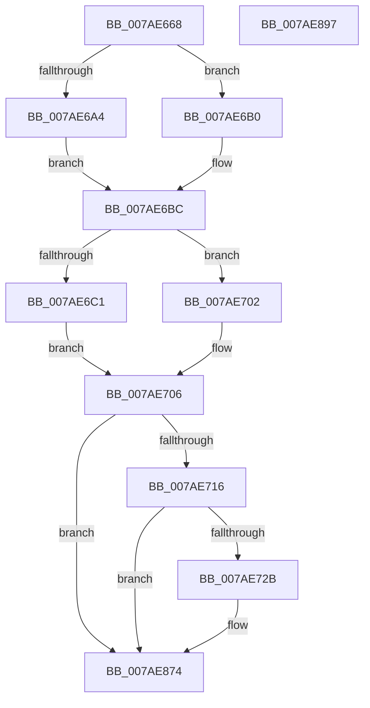

# VmpLogCreateMemoryProcess

- RVA: `0x007AE668`–`0x007AE898` (길이 `560` bytes)
- VA: `0x00000001407AE668`
- 실행 섹션: `PAGE`
- PDB 이름 있음: `예`; PDB Function 태그: `아니요`
- unwind 정보 RVA: `0x000D2F34`
- 디코드: `123`개 명령, `560/560` bytes 표시
- 미해석 바이트: `0` (있으면 어셈블리에 `.byte`로 보존)

> 이 문서는 커널 이미지의 기계어와 PDB 기호를 분석해 생성했습니다. 4번과 5번은 함수 원형과 자료형을 바이너리 사용 방식에서 추정한 C 해석이며 원본 소스 복구 결과는 아닙니다.

## 1. Dependencies

- 직접 호출 지점: **9**; 고유 호출 대상: **7**
- 직접 호출자로 확인된 함수: **1**
- RIP 상대 이미지 참조: **4**

### Outgoing calls
- `0x007AE6B7` → [RtlInitUnicodeString](../../text/42/RtlInitUnicodeString_function_0042A780.md) (function, `0x0042A780`)
- `0x007AE6E4` → [ObReferenceObjectByHandle](../86/ObReferenceObjectByHandle_function_00868DB0.md) (function, `0x00868DB0`)
- `0x007AE6EE` → [PsGetProcessId](../../text/43/PsGetProcessId_function_0043D910.md) (function, `0x0043D910`)
- `0x007AE6FB` → [ObfDereferenceObject](../../text/2F/ObfDereferenceObject_function_002F9350.md) (function, `0x002F9350`)
- `0x007AE71E` → [tlgKeywordOn](../../text/42/tlgKeywordOn_function_0042EAA0.md) (function, `0x0042EAA0`)
- `0x007AE73B` → [PsGetProcessId](../../text/43/PsGetProcessId_function_0043D910.md) (function, `0x0043D910`)
- `0x007AE75C` → [PsGetProcessId](../../text/43/PsGetProcessId_function_0043D910.md) (function, `0x0043D910`)
- `0x007AE86F` → [tlgWriteEx_EtwWriteEx](../../text/4A/tlgWriteEx_EtwWriteEx_function_004AA348.md) (function, `0x004AA348`)
- `0x007AE87B` → [_security_check_cookie](../../text/6A/_security_check_cookie_function_006AC640.md) (function, `0x006AC640`)

### Direct callers
- [VmCreateMemoryProcess](VmCreateMemoryProcess_function_007ACFA0.md) at `0x007AD197`

### Static image references
- `0x007AE680` → RVA `0x00E0A740` (`.data`; read)
- `0x007AE6C1` → RVA `0x00FC6A98` (`ALMOSTRO`; read)
- `0x007AE706` → RVA `0x00F02458` (`.data`; read)
- `0x007AE765` → RVA `0x000535DE` (`.rdata`; read)

## 2. Other-region calls and transfers

- 다른 실행 섹션으로 향하는 call: **8**
  - `0x007AE6B7` → [RtlInitUnicodeString](../../text/42/RtlInitUnicodeString_function_0042A780.md) (`PAGE` → `.text`)
  - `0x007AE6EE` → [PsGetProcessId](../../text/43/PsGetProcessId_function_0043D910.md) (`PAGE` → `.text`)
  - `0x007AE6FB` → [ObfDereferenceObject](../../text/2F/ObfDereferenceObject_function_002F9350.md) (`PAGE` → `.text`)
  - `0x007AE71E` → [tlgKeywordOn](../../text/42/tlgKeywordOn_function_0042EAA0.md) (`PAGE` → `.text`)
  - `0x007AE73B` → [PsGetProcessId](../../text/43/PsGetProcessId_function_0043D910.md) (`PAGE` → `.text`)
  - `0x007AE75C` → [PsGetProcessId](../../text/43/PsGetProcessId_function_0043D910.md) (`PAGE` → `.text`)
  - `0x007AE86F` → [tlgWriteEx_EtwWriteEx](../../text/4A/tlgWriteEx_EtwWriteEx_function_004AA348.md) (`PAGE` → `.text`)
  - `0x007AE87B` → [_security_check_cookie](../../text/6A/_security_check_cookie_function_006AC640.md) (`PAGE` → `.text`)
- 별도 외부 분기/꼬리 이동을 확인하지 못했습니다.

## 3. Assembly (complete function range)

```asm
007AE668  48 89 5C 24 08                  mov qword ptr [rsp + 8], rbx
007AE66D  55                              push rbp
007AE66E  56                              push rsi
007AE66F  57                              push rdi
007AE670  41 56                           push r14
007AE672  41 57                           push r15
007AE674  48 8D 6C 24 A0                  lea rbp, [rsp - 0x60]
007AE679  48 81 EC 60 01 00 00            sub rsp, 0x160
007AE680  48 8B 05 B9 C0 65 00            mov rax, qword ptr [rip + 0x65c0b9]
007AE687  48 33 C4                        xor rax, rsp
007AE68A  48 89 45 50                     mov qword ptr [rbp + 0x50], rax
007AE68E  45 33 FF                        xor r15d, r15d
007AE691  0F 57 C0                        xorps xmm0, xmm0
007AE694  41 8B F1                        mov esi, r9d
007AE697  48 8B DA                        mov rbx, rdx
007AE69A  0F 11 44 24 60                  movups xmmword ptr [rsp + 0x60], xmm0
007AE69F  4D 85 C0                        test r8, r8
007AE6A2  74 0C                           je 0x1407ae6b0
007AE6A4  41 0F 10 00                     movups xmm0, xmmword ptr [r8]
007AE6A8  F3 0F 7F 44 24 60               movdqu xmmword ptr [rsp + 0x60], xmm0
007AE6AE  EB 0C                           jmp 0x1407ae6bc
007AE6B0  33 D2                           xor edx, edx
007AE6B2  48 8D 4C 24 60                  lea rcx, [rsp + 0x60]
007AE6B7  E8 C4 C0 C7 FF                  call 0x14042a780
007AE6BC  48 85 DB                        test rbx, rbx
007AE6BF  74 41                           je 0x1407ae702
007AE6C1  4C 8B 05 D0 83 81 00            mov r8, qword ptr [rip + 0x8183d0]
007AE6C8  48 8D 44 24 40                  lea rax, [rsp + 0x40]
007AE6CD  4C 89 7C 24 28                  mov qword ptr [rsp + 0x28], r15
007AE6D2  45 33 C9                        xor r9d, r9d
007AE6D5  33 D2                           xor edx, edx
007AE6D7  48 89 44 24 20                  mov qword ptr [rsp + 0x20], rax
007AE6DC  48 8B CB                        mov rcx, rbx
007AE6DF  4C 89 7C 24 40                  mov qword ptr [rsp + 0x40], r15
007AE6E4  E8 C7 A6 0B 00                  call 0x140868db0
007AE6E9  48 8B 4C 24 40                  mov rcx, qword ptr [rsp + 0x40]
007AE6EE  E8 1D F2 C8 FF                  call 0x14043d910
007AE6F3  48 8B 4C 24 40                  mov rcx, qword ptr [rsp + 0x40]
007AE6F8  48 8B F8                        mov rdi, rax
007AE6FB  E8 50 AC B4 FF                  call 0x1402f9350
007AE700  EB 04                           jmp 0x1407ae706
007AE702  48 83 CF FF                     or rdi, 0xffffffffffffffff
007AE706  48 8B 1D 4B 3D 75 00            mov rbx, qword ptr [rip + 0x753d4b]
007AE70D  83 3B 05                        cmp dword ptr [rbx], 5
007AE710  0F 86 5E 01 00 00               jbe 0x1407ae874
007AE716  BA 80 00 00 00                  mov edx, 0x80
007AE71B  48 8B CB                        mov rcx, rbx
007AE71E  E8 7D 03 C8 FF                  call 0x14042eaa0
007AE723  84 C0                           test al, al
007AE725  0F 84 49 01 00 00               je 0x1407ae874
007AE72B  65 48 8B 0C 25 88 01 00 00      mov rcx, qword ptr gs:[0x188]
007AE734  48 8B 89 B8 00 00 00            mov rcx, qword ptr [rcx + 0xb8]
007AE73B  E8 D0 F1 C8 FF                  call 0x14043d910
007AE740  48 8B 8D D0 00 00 00            mov rcx, qword ptr [rbp + 0xd0]
007AE747  89 44 24 48                     mov dword ptr [rsp + 0x48], eax
007AE74B  48 8D 44 24 48                  lea rax, [rsp + 0x48]
007AE750  48 89 45 A0                     mov qword ptr [rbp - 0x60], rax
007AE754  48 C7 45 A8 04 00 00 00         mov qword ptr [rbp - 0x58], 4
007AE75C  E8 AF F1 C8 FF                  call 0x14043d910
007AE761  89 44 24 4C                     mov dword ptr [rsp + 0x4c], eax
007AE765  48 8D 15 72 4E 8A FF            lea rdx, [rip - 0x75b18e]
007AE76C  48 8D 44 24 4C                  lea rax, [rsp + 0x4c]
007AE771  48 C7 45 B8 04 00 00 00         mov qword ptr [rbp - 0x48], 4
007AE779  48 89 45 B0                     mov qword ptr [rbp - 0x50], rax
007AE77D  45 33 C9                        xor r9d, r9d
007AE780  48 8D 44 24 50                  lea rax, [rsp + 0x50]
007AE785  89 7C 24 50                     mov dword ptr [rsp + 0x50], edi
007AE789  48 89 45 C0                     mov qword ptr [rbp - 0x40], rax
007AE78D  48 8B CB                        mov rcx, rbx
007AE790  48 8D 45 E8                     lea rax, [rbp - 0x18]
007AE794  48 C7 45 C8 04 00 00 00         mov qword ptr [rbp - 0x38], 4
007AE79C  48 89 45 D0                     mov qword ptr [rbp - 0x30], rax
007AE7A0  48 8B 44 24 68                  mov rax, qword ptr [rsp + 0x68]
007AE7A5  48 89 45 E0                     mov qword ptr [rbp - 0x20], rax
007AE7A9  0F B7 44 24 60                  movzx eax, word ptr [rsp + 0x60]
007AE7AE  89 45 E8                        mov dword ptr [rbp - 0x18], eax
007AE7B1  48 8D 44 24 54                  lea rax, [rsp + 0x54]
007AE7B6  48 89 45 F0                     mov qword ptr [rbp - 0x10], rax
007AE7BA  8B 85 B0 00 00 00               mov eax, dword ptr [rbp + 0xb0]
007AE7C0  89 44 24 58                     mov dword ptr [rsp + 0x58], eax
007AE7C4  48 8D 44 24 58                  lea rax, [rsp + 0x58]
007AE7C9  48 89 45 00                     mov qword ptr [rbp], rax
007AE7CD  0F B6 85 C0 00 00 00            movzx eax, byte ptr [rbp + 0xc0]
007AE7D4  89 44 24 5C                     mov dword ptr [rsp + 0x5c], eax
007AE7D8  48 8D 44 24 5C                  lea rax, [rsp + 0x5c]
007AE7DD  48 89 45 10                     mov qword ptr [rbp + 0x10], rax
007AE7E1  48 8B 85 B8 00 00 00            mov rax, qword ptr [rbp + 0xb8]
007AE7E8  48 89 44 24 70                  mov qword ptr [rsp + 0x70], rax
007AE7ED  48 8D 44 24 70                  lea rax, [rsp + 0x70]
007AE7F2  48 89 45 20                     mov qword ptr [rbp + 0x20], rax
007AE7F6  48 8B 85 C8 00 00 00            mov rax, qword ptr [rbp + 0xc8]
007AE7FD  48 89 44 24 60                  mov qword ptr [rsp + 0x60], rax
007AE802  48 8D 44 24 60                  lea rax, [rsp + 0x60]
007AE807  48 89 45 30                     mov qword ptr [rbp + 0x30], rax
007AE80B  8B 85 D8 00 00 00               mov eax, dword ptr [rbp + 0xd8]
007AE811  89 44 24 40                     mov dword ptr [rsp + 0x40], eax
007AE815  48 8D 44 24 40                  lea rax, [rsp + 0x40]
007AE81A  48 89 45 40                     mov qword ptr [rbp + 0x40], rax
007AE81E  48 8D 45 80                     lea rax, [rbp - 0x80]
007AE822  48 89 44 24 38                  mov qword ptr [rsp + 0x38], rax
007AE827  C7 44 24 30 0D 00 00 00         mov dword ptr [rsp + 0x30], 0xd
007AE82F  48 C7 45 D8 02 00 00 00         mov qword ptr [rbp - 0x28], 2
007AE837  44 89 7D EC                     mov dword ptr [rbp - 0x14], r15d
007AE83B  89 74 24 54                     mov dword ptr [rsp + 0x54], esi
007AE83F  48 C7 45 F8 04 00 00 00         mov qword ptr [rbp - 8], 4
007AE847  48 C7 45 08 04 00 00 00         mov qword ptr [rbp + 8], 4
007AE84F  48 C7 45 18 04 00 00 00         mov qword ptr [rbp + 0x18], 4
007AE857  48 C7 45 28 08 00 00 00         mov qword ptr [rbp + 0x28], 8
007AE85F  48 C7 45 38 08 00 00 00         mov qword ptr [rbp + 0x38], 8
007AE867  48 C7 45 48 04 00 00 00         mov qword ptr [rbp + 0x48], 4
007AE86F  E8 D4 BA CF FF                  call 0x1404aa348
007AE874  48 8B 4D 50                     mov rcx, qword ptr [rbp + 0x50]
007AE878  48 33 CC                        xor rcx, rsp
007AE87B  E8 C0 DD EF FF                  call 0x1406ac640
007AE880  48 8B 9C 24 90 01 00 00         mov rbx, qword ptr [rsp + 0x190]
007AE888  48 81 C4 60 01 00 00            add rsp, 0x160
007AE88F  41 5F                           pop r15
007AE891  41 5E                           pop r14
007AE893  5F                              pop rdi
007AE894  5E                              pop rsi
007AE895  5D                              pop rbp
007AE896  C3                              ret
007AE897  CC                              int3
```

## 4. C-style interpretation (structured pseudocode)

```c
__int64 __fastcall VmpLogCreateMemoryProcess(__int64 a1, __int64 a2, __int64 a3, int a4, unsigned int a5, __int64 a6, unsigned __int8 a7, __int64 a8, __int64 a9, unsigned int a10)
{
    __int64 result;
    __int64 v_r15;
    __int64 v_rdi;
    __int64 v_rsp;
    unsigned __int64 v_stack_m108;
    unsigned __int64 v_stack_m118;
    unsigned __int64 v_stack_m120;
    unsigned __int64 v_stack_m128;
    unsigned int v_stack_m12C;
    unsigned int v_stack_m130;
    unsigned __int64 v_stack_m134;
    unsigned __int64 v_stack_m138;
    unsigned int v_stack_m13C;
    unsigned int v_stack_m140;
    unsigned __int64 v_stack_m148;
    unsigned __int64 v_stack_m150;
    unsigned int v_stack_m158;
    unsigned __int64 v_stack_m160;
    unsigned __int64 v_stack_m168;
    unsigned __int64 v_stack_m38;
    unsigned __int64 v_stack_m40;
    unsigned __int64 v_stack_m48;
    unsigned __int64 v_stack_m50;
    unsigned __int64 v_stack_m58;
    unsigned __int64 v_stack_m60;
    unsigned __int64 v_stack_m68;
    unsigned __int64 v_stack_m70;
    unsigned __int64 v_stack_m78;
    unsigned __int64 v_stack_m80;
    unsigned __int64 v_stack_m88;
    unsigned __int64 v_stack_m90;
    unsigned __int64 v_stack_m98;
    unsigned int v_stack_m9C;
    unsigned __int64 v_stack_mA0;
    unsigned __int64 v_stack_mA8;
    unsigned __int64 v_stack_mB0;
    unsigned __int64 v_stack_mB8;
    unsigned __int64 v_stack_mC0;
    unsigned __int64 v_stack_mC8;
    unsigned __int64 v_stack_mD0;
    unsigned __int64 v_stack_mD8;
    unsigned __int64 v_stack_mE0;
    unsigned __int64 v_stack_mE8;
    unsigned __int64 v_stack_p8;

    v_stack_p8 = v_rbx;
    v_rsp = (v_rsp) - (352);
    result = (*(unsigned __int64 *)(v_rip + 6668473)) ^ (v_rsp);
    v_stack_m38 = result;
    v_r15 = 0;
    v_stack_m128 = v_xmm0;
    if (a3 == 0) goto loc_007AE6B0;
    v_stack_m128 = v_xmm0;
    goto loc_007AE6BC;
loc_007AE6B0:
    a2 = 0;
    result = RtlInitUnicodeString(v_stack_m128, a2, a3, a4);
loc_007AE6BC:
    if (0 == 0) goto loc_007AE702;
    v_stack_m160 = 0;
    a4 = 0;
    a2 = 0;
    v_stack_m168 = v_stack_m148;
    v_stack_m148 = 0;
    result = ObReferenceObjectByHandle(0, a2, *(unsigned __int64 *)(v_rip + 8487888), a4);
    result = PsGetProcessId(v_stack_m148, a2, *(unsigned __int64 *)(v_rip + 8487888), a4);
    result = ObfDereferenceObject(v_stack_m148, a2, *(unsigned __int64 *)(v_rip + 8487888), a4);
    goto loc_007AE706;
loc_007AE702:
    v_rdi = (result) | (-1);
loc_007AE706:
    if ((*(unsigned int *)(*(unsigned __int64 *)(v_rip + 7683403))) <= 5) goto loc_007AE874;
    result = tlgKeywordOn(*(unsigned __int64 *)(v_rip + 7683403), 128, *(unsigned __int64 *)(v_rip + 8487888), a4);
    if ((unsigned __int8)(result) != 0) {
        a1 = *(unsigned __int64 *)(gs_base + (0 + 392));
        a1 = *(unsigned __int64 *)(a1 + 184);
        result = PsGetProcessId(a1, 128, *(unsigned __int64 *)(v_rip + 8487888), a4);
        a1 = a9;
        v_stack_m140 = (unsigned int)(result);
        result = v_stack_m140;
        v_stack_mE8 = result;
        v_stack_mE0 = 4;
        result = PsGetProcessId(a1, 128, *(unsigned __int64 *)(v_rip + 8487888), a4);
        v_stack_m13C = (unsigned int)(result);
        a2 = v_rip - 7713166;
        result = v_stack_m13C;
        v_stack_mD0 = 4;
        v_stack_mD8 = result;
        a4 = 0;
        result = v_stack_m138;
        v_stack_m138 = (unsigned int)(v_rdi);
        v_stack_mC8 = result;
        a1 = *(unsigned __int64 *)(v_rip + 7683403);
        result = v_stack_mA0;
        v_stack_mC0 = 4;
        v_stack_mB8 = result;
        result = v_stack_m120;
        v_stack_mA8 = result;
        result = v_stack_m128;
        v_stack_mA0 = (unsigned int)(result);
        result = v_stack_m134;
        v_stack_m98 = result;
        result = a5;
        v_stack_m130 = (unsigned int)(result);
        result = v_stack_m130;
        v_stack_m88 = result;
        result = a7;
        v_stack_m12C = (unsigned int)(result);
        result = v_stack_m12C;
        v_stack_m78 = result;
        result = a6;
        v_stack_m118 = result;
        result = v_stack_m118;
        v_stack_m68 = result;
        result = a8;
        v_stack_m128 = result;
        result = v_stack_m128;
        v_stack_m58 = result;
        result = a10;
        v_stack_m148 = (unsigned int)(result);
        result = v_stack_m148;
        v_stack_m48 = result;
        result = v_stack_m108;
        v_stack_m150 = result;
        v_stack_m158 = 13;
        v_stack_mB0 = 2;
        v_stack_m9C = 0;
        v_stack_m134 = (unsigned int)((unsigned int)(a4));
        v_stack_m90 = 4;
        v_stack_m80 = 4;
        v_stack_m70 = 4;
        v_stack_m60 = 8;
        v_stack_m50 = 8;
        v_stack_m40 = 4;
        result = tlgWriteEx_EtwWriteEx(a1, a2, *(unsigned __int64 *)(v_rip + 8487888), a4);
    }
    a1 = (v_stack_m38) ^ (v_rsp);
    result = _security_check_cookie(a1, a2, *(unsigned __int64 *)(v_rip + 8487888), a4);
    v_rsp = (v_rsp) + (352);
    return result;
}
```

## 5. (Beta) C Style

```c
int64_t VmpLogCreateMemoryProcess(int64_t Arg1, int64_t Arg2, int64_t Arg3, int32_t Arg4, uint32_t Arg5, int64_t Arg6, uint8_t Arg7, int64_t Arg8, int64_t Arg9, uint32_t Arg10)
{
    int64_t result;
    int64_t local_r15;
    int64_t local_rdi;
    int64_t local_rsp;
    uint64_t v_stack_m108;
    uint64_t v_stack_m118;
    uint64_t v_stack_m120;
    uint64_t v_stack_m128;
    uint32_t v_stack_m12C;
    uint32_t v_stack_m130;
    uint64_t v_stack_m134;
    uint64_t v_stack_m138;
    uint32_t v_stack_m13C;
    uint32_t v_stack_m140;
    uint64_t v_stack_m148;
    uint64_t v_stack_m150;
    uint32_t v_stack_m158;
    uint64_t v_stack_m160;
    uint64_t v_stack_m168;
    uint64_t v_stack_m38;
    uint64_t v_stack_m40;
    uint64_t v_stack_m48;
    uint64_t v_stack_m50;
    uint64_t v_stack_m58;
    uint64_t v_stack_m60;
    uint64_t v_stack_m68;
    uint64_t v_stack_m70;
    uint64_t v_stack_m78;
    uint64_t v_stack_m80;
    uint64_t v_stack_m88;
    uint64_t v_stack_m90;
    uint64_t v_stack_m98;
    uint32_t v_stack_m9C;
    uint64_t v_stack_mA0;
    uint64_t v_stack_mA8;
    uint64_t v_stack_mB0;
    uint64_t v_stack_mB8;
    uint64_t v_stack_mC0;
    uint64_t v_stack_mC8;
    uint64_t v_stack_mD0;
    uint64_t v_stack_mD8;
    uint64_t v_stack_mE0;
    uint64_t v_stack_mE8;
    uint64_t v_stack_p8;

    v_stack_p8 = local_rbx;
    local_rsp = (local_rsp) - (352);
    result = (*(uint64_t *)(v_rip + 0x65C0B9)) ^ (local_rsp);
    v_stack_m38 = result;
    local_r15 = 0;
    v_stack_m128 = v_xmm0;
    if (Arg3 == 0) goto loc_007AE6B0;
    v_stack_m128 = v_xmm0;
    goto loc_007AE6BC;
loc_007AE6B0:
    Arg2 = 0;
    result = RtlInitUnicodeString(v_stack_m128, Arg2, Arg3, Arg4);
loc_007AE6BC:
    if (0 == 0) goto loc_007AE702;
    v_stack_m160 = 0;
    Arg4 = 0;
    Arg2 = 0;
    v_stack_m168 = v_stack_m148;
    v_stack_m148 = 0;
    result = ObReferenceObjectByHandle(0, Arg2, *(uint64_t *)(v_rip + 0x8183D0), Arg4);
    result = PsGetProcessId(v_stack_m148, Arg2, *(uint64_t *)(v_rip + 0x8183D0), Arg4);
    result = ObfDereferenceObject(v_stack_m148, Arg2, *(uint64_t *)(v_rip + 0x8183D0), Arg4);
    goto loc_007AE706;
loc_007AE702:
    local_rdi = (result) | (-1);
loc_007AE706:
    if ((*(uint32_t *)(*(uint64_t *)(v_rip + 0x753D4B))) <= 5) goto loc_007AE874;
    result = tlgKeywordOn(*(uint64_t *)(v_rip + 0x753D4B), 128, *(uint64_t *)(v_rip + 0x8183D0), Arg4);
    if ((uint8_t)(result) != 0) {
        Arg1 = *(uint64_t *)(gs_base + (0 + 0x188));
        Arg1 = *(uint64_t *)(Arg1 + 0xB8);
        result = PsGetProcessId(Arg1, 128, *(uint64_t *)(v_rip + 0x8183D0), Arg4);
        Arg1 = Arg9;
        v_stack_m140 = (uint32_t)(result);
        result = v_stack_m140;
        v_stack_mE8 = result;
        v_stack_mE0 = 4;
        result = PsGetProcessId(Arg1, 128, *(uint64_t *)(v_rip + 0x8183D0), Arg4);
        v_stack_m13C = (uint32_t)(result);
        Arg2 = v_rip - 7713166;
        result = v_stack_m13C;
        v_stack_mD0 = 4;
        v_stack_mD8 = result;
        Arg4 = 0;
        result = v_stack_m138;
        v_stack_m138 = (uint32_t)(local_rdi);
        v_stack_mC8 = result;
        Arg1 = *(uint64_t *)(v_rip + 0x753D4B);
        result = v_stack_mA0;
        v_stack_mC0 = 4;
        v_stack_mB8 = result;
        result = v_stack_m120;
        v_stack_mA8 = result;
        result = v_stack_m128;
        v_stack_mA0 = (uint32_t)(result);
        result = v_stack_m134;
        v_stack_m98 = result;
        result = Arg5;
        v_stack_m130 = (uint32_t)(result);
        result = v_stack_m130;
        v_stack_m88 = result;
        result = Arg7;
        v_stack_m12C = (uint32_t)(result);
        result = v_stack_m12C;
        v_stack_m78 = result;
        result = Arg6;
        v_stack_m118 = result;
        result = v_stack_m118;
        v_stack_m68 = result;
        result = Arg8;
        v_stack_m128 = result;
        result = v_stack_m128;
        v_stack_m58 = result;
        result = Arg10;
        v_stack_m148 = (uint32_t)(result);
        result = v_stack_m148;
        v_stack_m48 = result;
        result = v_stack_m108;
        v_stack_m150 = result;
        v_stack_m158 = 13;
        v_stack_mB0 = 2;
        v_stack_m9C = 0;
        v_stack_m134 = (uint32_t)((uint32_t)(Arg4));
        v_stack_m90 = 4;
        v_stack_m80 = 4;
        v_stack_m70 = 4;
        v_stack_m60 = 8;
        v_stack_m50 = 8;
        v_stack_m40 = 4;
        result = tlgWriteEx_EtwWriteEx(Arg1, Arg2, *(uint64_t *)(v_rip + 0x8183D0), Arg4);
    }
    Arg1 = (v_stack_m38) ^ (local_rsp);
    result = _security_check_cookie(Arg1, Arg2, *(uint64_t *)(v_rip + 0x8183D0), Arg4);
    local_rsp = (local_rsp) + (352);
    return result;
}
```

## 6. Execution-region graph

[열기: 2D/3D 그래프와 함수 탐색 컨트롤 패널](../../../control-panel.html?section=page&rva=0x007AE668&view=graph)

- 2D 그래프는 위에서 아래로 흐르고, 3D 그래프는 빈 공간을 드래그해 회전합니다. Shift+드래그는 이동, 휠은 확대·축소, 함수 노드 선택은 대상 보고서 이동입니다.

### Static fallback


