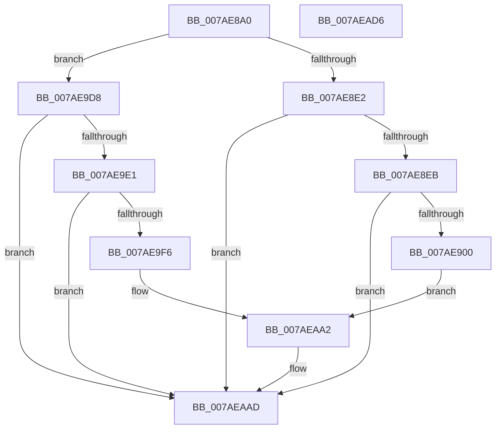

# VmpLogPin

- RVA: `0x007AE8A0`–`0x007AEAD7` (길이 `567` bytes)
- VA: `0x00000001407AE8A0`
- 실행 섹션: `PAGE`
- PDB 이름 있음: `예`; PDB Function 태그: `아니요`
- unwind 정보 RVA: `0x000A7978`
- 디코드: `120`개 명령, `567/567` bytes 표시
- 미해석 바이트: `0` (있으면 어셈블리에 `.byte`로 보존)

> 이 문서는 커널 이미지의 기계어와 PDB 기호를 분석해 생성했습니다. 4번과 5번은 함수 원형과 자료형을 바이너리 사용 방식에서 추정한 C 해석이며 원본 소스 복구 결과는 아닙니다.

## 1. Dependencies

- 직접 호출 지점: **6**; 고유 호출 대상: **4**
- 직접 호출자로 확인된 함수: **2**
- RIP 상대 이미지 참조: **4**

### Outgoing calls
- `0x007AE8F3` → [tlgKeywordOn](../../text/42/tlgKeywordOn_function_0042EAA0.md) (function, `0x0042EAA0`)
- `0x007AE910` → [PsGetProcessId](../../text/43/PsGetProcessId_function_0043D910.md) (function, `0x0043D910`)
- `0x007AE9E9` → [tlgKeywordOn](../../text/42/tlgKeywordOn_function_0042EAA0.md) (function, `0x0042EAA0`)
- `0x007AEA06` → [PsGetProcessId](../../text/43/PsGetProcessId_function_0043D910.md) (function, `0x0043D910`)
- `0x007AEAA8` → [tlgWriteEx_EtwWriteEx](../../text/4A/tlgWriteEx_EtwWriteEx_function_004AA348.md) (function, `0x004AA348`)
- `0x007AEAB4` → [_security_check_cookie](../../text/6A/_security_check_cookie_function_006AC640.md) (function, `0x006AC640`)

### Direct callers
- [VmPinMemoryRange](VmPinMemoryRange_function_007AD450.md) at `0x007AD655`
- [VmUnpinMemoryRange](VmUnpinMemoryRange_function_007AD730.md) at `0x007AD819`

### Static image references
- `0x007AE8BF` → RVA `0x00E0A740` (`.data`; read)
- `0x007AE8CD` → RVA `0x00F02458` (`.data`; read)
- `0x007AE919` → RVA `0x000539AF` (`.rdata`; read)
- `0x007AEA0F` → RVA `0x00053689` (`.rdata`; read)

## 2. Other-region calls and transfers

- 다른 실행 섹션으로 향하는 call: **6**
  - `0x007AE8F3` → [tlgKeywordOn](../../text/42/tlgKeywordOn_function_0042EAA0.md) (`PAGE` → `.text`)
  - `0x007AE910` → [PsGetProcessId](../../text/43/PsGetProcessId_function_0043D910.md) (`PAGE` → `.text`)
  - `0x007AE9E9` → [tlgKeywordOn](../../text/42/tlgKeywordOn_function_0042EAA0.md) (`PAGE` → `.text`)
  - `0x007AEA06` → [PsGetProcessId](../../text/43/PsGetProcessId_function_0043D910.md) (`PAGE` → `.text`)
  - `0x007AEAA8` → [tlgWriteEx_EtwWriteEx](../../text/4A/tlgWriteEx_EtwWriteEx_function_004AA348.md) (`PAGE` → `.text`)
  - `0x007AEAB4` → [_security_check_cookie](../../text/6A/_security_check_cookie_function_006AC640.md) (`PAGE` → `.text`)
- 별도 외부 분기/꼬리 이동을 확인하지 못했습니다.

## 3. Assembly (complete function range)

```asm
007AE8A0  48 8B C4                        mov rax, rsp
007AE8A3  48 89 58 08                     mov qword ptr [rax + 8], rbx
007AE8A7  48 89 70 10                     mov qword ptr [rax + 0x10], rsi
007AE8AB  48 89 78 18                     mov qword ptr [rax + 0x18], rdi
007AE8AF  4C 89 70 20                     mov qword ptr [rax + 0x20], r14
007AE8B3  55                              push rbp
007AE8B4  48 8D 68 E8                     lea rbp, [rax - 0x18]
007AE8B8  48 81 EC 10 01 00 00            sub rsp, 0x110
007AE8BF  48 8B 05 7A BE 65 00            mov rax, qword ptr [rip + 0x65be7a]
007AE8C6  48 33 C4                        xor rax, rsp
007AE8C9  48 89 45 00                     mov qword ptr [rbp], rax
007AE8CD  48 8B 1D 84 3B 75 00            mov rbx, qword ptr [rip + 0x753b84]
007AE8D4  49 8B F9                        mov rdi, r9
007AE8D7  49 8B F0                        mov rsi, r8
007AE8DA  85 D2                           test edx, edx
007AE8DC  0F 84 F6 00 00 00               je 0x1407ae9d8
007AE8E2  83 3B 05                        cmp dword ptr [rbx], 5
007AE8E5  0F 86 C2 01 00 00               jbe 0x1407aeaad
007AE8EB  BA 20 00 00 00                  mov edx, 0x20
007AE8F0  48 8B CB                        mov rcx, rbx
007AE8F3  E8 A8 01 C8 FF                  call 0x14042eaa0
007AE8F8  84 C0                           test al, al
007AE8FA  0F 84 AD 01 00 00               je 0x1407aeaad
007AE900  65 48 8B 0C 25 88 01 00 00      mov rcx, qword ptr gs:[0x188]
007AE909  48 8B 89 B8 00 00 00            mov rcx, qword ptr [rcx + 0xb8]
007AE910  E8 FB EF C8 FF                  call 0x14043d910
007AE915  89 44 24 48                     mov dword ptr [rsp + 0x48], eax
007AE919  48 8D 15 8F 50 8A FF            lea rdx, [rip - 0x75af71]
007AE920  48 8D 44 24 48                  lea rax, [rsp + 0x48]
007AE925  48 C7 45 98 04 00 00 00         mov qword ptr [rbp - 0x68], 4
007AE92D  48 89 45 90                     mov qword ptr [rbp - 0x70], rax
007AE931  48 8D 44 24 50                  lea rax, [rsp + 0x50]
007AE936  48 89 45 A0                     mov qword ptr [rbp - 0x60], rax
007AE93A  48 8D 44 24 58                  lea rax, [rsp + 0x58]
007AE93F  48 89 45 B0                     mov qword ptr [rbp - 0x50], rax
007AE943  48 8B 45 40                     mov rax, qword ptr [rbp + 0x40]
007AE947  48 89 44 24 60                  mov qword ptr [rsp + 0x60], rax
007AE94C  48 8D 44 24 60                  lea rax, [rsp + 0x60]
007AE951  48 89 45 C0                     mov qword ptr [rbp - 0x40], rax
007AE955  8B 45 48                        mov eax, dword ptr [rbp + 0x48]
007AE958  89 44 24 40                     mov dword ptr [rsp + 0x40], eax
007AE95C  48 8D 44 24 40                  lea rax, [rsp + 0x40]
007AE961  48 89 45 D0                     mov qword ptr [rbp - 0x30], rax
007AE965  48 8B 45 50                     mov rax, qword ptr [rbp + 0x50]
007AE969  48 89 44 24 68                  mov qword ptr [rsp + 0x68], rax
007AE96E  48 8D 44 24 68                  lea rax, [rsp + 0x68]
007AE973  48 89 45 E0                     mov qword ptr [rbp - 0x20], rax
007AE977  8B 45 58                        mov eax, dword ptr [rbp + 0x58]
007AE97A  89 44 24 44                     mov dword ptr [rsp + 0x44], eax
007AE97E  48 8D 44 24 44                  lea rax, [rsp + 0x44]
007AE983  48 89 45 F0                     mov qword ptr [rbp - 0x10], rax
007AE987  48 8D 44 24 70                  lea rax, [rsp + 0x70]
007AE98C  48 89 44 24 38                  mov qword ptr [rsp + 0x38], rax
007AE991  C7 44 24 30 09 00 00 00         mov dword ptr [rsp + 0x30], 9
007AE999  48 89 74 24 50                  mov qword ptr [rsp + 0x50], rsi
007AE99E  48 C7 45 A8 08 00 00 00         mov qword ptr [rbp - 0x58], 8
007AE9A6  48 89 7C 24 58                  mov qword ptr [rsp + 0x58], rdi
007AE9AB  48 C7 45 B8 08 00 00 00         mov qword ptr [rbp - 0x48], 8
007AE9B3  48 C7 45 C8 08 00 00 00         mov qword ptr [rbp - 0x38], 8
007AE9BB  48 C7 45 D8 04 00 00 00         mov qword ptr [rbp - 0x28], 4
007AE9C3  48 C7 45 E8 08 00 00 00         mov qword ptr [rbp - 0x18], 8
007AE9CB  48 C7 45 F8 04 00 00 00         mov qword ptr [rbp - 8], 4
007AE9D3  E9 CA 00 00 00                  jmp 0x1407aeaa2
007AE9D8  83 3B 05                        cmp dword ptr [rbx], 5
007AE9DB  0F 86 CC 00 00 00               jbe 0x1407aeaad
007AE9E1  BA 20 00 00 00                  mov edx, 0x20
007AE9E6  48 8B CB                        mov rcx, rbx
007AE9E9  E8 B2 00 C8 FF                  call 0x14042eaa0
007AE9EE  84 C0                           test al, al
007AE9F0  0F 84 B7 00 00 00               je 0x1407aeaad
007AE9F6  65 48 8B 0C 25 88 01 00 00      mov rcx, qword ptr gs:[0x188]
007AE9FF  48 8B 89 B8 00 00 00            mov rcx, qword ptr [rcx + 0xb8]
007AEA06  E8 05 EF C8 FF                  call 0x14043d910
007AEA0B  89 44 24 44                     mov dword ptr [rsp + 0x44], eax
007AEA0F  48 8D 15 73 4C 8A FF            lea rdx, [rip - 0x75b38d]
007AEA16  B9 08 00 00 00                  mov ecx, 8
007AEA1B  48 C7 45 98 04 00 00 00         mov qword ptr [rbp - 0x68], 4
007AEA23  48 8D 44 24 44                  lea rax, [rsp + 0x44]
007AEA28  48 89 74 24 68                  mov qword ptr [rsp + 0x68], rsi
007AEA2D  48 89 45 90                     mov qword ptr [rbp - 0x70], rax
007AEA31  48 8D 44 24 68                  lea rax, [rsp + 0x68]
007AEA36  48 89 45 A0                     mov qword ptr [rbp - 0x60], rax
007AEA3A  48 8D 44 24 60                  lea rax, [rsp + 0x60]
007AEA3F  48 89 45 B0                     mov qword ptr [rbp - 0x50], rax
007AEA43  48 8B 45 40                     mov rax, qword ptr [rbp + 0x40]
007AEA47  48 89 44 24 58                  mov qword ptr [rsp + 0x58], rax
007AEA4C  48 8D 44 24 58                  lea rax, [rsp + 0x58]
007AEA51  48 89 45 C0                     mov qword ptr [rbp - 0x40], rax
007AEA55  48 8B 45 50                     mov rax, qword ptr [rbp + 0x50]
007AEA59  48 89 44 24 50                  mov qword ptr [rsp + 0x50], rax
007AEA5E  48 8D 44 24 50                  lea rax, [rsp + 0x50]
007AEA63  48 89 45 D0                     mov qword ptr [rbp - 0x30], rax
007AEA67  8B 45 58                        mov eax, dword ptr [rbp + 0x58]
007AEA6A  89 44 24 40                     mov dword ptr [rsp + 0x40], eax
007AEA6E  48 8D 44 24 40                  lea rax, [rsp + 0x40]
007AEA73  48 89 45 E0                     mov qword ptr [rbp - 0x20], rax
007AEA77  48 8D 44 24 70                  lea rax, [rsp + 0x70]
007AEA7C  48 89 44 24 38                  mov qword ptr [rsp + 0x38], rax
007AEA81  89 4C 24 30                     mov dword ptr [rsp + 0x30], ecx
007AEA85  48 89 4D A8                     mov qword ptr [rbp - 0x58], rcx
007AEA89  48 89 7C 24 60                  mov qword ptr [rsp + 0x60], rdi
007AEA8E  48 89 4D B8                     mov qword ptr [rbp - 0x48], rcx
007AEA92  48 89 4D C8                     mov qword ptr [rbp - 0x38], rcx
007AEA96  48 89 4D D8                     mov qword ptr [rbp - 0x28], rcx
007AEA9A  48 C7 45 E8 04 00 00 00         mov qword ptr [rbp - 0x18], 4
007AEAA2  45 33 C9                        xor r9d, r9d
007AEAA5  48 8B CB                        mov rcx, rbx
007AEAA8  E8 9B B8 CF FF                  call 0x1404aa348
007AEAAD  48 8B 4D 00                     mov rcx, qword ptr [rbp]
007AEAB1  48 33 CC                        xor rcx, rsp
007AEAB4  E8 87 DB EF FF                  call 0x1406ac640
007AEAB9  4C 8D 9C 24 10 01 00 00         lea r11, [rsp + 0x110]
007AEAC1  49 8B 5B 10                     mov rbx, qword ptr [r11 + 0x10]
007AEAC5  49 8B 73 18                     mov rsi, qword ptr [r11 + 0x18]
007AEAC9  49 8B 7B 20                     mov rdi, qword ptr [r11 + 0x20]
007AEACD  4D 8B 73 28                     mov r14, qword ptr [r11 + 0x28]
007AEAD1  49 8B E3                        mov rsp, r11
007AEAD4  5D                              pop rbp
007AEAD5  C3                              ret
007AEAD6  CC                              int3
```

## 4. C-style interpretation (structured pseudocode)

```c
__int64 __fastcall VmpLogPin(__int64 a1, int a2, __int64 a3, __int64 a4)
{
    __int64 result;
    __int64 v_rsp;
    unsigned __int64 v_stack_m8;
    unsigned __int64 v_stack_mA8;
    unsigned __int64 v_stack_mB0;
    unsigned __int64 v_stack_mB8;
    unsigned __int64 v_stack_mC0;
    unsigned __int64 v_stack_mC8;
    unsigned int v_stack_mD0;
    unsigned int v_stack_mD4;
    unsigned int v_stack_mD8;
    unsigned __int64 v_stack_mE0;
    unsigned int v_stack_mE8;

    *(unsigned __int64 *)(v_rsp + 8) = v_rbx;
    *(unsigned __int64 *)(v_rsp + 16) = v_rsi;
    *(unsigned __int64 *)(v_rsp + 24) = v_rdi;
    *(unsigned __int64 *)(v_rsp + 32) = v_r14;
    v_rsp = (v_rsp) - (272);
    result = (*(unsigned __int64 *)(v_rip + 6667898)) ^ (v_rsp);
    *(unsigned __int64 *)(v_rsp - 24) = result;
    if (a2 == 0) goto loc_007AE9D8;
    if ((*(unsigned int *)(*(unsigned __int64 *)(v_rip + 7682948))) <= 5) goto loc_007AEAAD;
    result = tlgKeywordOn(*(unsigned __int64 *)(v_rip + 7682948), 32, a3, a4);
    if ((unsigned __int8)(result) == 0) goto loc_007AEAAD;
    result = PsGetProcessId(*(unsigned __int64 *)(*(unsigned __int64 *)(gs_base + (0 + 392)) + 184), 32, a3, a4);
    v_stack_mD0 = (unsigned int)(result);
    *(unsigned __int64 *)(v_rsp - 24 - 104) = 4;
    *(unsigned __int64 *)(v_rsp - 24 - 112) = v_stack_mD0;
    *(unsigned __int64 *)(v_rsp - 24 - 96) = v_stack_mC8;
    *(unsigned __int64 *)(v_rsp - 24 - 80) = v_stack_mC0;
    v_stack_mB8 = *(unsigned __int64 *)(v_rsp - 24 + 64);
    *(unsigned __int64 *)(v_rsp - 24 - 64) = v_stack_mB8;
    v_stack_mD8 = (unsigned int)((unsigned int)(*(unsigned int *)(v_rsp - 24 + 72)));
    *(unsigned __int64 *)(v_rsp - 24 - 48) = v_stack_mD8;
    v_stack_mB0 = *(unsigned __int64 *)(v_rsp - 24 + 80);
    *(unsigned __int64 *)(v_rsp - 24 - 32) = v_stack_mB0;
    v_stack_mD4 = (unsigned int)((unsigned int)(*(unsigned int *)(v_rsp - 24 + 88)));
    *(unsigned __int64 *)(v_rsp - 24 - 16) = v_stack_mD4;
    v_stack_mE0 = v_stack_mA8;
    v_stack_mE8 = 9;
    v_stack_mC8 = a3;
    *(unsigned __int64 *)(v_rsp - 24 - 88) = 8;
    v_stack_mC0 = a4;
    *(unsigned __int64 *)(v_rsp - 24 - 72) = 8;
    *(unsigned __int64 *)(v_rsp - 24 - 56) = 8;
    *(unsigned __int64 *)(v_rsp - 24 - 40) = 4;
    *(unsigned __int64 *)(v_rsp - 24 - 24) = 8;
    *(unsigned __int64 *)(v_rsp - 24 - 8) = 4;
    goto loc_007AEAA2;
loc_007AE9D8:
    if ((*(unsigned int *)(*(unsigned __int64 *)(v_rip + 7682948))) <= 5) goto loc_007AEAAD;
    result = tlgKeywordOn(*(unsigned __int64 *)(v_rip + 7682948), 32, a3, a4);
    if ((unsigned __int8)(result) == 0) goto loc_007AEAAD;
    result = PsGetProcessId(*(unsigned __int64 *)(*(unsigned __int64 *)(gs_base + (0 + 392)) + 184), 32, a3, a4);
    v_stack_mD4 = (unsigned int)(result);
    *(unsigned __int64 *)(v_rsp - 24 - 104) = 4;
    v_stack_mB0 = a3;
    *(unsigned __int64 *)(v_rsp - 24 - 112) = v_stack_mD4;
    *(unsigned __int64 *)(v_rsp - 24 - 96) = v_stack_mB0;
    *(unsigned __int64 *)(v_rsp - 24 - 80) = v_stack_mB8;
    v_stack_mC0 = *(unsigned __int64 *)(v_rsp - 24 + 64);
    *(unsigned __int64 *)(v_rsp - 24 - 64) = v_stack_mC0;
    v_stack_mC8 = *(unsigned __int64 *)(v_rsp - 24 + 80);
    *(unsigned __int64 *)(v_rsp - 24 - 48) = v_stack_mC8;
    v_stack_mD8 = (unsigned int)((unsigned int)(*(unsigned int *)(v_rsp - 24 + 88)));
    *(unsigned __int64 *)(v_rsp - 24 - 32) = v_stack_mD8;
    v_stack_mE0 = v_stack_mA8;
    v_stack_mE8 = 8;
    *(unsigned __int64 *)(v_rsp - 24 - 88) = 8;
    v_stack_mB8 = a4;
    *(unsigned __int64 *)(v_rsp - 24 - 72) = 8;
    *(unsigned __int64 *)(v_rsp - 24 - 56) = 8;
    *(unsigned __int64 *)(v_rsp - 24 - 40) = 8;
    *(unsigned __int64 *)(v_rsp - 24 - 24) = 4;
loc_007AEAA2:
    a4 = 0;
    result = tlgWriteEx_EtwWriteEx(*(unsigned __int64 *)(v_rip + 7682948), v_rip - 7713677, a3, a4);
loc_007AEAAD:
    a1 = (*(unsigned __int64 *)(v_rsp - 24)) ^ (v_rsp);
    result = _security_check_cookie(a1, v_rip - 7713677, a3, a4);
    return result;
}
```

## 5. (Beta) C Style

```c
int64_t VmpLogPin(int64_t Arg1, int32_t Arg2, int64_t Arg3, int64_t Arg4)
{
    int64_t result;
    int64_t local_rsp;
    uint64_t v_stack_m8;
    uint64_t v_stack_mA8;
    uint64_t v_stack_mB0;
    uint64_t v_stack_mB8;
    uint64_t v_stack_mC0;
    uint64_t v_stack_mC8;
    uint32_t v_stack_mD0;
    uint32_t v_stack_mD4;
    uint32_t v_stack_mD8;
    uint64_t v_stack_mE0;
    uint32_t v_stack_mE8;

    *(uint64_t *)(local_rsp + 0x8) = local_rbx;
    *(uint64_t *)(local_rsp + 0x10) = local_rsi;
    *(uint64_t *)(local_rsp + 0x18) = local_rdi;
    *(uint64_t *)(local_rsp + 0x20) = local_r14;
    local_rsp = (local_rsp) - (272);
    result = (*(uint64_t *)(v_rip + 0x65BE7A)) ^ (local_rsp);
    *(uint64_t *)(local_rsp - 0x18) = result;
    if (Arg2 == 0) goto loc_007AE9D8;
    if ((*(uint32_t *)(*(uint64_t *)(v_rip + 0x753B84))) <= 5) goto loc_007AEAAD;
    result = tlgKeywordOn(*(uint64_t *)(v_rip + 0x753B84), 32, Arg3, Arg4);
    if ((uint8_t)(result) == 0) goto loc_007AEAAD;
    result = PsGetProcessId(*(uint64_t *)(*(uint64_t *)(gs_base + (0 + 0x188)) + 0xB8), 32, Arg3, Arg4);
    v_stack_mD0 = (uint32_t)(result);
    *(uint64_t *)(local_rsp - 0x18 - 0x68) = 4;
    *(uint64_t *)(local_rsp - 0x18 - 0x70) = v_stack_mD0;
    *(uint64_t *)(local_rsp - 0x18 - 0x60) = v_stack_mC8;
    *(uint64_t *)(local_rsp - 0x18 - 0x50) = v_stack_mC0;
    v_stack_mB8 = *(uint64_t *)(local_rsp - 0x18 + 0x40);
    *(uint64_t *)(local_rsp - 0x18 - 0x40) = v_stack_mB8;
    v_stack_mD8 = (uint32_t)((uint32_t)(*(uint32_t *)(local_rsp - 0x18 + 0x48)));
    *(uint64_t *)(local_rsp - 0x18 - 0x30) = v_stack_mD8;
    v_stack_mB0 = *(uint64_t *)(local_rsp - 0x18 + 0x50);
    *(uint64_t *)(local_rsp - 0x18 - 0x20) = v_stack_mB0;
    v_stack_mD4 = (uint32_t)((uint32_t)(*(uint32_t *)(local_rsp - 0x18 + 0x58)));
    *(uint64_t *)(local_rsp - 0x18 - 0x10) = v_stack_mD4;
    v_stack_mE0 = v_stack_mA8;
    v_stack_mE8 = 9;
    v_stack_mC8 = Arg3;
    *(uint64_t *)(local_rsp - 0x18 - 0x58) = 8;
    v_stack_mC0 = Arg4;
    *(uint64_t *)(local_rsp - 0x18 - 0x48) = 8;
    *(uint64_t *)(local_rsp - 0x18 - 0x38) = 8;
    *(uint64_t *)(local_rsp - 0x18 - 0x28) = 4;
    *(uint64_t *)(local_rsp - 0x18 - 0x18) = 8;
    *(uint64_t *)(local_rsp - 0x18 - 0x8) = 4;
    goto loc_007AEAA2;
loc_007AE9D8:
    if ((*(uint32_t *)(*(uint64_t *)(v_rip + 0x753B84))) <= 5) goto loc_007AEAAD;
    result = tlgKeywordOn(*(uint64_t *)(v_rip + 0x753B84), 32, Arg3, Arg4);
    if ((uint8_t)(result) == 0) goto loc_007AEAAD;
    result = PsGetProcessId(*(uint64_t *)(*(uint64_t *)(gs_base + (0 + 0x188)) + 0xB8), 32, Arg3, Arg4);
    v_stack_mD4 = (uint32_t)(result);
    *(uint64_t *)(local_rsp - 0x18 - 0x68) = 4;
    v_stack_mB0 = Arg3;
    *(uint64_t *)(local_rsp - 0x18 - 0x70) = v_stack_mD4;
    *(uint64_t *)(local_rsp - 0x18 - 0x60) = v_stack_mB0;
    *(uint64_t *)(local_rsp - 0x18 - 0x50) = v_stack_mB8;
    v_stack_mC0 = *(uint64_t *)(local_rsp - 0x18 + 0x40);
    *(uint64_t *)(local_rsp - 0x18 - 0x40) = v_stack_mC0;
    v_stack_mC8 = *(uint64_t *)(local_rsp - 0x18 + 0x50);
    *(uint64_t *)(local_rsp - 0x18 - 0x30) = v_stack_mC8;
    v_stack_mD8 = (uint32_t)((uint32_t)(*(uint32_t *)(local_rsp - 0x18 + 0x58)));
    *(uint64_t *)(local_rsp - 0x18 - 0x20) = v_stack_mD8;
    v_stack_mE0 = v_stack_mA8;
    v_stack_mE8 = 8;
    *(uint64_t *)(local_rsp - 0x18 - 0x58) = 8;
    v_stack_mB8 = Arg4;
    *(uint64_t *)(local_rsp - 0x18 - 0x48) = 8;
    *(uint64_t *)(local_rsp - 0x18 - 0x38) = 8;
    *(uint64_t *)(local_rsp - 0x18 - 0x28) = 8;
    *(uint64_t *)(local_rsp - 0x18 - 0x18) = 4;
loc_007AEAA2:
    Arg4 = 0;
    result = tlgWriteEx_EtwWriteEx(*(uint64_t *)(v_rip + 0x753B84), v_rip - 7713677, Arg3, Arg4);
loc_007AEAAD:
    Arg1 = (*(uint64_t *)(local_rsp - 0x18)) ^ (local_rsp);
    result = _security_check_cookie(Arg1, v_rip - 7713677, Arg3, Arg4);
    return result;
}
```

## 6. Execution-region graph

[열기: 2D/3D 그래프와 함수 탐색 컨트롤 패널](../../../control-panel.html?section=page&rva=0x007AE8A0&view=graph)

- 2D 그래프는 위에서 아래로 흐르고, 3D 그래프는 빈 공간을 드래그해 회전합니다. Shift+드래그는 이동, 휠은 확대·축소, 함수 노드 선택은 대상 보고서 이동입니다.

### Static fallback


