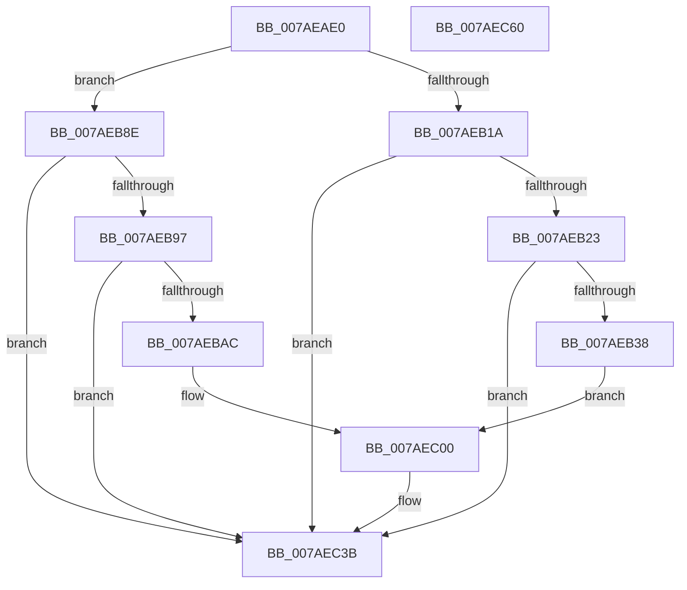

# VmpLogSplitMergeMemoryRange

- RVA: `0x007AEAE0`–`0x007AEC61` (길이 `385` bytes)
- VA: `0x00000001407AEAE0`
- 실행 섹션: `PAGE`
- PDB 이름 있음: `예`; PDB Function 태그: `아니요`
- unwind 정보 RVA: `0x000D2EE8`
- 디코드: `93`개 명령, `385/385` bytes 표시
- 미해석 바이트: `0` (있으면 어셈블리에 `.byte`로 보존)

> 이 문서는 커널 이미지의 기계어와 PDB 기호를 분석해 생성했습니다. 4번과 5번은 함수 원형과 자료형을 바이너리 사용 방식에서 추정한 C 해석이며 원본 소스 복구 결과는 아닙니다.

## 1. Dependencies

- 직접 호출 지점: **6**; 고유 호출 대상: **4**
- 직접 호출자로 확인된 함수: **2**
- RIP 상대 이미지 참조: **4**

### Outgoing calls
- `0x007AEB2B` → [tlgKeywordOn](../../text/42/tlgKeywordOn_function_0042EAA0.md) (function, `0x0042EAA0`)
- `0x007AEB48` → [PsGetProcessId](../../text/43/PsGetProcessId_function_0043D910.md) (function, `0x0043D910`)
- `0x007AEB9F` → [tlgKeywordOn](../../text/42/tlgKeywordOn_function_0042EAA0.md) (function, `0x0042EAA0`)
- `0x007AEBBC` → [PsGetProcessId](../../text/43/PsGetProcessId_function_0043D910.md) (function, `0x0043D910`)
- `0x007AEC36` → [tlgWriteEx_EtwWriteEx](../../text/4A/tlgWriteEx_EtwWriteEx_function_004AA348.md) (function, `0x004AA348`)
- `0x007AEC42` → [_security_check_cookie](../../text/6A/_security_check_cookie_function_006AC640.md) (function, `0x006AC640`)

### Direct callers
- [VmSplitMemoryRange](../A9/VmSplitMemoryRange_function_00A922A0.md) at `0x00A9237A`
- [VmMergeMemoryRanges](../A9/VmMergeMemoryRanges_function_00A94AE0.md) at `0x00A94B80`

### Static image references
- `0x007AEAFB` → RVA `0x00E0A740` (`.data`; read)
- `0x007AEB09` → RVA `0x00F02458` (`.data`; read)
- `0x007AEB60` → RVA `0x00053471` (`.rdata`; read)
- `0x007AEBD4` → RVA `0x00053A81` (`.rdata`; read)

## 2. Other-region calls and transfers

- 다른 실행 섹션으로 향하는 call: **6**
  - `0x007AEB2B` → [tlgKeywordOn](../../text/42/tlgKeywordOn_function_0042EAA0.md) (`PAGE` → `.text`)
  - `0x007AEB48` → [PsGetProcessId](../../text/43/PsGetProcessId_function_0043D910.md) (`PAGE` → `.text`)
  - `0x007AEB9F` → [tlgKeywordOn](../../text/42/tlgKeywordOn_function_0042EAA0.md) (`PAGE` → `.text`)
  - `0x007AEBBC` → [PsGetProcessId](../../text/43/PsGetProcessId_function_0043D910.md) (`PAGE` → `.text`)
  - `0x007AEC36` → [tlgWriteEx_EtwWriteEx](../../text/4A/tlgWriteEx_EtwWriteEx_function_004AA348.md) (`PAGE` → `.text`)
  - `0x007AEC42` → [_security_check_cookie](../../text/6A/_security_check_cookie_function_006AC640.md) (`PAGE` → `.text`)
- 별도 외부 분기/꼬리 이동을 확인하지 못했습니다.

## 3. Assembly (complete function range)

```asm
007AEAE0  48 8B C4                        mov rax, rsp
007AEAE3  48 89 58 08                     mov qword ptr [rax + 8], rbx
007AEAE7  48 89 70 10                     mov qword ptr [rax + 0x10], rsi
007AEAEB  48 89 78 18                     mov qword ptr [rax + 0x18], rdi
007AEAEF  55                              push rbp
007AEAF0  48 8D 68 A9                     lea rbp, [rax - 0x57]
007AEAF4  48 81 EC D0 00 00 00            sub rsp, 0xd0
007AEAFB  48 8B 05 3E BC 65 00            mov rax, qword ptr [rip + 0x65bc3e]
007AEB02  48 33 C4                        xor rax, rsp
007AEB05  48 89 45 3F                     mov qword ptr [rbp + 0x3f], rax
007AEB09  48 8B 1D 48 39 75 00            mov rbx, qword ptr [rip + 0x753948]
007AEB10  49 8B F9                        mov rdi, r9
007AEB13  49 8B F0                        mov rsi, r8
007AEB16  85 D2                           test edx, edx
007AEB18  74 74                           je 0x1407aeb8e
007AEB1A  83 3B 05                        cmp dword ptr [rbx], 5
007AEB1D  0F 86 18 01 00 00               jbe 0x1407aec3b
007AEB23  BA 80 00 00 00                  mov edx, 0x80
007AEB28  48 8B CB                        mov rcx, rbx
007AEB2B  E8 70 FF C7 FF                  call 0x14042eaa0
007AEB30  84 C0                           test al, al
007AEB32  0F 84 03 01 00 00               je 0x1407aec3b
007AEB38  65 48 8B 0C 25 88 01 00 00      mov rcx, qword ptr gs:[0x188]
007AEB41  48 8B 89 B8 00 00 00            mov rcx, qword ptr [rcx + 0xb8]
007AEB48  E8 C3 ED C8 FF                  call 0x14043d910
007AEB4D  89 45 BF                        mov dword ptr [rbp - 0x41], eax
007AEB50  48 8D 55 CF                     lea rdx, [rbp - 0x31]
007AEB54  48 8D 45 BF                     lea rax, [rbp - 0x41]
007AEB58  48 89 55 1F                     mov qword ptr [rbp + 0x1f], rdx
007AEB5C  48 89 45 FF                     mov qword ptr [rbp - 1], rax
007AEB60  48 8D 15 0A 49 8A FF            lea rdx, [rip - 0x75b6f6]
007AEB67  48 8D 45 C7                     lea rax, [rbp - 0x39]
007AEB6B  48 89 75 C7                     mov qword ptr [rbp - 0x39], rsi
007AEB6F  48 89 45 0F                     mov qword ptr [rbp + 0xf], rax
007AEB73  B8 08 00 00 00                  mov eax, 8
007AEB78  89 45 17                        mov dword ptr [rbp + 0x17], eax
007AEB7B  89 45 27                        mov dword ptr [rbp + 0x27], eax
007AEB7E  8B 45 7F                        mov eax, dword ptr [rbp + 0x7f]
007AEB81  89 45 C3                        mov dword ptr [rbp - 0x3d], eax
007AEB84  48 8D 45 C3                     lea rax, [rbp - 0x3d]
007AEB88  48 89 7D CF                     mov qword ptr [rbp - 0x31], rdi
007AEB8C  EB 72                           jmp 0x1407aec00
007AEB8E  83 3B 05                        cmp dword ptr [rbx], 5
007AEB91  0F 86 A4 00 00 00               jbe 0x1407aec3b
007AEB97  BA 80 00 00 00                  mov edx, 0x80
007AEB9C  48 8B CB                        mov rcx, rbx
007AEB9F  E8 FC FE C7 FF                  call 0x14042eaa0
007AEBA4  84 C0                           test al, al
007AEBA6  0F 84 8F 00 00 00               je 0x1407aec3b
007AEBAC  65 48 8B 0C 25 88 01 00 00      mov rcx, qword ptr gs:[0x188]
007AEBB5  48 8B 89 B8 00 00 00            mov rcx, qword ptr [rcx + 0xb8]
007AEBBC  E8 4F ED C8 FF                  call 0x14043d910
007AEBC1  89 45 C3                        mov dword ptr [rbp - 0x3d], eax
007AEBC4  48 8D 55 C7                     lea rdx, [rbp - 0x39]
007AEBC8  48 8D 45 C3                     lea rax, [rbp - 0x3d]
007AEBCC  48 89 55 1F                     mov qword ptr [rbp + 0x1f], rdx
007AEBD0  48 89 45 FF                     mov qword ptr [rbp - 1], rax
007AEBD4  48 8D 15 A6 4E 8A FF            lea rdx, [rip - 0x75b15a]
007AEBDB  48 8D 45 CF                     lea rax, [rbp - 0x31]
007AEBDF  48 89 75 CF                     mov qword ptr [rbp - 0x31], rsi
007AEBE3  48 89 45 0F                     mov qword ptr [rbp + 0xf], rax
007AEBE7  B8 08 00 00 00                  mov eax, 8
007AEBEC  89 45 17                        mov dword ptr [rbp + 0x17], eax
007AEBEF  89 45 27                        mov dword ptr [rbp + 0x27], eax
007AEBF2  8B 45 7F                        mov eax, dword ptr [rbp + 0x7f]
007AEBF5  89 45 BF                        mov dword ptr [rbp - 0x41], eax
007AEBF8  48 8D 45 BF                     lea rax, [rbp - 0x41]
007AEBFC  48 89 7D C7                     mov qword ptr [rbp - 0x39], rdi
007AEC00  83 65 0B 00                     and dword ptr [rbp + 0xb], 0
007AEC04  B9 04 00 00 00                  mov ecx, 4
007AEC09  83 65 1B 00                     and dword ptr [rbp + 0x1b], 0
007AEC0D  45 33 C9                        xor r9d, r9d
007AEC10  83 65 2B 00                     and dword ptr [rbp + 0x2b], 0
007AEC14  83 65 3B 00                     and dword ptr [rbp + 0x3b], 0
007AEC18  48 89 45 2F                     mov qword ptr [rbp + 0x2f], rax
007AEC1C  48 8D 45 DF                     lea rax, [rbp - 0x21]
007AEC20  89 4D 07                        mov dword ptr [rbp + 7], ecx
007AEC23  89 4D 37                        mov dword ptr [rbp + 0x37], ecx
007AEC26  48 8B CB                        mov rcx, rbx
007AEC29  48 89 44 24 38                  mov qword ptr [rsp + 0x38], rax
007AEC2E  C7 44 24 30 06 00 00 00         mov dword ptr [rsp + 0x30], 6
007AEC36  E8 0D B7 CF FF                  call 0x1404aa348
007AEC3B  48 8B 4D 3F                     mov rcx, qword ptr [rbp + 0x3f]
007AEC3F  48 33 CC                        xor rcx, rsp
007AEC42  E8 F9 D9 EF FF                  call 0x1406ac640
007AEC47  4C 8D 9C 24 D0 00 00 00         lea r11, [rsp + 0xd0]
007AEC4F  49 8B 5B 10                     mov rbx, qword ptr [r11 + 0x10]
007AEC53  49 8B 73 18                     mov rsi, qword ptr [r11 + 0x18]
007AEC57  49 8B 7B 20                     mov rdi, qword ptr [r11 + 0x20]
007AEC5B  49 8B E3                        mov rsp, r11
007AEC5E  5D                              pop rbp
007AEC5F  C3                              ret
007AEC60  CC                              int3
```

## 4. C-style interpretation (structured pseudocode)

```c
__int64 __fastcall VmpLogSplitMergeMemoryRange(__int64 a1, int a2, __int64 a3, __int64 a4)
{
    __int64 result;
    __int64 v_rsp;
    unsigned __int64 v_stack_m8;
    unsigned __int64 v_stack_mA0;
    unsigned int v_stack_mA8;

    *(unsigned __int64 *)(v_rsp + 8) = v_rbx;
    *(unsigned __int64 *)(v_rsp + 16) = v_rsi;
    *(unsigned __int64 *)(v_rsp + 24) = v_rdi;
    v_rsp = (v_rsp) - (208);
    result = (*(unsigned __int64 *)(v_rip + 6667326)) ^ (v_rsp);
    *(unsigned __int64 *)(v_rsp - 87 + 63) = result;
    if (a2 == 0) goto loc_007AEB8E;
    if ((*(unsigned int *)(*(unsigned __int64 *)(v_rip + 7682376))) <= 5) goto loc_007AEC3B;
    result = tlgKeywordOn(*(unsigned __int64 *)(v_rip + 7682376), 128, a3, a4);
    if ((unsigned __int8)(result) == 0) goto loc_007AEC3B;
    result = PsGetProcessId(*(unsigned __int64 *)(*(unsigned __int64 *)(gs_base + (0 + 392)) + 184), 128, a3, a4);
    *(unsigned int *)(v_rsp - 87 - 65) = (unsigned int)(result);
    *(unsigned __int64 *)(v_rsp - 87 + 31) = v_rsp - 87 - 49;
    *(unsigned __int64 *)(v_rsp - 87 - 1) = v_rsp - 87 - 65;
    *(unsigned __int64 *)(v_rsp - 87 - 57) = a3;
    *(unsigned __int64 *)(v_rsp - 87 + 15) = v_rsp - 87 - 57;
    *(unsigned int *)(v_rsp - 87 + 23) = 8;
    *(unsigned int *)(v_rsp - 87 + 39) = 8;
    *(unsigned int *)(v_rsp - 87 - 61) = (unsigned int)((unsigned int)(*(unsigned int *)(v_rsp - 87 + 127)));
    *(unsigned __int64 *)(v_rsp - 87 - 49) = a4;
    goto loc_007AEC00;
loc_007AEB8E:
    if ((*(unsigned int *)(*(unsigned __int64 *)(v_rip + 7682376))) <= 5) goto loc_007AEC3B;
    result = tlgKeywordOn(*(unsigned __int64 *)(v_rip + 7682376), 128, a3, a4);
    if ((unsigned __int8)(result) == 0) goto loc_007AEC3B;
    result = PsGetProcessId(*(unsigned __int64 *)(*(unsigned __int64 *)(gs_base + (0 + 392)) + 184), 128, a3, a4);
    *(unsigned int *)(v_rsp - 87 - 61) = (unsigned int)(result);
    *(unsigned __int64 *)(v_rsp - 87 + 31) = v_rsp - 87 - 57;
    *(unsigned __int64 *)(v_rsp - 87 - 1) = v_rsp - 87 - 61;
    *(unsigned __int64 *)(v_rsp - 87 - 49) = a3;
    *(unsigned __int64 *)(v_rsp - 87 + 15) = v_rsp - 87 - 49;
    *(unsigned int *)(v_rsp - 87 + 23) = 8;
    *(unsigned int *)(v_rsp - 87 + 39) = 8;
    *(unsigned int *)(v_rsp - 87 - 65) = (unsigned int)((unsigned int)(*(unsigned int *)(v_rsp - 87 + 127)));
    *(unsigned __int64 *)(v_rsp - 87 - 57) = a4;
loc_007AEC00:
    a4 = 0;
    *(unsigned __int64 *)(v_rsp - 87 + 47) = v_rsp - 87 - 65;
    *(unsigned int *)(v_rsp - 87 + 7) = 4;
    *(unsigned int *)(v_rsp - 87 + 55) = 4;
    v_stack_mA0 = v_rsp - 87 - 33;
    v_stack_mA8 = 6;
    result = tlgWriteEx_EtwWriteEx(*(unsigned __int64 *)(v_rip + 7682376), v_rip - 7713114, a3, a4);
loc_007AEC3B:
    a1 = (*(unsigned __int64 *)(v_rsp - 87 + 63)) ^ (v_rsp);
    result = _security_check_cookie(a1, v_rip - 7713114, a3, a4);
    return result;
}
```

## 5. (Beta) C Style

```c
int64_t VmpLogSplitMergeMemoryRange(int64_t Arg1, int32_t Arg2, int64_t Arg3, int64_t Arg4)
{
    int64_t result;
    int64_t local_rsp;
    uint64_t v_stack_m8;
    uint64_t v_stack_mA0;
    uint32_t v_stack_mA8;

    *(uint64_t *)(local_rsp + 0x8) = local_rbx;
    *(uint64_t *)(local_rsp + 0x10) = local_rsi;
    *(uint64_t *)(local_rsp + 0x18) = local_rdi;
    local_rsp = (local_rsp) - (208);
    result = (*(uint64_t *)(v_rip + 0x65BC3E)) ^ (local_rsp);
    *(uint64_t *)(local_rsp - 0x57 + 0x3F) = result;
    if (Arg2 == 0) goto loc_007AEB8E;
    if ((*(uint32_t *)(*(uint64_t *)(v_rip + 0x753948))) <= 5) goto loc_007AEC3B;
    result = tlgKeywordOn(*(uint64_t *)(v_rip + 0x753948), 128, Arg3, Arg4);
    if ((uint8_t)(result) == 0) goto loc_007AEC3B;
    result = PsGetProcessId(*(uint64_t *)(*(uint64_t *)(gs_base + (0 + 0x188)) + 0xB8), 128, Arg3, Arg4);
    *(uint32_t *)(local_rsp - 0x57 - 0x41) = (uint32_t)(result);
    *(uint64_t *)(local_rsp - 0x57 + 0x1F) = local_rsp - 87 - 49;
    *(uint64_t *)(local_rsp - 0x57 - 0x1) = local_rsp - 87 - 65;
    *(uint64_t *)(local_rsp - 0x57 - 0x39) = Arg3;
    *(uint64_t *)(local_rsp - 0x57 + 0xF) = local_rsp - 87 - 57;
    *(uint32_t *)(local_rsp - 0x57 + 0x17) = 8;
    *(uint32_t *)(local_rsp - 0x57 + 0x27) = 8;
    *(uint32_t *)(local_rsp - 0x57 - 0x3D) = (uint32_t)((uint32_t)(*(uint32_t *)(local_rsp - 0x57 + 0x7F)));
    *(uint64_t *)(local_rsp - 0x57 - 0x31) = Arg4;
    goto loc_007AEC00;
loc_007AEB8E:
    if ((*(uint32_t *)(*(uint64_t *)(v_rip + 0x753948))) <= 5) goto loc_007AEC3B;
    result = tlgKeywordOn(*(uint64_t *)(v_rip + 0x753948), 128, Arg3, Arg4);
    if ((uint8_t)(result) == 0) goto loc_007AEC3B;
    result = PsGetProcessId(*(uint64_t *)(*(uint64_t *)(gs_base + (0 + 0x188)) + 0xB8), 128, Arg3, Arg4);
    *(uint32_t *)(local_rsp - 0x57 - 0x3D) = (uint32_t)(result);
    *(uint64_t *)(local_rsp - 0x57 + 0x1F) = local_rsp - 87 - 57;
    *(uint64_t *)(local_rsp - 0x57 - 0x1) = local_rsp - 87 - 61;
    *(uint64_t *)(local_rsp - 0x57 - 0x31) = Arg3;
    *(uint64_t *)(local_rsp - 0x57 + 0xF) = local_rsp - 87 - 49;
    *(uint32_t *)(local_rsp - 0x57 + 0x17) = 8;
    *(uint32_t *)(local_rsp - 0x57 + 0x27) = 8;
    *(uint32_t *)(local_rsp - 0x57 - 0x41) = (uint32_t)((uint32_t)(*(uint32_t *)(local_rsp - 0x57 + 0x7F)));
    *(uint64_t *)(local_rsp - 0x57 - 0x39) = Arg4;
loc_007AEC00:
    Arg4 = 0;
    *(uint64_t *)(local_rsp - 0x57 + 0x2F) = local_rsp - 87 - 65;
    *(uint32_t *)(local_rsp - 0x57 + 0x7) = 4;
    *(uint32_t *)(local_rsp - 0x57 + 0x37) = 4;
    v_stack_mA0 = local_rsp - 87 - 33;
    v_stack_mA8 = 6;
    result = tlgWriteEx_EtwWriteEx(*(uint64_t *)(v_rip + 0x753948), v_rip - 7713114, Arg3, Arg4);
loc_007AEC3B:
    Arg1 = (*(uint64_t *)(local_rsp - 0x57 + 0x3F)) ^ (local_rsp);
    result = _security_check_cookie(Arg1, v_rip - 7713114, Arg3, Arg4);
    return result;
}
```

## 6. Execution-region graph

[열기: 2D/3D 그래프와 함수 탐색 컨트롤 패널](../../../control-panel.html?section=page&rva=0x007AEAE0&view=graph)

- 2D 그래프는 위에서 아래로 흐르고, 3D 그래프는 빈 공간을 드래그해 회전합니다. Shift+드래그는 이동, 휠은 확대·축소, 함수 노드 선택은 대상 보고서 이동입니다.

### Static fallback


