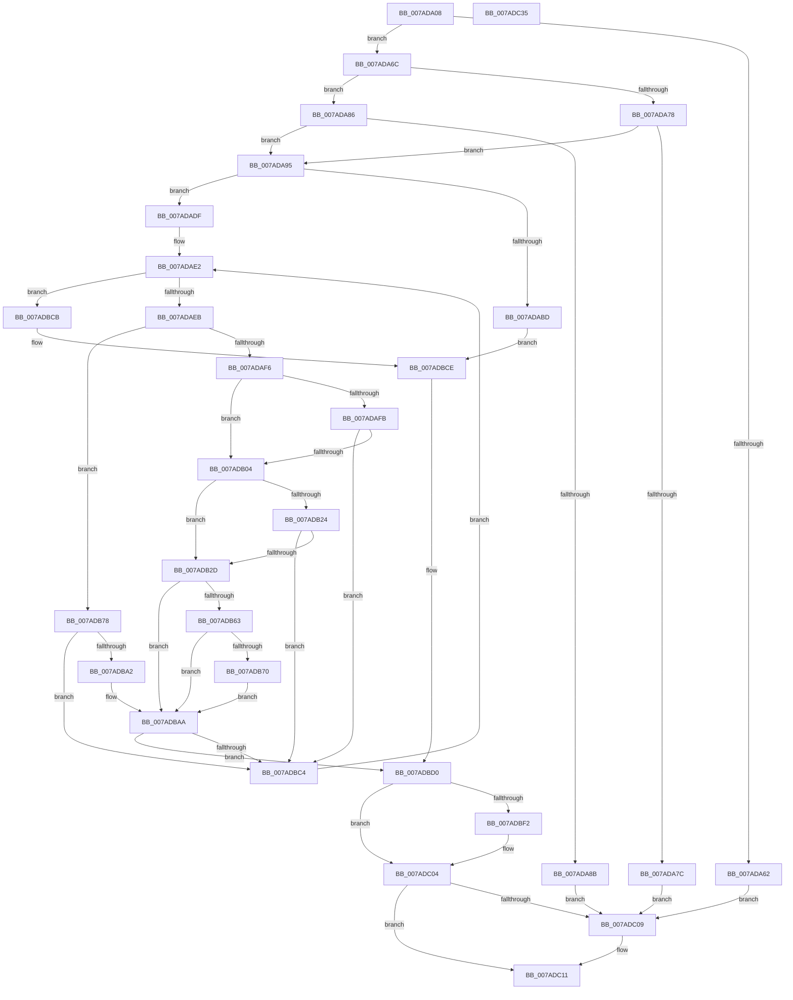

# VmpPauseResumeNotify

- RVA: `0x007ADA08`–`0x007ADC36` (길이 `558` bytes)
- VA: `0x00000001407ADA08`
- 실행 섹션: `PAGE`
- PDB 이름 있음: `예`; PDB Function 태그: `아니요`
- unwind 정보 RVA: `0x000D2DF0`
- 디코드: `144`개 명령, `558/558` bytes 표시
- 미해석 바이트: `0` (있으면 어셈블리에 `.byte`로 보존)

> 이 문서는 커널 이미지의 기계어와 PDB 기호를 분석해 생성했습니다. 4번과 5번은 함수 원형과 자료형을 바이너리 사용 방식에서 추정한 C 해석이며 원본 소스 복구 결과는 아닙니다.

## 1. Dependencies

- 직접 호출 지점: **9**; 고유 호출 대상: **6**
- 직접 호출자로 확인된 함수: **1**
- RIP 상대 이미지 참조: **1**

### Outgoing calls
- `0x007ADA52` → [FsRtlAcquirePushLockExclusive](../../text/4A/FsRtlAcquirePushLockExclusive_function_004A05F4.md) (function, `0x004A05F4`)
- `0x007ADAA2` → [PfLockExclusiveRelease](../../text/49/PfLockExclusiveRelease_function_00491D88.md) (function, `0x00491D88`)
- `0x007ADAD2` → [MmProcessWorkingSetControl](../A6/MmProcessWorkingSetControl_function_00A616C4.md) (function, `0x00A616C4`)
- `0x007ADB14` → [MiGetProcessPartition](../../text/44/MiGetProcessPartition_function_00443B10.md) (function, `0x00443B10`)
- `0x007ADB5A` → [SmStoreExistsForProcess](../../text/34/SmStoreExistsForProcess_function_00349F54.md) (function, `0x00349F54`)
- `0x007ADBB9` → [MmProcessWorkingSetControl](../A6/MmProcessWorkingSetControl_function_00A616C4.md) (function, `0x00A616C4`)
- `0x007ADBD6` → [FsRtlAcquirePushLockExclusive](../../text/4A/FsRtlAcquirePushLockExclusive_function_004A05F4.md) (function, `0x004A05F4`)
- `0x007ADC0C` → [PfLockExclusiveRelease](../../text/49/PfLockExclusiveRelease_function_00491D88.md) (function, `0x00491D88`)
- `0x007ADC11` → [KeLeaveCriticalRegion](../../text/25/KeLeaveCriticalRegion_function_0025D8B0.md) (function, `0x0025D8B0`)

### Direct callers
- [VmPauseResumeNotify](VmPauseResumeNotify_function_007AD410.md) at `0x007AD43D`

### Static image references
- `0x007ADB8F` → RVA `0x00FC52F8` (`ALMOSTRO`; read)

## 2. Other-region calls and transfers

- 다른 실행 섹션으로 향하는 call: **7**
  - `0x007ADA52` → [FsRtlAcquirePushLockExclusive](../../text/4A/FsRtlAcquirePushLockExclusive_function_004A05F4.md) (`PAGE` → `.text`)
  - `0x007ADAA2` → [PfLockExclusiveRelease](../../text/49/PfLockExclusiveRelease_function_00491D88.md) (`PAGE` → `.text`)
  - `0x007ADB14` → [MiGetProcessPartition](../../text/44/MiGetProcessPartition_function_00443B10.md) (`PAGE` → `.text`)
  - `0x007ADB5A` → [SmStoreExistsForProcess](../../text/34/SmStoreExistsForProcess_function_00349F54.md) (`PAGE` → `.text`)
  - `0x007ADBD6` → [FsRtlAcquirePushLockExclusive](../../text/4A/FsRtlAcquirePushLockExclusive_function_004A05F4.md) (`PAGE` → `.text`)
  - `0x007ADC0C` → [PfLockExclusiveRelease](../../text/49/PfLockExclusiveRelease_function_00491D88.md) (`PAGE` → `.text`)
  - `0x007ADC11` → [KeLeaveCriticalRegion](../../text/25/KeLeaveCriticalRegion_function_0025D8B0.md) (`PAGE` → `.text`)
- 별도 외부 분기/꼬리 이동을 확인하지 못했습니다.

## 3. Assembly (complete function range)

```asm
007ADA08  48 89 5C 24 08                  mov qword ptr [rsp + 8], rbx
007ADA0D  48 89 74 24 10                  mov qword ptr [rsp + 0x10], rsi
007ADA12  48 89 7C 24 18                  mov qword ptr [rsp + 0x18], rdi
007ADA17  55                              push rbp
007ADA18  41 54                           push r12
007ADA1A  41 55                           push r13
007ADA1C  41 56                           push r14
007ADA1E  41 57                           push r15
007ADA20  48 8B EC                        mov rbp, rsp
007ADA23  48 83 EC 30                     sub rsp, 0x30
007ADA27  65 48 8B 04 25 88 01 00 00      mov rax, qword ptr gs:[0x188]
007ADA30  4C 8D A9 90 00 00 00            lea r13, [rcx + 0x90]
007ADA37  4C 8B F9                        mov r15, rcx
007ADA3A  48 83 CE FF                     or rsi, 0xffffffffffffffff
007ADA3E  49 8B CD                        mov rcx, r13
007ADA41  44 8B F2                        mov r14d, edx
007ADA44  41 BC 04 00 00 00               mov r12d, 4
007ADA4A  66 01 B0 E4 01 00 00            add word ptr [rax + 0x1e4], si
007ADA51  90                              nop
007ADA52  E8 9D 2B CF FF                  call 0x1404a05f4
007ADA57  41 8B 87 98 00 00 00            mov eax, dword ptr [r15 + 0x98]
007ADA5E  A8 01                           test al, 1
007ADA60  74 0A                           je 0x1407ada6c
007ADA62  BF 76 04 00 C0                  mov edi, 0xc0000476
007ADA67  E9 9D 01 00 00                  jmp 0x1407adc09
007ADA6C  8B F8                           mov edi, eax
007ADA6E  D1 EF                           shr edi, 1
007ADA70  83 E7 03                        and edi, 3
007ADA73  45 85 F6                        test r14d, r14d
007ADA76  75 0E                           jne 0x1407ada86
007ADA78  85 FF                           test edi, edi
007ADA7A  75 19                           jne 0x1407ada95
007ADA7C  BF 34 00 19 40                  mov edi, 0x40190034
007ADA81  E9 83 01 00 00                  jmp 0x1407adc09
007ADA86  41 3B FE                        cmp edi, r14d
007ADA89  7C 0A                           jl 0x1407ada95
007ADA8B  BF 0D 00 00 C0                  mov edi, 0xc000000d
007ADA90  E9 74 01 00 00                  jmp 0x1407adc09
007ADA95  83 C8 01                        or eax, 1
007ADA98  49 8B CD                        mov rcx, r13
007ADA9B  41 89 87 98 00 00 00            mov dword ptr [r15 + 0x98], eax
007ADAA2  E8 E1 42 CE FF                  call 0x140491d88
007ADAA7  48 83 65 F4 00                  and qword ptr [rbp - 0xc], 0
007ADAAC  BB 06 00 00 00                  mov ebx, 6
007ADAB1  C7 45 F0 03 00 00 00            mov dword ptr [rbp - 0x10], 3
007ADAB8  45 85 F6                        test r14d, r14d
007ADABB  75 22                           jne 0x1407adadf
007ADABD  45 33 C9                        xor r9d, r9d
007ADAC0  C7 45 F8 01 00 00 00            mov dword ptr [rbp - 8], 1
007ADAC7  44 8D 43 06                     lea r8d, [rbx + 6]
007ADACB  48 8B CE                        mov rcx, rsi
007ADACE  48 8D 55 F0                     lea rdx, [rbp - 0x10]
007ADAD2  E8 ED 3B 2B 00                  call 0x140a616c4
007ADAD7  45 33 E4                        xor r12d, r12d
007ADADA  E9 EF 00 00 00                  jmp 0x1407adbce
007ADADF  8D 77 01                        lea esi, [rdi + 1]
007ADAE2  41 3B F6                        cmp esi, r14d
007ADAE5  0F 8F E0 00 00 00               jg 0x1407adbcb
007ADAEB  8B CE                           mov ecx, esi
007ADAED  83 E9 01                        sub ecx, 1
007ADAF0  0F 84 82 00 00 00               je 0x1407adb78
007ADAF6  83 E9 01                        sub ecx, 1
007ADAF9  74 09                           je 0x1407adb04
007ADAFB  83 F9 01                        cmp ecx, 1
007ADAFE  0F 85 C0 00 00 00               jne 0x1407adbc4
007ADB04  65 48 8B 0C 25 88 01 00 00      mov rcx, qword ptr gs:[0x188]
007ADB0D  48 8B 89 B8 00 00 00            mov rcx, qword ptr [rcx + 0xb8]
007ADB14  E8 F7 5F C9 FF                  call 0x140443b10
007ADB19  8B 80 B4 04 00 00               mov eax, dword ptr [rax + 0x4b4]
007ADB1F  83 F8 FF                        cmp eax, -1
007ADB22  75 09                           jne 0x1407adb2d
007ADB24  83 FE 03                        cmp esi, 3
007ADB27  0F 85 97 00 00 00               jne 0x1407adbc4
007ADB2D  41 F6 87 88 00 00 00 01         test byte ptr [r15 + 0x88], 1
007ADB35  BF 03 00 00 00                  mov edi, 3
007ADB3A  C7 45 F4 01 00 00 00            mov dword ptr [rbp - 0xc], 1
007ADB41  8D 47 20                        lea eax, [rdi + 0x20]
007ADB44  0F 45 F8                        cmovne edi, eax
007ADB47  65 48 8B 04 25 88 01 00 00      mov rax, qword ptr gs:[0x188]
007ADB50  89 7D F8                        mov dword ptr [rbp - 8], edi
007ADB53  48 8B 88 B8 00 00 00            mov rcx, qword ptr [rax + 0xb8]
007ADB5A  E8 F5 C3 B9 FF                  call 0x140349f54
007ADB5F  85 C0                           test eax, eax
007ADB61  74 47                           je 0x1407adbaa
007ADB63  8B C7                           mov eax, edi
007ADB65  83 C8 08                        or eax, 8
007ADB68  89 45 F8                        mov dword ptr [rbp - 8], eax
007ADB6B  83 FE 03                        cmp esi, 3
007ADB6E  75 3A                           jne 0x1407adbaa
007ADB70  83 CF 18                        or edi, 0x18
007ADB73  89 7D F8                        mov dword ptr [rbp - 8], edi
007ADB76  EB 32                           jmp 0x1407adbaa
007ADB78  65 48 8B 04 25 88 01 00 00      mov rax, qword ptr gs:[0x188]
007ADB81  48 8B 88 B8 00 00 00            mov rcx, qword ptr [rax + 0xb8]
007ADB88  48 8B 91 88 04 00 00            mov rdx, qword ptr [rcx + 0x488]
007ADB8F  8B 05 63 77 81 00               mov eax, dword ptr [rip + 0x817763]
007ADB95  48 C1 E2 0C                     shl rdx, 0xc
007ADB99  48 C1 EA 14                     shr rdx, 0x14
007ADB9D  48 3B D0                        cmp rdx, rax
007ADBA0  77 22                           ja 0x1407adbc4
007ADBA2  83 65 F4 00                     and dword ptr [rbp - 0xc], 0
007ADBA6  83 65 F8 00                     and dword ptr [rbp - 8], 0
007ADBAA  45 33 C9                        xor r9d, r9d
007ADBAD  48 8D 55 F0                     lea rdx, [rbp - 0x10]
007ADBB1  48 83 C9 FF                     or rcx, 0xffffffffffffffff
007ADBB5  45 8D 41 0C                     lea r8d, [r9 + 0xc]
007ADBB9  E8 06 3B 2B 00                  call 0x140a616c4
007ADBBE  8B F8                           mov edi, eax
007ADBC0  85 C0                           test eax, eax
007ADBC2  78 0C                           js 0x1407adbd0
007ADBC4  FF C6                           inc esi
007ADBC6  E9 17 FF FF FF                  jmp 0x1407adae2
007ADBCB  45 8B E6                        mov r12d, r14d
007ADBCE  33 FF                           xor edi, edi
007ADBD0  49 8B CD                        mov rcx, r13
007ADBD3  83 CB 01                        or ebx, 1
007ADBD6  E8 19 2A CF FF                  call 0x1404a05f4
007ADBDB  41 8B 97 98 00 00 00            mov edx, dword ptr [r15 + 0x98]
007ADBE2  83 E2 FE                        and edx, 0xfffffffe
007ADBE5  41 89 97 98 00 00 00            mov dword ptr [r15 + 0x98], edx
007ADBEC  41 83 FC 04                     cmp r12d, 4
007ADBF0  74 12                           je 0x1407adc04
007ADBF2  43 8D 04 24                     lea eax, [r12 + r12]
007ADBF6  33 C2                           xor eax, edx
007ADBF8  83 E0 06                        and eax, 6
007ADBFB  33 C2                           xor eax, edx
007ADBFD  41 89 87 98 00 00 00            mov dword ptr [r15 + 0x98], eax
007ADC04  F6 C3 01                        test bl, 1
007ADC07  74 08                           je 0x1407adc11
007ADC09  49 8B CD                        mov rcx, r13
007ADC0C  E8 77 41 CE FF                  call 0x140491d88
007ADC11  E8 9A FC AA FF                  call 0x14025d8b0
007ADC16  48 8B 5C 24 60                  mov rbx, qword ptr [rsp + 0x60]
007ADC1B  8B C7                           mov eax, edi
007ADC1D  48 8B 7C 24 70                  mov rdi, qword ptr [rsp + 0x70]
007ADC22  48 8B 74 24 68                  mov rsi, qword ptr [rsp + 0x68]
007ADC27  48 83 C4 30                     add rsp, 0x30
007ADC2B  41 5F                           pop r15
007ADC2D  41 5E                           pop r14
007ADC2F  41 5D                           pop r13
007ADC31  41 5C                           pop r12
007ADC33  5D                              pop rbp
007ADC34  C3                              ret
007ADC35  CC                              int3
```

## 4. C-style interpretation (structured pseudocode)

```c
__int64 __fastcall VmpPauseResumeNotify(__int64 a1, int a2, __int64 a3, int a4)
{
    __int64 result;
    __int64 v_r12;
    __int64 v_rbx;
    __int64 v_rdi;
    __int64 v_rsi;
    __int64 v_rsp;
    unsigned int v_stack_m30;
    unsigned __int64 v_stack_m34;
    unsigned int v_stack_m38;
    unsigned __int64 v_stack_p10;
    unsigned __int64 v_stack_p18;
    unsigned __int64 v_stack_p8;

    v_stack_p8 = v_rbx;
    v_stack_p10 = v_rsi;
    v_stack_p18 = v_rdi;
    v_rsp = (v_rsp) - (48);
    v_rsi = (v_rsi) | (-1);
    result = FsRtlAcquirePushLockExclusive(a1 + 144, a2, a3, a4);
    if ((((unsigned __int8)((unsigned int)(*(unsigned int *)(a1 + 152)))) & (1)) == 0) goto loc_007ADA6C;
    goto loc_007ADC09;
loc_007ADA6C:
    v_rdi = (unsigned int)(((unsigned int)((unsigned int)((unsigned int)(*(unsigned int *)(a1 + 152))))) >> (1));
    v_rdi = (unsigned int)((v_rdi) & (3));
    if ((unsigned int)((unsigned int)(a2)) != 0) goto loc_007ADA86;
    if ((unsigned int)(v_rdi) != 0) goto loc_007ADA95;
    goto loc_007ADC09;
loc_007ADA86:
    if (((unsigned int)((unsigned int)(0x40190034ULL))) < ((unsigned int)((unsigned int)(a2)))) goto loc_007ADA95;
    goto loc_007ADC09;
loc_007ADA95:
    result = (unsigned int)(((unsigned int)(*(unsigned int *)(a1 + 152))) | (1));
    *(unsigned int *)(a1 + 152) = (unsigned int)(result);
    result = PfLockExclusiveRelease(a1 + 144, a2, a3, a4);
    v_stack_m38 = 3;
    if ((unsigned int)((unsigned int)(a2)) != 0) goto loc_007ADADF;
    a4 = 0;
    v_stack_m30 = 1;
    result = MmProcessWorkingSetControl(v_rsi, v_stack_m38, 6 + 6, a4);
    v_r12 = 0;
    goto loc_007ADBCE;
loc_007ADADF:
loc_007ADAE2:
    if (((unsigned int)((unsigned int)(0xC000000DULL) + 1)) > ((unsigned int)((unsigned int)(a2)))) goto loc_007ADBCB;
    a1 = (unsigned int)(((unsigned int)((unsigned int)((unsigned int)(0xC000000DULL) + 1))) - (1));
    if (condition_is_equal) goto loc_007ADB78;
    a1 = (unsigned int)((a1) - (1));
    if (condition_is_equal) goto loc_007ADB04;
    if (((unsigned int)(a1)) != 1) goto loc_007ADBC4;
loc_007ADB04:
    result = MiGetProcessPartition(*(unsigned __int64 *)(*(unsigned __int64 *)(gs_base + (0 + 392)) + 184), v_stack_m38, 6 + 6, a4);
    if (((unsigned int)((unsigned int)(*(unsigned int *)(result + 1204)))) != -1) goto loc_007ADB2D;
    if (((unsigned int)((unsigned int)(0xC000000DULL) + 1)) != 3) goto loc_007ADBC4;
loc_007ADB2D:
    v_stack_m34 = 1;
    v_rdi = 3;
    if (((*(unsigned __int8 *)(a1 + 136)) & (1)) != 0) { v_rdi = (unsigned int)(3 + 32); }
    v_stack_m30 = (unsigned int)(v_rdi);
    result = SmStoreExistsForProcess(*(unsigned __int64 *)(*(unsigned __int64 *)(gs_base + (0 + 392)) + 184), v_stack_m38, 6 + 6, a4);
    if ((unsigned int)(result) == 0) goto loc_007ADBAA;
    result = (unsigned int)(((unsigned int)((unsigned int)(v_rdi))) | (8));
    v_stack_m30 = (unsigned int)(result);
    if (((unsigned int)((unsigned int)(0xC000000DULL) + 1)) != 3) goto loc_007ADBAA;
    v_rdi = (unsigned int)((v_rdi) | (24));
    v_stack_m30 = (unsigned int)(v_rdi);
    goto loc_007ADBAA;
loc_007ADB78:
    a2 = (*(unsigned __int64 *)(*(unsigned __int64 *)(*(unsigned __int64 *)(gs_base + (0 + 392)) + 184) + 1160)) << (12);
    a2 = (a2) >> (20);
    if (a2 > ((unsigned int)(*(unsigned int *)(v_rip + 8484707)))) goto loc_007ADBC4;
loc_007ADBAA:
    a4 = 0;
    a1 = (*(unsigned __int64 *)(*(unsigned __int64 *)(gs_base + (0 + 392)) + 184)) | (-1);
    result = MmProcessWorkingSetControl(a1, v_stack_m38, a4 + 12, a4);
    if (sign_flag) goto loc_007ADBD0;
loc_007ADBC4:
    v_rsi = (unsigned int)(((unsigned int)(0xC000000DULL) + 1) + 1);
    goto loc_007ADAE2;
loc_007ADBCB:
loc_007ADBCE:
    v_rdi = 0;
loc_007ADBD0:
    v_rbx = (unsigned int)((6) | (1));
    result = FsRtlAcquirePushLockExclusive(a1 + 144, v_stack_m38, a4 + 12, a4);
    a2 = (unsigned int)(((unsigned int)(*(unsigned int *)(a1 + 152))) & (0xFFFFFFFEULL));
    *(unsigned int *)(a1 + 152) = a2;
    if (((unsigned int)((unsigned int)((unsigned int)((unsigned int)(a2))))) != 4) {
        result = (unsigned int)((unsigned int)((unsigned int)(a2))) + (unsigned int)((unsigned int)((unsigned int)(a2))) * 1;
        result = (unsigned int)((result) ^ (a2));
        result = (unsigned int)((result) & (6));
        result = (unsigned int)((result) ^ (a2));
        *(unsigned int *)(a1 + 152) = (unsigned int)(result);
    }
    if ((((unsigned __int8)(v_rbx)) & (1)) != 0) {
        a1 = a1 + 144;
        result = PfLockExclusiveRelease(a1, a2, a4 + 12, a4);
    }
    result = KeLeaveCriticalRegion(a1, a2, a4 + 12, a4);
    v_rsp = (v_rsp) + (48);
    return 0;
}
```

## 5. (Beta) C Style

```c
int64_t VmpPauseResumeNotify(void *Arg1, int32_t Arg2, int64_t Arg3, int32_t Arg4)
{
    uint8_t *arg1 = (uint8_t *)Arg1;

    int64_t result;
    int64_t local_r12;
    int64_t local_rbx;
    int64_t local_rdi;
    int64_t local_rsi;
    int64_t local_rsp;
    uint32_t v_stack_m30;
    uint64_t v_stack_m34;
    uint32_t v_stack_m38;
    uint64_t v_stack_p10;
    uint64_t v_stack_p18;
    uint64_t v_stack_p8;

    v_stack_p8 = local_rbx;
    v_stack_p10 = local_rsi;
    v_stack_p18 = local_rdi;
    local_rsp = (local_rsp) - (48);
    local_rsi = (local_rsi) | (-1);
    result = FsRtlAcquirePushLockExclusive(Arg1 + 144, Arg2, Arg3, Arg4);
    if ((((uint8_t)((uint32_t)(*(uint32_t *)(arg1 + 0x98)))) & (1)) == 0) goto loc_007ADA6C;
    goto loc_007ADC09;
loc_007ADA6C:
    local_rdi = (uint32_t)(((uint32_t)((uint32_t)((uint32_t)(*(uint32_t *)(arg1 + 0x98))))) >> (1));
    local_rdi = (uint32_t)((local_rdi) & (3));
    if ((uint32_t)((uint32_t)(Arg2)) != 0) goto loc_007ADA86;
    if ((uint32_t)(local_rdi) != 0) goto loc_007ADA95;
    goto loc_007ADC09;
loc_007ADA86:
    if (((uint32_t)((uint32_t)(0x40190034ULL))) < ((uint32_t)((uint32_t)(Arg2)))) goto loc_007ADA95;
    goto loc_007ADC09;
loc_007ADA95:
    result = (uint32_t)(((uint32_t)(*(uint32_t *)(arg1 + 0x98))) | (1));
    *(uint32_t *)(arg1 + 0x98) = (uint32_t)(result);
    result = PfLockExclusiveRelease(Arg1 + 144, Arg2, Arg3, Arg4);
    v_stack_m38 = 3;
    if ((uint32_t)((uint32_t)(Arg2)) != 0) goto loc_007ADADF;
    Arg4 = 0;
    v_stack_m30 = 1;
    result = MmProcessWorkingSetControl(local_rsi, v_stack_m38, 6 + 6, Arg4);
    local_r12 = 0;
    goto loc_007ADBCE;
loc_007ADADF:
loc_007ADAE2:
    if (((uint32_t)((uint32_t)(0xC000000DULL) + 1)) > ((uint32_t)((uint32_t)(Arg2)))) goto loc_007ADBCB;
    Arg1 = (uint32_t)(((uint32_t)((uint32_t)((uint32_t)(0xC000000DULL) + 1))) - (1));
    if (condition_is_equal) goto loc_007ADB78;
    Arg1 = (uint32_t)((Arg1) - (1));
    if (condition_is_equal) goto loc_007ADB04;
    if (((uint32_t)(Arg1)) != 1) goto loc_007ADBC4;
loc_007ADB04:
    result = MiGetProcessPartition(*(uint64_t *)(*(uint64_t *)(gs_base + (0 + 0x188)) + 0xB8), v_stack_m38, 6 + 6, Arg4);
    if (((uint32_t)((uint32_t)(*(uint32_t *)(result + 0x4B4)))) != -1) goto loc_007ADB2D;
    if (((uint32_t)((uint32_t)(0xC000000DULL) + 1)) != 3) goto loc_007ADBC4;
loc_007ADB2D:
    v_stack_m34 = 1;
    local_rdi = 3;
    if (((*(uint8_t *)(arg1 + 0x88)) & (1)) != 0) { local_rdi = (uint32_t)(3 + 32); }
    v_stack_m30 = (uint32_t)(local_rdi);
    result = SmStoreExistsForProcess(*(uint64_t *)(*(uint64_t *)(gs_base + (0 + 0x188)) + 0xB8), v_stack_m38, 6 + 6, Arg4);
    if ((uint32_t)(result) == 0) goto loc_007ADBAA;
    result = (uint32_t)(((uint32_t)((uint32_t)(local_rdi))) | (8));
    v_stack_m30 = (uint32_t)(result);
    if (((uint32_t)((uint32_t)(0xC000000DULL) + 1)) != 3) goto loc_007ADBAA;
    local_rdi = (uint32_t)((local_rdi) | (24));
    v_stack_m30 = (uint32_t)(local_rdi);
    goto loc_007ADBAA;
loc_007ADB78:
    Arg2 = (*(uint64_t *)(*(uint64_t *)(*(uint64_t *)(gs_base + (0 + 0x188)) + 0xB8) + 0x488)) << (12);
    Arg2 = (Arg2) >> (20);
    if (Arg2 > ((uint32_t)(*(uint32_t *)(v_rip + 0x817763)))) goto loc_007ADBC4;
loc_007ADBAA:
    Arg4 = 0;
    Arg1 = (*(uint64_t *)(*(uint64_t *)(gs_base + (0 + 0x188)) + 0xB8)) | (-1);
    result = MmProcessWorkingSetControl(Arg1, v_stack_m38, Arg4 + 12, Arg4);
    if (sign_flag) goto loc_007ADBD0;
loc_007ADBC4:
    local_rsi = (uint32_t)(((uint32_t)(0xC000000DULL) + 1) + 1);
    goto loc_007ADAE2;
loc_007ADBCB:
loc_007ADBCE:
    local_rdi = 0;
loc_007ADBD0:
    local_rbx = (uint32_t)((6) | (1));
    result = FsRtlAcquirePushLockExclusive(Arg1 + 144, v_stack_m38, Arg4 + 12, Arg4);
    Arg2 = (uint32_t)(((uint32_t)(*(uint32_t *)(arg1 + 0x98))) & (0xFFFFFFFEULL));
    *(uint32_t *)(arg1 + 0x98) = Arg2;
    if (((uint32_t)((uint32_t)((uint32_t)((uint32_t)(Arg2))))) != 4) {
        result = (uint32_t)((uint32_t)((uint32_t)(Arg2))) + (uint32_t)((uint32_t)((uint32_t)(Arg2))) * 1;
        result = (uint32_t)((result) ^ (Arg2));
        result = (uint32_t)((result) & (6));
        result = (uint32_t)((result) ^ (Arg2));
        *(uint32_t *)(arg1 + 0x98) = (uint32_t)(result);
    }
    if ((((uint8_t)(local_rbx)) & (1)) != 0) {
        Arg1 = Arg1 + 144;
        result = PfLockExclusiveRelease(Arg1, Arg2, Arg4 + 12, Arg4);
    }
    result = KeLeaveCriticalRegion(Arg1, Arg2, Arg4 + 12, Arg4);
    local_rsp = (local_rsp) + (48);
    return 0;
}
```

### 관측된 메모리 오프셋

구조체 형식이 확인되지 않은 접근은 인자 기준의 오프셋으로만 기록했습니다.

| 기준 인자 | 오프셋 표현 | 폭 (bit) | 접근 |
|---|---:|---:|---|
| `Arg1` | `+ 0x88` | `8` | `R` |
| `Arg1` | `+ 0x90` | `64` | `R` |
| `Arg1` | `+ 0x98` | `32` | `R` |
| `Arg1` | `+ 0x98` | `32` | `W` |

## 6. Execution-region graph

[열기: 2D/3D 그래프와 함수 탐색 컨트롤 패널](../../../control-panel.html?section=page&rva=0x007ADA08&view=graph)

- 2D 그래프는 위에서 아래로 흐르고, 3D 그래프는 빈 공간을 드래그해 회전합니다. Shift+드래그는 이동, 휠은 확대·축소, 함수 노드 선택은 대상 보고서 이동입니다.

### Static fallback


