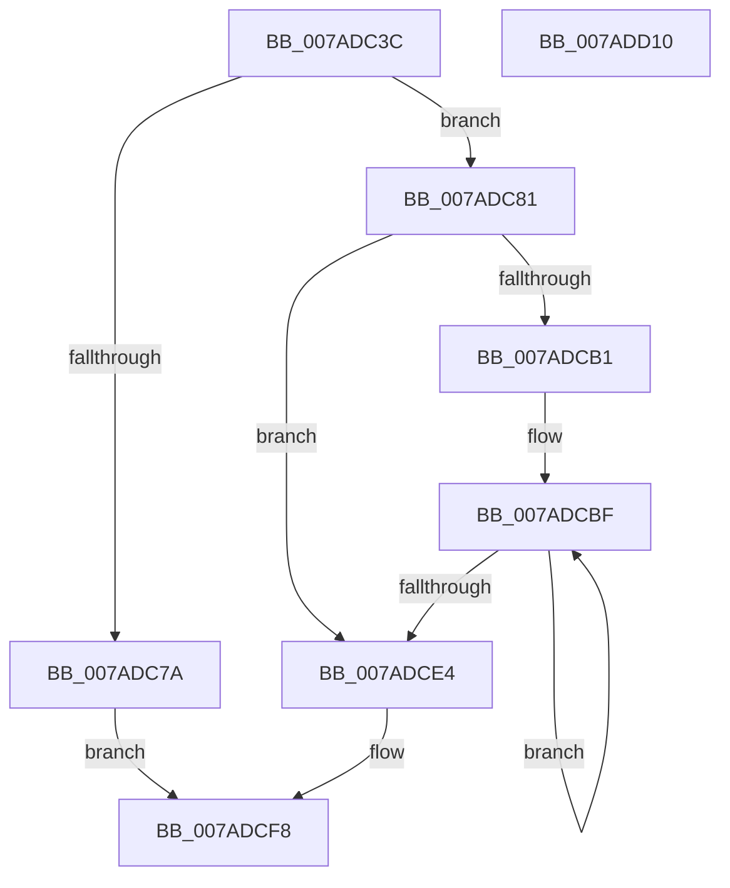

# VmpPrefetchForVirtualFault

- RVA: `0x007ADC3C`–`0x007ADD11` (길이 `213` bytes)
- VA: `0x00000001407ADC3C`
- 실행 섹션: `PAGE`
- PDB 이름 있음: `예`; PDB Function 태그: `아니요`
- unwind 정보 RVA: `0x0006F978`
- 디코드: `58`개 명령, `213/213` bytes 표시
- 미해석 바이트: `0` (있으면 어셈블리에 `.byte`로 보존)

> 이 문서는 커널 이미지의 기계어와 PDB 기호를 분석해 생성했습니다. 4번과 5번은 함수 원형과 자료형을 바이너리 사용 방식에서 추정한 C 해석이며 원본 소스 복구 결과는 아닙니다.

## 1. Dependencies

- 직접 호출 지점: **3**; 고유 호출 대상: **3**
- 직접 호출자로 확인된 함수: **1**
- RIP 상대 이미지 참조: **0**

### Outgoing calls
- `0x007ADC6D` → [ExAllocatePool2](../../poolcode/B8/ExAllocatePool2_function_00B820F0.md) (function, `0x00B820F0`)
- `0x007ADCE7` → [MmPrefetchVirtualAddresses](../93/MmPrefetchVirtualAddresses_function_0093A5E0.md) (function, `0x0093A5E0`)
- `0x007ADCF3` → [ExFreePoolWithTag](../../poolcode/B8/ExFreePoolWithTag_function_00B82870.md) (function, `0x00B82870`)

### Direct callers
- [VmAccessFault](../A1/VmAccessFault_function_00A18BF0.md) at `0x00A18F3D`

### Static image references
- 디코드된 RIP-relative 메모리 참조가 없습니다.

## 2. Other-region calls and transfers

- 다른 실행 섹션으로 향하는 call: **2**
  - `0x007ADC6D` → [ExAllocatePool2](../../poolcode/B8/ExAllocatePool2_function_00B820F0.md) (`PAGE` → `POOLCODE`)
  - `0x007ADCF3` → [ExFreePoolWithTag](../../poolcode/B8/ExFreePoolWithTag_function_00B82870.md) (`PAGE` → `POOLCODE`)
- 별도 외부 분기/꼬리 이동을 확인하지 못했습니다.

## 3. Assembly (complete function range)

```asm
007ADC3C  48 89 5C 24 08                  mov qword ptr [rsp + 8], rbx
007ADC41  48 89 74 24 10                  mov qword ptr [rsp + 0x10], rsi
007ADC46  48 89 7C 24 18                  mov qword ptr [rsp + 0x18], rdi
007ADC4B  41 56                           push r14
007ADC4D  48 83 EC 20                     sub rsp, 0x20
007ADC51  48 8B F2                        mov rsi, rdx
007ADC54  4D 8B F0                        mov r14, r8
007ADC57  49 8D 50 02                     lea rdx, [r8 + 2]
007ADC5B  48 8B F9                        mov rdi, rcx
007ADC5E  48 C1 E2 04                     shl rdx, 4
007ADC62  B9 40 00 00 00                  mov ecx, 0x40
007ADC67  41 B8 56 6D 50 76               mov r8d, 0x76506d56
007ADC6D  E8 7E 44 3D 00                  call 0x140b820f0
007ADC72  48 8B D8                        mov rbx, rax
007ADC75  48 85 C0                        test rax, rax
007ADC78  75 07                           jne 0x1407adc81
007ADC7A  BF 9A 00 00 C0                  mov edi, 0xc000009a
007ADC7F  EB 77                           jmp 0x1407adcf8
007ADC81  83 60 04 00                     and dword ptr [rax + 4], 0
007ADC85  48 8D 50 27                     lea rdx, [rax + 0x27]
007ADC89  83 60 04 F9                     and dword ptr [rax + 4], 0xfffffff9
007ADC8D  48 83 E2 F8                     and rdx, 0xfffffffffffffff8
007ADC91  48 83 48 08 FF                  or qword ptr [rax + 8], 0xffffffffffffffff
007ADC96  4C 89 70 10                     mov qword ptr [rax + 0x10], r14
007ADC9A  49 C1 E6 04                     shl r14, 4
007ADC9E  C7 00 01 00 00 00               mov dword ptr [rax], 1
007ADCA4  48 89 50 18                     mov qword ptr [rax + 0x18], rdx
007ADCA8  49 8D 04 3E                     lea rax, [r14 + rdi]
007ADCAC  48 3B F8                        cmp rdi, rax
007ADCAF  73 33                           jae 0x1407adce4
007ADCB1  49 8D 4E FF                     lea rcx, [r14 - 1]
007ADCB5  48 C1 E9 04                     shr rcx, 4
007ADCB9  48 FF C1                        inc rcx
007ADCBC  48 2B FA                        sub rdi, rdx
007ADCBF  48 8B 06                        mov rax, qword ptr [rsi]
007ADCC2  48 8D 76 08                     lea rsi, [rsi + 8]
007ADCC6  48 C1 E0 0C                     shl rax, 0xc
007ADCCA  48 89 02                        mov qword ptr [rdx], rax
007ADCCD  48 8B 44 17 08                  mov rax, qword ptr [rdi + rdx + 8]
007ADCD2  48 8D 52 10                     lea rdx, [rdx + 0x10]
007ADCD6  48 C1 E0 0C                     shl rax, 0xc
007ADCDA  48 89 42 F8                     mov qword ptr [rdx - 8], rax
007ADCDE  48 83 E9 01                     sub rcx, 1
007ADCE2  75 DB                           jne 0x1407adcbf
007ADCE4  48 8B CB                        mov rcx, rbx
007ADCE7  E8 F4 C8 18 00                  call 0x14093a5e0
007ADCEC  8B F8                           mov edi, eax
007ADCEE  33 D2                           xor edx, edx
007ADCF0  48 8B CB                        mov rcx, rbx
007ADCF3  E8 78 4B 3D 00                  call 0x140b82870
007ADCF8  48 8B 5C 24 30                  mov rbx, qword ptr [rsp + 0x30]
007ADCFD  8B C7                           mov eax, edi
007ADCFF  48 8B 7C 24 40                  mov rdi, qword ptr [rsp + 0x40]
007ADD04  48 8B 74 24 38                  mov rsi, qword ptr [rsp + 0x38]
007ADD09  48 83 C4 20                     add rsp, 0x20
007ADD0D  41 5E                           pop r14
007ADD0F  C3                              ret
007ADD10  CC                              int3
```

## 4. C-style interpretation (structured pseudocode)

```c
__int64 __fastcall VmpPrefetchForVirtualFault(__int64 a1, __int64 a2, __int64 a3)
{
    __int64 result;
    __int64 v_r14;
    __int64 v_rdi;
    __int64 v_rsp;
    unsigned __int64 v_stack_p10;
    unsigned __int64 v_stack_p18;
    unsigned __int64 v_stack_p8;

    v_stack_p8 = v_rbx;
    v_stack_p10 = v_rsi;
    v_stack_p18 = v_rdi;
    v_rsp = (v_rsp) - (32);
    a2 = (a3 + 2) << (4);
    result = ExAllocatePool2(64, a2, (unsigned int)(0x76506D56ULL), a4);
    if (result != 0) goto loc_007ADC81;
    goto loc_007ADCF8;
loc_007ADC81:
    a2 = (result + 39) & (-8);
    *(unsigned __int64 *)(result + 16) = a3;
    v_r14 = (a3) << (4);
    *(unsigned int *)(result) = 1;
    *(unsigned __int64 *)(result + 24) = a2;
    if (((unsigned int)(0xC000009AULL)) >= (v_r14 + (unsigned int)(0xC000009AULL) * 1)) goto loc_007ADCE4;
    a1 = (v_r14 - 1) >> (4);
    a1 = (a1) + 1;
    v_rdi = ((unsigned int)(0xC000009AULL)) - (a2);
loc_007ADCBF:
    result = (*(unsigned __int64 *)(a2)) << (12);
    *(unsigned __int64 *)(a2) = result;
    result = (*(unsigned __int64 *)(v_rdi + a2 * 1 + 8)) << (12);
    *(unsigned __int64 *)(a2 + 16 - 8) = result;
    a1 = (a1) - (1);
    if (condition_is_not_equal) goto loc_007ADCBF;
loc_007ADCE4:
    result = MmPrefetchVirtualAddresses(result, a2 + 16, (unsigned int)(0x76506D56ULL), a4);
    a2 = 0;
    result = ExFreePoolWithTag(result, a2, (unsigned int)(0x76506D56ULL), a4);
loc_007ADCF8:
    v_rsp = (v_rsp) + (32);
    return (unsigned int)((unsigned int)((unsigned int)((unsigned int)(result))));
}
```

## 5. (Beta) C Style

```c
int64_t VmpPrefetchForVirtualFault(int64_t Arg1, void *Arg2, void *Arg3)
{
    uint8_t *arg2 = (uint8_t *)Arg2;
    uint8_t *arg3 = (uint8_t *)Arg3;

    int64_t result;
    int64_t local_r14;
    int64_t local_rdi;
    int64_t local_rsp;
    uint64_t v_stack_p10;
    uint64_t v_stack_p18;
    uint64_t v_stack_p8;

    v_stack_p8 = local_rbx;
    v_stack_p10 = local_rsi;
    v_stack_p18 = local_rdi;
    local_rsp = (local_rsp) - (32);
    Arg2 = (Arg3 + 2) << (4);
    result = ExAllocatePool2(64, Arg2, (uint32_t)(0x76506D56ULL), a4);
    if (result != 0) goto loc_007ADC81;
    goto loc_007ADCF8;
loc_007ADC81:
    Arg2 = (result + 39) & (-8);
    *(void **)(result + 0x10) = Arg3;
    local_r14 = (Arg3) << (4);
    *(uint32_t *)(result) = 1;
    *(void **)(result + 0x18) = Arg2;
    if (((uint32_t)(0xC000009AULL)) >= (local_r14 + (uint32_t)(0xC000009AULL) * 1)) goto loc_007ADCE4;
    Arg1 = (local_r14 - 1) >> (4);
    Arg1 = (Arg1) + 1;
    local_rdi = ((uint32_t)(0xC000009AULL)) - (Arg2);
loc_007ADCBF:
    result = (*(uint64_t *)(arg2)) << (12);
    *(uint64_t *)(arg2) = result;
    result = (*(uint64_t *)(local_rdi + arg2 * 1 + 0x8)) << (12);
    *(uint64_t *)(arg2 + 0x10 - 0x8) = result;
    Arg1 = (Arg1) - (1);
    if (condition_is_not_equal) goto loc_007ADCBF;
loc_007ADCE4:
    result = MmPrefetchVirtualAddresses(result, Arg2 + 16, (uint32_t)(0x76506D56ULL), a4);
    Arg2 = 0;
    result = ExFreePoolWithTag(result, Arg2, (uint32_t)(0x76506D56ULL), a4);
loc_007ADCF8:
    local_rsp = (local_rsp) + (32);
    return (uint32_t)((uint32_t)((uint32_t)((uint32_t)(result))));
}
```

### 관측된 메모리 오프셋

구조체 형식이 확인되지 않은 접근은 인자 기준의 오프셋으로만 기록했습니다.

| 기준 인자 | 오프셋 표현 | 폭 (bit) | 접근 |
|---|---:|---:|---|
| `Arg2` | `+ 0x0` | `64` | `R` |
| `Arg2` | `+ 0x8` | `64` | `R` |
| `Arg3` | `+ 0x2` | `64` | `R` |

## 6. Execution-region graph

[열기: 2D/3D 그래프와 함수 탐색 컨트롤 패널](../../../control-panel.html?section=page&rva=0x007ADC3C&view=graph)

- 2D 그래프는 위에서 아래로 흐르고, 3D 그래프는 빈 공간을 드래그해 회전합니다. Shift+드래그는 이동, 휠은 확대·축소, 함수 노드 선택은 대상 보고서 이동입니다.

### Static fallback


