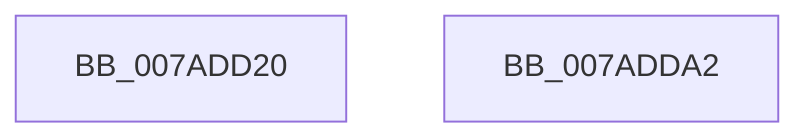

# VmpPrefetchWorker

- RVA: `0x007ADD20`–`0x007ADDA3` (길이 `131` bytes)
- VA: `0x00000001407ADD20`
- 실행 섹션: `PAGE`
- PDB 이름 있음: `예`; PDB Function 태그: `아니요`
- unwind 정보 RVA: `0x0005F638`
- 디코드: `33`개 명령, `131/131` bytes 표시
- 미해석 바이트: `0` (있으면 어셈블리에 `.byte`로 보존)

> 이 문서는 커널 이미지의 기계어와 PDB 기호를 분석해 생성했습니다. 4번과 5번은 함수 원형과 자료형을 바이너리 사용 방식에서 추정한 C 해석이며 원본 소스 복구 결과는 아닙니다.

## 1. Dependencies

- 직접 호출 지점: **6**; 고유 호출 대상: **6**
- 직접 호출자로 확인된 함수: **0**
- RIP 상대 이미지 참조: **1**

### Outgoing calls
- `0x007ADD53` → [KeStackAttachProcess](../../text/21/KeStackAttachProcess_function_00216800.md) (function, `0x00216800`)
- `0x007ADD6B` → [VmpPrefetchVirtualAddresses](../../text/42/VmpPrefetchVirtualAddresses_function_00428844.md) (function, `0x00428844`)
- `0x007ADD77` → [KiUnstackDetachProcess](../../text/21/KiUnstackDetachProcess_function_00217D30.md) (function, `0x00217D30`)
- `0x007ADD80` → [ObfDereferenceObject](../../text/2F/ObfDereferenceObject_function_002F9350.md) (function, `0x002F9350`)
- `0x007ADD8A` → [ExFreePoolWithTag](../../poolcode/B8/ExFreePoolWithTag_function_00B82870.md) (function, `0x00B82870`)
- `0x007ADD97` → [_security_check_cookie](../../text/6A/_security_check_cookie_function_006AC640.md) (function, `0x006AC640`)

### Direct callers
- 이 함수 시작 RVA로 연결되는 직접 call은 확인되지 않았습니다. 간접 호출은 완전히 역산할 수 없습니다.

### Static image references
- `0x007ADD26` → RVA `0x00E0A740` (`.data`; read)

## 2. Other-region calls and transfers

- 다른 실행 섹션으로 향하는 call: **6**
  - `0x007ADD53` → [KeStackAttachProcess](../../text/21/KeStackAttachProcess_function_00216800.md) (`PAGE` → `.text`)
  - `0x007ADD6B` → [VmpPrefetchVirtualAddresses](../../text/42/VmpPrefetchVirtualAddresses_function_00428844.md) (`PAGE` → `.text`)
  - `0x007ADD77` → [KiUnstackDetachProcess](../../text/21/KiUnstackDetachProcess_function_00217D30.md) (`PAGE` → `.text`)
  - `0x007ADD80` → [ObfDereferenceObject](../../text/2F/ObfDereferenceObject_function_002F9350.md) (`PAGE` → `.text`)
  - `0x007ADD8A` → [ExFreePoolWithTag](../../poolcode/B8/ExFreePoolWithTag_function_00B82870.md) (`PAGE` → `POOLCODE`)
  - `0x007ADD97` → [_security_check_cookie](../../text/6A/_security_check_cookie_function_006AC640.md) (`PAGE` → `.text`)
- 별도 외부 분기/꼬리 이동을 확인하지 못했습니다.

## 3. Assembly (complete function range)

```asm
007ADD20  40 53                           push rbx
007ADD22  48 83 EC 60                     sub rsp, 0x60
007ADD26  48 8B 05 13 CA 65 00            mov rax, qword ptr [rip + 0x65ca13]
007ADD2D  48 33 C4                        xor rax, rsp
007ADD30  48 89 44 24 50                  mov qword ptr [rsp + 0x50], rax
007ADD35  0F 57 C0                        xorps xmm0, xmm0
007ADD38  48 8D 54 24 20                  lea rdx, [rsp + 0x20]
007ADD3D  48 8B D9                        mov rbx, rcx
007ADD40  48 8B 49 20                     mov rcx, qword ptr [rcx + 0x20]
007ADD44  0F 11 44 24 20                  movups xmmword ptr [rsp + 0x20], xmm0
007ADD49  0F 11 44 24 30                  movups xmmword ptr [rsp + 0x30], xmm0
007ADD4E  0F 11 44 24 40                  movups xmmword ptr [rsp + 0x40], xmm0
007ADD53  E8 A8 8A A6 FF                  call 0x140216800
007ADD58  48 8B 4B 20                     mov rcx, qword ptr [rbx + 0x20]
007ADD5C  4C 8B 43 30                     mov r8, qword ptr [rbx + 0x30]
007ADD60  48 8B 53 28                     mov rdx, qword ptr [rbx + 0x28]
007ADD64  48 8B 89 70 06 00 00            mov rcx, qword ptr [rcx + 0x670]
007ADD6B  E8 D4 AA C7 FF                  call 0x140428844
007ADD70  33 D2                           xor edx, edx
007ADD72  48 8D 4C 24 20                  lea rcx, [rsp + 0x20]
007ADD77  E8 B4 9F A6 FF                  call 0x140217d30
007ADD7C  48 8B 4B 20                     mov rcx, qword ptr [rbx + 0x20]
007ADD80  E8 CB B5 B4 FF                  call 0x1402f9350
007ADD85  33 D2                           xor edx, edx
007ADD87  48 8B CB                        mov rcx, rbx
007ADD8A  E8 E1 4A 3D 00                  call 0x140b82870
007ADD8F  48 8B 4C 24 50                  mov rcx, qword ptr [rsp + 0x50]
007ADD94  48 33 CC                        xor rcx, rsp
007ADD97  E8 A4 E8 EF FF                  call 0x1406ac640
007ADD9C  48 83 C4 60                     add rsp, 0x60
007ADDA0  5B                              pop rbx
007ADDA1  C3                              ret
007ADDA2  CC                              int3
```

## 4. C-style interpretation (structured pseudocode)

```c
__int64 __fastcall VmpPrefetchWorker(__int64 a1)
{
    __int64 result;
    __int64 v_rsp;
    unsigned __int64 v_stack_m18;
    unsigned __int64 v_stack_m28;
    unsigned __int64 v_stack_m38;
    unsigned __int64 v_stack_m48;

    v_rsp = (v_rsp) - (96);
    result = (*(unsigned __int64 *)(v_rip + 6670867)) ^ (v_rsp);
    v_stack_m18 = result;
    v_stack_m48 = v_xmm0;
    v_stack_m38 = v_xmm0;
    v_stack_m28 = v_xmm0;
    result = KeStackAttachProcess(*(unsigned __int64 *)(a1 + 32), v_stack_m48, a3, a4);
    result = VmpPrefetchVirtualAddresses(*(unsigned __int64 *)(*(unsigned __int64 *)(a1 + 32) + 1648), *(unsigned __int64 *)(a1 + 40), *(unsigned __int64 *)(a1 + 48), a4);
    a2 = 0;
    result = KiUnstackDetachProcess(v_stack_m48, a2, *(unsigned __int64 *)(a1 + 48), a4);
    result = ObfDereferenceObject(*(unsigned __int64 *)(a1 + 32), a2, *(unsigned __int64 *)(a1 + 48), a4);
    a2 = 0;
    result = ExFreePoolWithTag(a1, a2, *(unsigned __int64 *)(a1 + 48), a4);
    a1 = (v_stack_m18) ^ (v_rsp);
    result = _security_check_cookie(a1, a2, *(unsigned __int64 *)(a1 + 48), a4);
    v_rsp = (v_rsp) + (96);
    return result;
}
```

## 5. (Beta) C Style

```c
int64_t VmpPrefetchWorker(void *Arg1)
{
    uint8_t *arg1 = (uint8_t *)Arg1;

    int64_t result;
    int64_t local_rsp;
    uint64_t v_stack_m18;
    uint64_t v_stack_m28;
    uint64_t v_stack_m38;
    uint64_t v_stack_m48;

    local_rsp = (local_rsp) - (96);
    result = (*(uint64_t *)(v_rip + 0x65CA13)) ^ (local_rsp);
    v_stack_m18 = result;
    v_stack_m48 = v_xmm0;
    v_stack_m38 = v_xmm0;
    v_stack_m28 = v_xmm0;
    result = KeStackAttachProcess(*(uint64_t *)(arg1 + 0x20), v_stack_m48, a3, a4);
    result = VmpPrefetchVirtualAddresses(*(uint64_t *)(*(uint64_t *)(arg1 + 0x20) + 0x670), *(uint64_t *)(arg1 + 0x28), *(uint64_t *)(arg1 + 0x30), a4);
    a2 = 0;
    result = KiUnstackDetachProcess(v_stack_m48, a2, *(uint64_t *)(arg1 + 0x30), a4);
    result = ObfDereferenceObject(*(uint64_t *)(arg1 + 0x20), a2, *(uint64_t *)(arg1 + 0x30), a4);
    a2 = 0;
    result = ExFreePoolWithTag(Arg1, a2, *(uint64_t *)(arg1 + 0x30), a4);
    Arg1 = (v_stack_m18) ^ (local_rsp);
    result = _security_check_cookie(Arg1, a2, *(uint64_t *)(arg1 + 0x30), a4);
    local_rsp = (local_rsp) + (96);
    return result;
}
```

### 관측된 메모리 오프셋

구조체 형식이 확인되지 않은 접근은 인자 기준의 오프셋으로만 기록했습니다.

| 기준 인자 | 오프셋 표현 | 폭 (bit) | 접근 |
|---|---:|---:|---|
| `Arg1` | `+ 0x20` | `64` | `R` |
| `Arg1` | `+ 0x28` | `64` | `R` |
| `Arg1` | `+ 0x30` | `64` | `R` |

## 6. Execution-region graph

[열기: 2D/3D 그래프와 함수 탐색 컨트롤 패널](../../../control-panel.html?section=page&rva=0x007ADD20&view=graph)

- 2D 그래프는 위에서 아래로 흐르고, 3D 그래프는 빈 공간을 드래그해 회전합니다. Shift+드래그는 이동, 휠은 확대·축소, 함수 노드 선택은 대상 보고서 이동입니다.

### Static fallback


