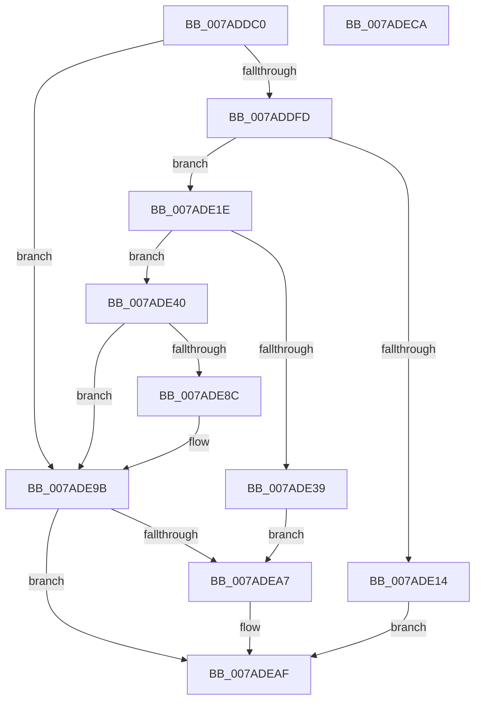

# VmpProcessContextSetup

- RVA: `0x007ADDC0`–`0x007ADECB` (길이 `267` bytes)
- VA: `0x00000001407ADDC0`
- 실행 섹션: `PAGE`
- PDB 이름 있음: `예`; PDB Function 태그: `아니요`
- unwind 정보 RVA: `0x00095AD0`
- 디코드: `67`개 명령, `267/267` bytes 표시
- 미해석 바이트: `0` (있으면 어셈블리에 `.byte`로 보존)

> 이 문서는 커널 이미지의 기계어와 PDB 기호를 분석해 생성했습니다. 4번과 5번은 함수 원형과 자료형을 바이너리 사용 방식에서 추정한 C 해석이며 원본 소스 복구 결과는 아닙니다.

## 1. Dependencies

- 직접 호출 지점: **6**; 고유 호출 대상: **6**
- 직접 호출자로 확인된 함수: **2**
- RIP 상대 이미지 참조: **0**

### Outgoing calls
- `0x007ADE07` → [ExAcquireRundownProtection](../../text/21/ExAcquireRundownProtection_function_00216620.md) (function, `0x00216620`)
- `0x007ADE2C` → [ExAllocatePool2](../../poolcode/B8/ExAllocatePool2_function_00B820F0.md) (function, `0x00B820F0`)
- `0x007ADE4B` → [memset](../../text/6C/memset_function_006C6C40.md) (function, `0x006C6C40`)
- `0x007ADE8F` → [VmpProcessContextCleanup](VmpProcessContextCleanup_function_007ADDAC.md) (function, `0x007ADDAC`)
- `0x007ADE96` → [ExFreePoolWithTag](../../poolcode/B8/ExFreePoolWithTag_function_00B82870.md) (function, `0x00B82870`)
- `0x007ADEAA` → [ExReleaseRundownProtection](../../text/34/ExReleaseRundownProtection_function_00349E80.md) (function, `0x00349E80`)

### Direct callers
- [VmCreateMemoryRange](VmCreateMemoryRange_function_007AD1D0.md) at `0x007AD239`
- [VmPreallocateForRangeCreate](../A7/VmPreallocateForRangeCreate_function_00A755E0.md) at `0x00A7563E`

### Static image references
- 디코드된 RIP-relative 메모리 참조가 없습니다.

## 2. Other-region calls and transfers

- 다른 실행 섹션으로 향하는 call: **5**
  - `0x007ADE07` → [ExAcquireRundownProtection](../../text/21/ExAcquireRundownProtection_function_00216620.md) (`PAGE` → `.text`)
  - `0x007ADE2C` → [ExAllocatePool2](../../poolcode/B8/ExAllocatePool2_function_00B820F0.md) (`PAGE` → `POOLCODE`)
  - `0x007ADE4B` → [memset](../../text/6C/memset_function_006C6C40.md) (`PAGE` → `.text`)
  - `0x007ADE96` → [ExFreePoolWithTag](../../poolcode/B8/ExFreePoolWithTag_function_00B82870.md) (`PAGE` → `POOLCODE`)
  - `0x007ADEAA` → [ExReleaseRundownProtection](../../text/34/ExReleaseRundownProtection_function_00349E80.md) (`PAGE` → `.text`)
- 별도 외부 분기/꼬리 이동을 확인하지 못했습니다.

## 3. Assembly (complete function range)

```asm
007ADDC0  48 89 5C 24 08                  mov qword ptr [rsp + 8], rbx
007ADDC5  48 89 6C 24 18                  mov qword ptr [rsp + 0x18], rbp
007ADDCA  48 89 74 24 20                  mov qword ptr [rsp + 0x20], rsi
007ADDCF  57                              push rdi
007ADDD0  41 56                           push r14
007ADDD2  41 57                           push r15
007ADDD4  48 83 EC 20                     sub rsp, 0x20
007ADDD8  65 48 8B 04 25 88 01 00 00      mov rax, qword ptr gs:[0x188]
007ADDE1  33 DB                           xor ebx, ebx
007ADDE3  4C 8B F9                        mov r15, rcx
007ADDE6  44 8B F3                        mov r14d, ebx
007ADDE9  48 8B B0 B8 00 00 00            mov rsi, qword ptr [rax + 0xb8]
007ADDF0  48 39 9E 70 06 00 00            cmp qword ptr [rsi + 0x670], rbx
007ADDF7  0F 85 9E 00 00 00               jne 0x1407ade9b
007ADDFD  48 8D AE E8 01 00 00            lea rbp, [rsi + 0x1e8]
007ADE04  48 8B CD                        mov rcx, rbp
007ADE07  E8 14 88 A6 FF                  call 0x140216620
007ADE0C  44 0F B6 F0                     movzx r14d, al
007ADE10  84 C0                           test al, al
007ADE12  75 0A                           jne 0x1407ade1e
007ADE14  BB 0A 01 00 C0                  mov ebx, 0xc000010a
007ADE19  E9 91 00 00 00                  jmp 0x1407adeaf
007ADE1E  BA A0 00 00 00                  mov edx, 0xa0
007ADE23  41 B8 56 6D 50 63               mov r8d, 0x63506d56
007ADE29  8D 4A A0                        lea ecx, [rdx - 0x60]
007ADE2C  E8 BF 42 3D 00                  call 0x140b820f0
007ADE31  48 8B F8                        mov rdi, rax
007ADE34  48 85 C0                        test rax, rax
007ADE37  75 07                           jne 0x1407ade40
007ADE39  BB 9A 00 00 C0                  mov ebx, 0xc000009a
007ADE3E  EB 67                           jmp 0x1407adea7
007ADE40  33 D2                           xor edx, edx
007ADE42  41 B8 A0 00 00 00               mov r8d, 0xa0
007ADE48  48 8B CF                        mov rcx, rdi
007ADE4B  E8 F0 8D F1 FF                  call 0x1406c6c40
007ADE50  4C 89 7F 68                     mov qword ptr [rdi + 0x68], r15
007ADE54  33 C0                           xor eax, eax
007ADE56  48 89 5F 10                     mov qword ptr [rdi + 0x10], rbx
007ADE5A  48 89 5F 18                     mov qword ptr [rdi + 0x18], rbx
007ADE5E  48 89 5F 20                     mov qword ptr [rdi + 0x20], rbx
007ADE62  48 89 5F 28                     mov qword ptr [rdi + 0x28], rbx
007ADE66  48 89 5F 30                     mov qword ptr [rdi + 0x30], rbx
007ADE6A  48 89 5F 50                     mov qword ptr [rdi + 0x50], rbx
007ADE6E  48 89 5F 58                     mov qword ptr [rdi + 0x58], rbx
007ADE72  48 C7 47 40 00 02 00 00         mov qword ptr [rdi + 0x40], 0x200
007ADE7A  48 89 9F 80 00 00 00            mov qword ptr [rdi + 0x80], rbx
007ADE81  F0 48 0F B1 BE 70 06 00 00      lock cmpxchg qword ptr [rsi + 0x670], rdi
007ADE8A  74 0F                           je 0x1407ade9b
007ADE8C  48 8B CF                        mov rcx, rdi
007ADE8F  E8 18 FF FF FF                  call 0x1407addac
007ADE94  33 D2                           xor edx, edx
007ADE96  E8 D5 49 3D 00                  call 0x140b82870
007ADE9B  48 8D AE E8 01 00 00            lea rbp, [rsi + 0x1e8]
007ADEA2  45 85 F6                        test r14d, r14d
007ADEA5  74 08                           je 0x1407adeaf
007ADEA7  48 8B CD                        mov rcx, rbp
007ADEAA  E8 D1 BF B9 FF                  call 0x140349e80
007ADEAF  48 8B 6C 24 50                  mov rbp, qword ptr [rsp + 0x50]
007ADEB4  8B C3                           mov eax, ebx
007ADEB6  48 8B 5C 24 40                  mov rbx, qword ptr [rsp + 0x40]
007ADEBB  48 8B 74 24 58                  mov rsi, qword ptr [rsp + 0x58]
007ADEC0  48 83 C4 20                     add rsp, 0x20
007ADEC4  41 5F                           pop r15
007ADEC6  41 5E                           pop r14
007ADEC8  5F                              pop rdi
007ADEC9  C3                              ret
007ADECA  CC                              int3
```

## 4. C-style interpretation (structured pseudocode)

```c
__int64 __fastcall VmpProcessContextSetup(__int64 a1)
{
    __int64 result;
    __int64 v_rbx;
    __int64 v_rsp;
    unsigned __int64 v_stack_p18;
    unsigned __int64 v_stack_p20;
    unsigned __int64 v_stack_p8;

    v_stack_p8 = v_rbx;
    v_stack_p18 = v_rbp;
    v_stack_p20 = v_rsi;
    v_rsp = (v_rsp) - (32);
    v_rbx = 0;
    if ((*(unsigned __int64 *)(*(unsigned __int64 *)(*(unsigned __int64 *)(gs_base + (0 + 392)) + 184) + 1648)) != 0) goto loc_007ADE9B;
    result = ExAcquireRundownProtection(*(unsigned __int64 *)(*(unsigned __int64 *)(gs_base + (0 + 392)) + 184) + 488, a2, a3, a4);
    if ((unsigned __int8)(result) != 0) goto loc_007ADE1E;
    goto loc_007ADEAF;
loc_007ADE1E:
    result = ExAllocatePool2(160 - 96, 160, (unsigned int)(0x63506D56ULL), a4);
    if (result != 0) goto loc_007ADE40;
    goto loc_007ADEA7;
loc_007ADE40:
    a2 = 0;
    result = memset(result, a2, 160, a4);
    *(unsigned __int64 *)(result + 104) = a1;
    result = 0;
    *(unsigned __int64 *)(result + 16) = (unsigned int)(0xC000009AULL);
    *(unsigned __int64 *)(result + 24) = (unsigned int)(0xC000009AULL);
    *(unsigned __int64 *)(result + 32) = (unsigned int)(0xC000009AULL);
    *(unsigned __int64 *)(result + 40) = (unsigned int)(0xC000009AULL);
    *(unsigned __int64 *)(result + 48) = (unsigned int)(0xC000009AULL);
    *(unsigned __int64 *)(result + 80) = (unsigned int)(0xC000009AULL);
    *(unsigned __int64 *)(result + 88) = (unsigned int)(0xC000009AULL);
    *(unsigned __int64 *)(result + 64) = 512;
    *(unsigned __int64 *)(result + 128) = (unsigned int)(0xC000009AULL);
    if (!(condition_is_equal)) {
        a1 = 0;
        result = VmpProcessContextCleanup(a1, a2, 160, a4);
        a2 = 0;
        result = ExFreePoolWithTag(a1, a2, 160, a4);
    }
    if ((unsigned int)((unsigned __int8)(result)) != 0) {
        a1 = *(unsigned __int64 *)(*(unsigned __int64 *)(gs_base + (0 + 392)) + 184) + 488;
        result = ExReleaseRundownProtection(a1, a2, 160, a4);
    }
    v_rsp = (v_rsp) + (32);
    return (unsigned int)((unsigned int)((unsigned int)(0xC000009AULL)));
}
```

## 5. (Beta) C Style

```c
int64_t VmpProcessContextSetup(int64_t Arg1)
{
    int64_t result;
    int64_t local_rbx;
    int64_t local_rsp;
    uint64_t v_stack_p18;
    uint64_t v_stack_p20;
    uint64_t v_stack_p8;

    v_stack_p8 = local_rbx;
    v_stack_p18 = local_rbp;
    v_stack_p20 = local_rsi;
    local_rsp = (local_rsp) - (32);
    local_rbx = 0;
    if ((*(uint64_t *)(*(uint64_t *)(*(uint64_t *)(gs_base + (0 + 0x188)) + 0xB8) + 0x670)) != 0) goto loc_007ADE9B;
    result = ExAcquireRundownProtection(*(uint64_t *)(*(uint64_t *)(gs_base + (0 + 0x188)) + 0xB8) + 488, a2, a3, a4);
    if ((uint8_t)(result) != 0) goto loc_007ADE1E;
    goto loc_007ADEAF;
loc_007ADE1E:
    result = ExAllocatePool2(160 - 96, 160, (uint32_t)(0x63506D56ULL), a4);
    if (result != 0) goto loc_007ADE40;
    goto loc_007ADEA7;
loc_007ADE40:
    a2 = 0;
    result = memset(result, a2, 160, a4);
    *(uint64_t *)(result + 0x68) = Arg1;
    result = 0;
    *(uint64_t *)(result + 0x10) = (uint32_t)(0xC000009AULL);
    *(uint64_t *)(result + 0x18) = (uint32_t)(0xC000009AULL);
    *(uint64_t *)(result + 0x20) = (uint32_t)(0xC000009AULL);
    *(uint64_t *)(result + 0x28) = (uint32_t)(0xC000009AULL);
    *(uint64_t *)(result + 0x30) = (uint32_t)(0xC000009AULL);
    *(uint64_t *)(result + 0x50) = (uint32_t)(0xC000009AULL);
    *(uint64_t *)(result + 0x58) = (uint32_t)(0xC000009AULL);
    *(uint64_t *)(result + 0x40) = 512;
    *(uint64_t *)(result + 0x80) = (uint32_t)(0xC000009AULL);
    if (!(condition_is_equal)) {
        Arg1 = 0;
        result = VmpProcessContextCleanup(Arg1, a2, 160, a4);
        a2 = 0;
        result = ExFreePoolWithTag(Arg1, a2, 160, a4);
    }
    if ((uint32_t)((uint8_t)(result)) != 0) {
        Arg1 = *(uint64_t *)(*(uint64_t *)(gs_base + (0 + 0x188)) + 0xB8) + 488;
        result = ExReleaseRundownProtection(Arg1, a2, 160, a4);
    }
    local_rsp = (local_rsp) + (32);
    return (uint32_t)((uint32_t)((uint32_t)(0xC000009AULL)));
}
```

## 6. Execution-region graph

[열기: 2D/3D 그래프와 함수 탐색 컨트롤 패널](../../../control-panel.html?section=page&rva=0x007ADDC0&view=graph)

- 2D 그래프는 위에서 아래로 흐르고, 3D 그래프는 빈 공간을 드래그해 회전합니다. Shift+드래그는 이동, 휠은 확대·축소, 함수 노드 선택은 대상 보고서 이동입니다.

### Static fallback


