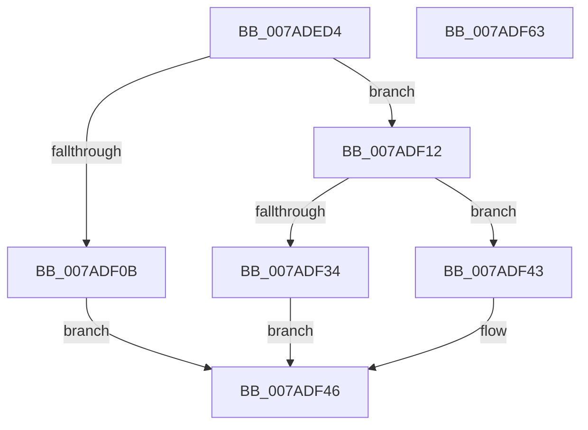

# VmpSecureMemoryForPin

- RVA: `0x007ADED4`–`0x007ADF64` (길이 `144` bytes)
- VA: `0x00000001407ADED4`
- 실행 섹션: `PAGE`
- PDB 이름 있음: `예`; PDB Function 태그: `아니요`
- unwind 정보 RVA: `0x0005E6B4`
- 디코드: `41`개 명령, `144/144` bytes 표시
- 미해석 바이트: `0` (있으면 어셈블리에 `.byte`로 보존)

> 이 문서는 커널 이미지의 기계어와 PDB 기호를 분석해 생성했습니다. 4번과 5번은 함수 원형과 자료형을 바이너리 사용 방식에서 추정한 C 해석이며 원본 소스 복구 결과는 아닙니다.

## 1. Dependencies

- 직접 호출 지점: **3**; 고유 호출 대상: **3**
- 직접 호출자로 확인된 함수: **3**
- RIP 상대 이미지 참조: **0**

### Outgoing calls
- `0x007ADF00` → [ExAcquireRundownProtection](../../text/21/ExAcquireRundownProtection_function_00216620.md) (function, `0x00216620`)
- `0x007ADF2A` → [MmSecureVirtualMemoryEx](../9F/MmSecureVirtualMemoryEx_function_009F5620.md) (function, `0x009F5620`)
- `0x007ADF3C` → [ExReleaseRundownProtection](../../text/34/ExReleaseRundownProtection_function_00349E80.md) (function, `0x00349E80`)

### Direct callers
- [VmpMergeMemoryRanges](../../text/4D/VmpMergeMemoryRanges_function_004D9EDC.md) at `0x004DA062`
- [VmpPinMemoryRange](../../text/64/VmpPinMemoryRange_function_0064CCD0.md) at `0x0064CEA5`
- [sub_006EE148](../../text/6E/Unknown_function_006EE148.md) at `0x006EE1C8`

### Static image references
- 디코드된 RIP-relative 메모리 참조가 없습니다.

## 2. Other-region calls and transfers

- 다른 실행 섹션으로 향하는 call: **2**
  - `0x007ADF00` → [ExAcquireRundownProtection](../../text/21/ExAcquireRundownProtection_function_00216620.md) (`PAGE` → `.text`)
  - `0x007ADF3C` → [ExReleaseRundownProtection](../../text/34/ExReleaseRundownProtection_function_00349E80.md) (`PAGE` → `.text`)
- 별도 외부 분기/꼬리 이동을 확인하지 못했습니다.

## 3. Assembly (complete function range)

```asm
007ADED4  48 8B C4                        mov rax, rsp
007ADED7  48 89 58 08                     mov qword ptr [rax + 8], rbx
007ADEDB  48 89 68 10                     mov qword ptr [rax + 0x10], rbp
007ADEDF  48 89 70 18                     mov qword ptr [rax + 0x18], rsi
007ADEE3  48 89 78 20                     mov qword ptr [rax + 0x20], rdi
007ADEE7  41 56                           push r14
007ADEE9  48 83 EC 20                     sub rsp, 0x20
007ADEED  48 8D B9 80 00 00 00            lea rdi, [rcx + 0x80]
007ADEF4  4D 8B F1                        mov r14, r9
007ADEF7  48 8B CF                        mov rcx, rdi
007ADEFA  49 8B F0                        mov rsi, r8
007ADEFD  48 8B EA                        mov rbp, rdx
007ADF00  E8 1B 87 A6 FF                  call 0x140216620
007ADF05  33 DB                           xor ebx, ebx
007ADF07  84 C0                           test al, al
007ADF09  75 07                           jne 0x1407adf12
007ADF0B  BB 0A 01 00 C0                  mov ebx, 0xc000010a
007ADF10  EB 34                           jmp 0x1407adf46
007ADF12  41 B9 0A 00 00 00               mov r9d, 0xa
007ADF18  48 C1 E6 0C                     shl rsi, 0xc
007ADF1C  48 C1 E5 0C                     shl rbp, 0xc
007ADF20  48 8B D6                        mov rdx, rsi
007ADF23  48 8B CD                        mov rcx, rbp
007ADF26  45 8D 41 F7                     lea r8d, [r9 - 9]
007ADF2A  E8 F1 76 24 00                  call 0x1409f5620
007ADF2F  48 85 C0                        test rax, rax
007ADF32  75 0F                           jne 0x1407adf43
007ADF34  48 8B CF                        mov rcx, rdi
007ADF37  BB 9A 00 00 C0                  mov ebx, 0xc000009a
007ADF3C  E8 3F BF B9 FF                  call 0x140349e80
007ADF41  EB 03                           jmp 0x1407adf46
007ADF43  49 89 06                        mov qword ptr [r14], rax
007ADF46  48 8B 6C 24 38                  mov rbp, qword ptr [rsp + 0x38]
007ADF4B  8B C3                           mov eax, ebx
007ADF4D  48 8B 5C 24 30                  mov rbx, qword ptr [rsp + 0x30]
007ADF52  48 8B 74 24 40                  mov rsi, qword ptr [rsp + 0x40]
007ADF57  48 8B 7C 24 48                  mov rdi, qword ptr [rsp + 0x48]
007ADF5C  48 83 C4 20                     add rsp, 0x20
007ADF60  41 5E                           pop r14
007ADF62  C3                              ret
007ADF63  CC                              int3
```

## 4. C-style interpretation (structured pseudocode)

```c
__int64 __fastcall VmpSecureMemoryForPin(__int64 a1, __int64 a2, __int64 a3, __int64 a4)
{
    __int64 result;
    __int64 v_rbp;
    __int64 v_rbx;
    __int64 v_rsi;
    __int64 v_rsp;
    unsigned __int64 v_stack_p10;
    unsigned __int64 v_stack_p18;
    unsigned __int64 v_stack_p20;
    unsigned __int64 v_stack_p8;

    *(unsigned __int64 *)(v_rsp + 8) = v_rbx;
    *(unsigned __int64 *)(v_rsp + 16) = v_rbp;
    *(unsigned __int64 *)(v_rsp + 24) = v_rsi;
    *(unsigned __int64 *)(v_rsp + 32) = v_rdi;
    v_rsp = (v_rsp) - (32);
    result = ExAcquireRundownProtection(a1 + 128, a2, a3, a4);
    v_rbx = 0;
    if ((unsigned __int8)(result) != 0) goto loc_007ADF12;
    goto loc_007ADF46;
loc_007ADF12:
    v_rsi = (a3) << (12);
    v_rbp = (a2) << (12);
    result = MmSecureVirtualMemoryEx(v_rbp, v_rsi, 10 - 9, 10);
    if (result != 0) goto loc_007ADF43;
    result = ExReleaseRundownProtection(a1 + 128, v_rsi, 10 - 9, 10);
    goto loc_007ADF46;
loc_007ADF43:
    *(unsigned __int64 *)(a4) = result;
loc_007ADF46:
    v_rsp = (v_rsp) + (32);
    return (unsigned int)((unsigned int)((unsigned int)(0xC000009AULL)));
}
```

## 5. (Beta) C Style

```c
int64_t VmpSecureMemoryForPin(void *Arg1, int64_t Arg2, int64_t Arg3, void *Arg4)
{
    uint8_t *arg1 = (uint8_t *)Arg1;
    uint8_t *arg4 = (uint8_t *)Arg4;

    int64_t result;
    int64_t local_rbp;
    int64_t local_rbx;
    int64_t local_rsi;
    int64_t local_rsp;
    uint64_t v_stack_p10;
    uint64_t v_stack_p18;
    uint64_t v_stack_p20;
    uint64_t v_stack_p8;

    *(uint64_t *)(local_rsp + 0x8) = local_rbx;
    *(uint64_t *)(local_rsp + 0x10) = local_rbp;
    *(uint64_t *)(local_rsp + 0x18) = local_rsi;
    *(uint64_t *)(local_rsp + 0x20) = local_rdi;
    local_rsp = (local_rsp) - (32);
    result = ExAcquireRundownProtection(Arg1 + 128, Arg2, Arg3, Arg4);
    local_rbx = 0;
    if ((uint8_t)(result) != 0) goto loc_007ADF12;
    goto loc_007ADF46;
loc_007ADF12:
    local_rsi = (Arg3) << (12);
    local_rbp = (Arg2) << (12);
    result = MmSecureVirtualMemoryEx(local_rbp, local_rsi, 10 - 9, 10);
    if (result != 0) goto loc_007ADF43;
    result = ExReleaseRundownProtection(Arg1 + 128, local_rsi, 10 - 9, 10);
    goto loc_007ADF46;
loc_007ADF43:
    *(uint64_t *)(arg4) = result;
loc_007ADF46:
    local_rsp = (local_rsp) + (32);
    return (uint32_t)((uint32_t)((uint32_t)(0xC000009AULL)));
}
```

### 관측된 메모리 오프셋

구조체 형식이 확인되지 않은 접근은 인자 기준의 오프셋으로만 기록했습니다.

| 기준 인자 | 오프셋 표현 | 폭 (bit) | 접근 |
|---|---:|---:|---|
| `Arg1` | `+ 0x80` | `64` | `R` |
| `Arg4` | `+ 0x0` | `64` | `W` |

## 6. Execution-region graph

[열기: 2D/3D 그래프와 함수 탐색 컨트롤 패널](../../../control-panel.html?section=page&rva=0x007ADED4&view=graph)

- 2D 그래프는 위에서 아래로 흐르고, 3D 그래프는 빈 공간을 드래그해 회전합니다. Shift+드래그는 이동, 휠은 확대·축소, 함수 노드 선택은 대상 보고서 이동입니다.

### Static fallback


