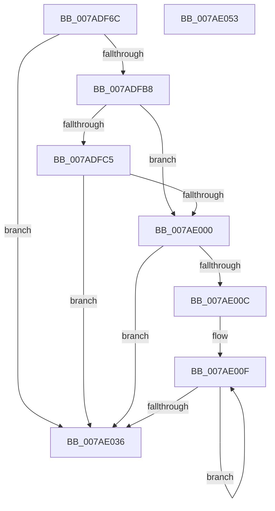

# VmpUnpinMemoryRange

- RVA: `0x007ADF6C`–`0x007AE054` (길이 `232` bytes)
- VA: `0x00000001407ADF6C`
- 실행 섹션: `PAGE`
- PDB 이름 있음: `예`; PDB Function 태그: `아니요`
- unwind 정보 RVA: `0x0008C20C`
- 디코드: `64`개 명령, `232/232` bytes 표시
- 미해석 바이트: `0` (있으면 어셈블리에 `.byte`로 보존)

> 이 문서는 커널 이미지의 기계어와 PDB 기호를 분석해 생성했습니다. 4번과 5번은 함수 원형과 자료형을 바이너리 사용 방식에서 추정한 C 해석이며 원본 소스 복구 결과는 아닙니다.

## 1. Dependencies

- 직접 호출 지점: **5**; 고유 호출 대상: **3**
- 직접 호출자로 확인된 함수: **3**
- RIP 상대 이미지 참조: **0**

### Outgoing calls
- `0x007ADFAC` → [VmpUnpinMemoryRangeHelper](../../text/64/VmpUnpinMemoryRangeHelper_function_0064D370.md) (function, `0x0064D370`)
- `0x007ADFC9` → [PfLockSharedRelease](../../text/48/PfLockSharedRelease_function_0048DF24.md) (function, `0x0048DF24`)
- `0x007ADFD2` → [FsRtlAcquirePushLockExclusive](../../text/4A/FsRtlAcquirePushLockExclusive_function_004A05F4.md) (function, `0x004A05F4`)
- `0x007ADFF4` → [VmpUnpinMemoryRangeHelper](../../text/64/VmpUnpinMemoryRangeHelper_function_0064D370.md) (function, `0x0064D370`)
- `0x007AE029` → [VmpUnpinMemoryRangeHelper](../../text/64/VmpUnpinMemoryRangeHelper_function_0064D370.md) (function, `0x0064D370`)

### Direct callers
- [sub_006F5CAE](../../text/6F/Unknown_function_006F5CAE.md) at `0x006F5D5F`
- [VmPinMemoryRange](VmPinMemoryRange_function_007AD450.md) at `0x007AD5F8`
- [VmUnpinMemoryRange](VmUnpinMemoryRange_function_007AD730.md) at `0x007AD7D8`

### Static image references
- 디코드된 RIP-relative 메모리 참조가 없습니다.

## 2. Other-region calls and transfers

- 다른 실행 섹션으로 향하는 call: **5**
  - `0x007ADFAC` → [VmpUnpinMemoryRangeHelper](../../text/64/VmpUnpinMemoryRangeHelper_function_0064D370.md) (`PAGE` → `.text`)
  - `0x007ADFC9` → [PfLockSharedRelease](../../text/48/PfLockSharedRelease_function_0048DF24.md) (`PAGE` → `.text`)
  - `0x007ADFD2` → [FsRtlAcquirePushLockExclusive](../../text/4A/FsRtlAcquirePushLockExclusive_function_004A05F4.md) (`PAGE` → `.text`)
  - `0x007ADFF4` → [VmpUnpinMemoryRangeHelper](../../text/64/VmpUnpinMemoryRangeHelper_function_0064D370.md) (`PAGE` → `.text`)
  - `0x007AE029` → [VmpUnpinMemoryRangeHelper](../../text/64/VmpUnpinMemoryRangeHelper_function_0064D370.md) (`PAGE` → `.text`)
- 별도 외부 분기/꼬리 이동을 확인하지 못했습니다.

## 3. Assembly (complete function range)

```asm
007ADF6C  48 8B C4                        mov rax, rsp
007ADF6F  48 89 58 08                     mov qword ptr [rax + 8], rbx
007ADF73  48 89 68 10                     mov qword ptr [rax + 0x10], rbp
007ADF77  48 89 70 18                     mov qword ptr [rax + 0x18], rsi
007ADF7B  57                              push rdi
007ADF7C  41 54                           push r12
007ADF7E  41 55                           push r13
007ADF80  41 56                           push r14
007ADF82  41 57                           push r15
007ADF84  48 83 EC 30                     sub rsp, 0x30
007ADF88  44 8B A4 24 88 00 00 00         mov r12d, dword ptr [rsp + 0x88]
007ADF90  49 8B E9                        mov rbp, r9
007ADF93  4C 8B AC 24 80 00 00 00         mov r13, qword ptr [rsp + 0x80]
007ADF9B  49 8B F0                        mov rsi, r8
007ADF9E  44 89 60 D0                     mov dword ptr [rax - 0x30], r12d
007ADFA2  48 8B FA                        mov rdi, rdx
007ADFA5  4C 89 68 C8                     mov qword ptr [rax - 0x38], r13
007ADFA9  4C 8B F9                        mov r15, rcx
007ADFAC  E8 BF F3 E9 FF                  call 0x14064d370
007ADFB1  3D 2D 02 00 C0                  cmp eax, 0xc000022d
007ADFB6  75 7E                           jne 0x1407ae036
007ADFB8  4C 8B B4 24 90 00 00 00         mov r14, qword ptr [rsp + 0x90]
007ADFC0  4D 85 F6                        test r14, r14
007ADFC3  74 3B                           je 0x1407ae000
007ADFC5  49 8D 4F 78                     lea rcx, [r15 + 0x78]
007ADFC9  E8 56 FF CD FF                  call 0x14048df24
007ADFCE  49 8D 4F 78                     lea rcx, [r15 + 0x78]
007ADFD2  E8 1D 26 CF FF                  call 0x1404a05f4
007ADFD7  4C 8B CD                        mov r9, rbp
007ADFDA  44 89 64 24 28                  mov dword ptr [rsp + 0x28], r12d
007ADFDF  4C 8B C6                        mov r8, rsi
007ADFE2  41 C7 06 01 00 00 00            mov dword ptr [r14], 1
007ADFE9  48 8B D7                        mov rdx, rdi
007ADFEC  4C 89 6C 24 20                  mov qword ptr [rsp + 0x20], r13
007ADFF1  49 8B CF                        mov rcx, r15
007ADFF4  E8 77 F3 E9 FF                  call 0x14064d370
007ADFF9  3D 2D 02 00 C0                  cmp eax, 0xc000022d
007ADFFE  75 36                           jne 0x1407ae036
007AE000  48 8D 5D FF                     lea rbx, [rbp - 1]
007AE004  48 03 DF                        add rbx, rdi
007AE007  48 3B FB                        cmp rdi, rbx
007AE00A  77 2A                           ja 0x1407ae036
007AE00C  48 2B F7                        sub rsi, rdi
007AE00F  4C 8D 04 3E                     lea r8, [rsi + rdi]
007AE013  44 89 64 24 28                  mov dword ptr [rsp + 0x28], r12d
007AE018  41 B9 01 00 00 00               mov r9d, 1
007AE01E  4C 89 6C 24 20                  mov qword ptr [rsp + 0x20], r13
007AE023  48 8B D7                        mov rdx, rdi
007AE026  49 8B CF                        mov rcx, r15
007AE029  E8 42 F3 E9 FF                  call 0x14064d370
007AE02E  48 FF C7                        inc rdi
007AE031  48 3B FB                        cmp rdi, rbx
007AE034  76 D9                           jbe 0x1407ae00f
007AE036  48 8B 5C 24 60                  mov rbx, qword ptr [rsp + 0x60]
007AE03B  48 8B 6C 24 68                  mov rbp, qword ptr [rsp + 0x68]
007AE040  48 8B 74 24 70                  mov rsi, qword ptr [rsp + 0x70]
007AE045  48 83 C4 30                     add rsp, 0x30
007AE049  41 5F                           pop r15
007AE04B  41 5E                           pop r14
007AE04D  41 5D                           pop r13
007AE04F  41 5C                           pop r12
007AE051  5F                              pop rdi
007AE052  C3                              ret
007AE053  CC                              int3
```

## 4. C-style interpretation (structured pseudocode)

```c
__int64 __fastcall VmpUnpinMemoryRange(__int64 a1, __int64 a2, __int64 a3, __int64 a4, __int64 a5, unsigned int a6, __int64 a7)
{
    __int64 result;
    __int64 v_rbx;
    __int64 v_rdi;
    __int64 v_rsi;
    __int64 v_rsp;
    unsigned int v_stack_m30;
    unsigned __int64 v_stack_m38;
    unsigned __int64 v_stack_p10;
    unsigned __int64 v_stack_p18;
    unsigned __int64 v_stack_p8;

    *(unsigned __int64 *)(v_rsp + 8) = v_rbx;
    *(unsigned __int64 *)(v_rsp + 16) = v_rbp;
    *(unsigned __int64 *)(v_rsp + 24) = v_rsi;
    v_rsp = (v_rsp) - (48);
    *(unsigned int *)(v_rsp - 48) = (unsigned int)((unsigned int)(a6));
    *(unsigned __int64 *)(v_rsp - 56) = a5;
    result = VmpUnpinMemoryRangeHelper(a1, a2, a3, a4);
    if (((unsigned int)(result)) != 0xC000022DULL) goto loc_007AE036;
    if (a7 == 0) goto loc_007AE000;
    result = PfLockSharedRelease(a1 + 120, a2, a3, a4);
    result = FsRtlAcquirePushLockExclusive(a1 + 120, a2, a3, a4);
    v_stack_m30 = (unsigned int)((unsigned int)(a6));
    *(unsigned int *)(a7) = 1;
    v_stack_m38 = a5;
    result = VmpUnpinMemoryRangeHelper(a1, a2, a3, a4);
    if (((unsigned int)(result)) != 0xC000022DULL) goto loc_007AE036;
loc_007AE000:
    v_rbx = (a4 - 1) + (a2);
    if (a2 > v_rbx) goto loc_007AE036;
    v_rsi = (a3) - (a2);
loc_007AE00F:
    v_stack_m30 = (unsigned int)((unsigned int)(a6));
    v_stack_m38 = a5;
    result = VmpUnpinMemoryRangeHelper(a1, a2, v_rsi + a2 * 1, 1);
    v_rdi = (a2) + 1;
    if (v_rdi <= v_rbx) goto loc_007AE00F;
loc_007AE036:
    v_rsp = (v_rsp) + (48);
    return result;
}
```

## 5. (Beta) C Style

```c
int64_t VmpUnpinMemoryRange(void *Arg1, int64_t Arg2, void *Arg3, void *Arg4, int64_t Arg5, uint32_t Arg6, int64_t Arg7)
{
    uint8_t *arg1 = (uint8_t *)Arg1;
    uint8_t *arg3 = (uint8_t *)Arg3;
    uint8_t *arg4 = (uint8_t *)Arg4;

    int64_t result;
    int64_t local_rbx;
    int64_t local_rdi;
    int64_t local_rsi;
    int64_t local_rsp;
    uint32_t v_stack_m30;
    uint64_t v_stack_m38;
    uint64_t v_stack_p10;
    uint64_t v_stack_p18;
    uint64_t v_stack_p8;

    *(uint64_t *)(local_rsp + 0x8) = local_rbx;
    *(uint64_t *)(local_rsp + 0x10) = local_rbp;
    *(uint64_t *)(local_rsp + 0x18) = local_rsi;
    local_rsp = (local_rsp) - (48);
    *(uint32_t *)(local_rsp - 0x30) = (uint32_t)((uint32_t)(Arg6));
    *(uint64_t *)(local_rsp - 0x38) = Arg5;
    result = VmpUnpinMemoryRangeHelper(Arg1, Arg2, Arg3, Arg4);
    if (((uint32_t)(result)) != 0xC000022DULL) goto loc_007AE036;
    if (Arg7 == 0) goto loc_007AE000;
    result = PfLockSharedRelease(Arg1 + 120, Arg2, Arg3, Arg4);
    result = FsRtlAcquirePushLockExclusive(Arg1 + 120, Arg2, Arg3, Arg4);
    v_stack_m30 = (uint32_t)((uint32_t)(Arg6));
    *(uint32_t *)(Arg7) = 1;
    v_stack_m38 = Arg5;
    result = VmpUnpinMemoryRangeHelper(Arg1, Arg2, Arg3, Arg4);
    if (((uint32_t)(result)) != 0xC000022DULL) goto loc_007AE036;
loc_007AE000:
    local_rbx = (Arg4 - 1) + (Arg2);
    if (Arg2 > local_rbx) goto loc_007AE036;
    local_rsi = (Arg3) - (Arg2);
loc_007AE00F:
    v_stack_m30 = (uint32_t)((uint32_t)(Arg6));
    v_stack_m38 = Arg5;
    result = VmpUnpinMemoryRangeHelper(Arg1, Arg2, local_rsi + Arg2 * 1, 1);
    local_rdi = (Arg2) + 1;
    if (local_rdi <= local_rbx) goto loc_007AE00F;
loc_007AE036:
    local_rsp = (local_rsp) + (48);
    return result;
}
```

### 관측된 메모리 오프셋

구조체 형식이 확인되지 않은 접근은 인자 기준의 오프셋으로만 기록했습니다.

| 기준 인자 | 오프셋 표현 | 폭 (bit) | 접근 |
|---|---:|---:|---|
| `Arg1` | `+ 0x78` | `64` | `R` |
| `Arg3` | `+ 0x0 + rdi*1` | `64` | `R` |
| `Arg4` | `- 0x1` | `64` | `R` |

## 6. Execution-region graph

[열기: 2D/3D 그래프와 함수 탐색 컨트롤 패널](../../../control-panel.html?section=page&rva=0x007ADF6C&view=graph)

- 2D 그래프는 위에서 아래로 흐르고, 3D 그래프는 빈 공간을 드래그해 회전합니다. Shift+드래그는 이동, 휠은 확대·축소, 함수 노드 선택은 대상 보고서 이동입니다.

### Static fallback


