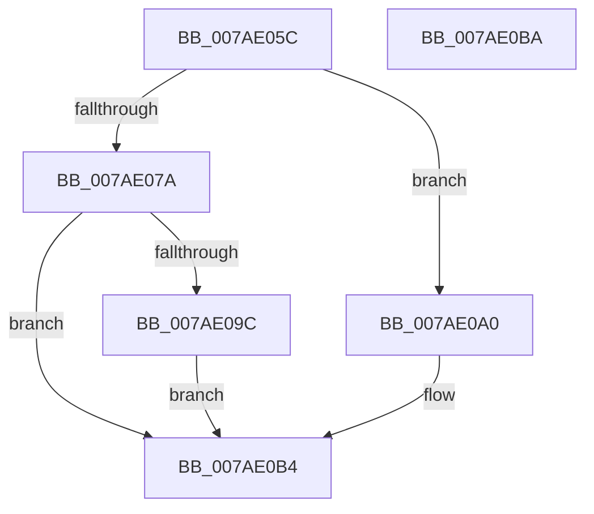

# VmpUnsecureMemoryForPin

- RVA: `0x007AE05C`–`0x007AE0BB` (길이 `95` bytes)
- VA: `0x00000001407AE05C`
- 실행 섹션: `PAGE`
- PDB 이름 있음: `예`; PDB Function 태그: `아니요`
- unwind 정보 RVA: `0x0005CF00`
- 디코드: `29`개 명령, `95/95` bytes 표시
- 미해석 바이트: `0` (있으면 어셈블리에 `.byte`로 보존)

> 이 문서는 커널 이미지의 기계어와 PDB 기호를 분석해 생성했습니다. 4번과 5번은 함수 원형과 자료형을 바이너리 사용 방식에서 추정한 C 해석이며 원본 소스 복구 결과는 아닙니다.

## 1. Dependencies

- 직접 호출 지점: **3**; 고유 호출 대상: **3**
- 직접 호출자로 확인된 함수: **4**
- RIP 상대 이미지 참조: **0**

### Outgoing calls
- `0x007AE093` → [MmAdjustSecuredVirtualMemorySize](../7F/MmAdjustSecuredVirtualMemorySize_function_007FE7E8.md) (function, `0x007FE7E8`)
- `0x007AE0A3` → [MmUnsecureVirtualMemory](../88/MmUnsecureVirtualMemory_function_0088A2A0.md) (function, `0x0088A2A0`)
- `0x007AE0AF` → [ExReleaseRundownProtection](../../text/34/ExReleaseRundownProtection_function_00349E80.md) (function, `0x00349E80`)

### Direct callers
- [VmpSplitMemoryRange](../../text/42/VmpSplitMemoryRange_function_00429754.md) at `0x00429B62`
- [VmpSplitMemoryRange](../../text/42/VmpSplitMemoryRange_function_00429754.md) at `0x00429B87`
- [VmpMergeMemoryRanges](../../text/4D/VmpMergeMemoryRanges_function_004D9EDC.md) at `0x004DA095`
- [VmpMergeMemoryRanges](../../text/4D/VmpMergeMemoryRanges_function_004D9EDC.md) at `0x004DA0BE`
- [VmpPinMemoryRange](../../text/64/VmpPinMemoryRange_function_0064CCD0.md) at `0x0064D131`
- [VmpPinMemoryRange](../../text/64/VmpPinMemoryRange_function_0064CCD0.md) at `0x0064D152`
- [VmpUnpinMemoryRangeHelper](../../text/64/VmpUnpinMemoryRangeHelper_function_0064D370.md) at `0x0064D560`

### Static image references
- 디코드된 RIP-relative 메모리 참조가 없습니다.

## 2. Other-region calls and transfers

- 다른 실행 섹션으로 향하는 call: **1**
  - `0x007AE0AF` → [ExReleaseRundownProtection](../../text/34/ExReleaseRundownProtection_function_00349E80.md) (`PAGE` → `.text`)
- 별도 외부 분기/꼬리 이동을 확인하지 못했습니다.

## 3. Assembly (complete function range)

```asm
007AE05C  40 53                           push rbx
007AE05E  48 83 EC 20                     sub rsp, 0x20
007AE062  4D 8B D0                        mov r10, r8
007AE065  48 8B D9                        mov rbx, rcx
007AE068  4C 8B 44 24 58                  mov r8, qword ptr [rsp + 0x58]
007AE06D  48 8B C2                        mov rax, rdx
007AE070  48 8B 4C 24 50                  mov rcx, qword ptr [rsp + 0x50]
007AE075  4D 3B C8                        cmp r9, r8
007AE078  74 26                           je 0x1407ae0a0
007AE07A  4D 2B C1                        sub r8, r9
007AE07D  4A 8D 14 09                     lea rdx, [rcx + r9]
007AE081  49 C1 E0 0C                     shl r8, 0xc
007AE085  4C 3B D1                        cmp r10, rcx
007AE088  48 0F 45 D1                     cmovne rdx, rcx
007AE08C  48 8B C8                        mov rcx, rax
007AE08F  48 C1 E2 0C                     shl rdx, 0xc
007AE093  E8 50 07 05 00                  call 0x1407fe7e8
007AE098  85 C0                           test eax, eax
007AE09A  79 18                           jns 0x1407ae0b4
007AE09C  CD 2C                           int 0x2c
007AE09E  EB 14                           jmp 0x1407ae0b4
007AE0A0  48 8B C8                        mov rcx, rax
007AE0A3  E8 F8 C1 0D 00                  call 0x14088a2a0
007AE0A8  48 8D 8B 80 00 00 00            lea rcx, [rbx + 0x80]
007AE0AF  E8 CC BD B9 FF                  call 0x140349e80
007AE0B4  48 83 C4 20                     add rsp, 0x20
007AE0B8  5B                              pop rbx
007AE0B9  C3                              ret
007AE0BA  CC                              int3
```

## 4. C-style interpretation (structured pseudocode)

```c
__int64 __fastcall VmpUnsecureMemoryForPin(__int64 a1, __int64 a2, __int64 a3, __int64 a4, __int64 a5, __int64 a6)
{
    __int64 result;
    __int64 v_rsp;

    v_rsp = (v_rsp) - (32);
    if (a4 == a6) goto loc_007AE0A0;
    a3 = (a6) - (a4);
    a3 = (a3) << (12);
    a2 = a5 + a4 * 1;
    if (a3 != a5) { a2 = a5; }
    a2 = (a2) << (12);
    result = MmAdjustSecuredVirtualMemorySize(a2, a2, a3, a4);
    if (!sign_flag) goto loc_007AE0B4;
    goto loc_007AE0B4;
loc_007AE0A0:
    result = MmUnsecureVirtualMemory(result, a2, a3, a4);
    result = ExReleaseRundownProtection(a1 + 128, a2, a3, a4);
loc_007AE0B4:
    v_rsp = (v_rsp) + (32);
    return result;
}
```

## 5. (Beta) C Style

```c
int64_t VmpUnsecureMemoryForPin(void *Arg1, int64_t Arg2, int64_t Arg3, int64_t Arg4, void *Arg5, int64_t Arg6)
{
    uint8_t *arg1 = (uint8_t *)Arg1;
    uint8_t *arg5 = (uint8_t *)Arg5;

    int64_t result;
    int64_t local_rsp;

    local_rsp = (local_rsp) - (32);
    if (Arg4 == Arg6) goto loc_007AE0A0;
    Arg3 = (Arg6) - (Arg4);
    Arg3 = (Arg3) << (12);
    Arg2 = Arg5 + Arg4 * 1;
    if (Arg3 != Arg5) { Arg2 = Arg5; }
    Arg2 = (Arg2) << (12);
    result = MmAdjustSecuredVirtualMemorySize(Arg2, Arg2, Arg3, Arg4);
    if (!sign_flag) goto loc_007AE0B4;
    goto loc_007AE0B4;
loc_007AE0A0:
    result = MmUnsecureVirtualMemory(result, Arg2, Arg3, Arg4);
    result = ExReleaseRundownProtection(Arg1 + 128, Arg2, Arg3, Arg4);
loc_007AE0B4:
    local_rsp = (local_rsp) + (32);
    return result;
}
```

### 관측된 메모리 오프셋

구조체 형식이 확인되지 않은 접근은 인자 기준의 오프셋으로만 기록했습니다.

| 기준 인자 | 오프셋 표현 | 폭 (bit) | 접근 |
|---|---:|---:|---|
| `Arg1` | `+ 0x80` | `64` | `R` |
| `Arg5` | `+ 0x0 + r9*1` | `64` | `R` |

## 6. Execution-region graph

[열기: 2D/3D 그래프와 함수 탐색 컨트롤 패널](../../../control-panel.html?section=page&rva=0x007AE05C&view=graph)

- 2D 그래프는 위에서 아래로 흐르고, 3D 그래프는 빈 공간을 드래그해 회전합니다. Shift+드래그는 이동, 휠은 확대·축소, 함수 노드 선택은 대상 보고서 이동입니다.

### Static fallback


