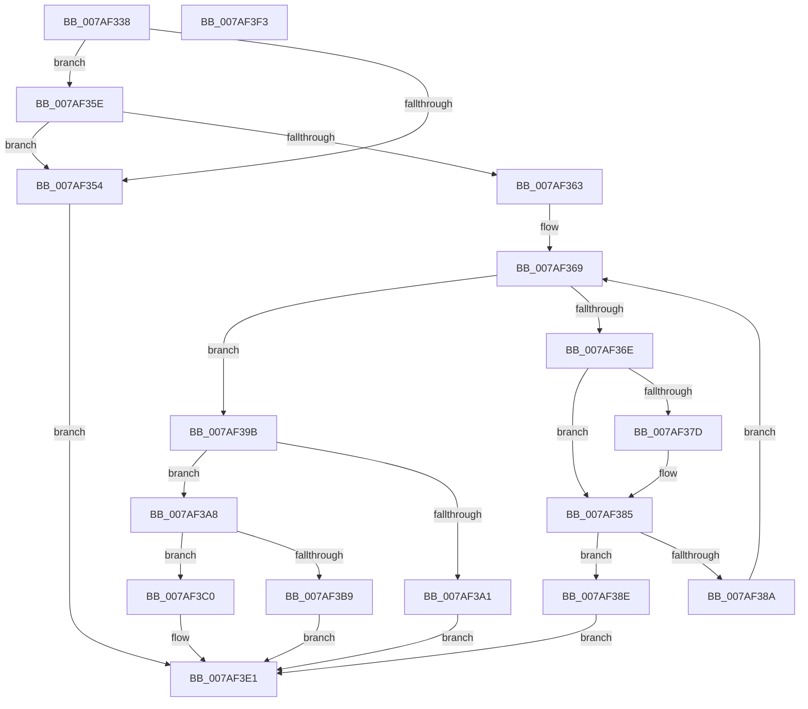

# WdipSemAddContextEventToScenario

- RVA: `0x007AF338`–`0x007AF3F4` (길이 `188` bytes)
- VA: `0x00000001407AF338`
- 실행 섹션: `PAGE`
- PDB 이름 있음: `예`; PDB Function 태그: `아니요`
- unwind 정보 RVA: `0x00060BC4`
- 디코드: `59`개 명령, `188/188` bytes 표시
- 미해석 바이트: `0` (있으면 어셈블리에 `.byte`로 보존)

> 이 문서는 커널 이미지의 기계어와 PDB 기호를 분석해 생성했습니다. 4번과 5번은 함수 원형과 자료형을 바이너리 사용 방식에서 추정한 C 해석이며 원본 소스 복구 결과는 아닙니다.

## 1. Dependencies

- 직접 호출 지점: **2**; 고유 호출 대상: **2**
- 직접 호출자로 확인된 함수: **1**
- RIP 상대 이미지 참조: **0**

### Outgoing calls
- `0x007AF394` → [WdipSemMergeEvents](../7B/WdipSemMergeEvents_function_007B0824.md) (function, `0x007B0824`)
- `0x007AF3AF` → [WdipSemFastAllocate](../A5/WdipSemFastAllocate_function_00A5DC04.md) (function, `0x00A5DC04`)

### Direct callers
- [WdipSemMergeScenarios](../7B/WdipSemMergeScenarios_function_007B0858.md) at `0x007B0896`

### Static image references
- 디코드된 RIP-relative 메모리 참조가 없습니다.

## 2. Other-region calls and transfers

- 다른 실행 섹션으로 향하는 call: **0**
- 별도 외부 분기/꼬리 이동을 확인하지 못했습니다.

## 3. Assembly (complete function range)

```asm
007AF338  48 89 5C 24 08                  mov qword ptr [rsp + 8], rbx
007AF33D  48 89 74 24 10                  mov qword ptr [rsp + 0x10], rsi
007AF342  57                              push rdi
007AF343  48 83 EC 20                     sub rsp, 0x20
007AF347  33 DB                           xor ebx, ebx
007AF349  48 8B FA                        mov rdi, rdx
007AF34C  48 8B F1                        mov rsi, rcx
007AF34F  48 85 C9                        test rcx, rcx
007AF352  75 0A                           jne 0x1407af35e
007AF354  BB 0D 00 00 C0                  mov ebx, 0xc000000d
007AF359  E9 83 00 00 00                  jmp 0x1407af3e1
007AF35E  48 85 FF                        test rdi, rdi
007AF361  74 F1                           je 0x1407af354
007AF363  44 8B 4E 30                     mov r9d, dword ptr [rsi + 0x30]
007AF367  8B CB                           mov ecx, ebx
007AF369  41 3B C9                        cmp ecx, r9d
007AF36C  73 2D                           jae 0x1407af39b
007AF36E  48 8B 17                        mov rdx, qword ptr [rdi]
007AF371  8B C1                           mov eax, ecx
007AF373  4C 8B 44 C6 38                  mov r8, qword ptr [rsi + rax*8 + 0x38]
007AF378  49 2B 10                        sub rdx, qword ptr [r8]
007AF37B  75 08                           jne 0x1407af385
007AF37D  48 8B 57 08                     mov rdx, qword ptr [rdi + 8]
007AF381  49 2B 50 08                     sub rdx, qword ptr [r8 + 8]
007AF385  48 85 D2                        test rdx, rdx
007AF388  74 04                           je 0x1407af38e
007AF38A  FF C1                           inc ecx
007AF38C  EB DB                           jmp 0x1407af369
007AF38E  48 8B D7                        mov rdx, rdi
007AF391  49 8B C8                        mov rcx, r8
007AF394  E8 8B 14 00 00                  call 0x1407b0824
007AF399  EB 46                           jmp 0x1407af3e1
007AF39B  41 83 F9 7C                     cmp r9d, 0x7c
007AF39F  72 07                           jb 0x1407af3a8
007AF3A1  BB 01 00 00 C0                  mov ebx, 0xc0000001
007AF3A6  EB 39                           jmp 0x1407af3e1
007AF3A8  BA 30 00 00 00                  mov edx, 0x30
007AF3AD  33 C9                           xor ecx, ecx
007AF3AF  E8 50 E8 2A 00                  call 0x140a5dc04
007AF3B4  48 85 C0                        test rax, rax
007AF3B7  75 07                           jne 0x1407af3c0
007AF3B9  BB 9A 00 00 C0                  mov ebx, 0xc000009a
007AF3BE  EB 21                           jmp 0x1407af3e1
007AF3C0  0F 10 07                        movups xmm0, xmmword ptr [rdi]
007AF3C3  0F 11 00                        movups xmmword ptr [rax], xmm0
007AF3C6  0F 10 4F 10                     movups xmm1, xmmword ptr [rdi + 0x10]
007AF3CA  0F 11 48 10                     movups xmmword ptr [rax + 0x10], xmm1
007AF3CE  0F 10 47 20                     movups xmm0, xmmword ptr [rdi + 0x20]
007AF3D2  0F 11 40 20                     movups xmmword ptr [rax + 0x20], xmm0
007AF3D6  8B 4E 30                        mov ecx, dword ptr [rsi + 0x30]
007AF3D9  48 89 44 CE 38                  mov qword ptr [rsi + rcx*8 + 0x38], rax
007AF3DE  FF 46 30                        inc dword ptr [rsi + 0x30]
007AF3E1  48 8B 74 24 38                  mov rsi, qword ptr [rsp + 0x38]
007AF3E6  8B C3                           mov eax, ebx
007AF3E8  48 8B 5C 24 30                  mov rbx, qword ptr [rsp + 0x30]
007AF3ED  48 83 C4 20                     add rsp, 0x20
007AF3F1  5F                              pop rdi
007AF3F2  C3                              ret
007AF3F3  CC                              int3
```

## 4. C-style interpretation (structured pseudocode)

```c
__int64 __fastcall WdipSemAddContextEventToScenario(__int64 a1, __int64 a2)
{
    __int64 result;
    __int64 v_rbx;
    __int64 v_rsp;
    unsigned __int64 v_stack_p10;
    unsigned __int64 v_stack_p8;

    v_stack_p8 = v_rbx;
    v_stack_p10 = v_rsi;
    v_rsp = (v_rsp) - (32);
    v_rbx = 0;
    if (a1 != 0) goto loc_007AF35E;
loc_007AF354:
    goto loc_007AF3E1;
loc_007AF35E:
    if (a2 == 0) goto loc_007AF354;
loc_007AF369:
    if (((unsigned int)((unsigned int)((unsigned int)((unsigned int)(0xC000000DULL))))) >= ((unsigned int)((unsigned int)(*(unsigned int *)(a1 + 48))))) goto loc_007AF39B;
    a2 = (*(unsigned __int64 *)(a2)) - (*(unsigned __int64 *)(*(unsigned __int64 *)(a1 + (unsigned int)((unsigned int)((unsigned int)((unsigned int)((unsigned int)(0xC000000DULL))))) * 8 + 56)));
    if (!(condition_is_not_equal)) {
        a2 = *(unsigned __int64 *)(a2 + 8);
        a2 = (a2) - (*(unsigned __int64 *)(*(unsigned __int64 *)(a1 + (unsigned int)((unsigned int)((unsigned int)((unsigned int)((unsigned int)(0xC000000DULL))))) * 8 + 56) + 8));
    }
    if (a2 == 0) goto loc_007AF38E;
    a1 = (unsigned int)(((unsigned int)((unsigned int)((unsigned int)(0xC000000DULL)))) + 1);
    goto loc_007AF369;
loc_007AF38E:
    result = WdipSemMergeEvents(*(unsigned __int64 *)(a1 + (unsigned int)((unsigned int)((unsigned int)((unsigned int)((unsigned int)(0xC000000DULL))))) * 8 + 56), a2, *(unsigned __int64 *)(a1 + (unsigned int)((unsigned int)((unsigned int)((unsigned int)((unsigned int)(0xC000000DULL))))) * 8 + 56), (unsigned int)(*(unsigned int *)(a1 + 48)));
    goto loc_007AF3E1;
loc_007AF39B:
    if (((unsigned int)((unsigned int)(*(unsigned int *)(a1 + 48)))) < 124) goto loc_007AF3A8;
    goto loc_007AF3E1;
loc_007AF3A8:
    a1 = 0;
    result = WdipSemFastAllocate(a1, 48, *(unsigned __int64 *)(a1 + (unsigned int)((unsigned int)((unsigned int)((unsigned int)((unsigned int)(0xC000000DULL))))) * 8 + 56), (unsigned int)(*(unsigned int *)(a1 + 48)));
    if (result != 0) goto loc_007AF3C0;
    goto loc_007AF3E1;
loc_007AF3C0:
    *(unsigned __int64 *)(result) = v_xmm0;
    *(unsigned __int64 *)(result + 16) = v_xmm1;
    *(unsigned __int64 *)(result + 32) = v_xmm0;
    *(unsigned __int64 *)(a1 + (unsigned int)(*(unsigned int *)(a1 + 48)) * 8 + 56) = result;
loc_007AF3E1:
    v_rsp = (v_rsp) + (32);
    return (unsigned int)((unsigned int)((unsigned int)(0xC000009AULL)));
}
```

## 5. (Beta) C Style

```c
int64_t WdipSemAddContextEventToScenario(void *Arg1, int64_t Arg2)
{
    uint8_t *arg1 = (uint8_t *)Arg1;

    int64_t result;
    int64_t local_rbx;
    int64_t local_rsp;
    uint64_t v_stack_p10;
    uint64_t v_stack_p8;

    v_stack_p8 = local_rbx;
    v_stack_p10 = local_rsi;
    local_rsp = (local_rsp) - (32);
    local_rbx = 0;
    if (Arg1 != NULL) goto loc_007AF35E;
loc_007AF354:
    goto loc_007AF3E1;
loc_007AF35E:
    if (Arg2 == 0) goto loc_007AF354;
loc_007AF369:
    if (((uint32_t)((uint32_t)((uint32_t)((uint32_t)(0xC000000DULL))))) >= ((uint32_t)((uint32_t)(*(uint32_t *)(arg1 + 0x30))))) goto loc_007AF39B;
    Arg2 = (*(uint64_t *)(Arg2)) - (*(uint64_t *)(*(uint64_t *)(arg1 + (uint32_t)((uint32_t)((uint32_t)((uint32_t)((uint32_t)(0xC000000DULL))))) * 8 + 0x38)));
    if (!(condition_is_not_equal)) {
        Arg2 = *(uint64_t *)(Arg2 + 0x8);
        Arg2 = (Arg2) - (*(uint64_t *)(*(uint64_t *)(arg1 + (uint32_t)((uint32_t)((uint32_t)((uint32_t)((uint32_t)(0xC000000DULL))))) * 8 + 0x38) + 0x8));
    }
    if (Arg2 == 0) goto loc_007AF38E;
    Arg1 = (uint32_t)(((uint32_t)((uint32_t)((uint32_t)(0xC000000DULL)))) + 1);
    goto loc_007AF369;
loc_007AF38E:
    result = WdipSemMergeEvents(*(uint64_t *)(arg1 + (uint32_t)((uint32_t)((uint32_t)((uint32_t)((uint32_t)(0xC000000DULL))))) * 8 + 0x38), Arg2, *(uint64_t *)(arg1 + (uint32_t)((uint32_t)((uint32_t)((uint32_t)((uint32_t)(0xC000000DULL))))) * 8 + 0x38), (uint32_t)(*(uint32_t *)(arg1 + 0x30)));
    goto loc_007AF3E1;
loc_007AF39B:
    if (((uint32_t)((uint32_t)(*(uint32_t *)(arg1 + 0x30)))) < 124) goto loc_007AF3A8;
    goto loc_007AF3E1;
loc_007AF3A8:
    Arg1 = 0;
    result = WdipSemFastAllocate(Arg1, 48, *(uint64_t *)(arg1 + (uint32_t)((uint32_t)((uint32_t)((uint32_t)((uint32_t)(0xC000000DULL))))) * 8 + 0x38), (uint32_t)(*(uint32_t *)(arg1 + 0x30)));
    if (result != 0) goto loc_007AF3C0;
    goto loc_007AF3E1;
loc_007AF3C0:
    *(uint64_t *)(result) = v_xmm0;
    *(uint64_t *)(result + 0x10) = v_xmm1;
    *(uint64_t *)(result + 0x20) = v_xmm0;
    *(uint64_t *)(arg1 + (uint32_t)(*(uint32_t *)(arg1 + 0x30)) * 8 + 0x38) = result;
loc_007AF3E1:
    local_rsp = (local_rsp) + (32);
    return (uint32_t)((uint32_t)((uint32_t)(0xC000009AULL)));
}
```

### 관측된 메모리 오프셋

구조체 형식이 확인되지 않은 접근은 인자 기준의 오프셋으로만 기록했습니다.

| 기준 인자 | 오프셋 표현 | 폭 (bit) | 접근 |
|---|---:|---:|---|
| `Arg1` | `+ 0x30` | `32` | `R` |
| `Arg1` | `+ 0x30` | `32` | `R/W` |
| `Arg1` | `+ 0x38 + rax*8` | `64` | `R` |
| `Arg1` | `+ 0x38 + rcx*8` | `64` | `W` |

## 6. Execution-region graph

[열기: 2D/3D 그래프와 함수 탐색 컨트롤 패널](../../../control-panel.html?section=page&rva=0x007AF338&view=graph)

- 2D 그래프는 위에서 아래로 흐르고, 3D 그래프는 빈 공간을 드래그해 회전합니다. Shift+드래그는 이동, 휠은 확대·축소, 함수 노드 선택은 대상 보고서 이동입니다.

### Static fallback


