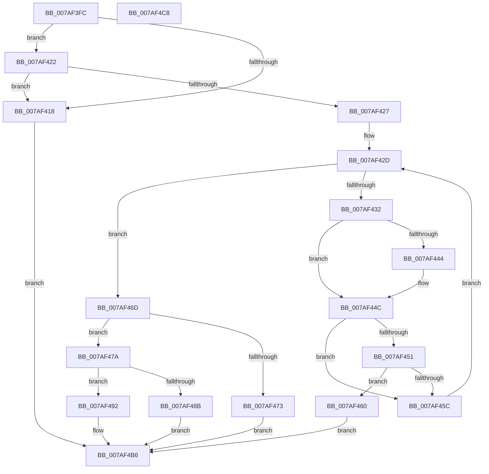

# WdipSemAddEndEventToScenario

- RVA: `0x007AF3FC`–`0x007AF4C9` (길이 `205` bytes)
- VA: `0x00000001407AF3FC`
- 실행 섹션: `PAGE`
- PDB 이름 있음: `예`; PDB Function 태그: `아니요`
- unwind 정보 RVA: `0x00060BC4`
- 디코드: `62`개 명령, `205/205` bytes 표시
- 미해석 바이트: `0` (있으면 어셈블리에 `.byte`로 보존)

> 이 문서는 커널 이미지의 기계어와 PDB 기호를 분석해 생성했습니다. 4번과 5번은 함수 원형과 자료형을 바이너리 사용 방식에서 추정한 C 해석이며 원본 소스 복구 결과는 아닙니다.

## 1. Dependencies

- 직접 호출 지점: **2**; 고유 호출 대상: **2**
- 직접 호출자로 확인된 함수: **1**
- RIP 상대 이미지 참조: **0**

### Outgoing calls
- `0x007AF466` → [WdipSemMergeEvents](../7B/WdipSemMergeEvents_function_007B0824.md) (function, `0x007B0824`)
- `0x007AF481` → [WdipSemFastAllocate](../A5/WdipSemFastAllocate_function_00A5DC04.md) (function, `0x00A5DC04`)

### Direct callers
- [WdipSemMergeScenarios](../7B/WdipSemMergeScenarios_function_007B0858.md) at `0x007B08B8`

### Static image references
- 디코드된 RIP-relative 메모리 참조가 없습니다.

## 2. Other-region calls and transfers

- 다른 실행 섹션으로 향하는 call: **0**
- 별도 외부 분기/꼬리 이동을 확인하지 못했습니다.

## 3. Assembly (complete function range)

```asm
007AF3FC  48 89 5C 24 08                  mov qword ptr [rsp + 8], rbx
007AF401  48 89 74 24 10                  mov qword ptr [rsp + 0x10], rsi
007AF406  57                              push rdi
007AF407  48 83 EC 20                     sub rsp, 0x20
007AF40B  33 DB                           xor ebx, ebx
007AF40D  48 8B FA                        mov rdi, rdx
007AF410  48 8B F1                        mov rsi, rcx
007AF413  48 85 C9                        test rcx, rcx
007AF416  75 0A                           jne 0x1407af422
007AF418  BB 0D 00 00 C0                  mov ebx, 0xc000000d
007AF41D  E9 94 00 00 00                  jmp 0x1407af4b6
007AF422  48 85 FF                        test rdi, rdi
007AF425  74 F1                           je 0x1407af418
007AF427  44 8B 4E 34                     mov r9d, dword ptr [rsi + 0x34]
007AF42B  8B CB                           mov ecx, ebx
007AF42D  41 3B C9                        cmp ecx, r9d
007AF430  73 3B                           jae 0x1407af46d
007AF432  48 8B 17                        mov rdx, qword ptr [rdi]
007AF435  8B C1                           mov eax, ecx
007AF437  4C 8B 84 C6 18 04 00 00         mov r8, qword ptr [rsi + rax*8 + 0x418]
007AF43F  49 2B 10                        sub rdx, qword ptr [r8]
007AF442  75 08                           jne 0x1407af44c
007AF444  48 8B 57 08                     mov rdx, qword ptr [rdi + 8]
007AF448  49 2B 50 08                     sub rdx, qword ptr [r8 + 8]
007AF44C  48 85 D2                        test rdx, rdx
007AF44F  75 0B                           jne 0x1407af45c
007AF451  41 0F B7 40 10                  movzx eax, word ptr [r8 + 0x10]
007AF456  66 39 47 10                     cmp word ptr [rdi + 0x10], ax
007AF45A  74 04                           je 0x1407af460
007AF45C  FF C1                           inc ecx
007AF45E  EB CD                           jmp 0x1407af42d
007AF460  48 8B D7                        mov rdx, rdi
007AF463  49 8B C8                        mov rcx, r8
007AF466  E8 B9 13 00 00                  call 0x1407b0824
007AF46B  EB 49                           jmp 0x1407af4b6
007AF46D  41 83 F9 10                     cmp r9d, 0x10
007AF471  72 07                           jb 0x1407af47a
007AF473  BB 01 00 00 C0                  mov ebx, 0xc0000001
007AF478  EB 3C                           jmp 0x1407af4b6
007AF47A  BA 30 00 00 00                  mov edx, 0x30
007AF47F  33 C9                           xor ecx, ecx
007AF481  E8 7E E7 2A 00                  call 0x140a5dc04
007AF486  48 85 C0                        test rax, rax
007AF489  75 07                           jne 0x1407af492
007AF48B  BB 9A 00 00 C0                  mov ebx, 0xc000009a
007AF490  EB 24                           jmp 0x1407af4b6
007AF492  0F 10 07                        movups xmm0, xmmword ptr [rdi]
007AF495  0F 11 00                        movups xmmword ptr [rax], xmm0
007AF498  0F 10 4F 10                     movups xmm1, xmmword ptr [rdi + 0x10]
007AF49C  0F 11 48 10                     movups xmmword ptr [rax + 0x10], xmm1
007AF4A0  0F 10 47 20                     movups xmm0, xmmword ptr [rdi + 0x20]
007AF4A4  0F 11 40 20                     movups xmmword ptr [rax + 0x20], xmm0
007AF4A8  8B 4E 34                        mov ecx, dword ptr [rsi + 0x34]
007AF4AB  48 89 84 CE 18 04 00 00         mov qword ptr [rsi + rcx*8 + 0x418], rax
007AF4B3  FF 46 34                        inc dword ptr [rsi + 0x34]
007AF4B6  48 8B 74 24 38                  mov rsi, qword ptr [rsp + 0x38]
007AF4BB  8B C3                           mov eax, ebx
007AF4BD  48 8B 5C 24 30                  mov rbx, qword ptr [rsp + 0x30]
007AF4C2  48 83 C4 20                     add rsp, 0x20
007AF4C6  5F                              pop rdi
007AF4C7  C3                              ret
007AF4C8  CC                              int3
```

## 4. C-style interpretation (structured pseudocode)

```c
__int64 __fastcall WdipSemAddEndEventToScenario(__int64 a1, __int64 a2)
{
    __int64 result;
    __int64 v_rbx;
    __int64 v_rsp;
    unsigned __int64 v_stack_p10;
    unsigned __int64 v_stack_p8;

    v_stack_p8 = v_rbx;
    v_stack_p10 = v_rsi;
    v_rsp = (v_rsp) - (32);
    v_rbx = 0;
    if (a1 != 0) goto loc_007AF422;
loc_007AF418:
    goto loc_007AF4B6;
loc_007AF422:
    if (a2 == 0) goto loc_007AF418;
loc_007AF42D:
    if (((unsigned int)((unsigned int)((unsigned int)((unsigned int)(0xC000000DULL))))) >= ((unsigned int)((unsigned int)(*(unsigned int *)(a1 + 52))))) goto loc_007AF46D;
    a2 = (*(unsigned __int64 *)(a2)) - (*(unsigned __int64 *)(*(unsigned __int64 *)(a1 + (unsigned int)((unsigned int)((unsigned int)((unsigned int)((unsigned int)(0xC000000DULL))))) * 8 + 1048)));
    if (!(condition_is_not_equal)) {
        a2 = *(unsigned __int64 *)(a2 + 8);
        a2 = (a2) - (*(unsigned __int64 *)(*(unsigned __int64 *)(a1 + (unsigned int)((unsigned int)((unsigned int)((unsigned int)((unsigned int)(0xC000000DULL))))) * 8 + 1048) + 8));
    }
    if (a2 != 0) goto loc_007AF45C;
    if ((*(unsigned __int16 *)(a2 + 16)) == ((unsigned __int16)(*(unsigned __int16 *)(*(unsigned __int64 *)(a1 + (unsigned int)((unsigned int)((unsigned int)((unsigned int)((unsigned int)(0xC000000DULL))))) * 8 + 1048) + 16)))) goto loc_007AF460;
loc_007AF45C:
    a1 = (unsigned int)(((unsigned int)((unsigned int)((unsigned int)(0xC000000DULL)))) + 1);
    goto loc_007AF42D;
loc_007AF460:
    result = WdipSemMergeEvents(*(unsigned __int64 *)(a1 + (unsigned int)((unsigned int)((unsigned int)((unsigned int)((unsigned int)(0xC000000DULL))))) * 8 + 1048), a2, *(unsigned __int64 *)(a1 + (unsigned int)((unsigned int)((unsigned int)((unsigned int)((unsigned int)(0xC000000DULL))))) * 8 + 1048), (unsigned int)(*(unsigned int *)(a1 + 52)));
    goto loc_007AF4B6;
loc_007AF46D:
    if (((unsigned int)((unsigned int)(*(unsigned int *)(a1 + 52)))) < 16) goto loc_007AF47A;
    goto loc_007AF4B6;
loc_007AF47A:
    a1 = 0;
    result = WdipSemFastAllocate(a1, 48, *(unsigned __int64 *)(a1 + (unsigned int)((unsigned int)((unsigned int)((unsigned int)((unsigned int)(0xC000000DULL))))) * 8 + 1048), (unsigned int)(*(unsigned int *)(a1 + 52)));
    if (result != 0) goto loc_007AF492;
    goto loc_007AF4B6;
loc_007AF492:
    *(unsigned __int64 *)(result) = v_xmm0;
    *(unsigned __int64 *)(result + 16) = v_xmm1;
    *(unsigned __int64 *)(result + 32) = v_xmm0;
    *(unsigned __int64 *)(a1 + (unsigned int)(*(unsigned int *)(a1 + 52)) * 8 + 1048) = result;
loc_007AF4B6:
    v_rsp = (v_rsp) + (32);
    return (unsigned int)((unsigned int)((unsigned int)(0xC000009AULL)));
}
```

## 5. (Beta) C Style

```c
int64_t WdipSemAddEndEventToScenario(void *Arg1, int64_t Arg2)
{
    uint8_t *arg1 = (uint8_t *)Arg1;

    int64_t result;
    int64_t local_rbx;
    int64_t local_rsp;
    uint64_t v_stack_p10;
    uint64_t v_stack_p8;

    v_stack_p8 = local_rbx;
    v_stack_p10 = local_rsi;
    local_rsp = (local_rsp) - (32);
    local_rbx = 0;
    if (Arg1 != NULL) goto loc_007AF422;
loc_007AF418:
    goto loc_007AF4B6;
loc_007AF422:
    if (Arg2 == 0) goto loc_007AF418;
loc_007AF42D:
    if (((uint32_t)((uint32_t)((uint32_t)((uint32_t)(0xC000000DULL))))) >= ((uint32_t)((uint32_t)(*(uint32_t *)(arg1 + 0x34))))) goto loc_007AF46D;
    Arg2 = (*(uint64_t *)(Arg2)) - (*(uint64_t *)(*(uint64_t *)(arg1 + (uint32_t)((uint32_t)((uint32_t)((uint32_t)((uint32_t)(0xC000000DULL))))) * 8 + 0x418)));
    if (!(condition_is_not_equal)) {
        Arg2 = *(uint64_t *)(Arg2 + 0x8);
        Arg2 = (Arg2) - (*(uint64_t *)(*(uint64_t *)(arg1 + (uint32_t)((uint32_t)((uint32_t)((uint32_t)((uint32_t)(0xC000000DULL))))) * 8 + 0x418) + 0x8));
    }
    if (Arg2 != 0) goto loc_007AF45C;
    if ((*(uint16_t *)(Arg2 + 0x10)) == ((uint16_t)(*(uint16_t *)(*(uint64_t *)(arg1 + (uint32_t)((uint32_t)((uint32_t)((uint32_t)((uint32_t)(0xC000000DULL))))) * 8 + 0x418) + 0x10)))) goto loc_007AF460;
loc_007AF45C:
    Arg1 = (uint32_t)(((uint32_t)((uint32_t)((uint32_t)(0xC000000DULL)))) + 1);
    goto loc_007AF42D;
loc_007AF460:
    result = WdipSemMergeEvents(*(uint64_t *)(arg1 + (uint32_t)((uint32_t)((uint32_t)((uint32_t)((uint32_t)(0xC000000DULL))))) * 8 + 0x418), Arg2, *(uint64_t *)(arg1 + (uint32_t)((uint32_t)((uint32_t)((uint32_t)((uint32_t)(0xC000000DULL))))) * 8 + 0x418), (uint32_t)(*(uint32_t *)(arg1 + 0x34)));
    goto loc_007AF4B6;
loc_007AF46D:
    if (((uint32_t)((uint32_t)(*(uint32_t *)(arg1 + 0x34)))) < 16) goto loc_007AF47A;
    goto loc_007AF4B6;
loc_007AF47A:
    Arg1 = 0;
    result = WdipSemFastAllocate(Arg1, 48, *(uint64_t *)(arg1 + (uint32_t)((uint32_t)((uint32_t)((uint32_t)((uint32_t)(0xC000000DULL))))) * 8 + 0x418), (uint32_t)(*(uint32_t *)(arg1 + 0x34)));
    if (result != 0) goto loc_007AF492;
    goto loc_007AF4B6;
loc_007AF492:
    *(uint64_t *)(result) = v_xmm0;
    *(uint64_t *)(result + 0x10) = v_xmm1;
    *(uint64_t *)(result + 0x20) = v_xmm0;
    *(uint64_t *)(arg1 + (uint32_t)(*(uint32_t *)(arg1 + 0x34)) * 8 + 0x418) = result;
loc_007AF4B6:
    local_rsp = (local_rsp) + (32);
    return (uint32_t)((uint32_t)((uint32_t)(0xC000009AULL)));
}
```

### 관측된 메모리 오프셋

구조체 형식이 확인되지 않은 접근은 인자 기준의 오프셋으로만 기록했습니다.

| 기준 인자 | 오프셋 표현 | 폭 (bit) | 접근 |
|---|---:|---:|---|
| `Arg1` | `+ 0x34` | `32` | `R` |
| `Arg1` | `+ 0x34` | `32` | `R/W` |
| `Arg1` | `+ 0x418 + rax*8` | `64` | `R` |
| `Arg1` | `+ 0x418 + rcx*8` | `64` | `W` |

## 6. Execution-region graph

[열기: 2D/3D 그래프와 함수 탐색 컨트롤 패널](../../../control-panel.html?section=page&rva=0x007AF3FC&view=graph)

- 2D 그래프는 위에서 아래로 흐르고, 3D 그래프는 빈 공간을 드래그해 회전합니다. Shift+드래그는 이동, 휠은 확대·축소, 함수 노드 선택은 대상 보고서 이동입니다.

### Static fallback


