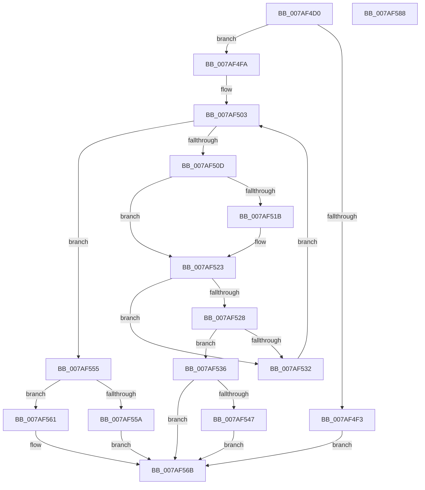

# WdipSemAddScenarioToTable

- RVA: `0x007AF4D0`–`0x007AF589` (길이 `185` bytes)
- VA: `0x00000001407AF4D0`
- 실행 섹션: `PAGE`
- PDB 이름 있음: `예`; PDB Function 태그: `아니요`
- unwind 정보 RVA: `0x0005E6B4`
- 디코드: `57`개 명령, `185/185` bytes 표시
- 미해석 바이트: `0` (있으면 어셈블리에 `.byte`로 보존)

> 이 문서는 커널 이미지의 기계어와 PDB 기호를 분석해 생성했습니다. 4번과 5번은 함수 원형과 자료형을 바이너리 사용 방식에서 추정한 C 해석이며 원본 소스 복구 결과는 아닙니다.

## 1. Dependencies

- 직접 호출 지점: **2**; 고유 호출 대상: **2**
- 직접 호출자로 확인된 함수: **1**
- RIP 상대 이미지 참조: **3**

### Outgoing calls
- `0x007AF53C` → [WdipSemMergeScenarios](../7B/WdipSemMergeScenarios_function_007B0858.md) (function, `0x007B0858`)
- `0x007AF54E` → [WdipSemFreeScenario](../7B/WdipSemFreeScenario_function_007B1060.md) (function, `0x007B1060`)

### Direct callers
- [WdipSemLoadScenarioTable](../7B/WdipSemLoadScenarioTable_function_007B02D8.md) at `0x007B06EC`

### Static image references
- `0x007AF4FC` → RVA `0x00F01E20` (`.data`; read)
- `0x007AF503` → RVA `0x00F02020` (`.data`; read)
- `0x007AF565` → RVA `0x00F02020` (`.data`; read/write)

## 2. Other-region calls and transfers

- 다른 실행 섹션으로 향하는 call: **0**
- 별도 외부 분기/꼬리 이동을 확인하지 못했습니다.

## 3. Assembly (complete function range)

```asm
007AF4D0  48 8B C4                        mov rax, rsp
007AF4D3  48 89 58 08                     mov qword ptr [rax + 8], rbx
007AF4D7  48 89 68 10                     mov qword ptr [rax + 0x10], rbp
007AF4DB  48 89 70 18                     mov qword ptr [rax + 0x18], rsi
007AF4DF  48 89 78 20                     mov qword ptr [rax + 0x20], rdi
007AF4E3  41 56                           push r14
007AF4E5  48 83 EC 20                     sub rsp, 0x20
007AF4E9  33 FF                           xor edi, edi
007AF4EB  48 8B D9                        mov rbx, rcx
007AF4EE  48 85 C9                        test rcx, rcx
007AF4F1  75 07                           jne 0x1407af4fa
007AF4F3  BF 0D 00 00 C0                  mov edi, 0xc000000d
007AF4F8  EB 71                           jmp 0x1407af56b
007AF4FA  33 C9                           xor ecx, ecx
007AF4FC  4C 8D 35 1D 29 75 00            lea r14, [rip + 0x75291d]
007AF503  8B 05 17 2B 75 00               mov eax, dword ptr [rip + 0x752b17]
007AF509  3B C8                           cmp ecx, eax
007AF50B  73 48                           jae 0x1407af555
007AF50D  49 8B 34 CE                     mov rsi, qword ptr [r14 + rcx*8]
007AF511  8B E9                           mov ebp, ecx
007AF513  48 8B 16                        mov rdx, qword ptr [rsi]
007AF516  48 2B 13                        sub rdx, qword ptr [rbx]
007AF519  75 08                           jne 0x1407af523
007AF51B  48 8B 56 08                     mov rdx, qword ptr [rsi + 8]
007AF51F  48 2B 53 08                     sub rdx, qword ptr [rbx + 8]
007AF523  48 85 D2                        test rdx, rdx
007AF526  75 0A                           jne 0x1407af532
007AF528  0F B7 43 10                     movzx eax, word ptr [rbx + 0x10]
007AF52C  66 39 46 10                     cmp word ptr [rsi + 0x10], ax
007AF530  74 04                           je 0x1407af536
007AF532  FF C1                           inc ecx
007AF534  EB CD                           jmp 0x1407af503
007AF536  48 8B D6                        mov rdx, rsi
007AF539  48 8B CB                        mov rcx, rbx
007AF53C  E8 17 13 00 00                  call 0x1407b0858
007AF541  8B F8                           mov edi, eax
007AF543  85 C0                           test eax, eax
007AF545  78 24                           js 0x1407af56b
007AF547  48 8B CE                        mov rcx, rsi
007AF54A  49 89 1C EE                     mov qword ptr [r14 + rbp*8], rbx
007AF54E  E8 0D 1B 00 00                  call 0x1407b1060
007AF553  EB 16                           jmp 0x1407af56b
007AF555  83 F8 40                        cmp eax, 0x40
007AF558  72 07                           jb 0x1407af561
007AF55A  BF 01 00 00 C0                  mov edi, 0xc0000001
007AF55F  EB 0A                           jmp 0x1407af56b
007AF561  49 89 1C C6                     mov qword ptr [r14 + rax*8], rbx
007AF565  FF 05 B5 2A 75 00               inc dword ptr [rip + 0x752ab5]
007AF56B  48 8B 5C 24 30                  mov rbx, qword ptr [rsp + 0x30]
007AF570  8B C7                           mov eax, edi
007AF572  48 8B 7C 24 48                  mov rdi, qword ptr [rsp + 0x48]
007AF577  48 8B 6C 24 38                  mov rbp, qword ptr [rsp + 0x38]
007AF57C  48 8B 74 24 40                  mov rsi, qword ptr [rsp + 0x40]
007AF581  48 83 C4 20                     add rsp, 0x20
007AF585  41 5E                           pop r14
007AF587  C3                              ret
007AF588  CC                              int3
```

## 4. C-style interpretation (structured pseudocode)

```c
__int64 __fastcall WdipSemAddScenarioToTable(__int64 a1)
{
    __int64 result;
    __int64 v_rdi;
    __int64 v_rsp;
    unsigned __int64 v_stack_p10;
    unsigned __int64 v_stack_p18;
    unsigned __int64 v_stack_p20;
    unsigned __int64 v_stack_p8;

    *(unsigned __int64 *)(v_rsp + 8) = v_rbx;
    *(unsigned __int64 *)(v_rsp + 16) = v_rbp;
    *(unsigned __int64 *)(v_rsp + 24) = v_rsi;
    *(unsigned __int64 *)(v_rsp + 32) = v_rdi;
    v_rsp = (v_rsp) - (32);
    v_rdi = 0;
    if (a1 != 0) goto loc_007AF4FA;
    goto loc_007AF56B;
loc_007AF4FA:
    a1 = 0;
loc_007AF503:
    if (0 >= ((unsigned int)((unsigned int)(*(unsigned int *)(v_rip + 7678743))))) goto loc_007AF555;
    a2 = (*(unsigned __int64 *)(*(unsigned __int64 *)(v_rip + 7678237 + a1 * 8))) - (*(unsigned __int64 *)(a1));
    if (!(condition_is_not_equal)) {
        a2 = *(unsigned __int64 *)(*(unsigned __int64 *)(v_rip + 7678237 + a1 * 8) + 8);
        a2 = (a2) - (*(unsigned __int64 *)(a1 + 8));
    }
    if (a2 != 0) goto loc_007AF532;
    if ((*(unsigned __int16 *)(*(unsigned __int64 *)(v_rip + 7678237 + a1 * 8) + 16)) == ((unsigned __int16)(*(unsigned __int16 *)(a1 + 16)))) goto loc_007AF536;
loc_007AF532:
    a1 = (unsigned int)((a1) + 1);
    goto loc_007AF503;
loc_007AF536:
    result = WdipSemMergeScenarios(a1, *(unsigned __int64 *)(v_rip + 7678237 + a1 * 8), a3, a4);
    if (sign_flag) goto loc_007AF56B;
    *(unsigned __int64 *)(v_rip + 7678237 + 0 * 8) = a1;
    result = WdipSemFreeScenario(*(unsigned __int64 *)(v_rip + 7678237 + a1 * 8), *(unsigned __int64 *)(v_rip + 7678237 + a1 * 8), a3, a4);
    goto loc_007AF56B;
loc_007AF555:
    if (((unsigned int)(result)) < 64) goto loc_007AF561;
    goto loc_007AF56B;
loc_007AF561:
    *(unsigned __int64 *)(v_rip + 7678237 + result * 8) = a1;
loc_007AF56B:
    v_rsp = (v_rsp) + (32);
    return (unsigned int)((unsigned int)((unsigned int)(0xC0000001ULL)));
}
```

## 5. (Beta) C Style

```c
int64_t WdipSemAddScenarioToTable(void *Arg1)
{
    uint8_t *arg1 = (uint8_t *)Arg1;

    int64_t result;
    int64_t local_rdi;
    int64_t local_rsp;
    uint64_t v_stack_p10;
    uint64_t v_stack_p18;
    uint64_t v_stack_p20;
    uint64_t v_stack_p8;

    *(uint64_t *)(local_rsp + 0x8) = local_rbx;
    *(uint64_t *)(local_rsp + 0x10) = local_rbp;
    *(uint64_t *)(local_rsp + 0x18) = local_rsi;
    *(uint64_t *)(local_rsp + 0x20) = local_rdi;
    local_rsp = (local_rsp) - (32);
    local_rdi = 0;
    if (Arg1 != NULL) goto loc_007AF4FA;
    goto loc_007AF56B;
loc_007AF4FA:
    Arg1 = 0;
loc_007AF503:
    if (0 >= ((uint32_t)((uint32_t)(*(uint32_t *)(v_rip + 0x752B17))))) goto loc_007AF555;
    a2 = (*(uint64_t *)(*(uint64_t *)(v_rip + 0x75291D + arg1 * 8))) - (*(uint64_t *)(arg1));
    if (!(condition_is_not_equal)) {
        a2 = *(uint64_t *)(*(uint64_t *)(v_rip + 0x75291D + arg1 * 8) + 0x8);
        a2 = (a2) - (*(uint64_t *)(arg1 + 0x8));
    }
    if (a2 != 0) goto loc_007AF532;
    if ((*(uint16_t *)(*(uint64_t *)(v_rip + 0x75291D + arg1 * 8) + 0x10)) == ((uint16_t)(*(uint16_t *)(arg1 + 0x10)))) goto loc_007AF536;
loc_007AF532:
    Arg1 = (uint32_t)((Arg1) + 1);
    goto loc_007AF503;
loc_007AF536:
    result = WdipSemMergeScenarios(Arg1, *(uint64_t *)(v_rip + 0x75291D + arg1 * 8), a3, a4);
    if (sign_flag) goto loc_007AF56B;
    *(void **)(v_rip + 0x75291D + 0x0 * 8) = Arg1;
    result = WdipSemFreeScenario(*(uint64_t *)(v_rip + 0x75291D + arg1 * 8), *(uint64_t *)(v_rip + 0x75291D + arg1 * 8), a3, a4);
    goto loc_007AF56B;
loc_007AF555:
    if (((uint32_t)(result)) < 64) goto loc_007AF561;
    goto loc_007AF56B;
loc_007AF561:
    *(void **)(v_rip + 0x75291D + result * 8) = Arg1;
loc_007AF56B:
    local_rsp = (local_rsp) + (32);
    return (uint32_t)((uint32_t)((uint32_t)(0xC0000001ULL)));
}
```

### 관측된 메모리 오프셋

구조체 형식이 확인되지 않은 접근은 인자 기준의 오프셋으로만 기록했습니다.

| 기준 인자 | 오프셋 표현 | 폭 (bit) | 접근 |
|---|---:|---:|---|
| `Arg1` | `+ 0x0` | `64` | `R` |
| `Arg1` | `+ 0x8` | `64` | `R` |
| `Arg1` | `+ 0x10` | `16` | `R` |

## 6. Execution-region graph

[열기: 2D/3D 그래프와 함수 탐색 컨트롤 패널](../../../control-panel.html?section=page&rva=0x007AF4D0&view=graph)

- 2D 그래프는 위에서 아래로 흐르고, 3D 그래프는 빈 공간을 드래그해 회전합니다. Shift+드래그는 이동, 휠은 확대·축소, 함수 노드 선택은 대상 보고서 이동입니다.

### Static fallback


