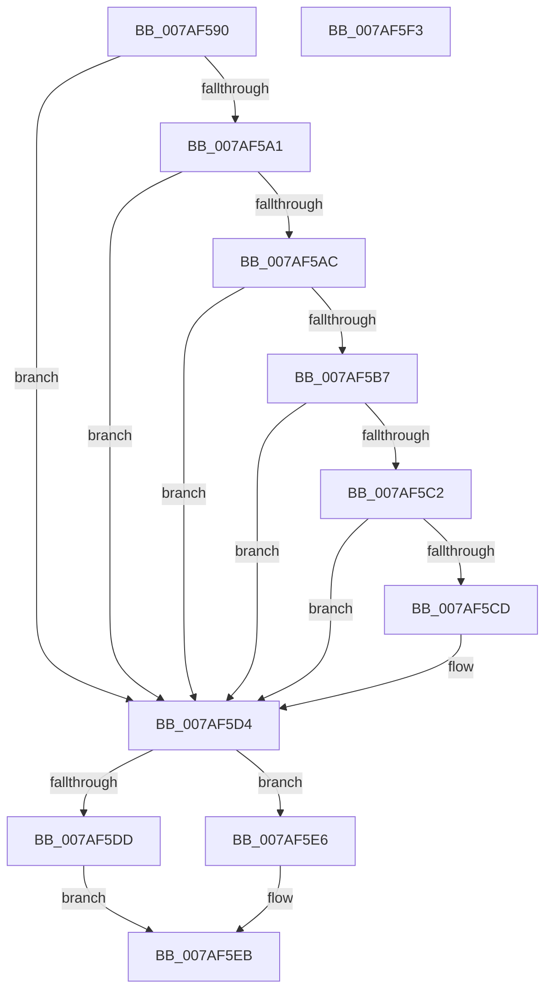

# WdipSemCleanStart

- RVA: `0x007AF590`–`0x007AF5F4` (길이 `100` bytes)
- VA: `0x00000001407AF590`
- 실행 섹션: `PAGE`
- PDB 이름 있음: `예`; PDB Function 태그: `아니요`
- unwind 정보 RVA: `0x0005CF00`
- 디코드: `35`개 명령, `100/100` bytes 표시
- 미해석 바이트: `0` (있으면 어셈블리에 `.byte`로 보존)

> 이 문서는 커널 이미지의 기계어와 PDB 기호를 분석해 생성했습니다. 4번과 5번은 함수 원형과 자료형을 바이너리 사용 방식에서 추정한 C 해석이며 원본 소스 복구 결과는 아닙니다.

## 1. Dependencies

- 직접 호출 지점: **8**; 고유 호출 대상: **8**
- 직접 호출자로 확인된 함수: **2**
- RIP 상대 이미지 참조: **1**

### Outgoing calls
- `0x007AF596` → [WdipSemGetLoggerIds](../A5/WdipSemGetLoggerIds_function_00A5CBB4.md) (function, `0x00A5CBB4`)
- `0x007AF5A1` → [WdipSemEnableSemProvider](../7B/WdipSemEnableSemProvider_function_007B1B54.md) (function, `0x007B1B54`)
- `0x007AF5AC` → [WdipSemLoadConfigInfo](WdipSemLoadConfigInfo_function_007AF700.md) (function, `0x007AF700`)
- `0x007AF5B7` → [WdipSemLoadGroupPolicy](../7B/WdipSemLoadGroupPolicy_function_007B1124.md) (function, `0x007B1124`)
- `0x007AF5C2` → [WdipSemLoadScenarioTable](../7B/WdipSemLoadScenarioTable_function_007B02D8.md) (function, `0x007B02D8`)
- `0x007AF5CD` → [WdipSemStartTimeoutCheck](../7B/WdipSemStartTimeoutCheck_function_007B13B0.md) (function, `0x007B13B0`)
- `0x007AF5D4` → [WdipSemCleanupGroupPolicy](../7B/WdipSemCleanupGroupPolicy_function_007B10F8.md) (function, `0x007B10F8`)
- `0x007AF5E6` → [WdipSemShutdown](../7B/WdipSemShutdown_function_007B0954.md) (function, `0x007B0954`)

### Direct callers
- [WdipSemInitialize](WdipSemInitialize_function_007AEC68.md) at `0x007AECC5`
- [WdipSemUpdate](WdipSemUpdate_function_007AED28.md) at `0x007AED9C`

### Static image references
- `0x007AF5DD` → RVA `0x00F01E18` (`.data`; write)

## 2. Other-region calls and transfers

- 다른 실행 섹션으로 향하는 call: **0**
- 별도 외부 분기/꼬리 이동을 확인하지 못했습니다.

## 3. Assembly (complete function range)

```asm
007AF590  40 53                           push rbx
007AF592  48 83 EC 20                     sub rsp, 0x20
007AF596  E8 19 D6 2A 00                  call 0x140a5cbb4
007AF59B  8B D8                           mov ebx, eax
007AF59D  85 C0                           test eax, eax
007AF59F  78 33                           js 0x1407af5d4
007AF5A1  E8 AE 25 00 00                  call 0x1407b1b54
007AF5A6  8B D8                           mov ebx, eax
007AF5A8  85 C0                           test eax, eax
007AF5AA  78 28                           js 0x1407af5d4
007AF5AC  E8 4F 01 00 00                  call 0x1407af700
007AF5B1  8B D8                           mov ebx, eax
007AF5B3  85 C0                           test eax, eax
007AF5B5  78 1D                           js 0x1407af5d4
007AF5B7  E8 68 1B 00 00                  call 0x1407b1124
007AF5BC  8B D8                           mov ebx, eax
007AF5BE  85 C0                           test eax, eax
007AF5C0  78 12                           js 0x1407af5d4
007AF5C2  E8 11 0D 00 00                  call 0x1407b02d8
007AF5C7  8B D8                           mov ebx, eax
007AF5C9  85 C0                           test eax, eax
007AF5CB  78 07                           js 0x1407af5d4
007AF5CD  E8 DE 1D 00 00                  call 0x1407b13b0
007AF5D2  8B D8                           mov ebx, eax
007AF5D4  E8 1F 1B 00 00                  call 0x1407b10f8
007AF5D9  85 DB                           test ebx, ebx
007AF5DB  78 09                           js 0x1407af5e6
007AF5DD  C6 05 34 28 75 00 01            mov byte ptr [rip + 0x752834], 1
007AF5E4  EB 05                           jmp 0x1407af5eb
007AF5E6  E8 69 13 00 00                  call 0x1407b0954
007AF5EB  8B C3                           mov eax, ebx
007AF5ED  48 83 C4 20                     add rsp, 0x20
007AF5F1  5B                              pop rbx
007AF5F2  C3                              ret
007AF5F3  CC                              int3
```

## 4. C-style interpretation (structured pseudocode)

```c
__int64 __fastcall WdipSemCleanStart(void)
{
    __int64 result;
    __int64 v_rbx;
    __int64 v_rsp;

    v_rsp = (v_rsp) - (32);
    result = WdipSemGetLoggerIds(a1, a2, a3, a4);
    if (sign_flag) goto loc_007AF5D4;
    result = WdipSemEnableSemProvider(a1, a2, a3, a4);
    if (sign_flag) goto loc_007AF5D4;
    result = WdipSemLoadConfigInfo(a1, a2, a3, a4);
    if (sign_flag) goto loc_007AF5D4;
    result = WdipSemLoadGroupPolicy(a1, a2, a3, a4);
    if (sign_flag) goto loc_007AF5D4;
    result = WdipSemLoadScenarioTable(a1, a2, a3, a4);
    v_rbx = (unsigned int)((unsigned int)(result));
    if (!(sign_flag)) {
        result = WdipSemStartTimeoutCheck(a1, a2, a3, a4);
        v_rbx = (unsigned int)(result);
    }
    result = WdipSemCleanupGroupPolicy(a1, a2, a3, a4);
    if (sign_flag) goto loc_007AF5E6;
    *(unsigned __int8 *)(v_rip + 7678004) = 1;
    goto loc_007AF5EB;
loc_007AF5E6:
    result = WdipSemShutdown(a1, a2, a3, a4);
loc_007AF5EB:
    v_rsp = (v_rsp) + (32);
    return (unsigned int)((unsigned int)(v_rbx));
}
```

## 5. (Beta) C Style

```c
void WdipSemCleanStart(void)
{
    int64_t result;
    int64_t local_rbx;
    int64_t local_rsp;

    local_rsp = (local_rsp) - (32);
    result = WdipSemGetLoggerIds(a1, a2, a3, a4);
    if (sign_flag) goto loc_007AF5D4;
    result = WdipSemEnableSemProvider(a1, a2, a3, a4);
    if (sign_flag) goto loc_007AF5D4;
    result = WdipSemLoadConfigInfo(a1, a2, a3, a4);
    if (sign_flag) goto loc_007AF5D4;
    result = WdipSemLoadGroupPolicy(a1, a2, a3, a4);
    if (sign_flag) goto loc_007AF5D4;
    result = WdipSemLoadScenarioTable(a1, a2, a3, a4);
    local_rbx = (uint32_t)((uint32_t)(result));
    if (!(sign_flag)) {
        result = WdipSemStartTimeoutCheck(a1, a2, a3, a4);
        local_rbx = (uint32_t)(result);
    }
    result = WdipSemCleanupGroupPolicy(a1, a2, a3, a4);
    if (sign_flag) goto loc_007AF5E6;
    *(uint8_t *)(v_rip + 0x752834) = 1;
    goto loc_007AF5EB;
loc_007AF5E6:
    result = WdipSemShutdown(a1, a2, a3, a4);
loc_007AF5EB:
    local_rsp = (local_rsp) + (32);
    return (uint32_t)((uint32_t)(local_rbx));
}
```

## 6. Execution-region graph

[열기: 2D/3D 그래프와 함수 탐색 컨트롤 패널](../../../control-panel.html?section=page&rva=0x007AF590&view=graph)

- 2D 그래프는 위에서 아래로 흐르고, 3D 그래프는 빈 공간을 드래그해 회전합니다. Shift+드래그는 이동, 휠은 확대·축소, 함수 노드 선택은 대상 보고서 이동입니다.

### Static fallback


