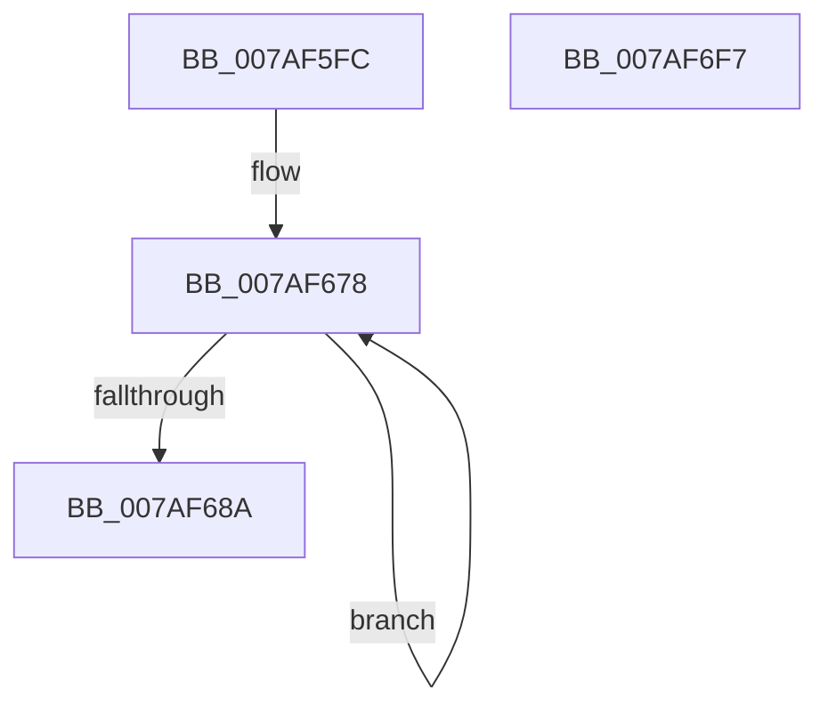

# WdipSemInitializeGlobalState

- RVA: `0x007AF5FC`–`0x007AF6F8` (길이 `252` bytes)
- VA: `0x00000001407AF5FC`
- 실행 섹션: `PAGE`
- PDB 이름 있음: `예`; PDB Function 태그: `아니요`
- unwind 정보 RVA: `0x00060BC4`
- 디코드: `50`개 명령, `252/252` bytes 표시
- 미해석 바이트: `0` (있으면 어셈블리에 `.byte`로 보존)

> 이 문서는 커널 이미지의 기계어와 PDB 기호를 분석해 생성했습니다. 4번과 5번은 함수 원형과 자료형을 바이너리 사용 방식에서 추정한 C 해석이며 원본 소스 복구 결과는 아닙니다.

## 1. Dependencies

- 직접 호출 지점: **5**; 고유 호출 대상: **3**
- 직접 호출자로 확인된 함수: **2**
- RIP 상대 이미지 참조: **22**

### Outgoing calls
- `0x007AF654` → [memset](../../text/6C/memset_function_006C6C40.md) (function, `0x006C6C40`)
- `0x007AF67B` → [InitializeSListHead](../../text/46/InitializeSListHead_function_00468A90.md) (function, `0x00468A90`)
- `0x007AF699` → [memset](../../text/6C/memset_function_006C6C40.md) (function, `0x006C6C40`)
- `0x007AF6AD` → [memset](../../text/6C/memset_function_006C6C40.md) (function, `0x006C6C40`)
- `0x007AF6DB` → [WdipSemClearFrequentScenarioTable](../../text/64/WdipSemClearFrequentScenarioTable_function_0064E340.md) (function, `0x0064E340`)

### Direct callers
- [WdipSemInitialize](WdipSemInitialize_function_007AEC68.md) at `0x007AEC77`
- [WdipSemUpdate](WdipSemUpdate_function_007AED28.md) at `0x007AED42`

### Static image references
- `0x007AF60D` → RVA `0x00E28C60` (`.data`; read)
- `0x007AF617` → RVA `0x00F01E08` (`.data`; write)
- `0x007AF620` → RVA `0x00F01DD0` (`.data`; write)
- `0x007AF62D` → RVA `0x00F01E18` (`.data`; write)
- `0x007AF634` → RVA `0x00F02028` (`.data`; write)
- `0x007AF63B` → RVA `0x00F01E04` (`.data`; write)
- `0x007AF641` → RVA `0x00F01E10` (`.data`; write)
- `0x007AF648` → RVA `0x00F02450` (`.data`; write)
- `0x007AF64E` → RVA `0x00F02454` (`.data`; write)
- `0x007AF659` → RVA `0x00E28C68` (`.data`; write)
- `0x007AF663` → RVA `0x00E28C60` (`.data`; write)
- `0x007AF66A` → RVA `0x00E28C90` (`.data`; read)
- `0x007AF671` → RVA `0x00E28C80` (`.data`; write)
- `0x007AF68C` → RVA `0x00F01E20` (`.data`; read)
- `0x007AF6A0` → RVA `0x00EFFDC0` (`.data`; read)
- `0x007AF6B2` → RVA `0x00F01DE0` (`.data`; read)
- `0x007AF6B9` → RVA `0x00F01DC8` (`.data`; write)
- `0x007AF6C0` → RVA `0x00F01DE8` (`.data`; write)
- `0x007AF6C7` → RVA `0x00F01DE0` (`.data`; write)
- `0x007AF6CE` → RVA `0x00F01DF0` (`.data`; write)
- `0x007AF6D4` → RVA `0x00F01DF8` (`.data`; write)
- `0x007AF6EA` → RVA `0x00F01E00` (`.data`; write)

## 2. Other-region calls and transfers

- 다른 실행 섹션으로 향하는 call: **5**
  - `0x007AF654` → [memset](../../text/6C/memset_function_006C6C40.md) (`PAGE` → `.text`)
  - `0x007AF67B` → [InitializeSListHead](../../text/46/InitializeSListHead_function_00468A90.md) (`PAGE` → `.text`)
  - `0x007AF699` → [memset](../../text/6C/memset_function_006C6C40.md) (`PAGE` → `.text`)
  - `0x007AF6AD` → [memset](../../text/6C/memset_function_006C6C40.md) (`PAGE` → `.text`)
  - `0x007AF6DB` → [WdipSemClearFrequentScenarioTable](../../text/64/WdipSemClearFrequentScenarioTable_function_0064E340.md) (`PAGE` → `.text`)
- 별도 외부 분기/꼬리 이동을 확인하지 못했습니다.

## 3. Assembly (complete function range)

```asm
007AF5FC  48 89 5C 24 08                  mov qword ptr [rsp + 8], rbx
007AF601  48 89 74 24 10                  mov qword ptr [rsp + 0x10], rsi
007AF606  57                              push rdi
007AF607  48 83 EC 20                     sub rsp, 0x20
007AF60B  33 F6                           xor esi, esi
007AF60D  48 8D 1D 4C 96 67 00            lea rbx, [rip + 0x67964c]
007AF614  48 8B CB                        mov rcx, rbx
007AF617  48 89 35 EA 27 75 00            mov qword ptr [rip + 0x7527ea], rsi
007AF61E  33 D2                           xor edx, edx
007AF620  48 89 35 A9 27 75 00            mov qword ptr [rip + 0x7527a9], rsi
007AF627  41 B8 90 00 00 00               mov r8d, 0x90
007AF62D  40 88 35 E4 27 75 00            mov byte ptr [rip + 0x7527e4], sil
007AF634  40 88 35 ED 29 75 00            mov byte ptr [rip + 0x7529ed], sil
007AF63B  89 35 C3 27 75 00               mov dword ptr [rip + 0x7527c3], esi
007AF641  48 89 35 C8 27 75 00            mov qword ptr [rip + 0x7527c8], rsi
007AF648  89 35 02 2E 75 00               mov dword ptr [rip + 0x752e02], esi
007AF64E  89 35 00 2E 75 00               mov dword ptr [rip + 0x752e00], esi
007AF654  E8 E7 75 F1 FF                  call 0x1406c6c40
007AF659  48 89 1D 08 96 67 00            mov qword ptr [rip + 0x679608], rbx
007AF660  8D 7E 06                        lea edi, [rsi + 6]
007AF663  48 89 1D F6 95 67 00            mov qword ptr [rip + 0x6795f6], rbx
007AF66A  48 8D 1D 1F 96 67 00            lea rbx, [rip + 0x67961f]
007AF671  48 89 35 08 96 67 00            mov qword ptr [rip + 0x679608], rsi
007AF678  48 8B CB                        mov rcx, rbx
007AF67B  E8 10 94 CB FF                  call 0x140468a90
007AF680  48 83 C3 10                     add rbx, 0x10
007AF684  48 83 EF 01                     sub rdi, 1
007AF688  75 EE                           jne 0x1407af678
007AF68A  33 D2                           xor edx, edx
007AF68C  48 8D 0D 8D 27 75 00            lea rcx, [rip + 0x75278d]
007AF693  41 B8 08 02 00 00               mov r8d, 0x208
007AF699  E8 A2 75 F1 FF                  call 0x1406c6c40
007AF69E  33 D2                           xor edx, edx
007AF6A0  48 8D 0D 19 07 75 00            lea rcx, [rip + 0x750719]
007AF6A7  41 B8 08 20 00 00               mov r8d, 0x2008
007AF6AD  E8 8E 75 F1 FF                  call 0x1406c6c40
007AF6B2  48 8D 05 27 27 75 00            lea rax, [rip + 0x752727]
007AF6B9  48 89 35 08 27 75 00            mov qword ptr [rip + 0x752708], rsi
007AF6C0  48 89 05 21 27 75 00            mov qword ptr [rip + 0x752721], rax
007AF6C7  48 89 05 12 27 75 00            mov qword ptr [rip + 0x752712], rax
007AF6CE  89 35 1C 27 75 00               mov dword ptr [rip + 0x75271c], esi
007AF6D4  48 89 35 1D 27 75 00            mov qword ptr [rip + 0x75271d], rsi
007AF6DB  E8 60 EC E9 FF                  call 0x14064e340
007AF6E0  48 8B 5C 24 30                  mov rbx, qword ptr [rsp + 0x30]
007AF6E5  48 8B 74 24 38                  mov rsi, qword ptr [rsp + 0x38]
007AF6EA  C6 05 0F 27 75 00 01            mov byte ptr [rip + 0x75270f], 1
007AF6F1  48 83 C4 20                     add rsp, 0x20
007AF6F5  5F                              pop rdi
007AF6F6  C3                              ret
007AF6F7  CC                              int3
```

## 4. C-style interpretation (structured pseudocode)

```c
__int64 __fastcall WdipSemInitializeGlobalState(__int64 a1, int a2)
{
    __int64 result;
    __int64 v_rbx;
    __int64 v_rdi;
    __int64 v_rsi;
    __int64 v_rsp;
    unsigned __int64 v_stack_p10;
    unsigned __int64 v_stack_p8;

    v_stack_p8 = v_rbx;
    v_stack_p10 = v_rsi;
    v_rsp = (v_rsp) - (32);
    v_rsi = 0;
    *(unsigned __int64 *)(v_rip + 7677930) = 0;
    a2 = 0;
    *(unsigned __int64 *)(v_rip + 7677865) = 0;
    *(unsigned __int8 *)(v_rip + 7677924) = 0;
    *(unsigned __int8 *)(v_rip + 7678445) = 0;
    *(unsigned int *)(v_rip + 7677891) = 0;
    *(unsigned __int64 *)(v_rip + 7677896) = 0;
    *(unsigned int *)(v_rip + 7679490) = 0;
    *(unsigned int *)(v_rip + 7679488) = 0;
    result = memset(v_rip + 6788684, a2, 144, a4);
    *(unsigned __int64 *)(v_rip + 6788616) = v_rip + 6788684;
    *(unsigned __int64 *)(v_rip + 6788598) = v_rip + 6788684;
    *(unsigned __int64 *)(v_rip + 6788616) = 0;
loc_007AF678:
    result = InitializeSListHead(v_rip + 6788639, a2, 144, a4);
    v_rbx = (v_rip + 6788639) + (16);
    v_rdi = (v_rsi + 6) - (1);
    if (condition_is_not_equal) goto loc_007AF678;
    a2 = 0;
    result = memset(v_rip + 7677837, a2, 520, a4);
    a2 = 0;
    result = memset(v_rip + 7669529, a2, (unsigned int)(0x2008ULL), a4);
    *(unsigned __int64 *)(v_rip + 7677704) = 0;
    *(unsigned __int64 *)(v_rip + 7677729) = v_rip + 7677735;
    *(unsigned __int64 *)(v_rip + 7677714) = v_rip + 7677735;
    *(unsigned int *)(v_rip + 7677724) = 0;
    *(unsigned __int64 *)(v_rip + 7677725) = 0;
    result = WdipSemClearFrequentScenarioTable(v_rip + 7669529, a2, (unsigned int)(0x2008ULL), a4);
    *(unsigned __int8 *)(v_rip + 7677711) = 1;
    v_rsp = (v_rsp) + (32);
    return result;
}
```

## 5. (Beta) C Style

```c
int64_t WdipSemInitializeGlobalState(int64_t Arg1, int32_t Arg2)
{
    int64_t result;
    int64_t local_rbx;
    int64_t local_rdi;
    int64_t local_rsi;
    int64_t local_rsp;
    uint64_t v_stack_p10;
    uint64_t v_stack_p8;

    v_stack_p8 = local_rbx;
    v_stack_p10 = local_rsi;
    local_rsp = (local_rsp) - (32);
    local_rsi = 0;
    *(uint64_t *)(v_rip + 0x7527EA) = 0;
    Arg2 = 0;
    *(uint64_t *)(v_rip + 0x7527A9) = 0;
    *(uint8_t *)(v_rip + 0x7527E4) = 0;
    *(uint8_t *)(v_rip + 0x7529ED) = 0;
    *(uint32_t *)(v_rip + 0x7527C3) = 0;
    *(uint64_t *)(v_rip + 0x7527C8) = 0;
    *(uint32_t *)(v_rip + 0x752E02) = 0;
    *(uint32_t *)(v_rip + 0x752E00) = 0;
    result = memset(v_rip + 6788684, Arg2, 144, a4);
    *(uint64_t *)(v_rip + 0x679608) = v_rip + 6788684;
    *(uint64_t *)(v_rip + 0x6795F6) = v_rip + 6788684;
    *(uint64_t *)(v_rip + 0x679608) = 0;
loc_007AF678:
    result = InitializeSListHead(v_rip + 6788639, Arg2, 144, a4);
    local_rbx = (v_rip + 6788639) + (16);
    local_rdi = (local_rsi + 6) - (1);
    if (condition_is_not_equal) goto loc_007AF678;
    Arg2 = 0;
    result = memset(v_rip + 7677837, Arg2, 520, a4);
    Arg2 = 0;
    result = memset(v_rip + 7669529, Arg2, (uint32_t)(0x2008ULL), a4);
    *(uint64_t *)(v_rip + 0x752708) = 0;
    *(uint64_t *)(v_rip + 0x752721) = v_rip + 7677735;
    *(uint64_t *)(v_rip + 0x752712) = v_rip + 7677735;
    *(uint32_t *)(v_rip + 0x75271C) = 0;
    *(uint64_t *)(v_rip + 0x75271D) = 0;
    result = WdipSemClearFrequentScenarioTable(v_rip + 7669529, Arg2, (uint32_t)(0x2008ULL), a4);
    *(uint8_t *)(v_rip + 0x75270F) = 1;
    local_rsp = (local_rsp) + (32);
    return result;
}
```

## 6. Execution-region graph

[열기: 2D/3D 그래프와 함수 탐색 컨트롤 패널](../../../control-panel.html?section=page&rva=0x007AF5FC&view=graph)

- 2D 그래프는 위에서 아래로 흐르고, 3D 그래프는 빈 공간을 드래그해 회전합니다. Shift+드래그는 이동, 휠은 확대·축소, 함수 노드 선택은 대상 보고서 이동입니다.

### Static fallback


